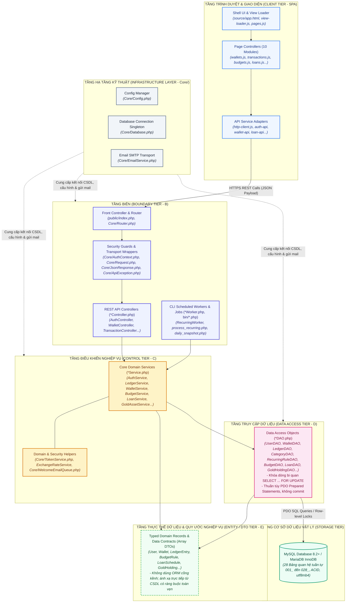

# Thiết Kế Kiến Trúc Thành Phần & Cấu Trúc Triển Khai (Component & Package Design)
## Hệ Thống Quản Lý Tài Chính Cá Nhân & Tài Chính Vi Mô Thông Minh (WealthFlow)

> **Liên kết Tài liệu Liên quan (Related Documents):**  
> - **Yêu cầu & Quy chuẩn:** [SRS.md (Đặc tả Yêu cầu Phần mềm v2.1)](./SRS.md) | [WealthFlow_Coding_Convention.md (Quy chuẩn Pha Construction)](../03_construction/WealthFlow_Coding_Convention.md) | [Business-Modelling.md](../01_inception/Business-Modelling.md)
> - **Mô hình Hóa Phân tích & Thiết kế (UML):** [usecase_diagram.md](./uml_modeling/usecase_diagram.md) | [activity_diagram.md](./uml_modeling/activity_diagram.md) | [class_diagram.md (Sơ đồ Lớp Chi tiết BCE+D)](./uml_modeling/class_diagram.md) | [sequence_diagram.md (Sơ đồ Tuần tự 08 Kịch bản)](./uml_modeling/sequence_diagram.md)
> - **Cơ sở Dữ liệu & Giao diện Lập trình:** [database_design.md (Thiết kế CSDL Vật lý MySQL 8.2+ 28 Bảng)](./database_design.md) | [api_design.md (Đặc tả RESTful API 42 Endpoints)](./api_design.md)

---

## 1. Giới Thiệu & Mục Tiêu Thiết Kế Thành Phần

Tài liệu **Thiết Kế Kiến Trúc Thành Phần & Cấu Trúc Triển Khai (Component Design)** đóng vai trò là "chiếc cầu nối sống còn" giữa Pha Tinh tế hóa (Elaboration) và Pha Xây dựng (Construction) trong tiến trình Unified Process (UP/RUP). 

Mục tiêu cốt lõi của tài liệu này là:
1. **Chuyển hóa Mô hình Trừu tượng thành Thực tế Triển khai:** Ánh xạ tường minh toàn bộ các lớp thiết kế trong [class_diagram.md](./uml_modeling/class_diagram.md), các tương tác động trong [sequence_diagram.md](./uml_modeling/sequence_diagram.md), cấu trúc 28 bảng CSDL trong [database_design.md](./database_design.md), và 42 endpoints trong [api_design.md](./api_design.md) vào **cấu trúc thư mục và tệp tin mã nguồn vật lý** trong thư mục `source/`.
2. **Quy định Vị trí Tệp tin Tuyệt đối (Absolute File Placement):** Xác định chính xác từng thành phần (Component/Class/Module) phải nằm trong thư mục nào, tệp tin tên gì, namespace chuẩn PSR-4 là gì, phụ thuộc vào những module nào, loại bỏ hoàn toàn tình trạng lập trình viên đặt file tùy tiện hoặc trùng lặp trách nhiệm.
3. **Phân Rã Độc Lập Cho Làm Việc Nhóm (Parallel Development):** Thiết lập ranh giới mô-đun rõ ràng (Modular Monolith) giúp 4 thành viên trong nhóm kỹ thuật có thể đồng thời triển khai các phân hệ nghiệp vụ mà không gây xung đột mã nguồn (Merge Conflicts).

---

## 2. Sơ Đồ Kiến Trúc Thành Phần Hệ Thống (UML Component Diagram - BCE+D)

Kiến trúc phần mềm của WealthFlow tuân thủ mô hình **Layered Modular Monolith** phân bổ theo mẫu phân tích **BCE+D (Boundary - Control - Entity + DataAccess)** kết hợp tầng **Hạ tầng Kỹ thuật (Infrastructure Layer)**:



---

## 3. Đặc Tả Chi Tiết Từng Phân Hệ Thành Phần & Ánh Xạ Tệp Tin Vật Lý

Dưới đây là bảng quy hoạch chi tiết từng thành phần phần mềm trong hệ thống, chỉ định rõ ràng vị trí tệp tin, namespace và tầng kiến trúc BCE+D tương ứng:

### 3.0. Tầng Hạ Tầng Kỹ Thuật Chung (Infrastructure Layer - `src/Core/`)
- **Mục tiêu:** Cung cấp dịch vụ nền tảng (Routing, CSDL, Cấu hình, Transport, Security Guard, Email, Ngoại lệ HTTP) cho toàn bộ 11 phân hệ BCE+D trong cùng một namespace chuẩn mực `WealthFlow\Core`.

| Tên Thành phần (Component) | Đường dẫn Tệp tin Vật lý | Tầng Kiến trúc | Trách nhiệm Kỹ thuật |
| :--- | :--- | :---: | :--- |
| `Config` | `source/backend/src/Core/Config.php` | `<<Infrastructure / Config>>` | Đọc `config.example.php` và `config.local.php`, thẩm định `APP_KEY`, `APP_URL`, chế độ HTTPS. |
| `Database` | `source/backend/src/Core/Database.php` | `<<Infrastructure / Database>>` | Quản lý kết nối PDO MySQL singleton, thiết lập múi giờ UTC, chế độ `ERRMODE_EXCEPTION`, và mock SQLite schema cho unit tests. |
| `Router` | `source/backend/src/Core/Router.php` | `<<Boundary / Routing>>` | Định tuyến các URL `/api/*` tới đúng Controller tương ứng (GET, POST, PUT, DELETE). |
| `Request` | `source/backend/src/Core/Request.php` | `<<Boundary / Transport>>` | Giải mã HTTP Request, trích xuất JSON body, query parameters, method, header `Idempotency-Key`. |
| `JsonResponse` | `source/backend/src/Core/JsonResponse.php` | `<<Boundary / Transport>>` | Xuất phản hồi JSON Envelope chuẩn hóa (`success: true/false`, `data`, `error`). |
| `ApiException` | `source/backend/src/Core/ApiException.php` | `<<Boundary / Exception>>` | Bắt lỗi nghiệp vụ, chuyển thành mã HTTP (400, 401, 403, 404, 409, 422, 429, 503). |
| `AuthContext` | `source/backend/src/Core/AuthContext.php` | `<<Boundary / Guard>>` | Trích xuất và xác thực `userId`, `role` từ cookie/token để cung cấp danh tính người dùng hiện tại và phân quyền admin cho các Controller. |
| `TokenService` | `source/backend/src/Core/TokenService.php` | `<<Infrastructure / Security>>` | Ký số và giải mã Access Token JWT (15 phút) và Refresh Token (7 ngày); thiết lập HttpOnly cookies. |
| `EmailService` | `source/backend/src/Core/EmailService.php` | `<<Infrastructure / Mailer>>` | Đóng gói PHPMailer gửi mail OTP, hỗ trợ chế độ log khi dev. |
| `WelcomeEmailQueue` | `source/backend/src/Core/WelcomeEmailQueue.php` | `<<Infrastructure / Queue>>` | Hàng đợi gửi email chào mừng bất đồng bộ tránh nghẽn thread đăng ký. |

---

### 3.1. Phân Hệ 1: Định Danh, Xác Thực & Quản Lý Phiên (`Auth`)
- **Use Cases:** [UC01: Đăng ký & Đăng nhập](./uml_modeling/usecase_diagram.md#uc01-dang-ky-va-dang-nhap) | [SQ01](./uml_modeling/sequence_diagram.md#31-sq01-đăng-ký-tài-khoản-mã-hóa-argon2id--đăng-nhập-jwt)
- **API Endpoints:** `POST /api/auth/register`, `POST /api/auth/login`, `POST /api/auth/refresh`, `POST /api/auth/logout`, `GET /api/auth/me`, `POST /api/auth/password/change`, `POST /api/auth/password/forgot`, `POST /api/auth/password/reset`.
- **Bảng CSDL liên kết:** `users`, `auth_sessions`, `password_reset_tokens`, `auth_rate_limits`, `security_audit_logs`.

| Tên Thành phần (Component) | Đường dẫn Tệp tin Vật lý | Tầng Kiến trúc | Trách nhiệm Kỹ thuật |
| :--- | :--- | :---: | :--- |
| `AuthController` | `source/backend/src/Modules/Auth/AuthController.php` | `<<Boundary>>` | Tiếp nhận REST request đăng ký, đăng nhập, đổi/quên mật khẩu; trả về `JsonResponse`. |
| `AuthService` | `source/backend/src/Modules/Auth/AuthService.php` | `<<Control>>` | Điều phối đăng ký, băm mật khẩu Bcrypt (cost 12), xác thực đăng nhập, quản lý phiên và OTP. |
| `UserDAO` | `source/backend/src/Modules/Auth/UserDAO.php` | `<<DataAccess>>` | Thực thi các câu lệnh SQL Prepared Statements trên bảng `users`, `auth_sessions`, `security_audit_logs`. |
| `auth-api.js` | `source/frontend/js/services/auth-api.js` | Frontend Service | Gọi HTTP API Auth, lưu trữ phiên đăng nhập. |

---

### 3.2. Phân Hệ 2: Quản Lý Ví Tài Sản & Số Dư Mở Sổ (`Wallets`)
- **Use Cases:** [UC02: Quản lý ví tiền & Số dư mở sổ](./uml_modeling/usecase_diagram.md#uc02-quan-ly-vi-va-so-du-mo-so) | [SQ01](./uml_modeling/sequence_diagram.md#31-sq01-đăng-ký-tài-khoản-mã-hóa-argon2id--đăng-nhập-jwt)
- **API Endpoints:** `GET /api/wallets`, `POST /api/wallets`, `GET /api/wallets/{id}`, `PUT /api/wallets/{id}`, `DELETE /api/wallets/{id}`.
- **Bảng CSDL liên kết:** `wallets`, `financial_transactions`, `ledger_entries`.

| Tên Thành phần (Component) | Đường dẫn Tệp tin Vật lý | Tầng Kiến trúc | Trách nhiệm Kỹ thuật |
| :--- | :--- | :---: | :--- |
| `WalletController` | `source/backend/src/Modules/Wallets/WalletController.php` | `<<Boundary>>` | Tiếp nhận yêu cầu REST, validate DTO, kiểm tra quyền sở hữu ví. |
| `WalletService` | `source/backend/src/Modules/Wallets/WalletService.php` | `<<Control>>` | Xử lý nghiệp vụ mở sổ số dư đối ứng Equity, khóa sắp xếp thứ tự ví (`min/max`). |
| `WalletDAO` | `source/backend/src/Modules/Wallets/WalletDAO.php` | `<<DataAccess>>` | Khóa dòng `SELECT ... FOR UPDATE`, cập nhật `cached_balance`. |
| `wallet-api.js` | `source/frontend/js/services/wallet-api.js` | Frontend Service | Tương tác các endpoint ví từ giao diện người dùng. |
| `wallets.js` | `source/frontend/js/app/wallets.js` | Frontend Page | Quản lý giao diện danh sách thẻ ví, modal thêm/sửa ví và chuyển tiền. |

---

### 3.3. Phân Hệ 3: Giao Dịch Thu Chi, Chuyển Khoản & Sổ Cái Kép (`Transactions`)
- **Use Cases:** [UC03: Giao dịch thu chi & Chuyển khoản](./uml_modeling/usecase_diagram.md#uc03-quan-ly-giao-dich-thu-chi-va-chuyen-khoan) | [SQ02](./uml_modeling/sequence_diagram.md#32-sq02-ghi-nhận-chi-tiêu-khóa-bi-quan--cảnh-báo-ngân-sách) | [SQ03](./uml_modeling/sequence_diagram.md#33-sq03-chuyển-tiền-nội-bộ--đảo-giao-dịch-reversal)
- **API Endpoints:** `GET /api/transactions`, `POST /api/transactions`, `POST /api/transactions/transfer`, `POST /api/transactions/{id}/reverse`, `GET /api/categories`.
- **Bảng CSDL liên kết:** `financial_transactions`, `ledger_entries`, `transaction_categories`, `idempotency_keys`, `exchange_rates`.

| Tên Thành phần (Component) | Đường dẫn Tệp tin Vật lý | Tầng Kiến trúc | Trách nhiệm Kỹ thuật |
| :--- | :--- | :---: | :--- |
| `TransactionController` | `source/backend/src/Modules/Transactions/TransactionController.php` | `<<Boundary>>` | Tiếp nhận tạo giao dịch, nhận header `Idempotency-Key`. |
| `LedgerService` | `source/backend/src/Modules/Transactions/LedgerService.php` | `<<Control>>` | Động cơ kế toán kép cốt lõi: kiểm tra số dư, hạch toán 2 bút toán Nợ/Có cân bằng, đảo giao dịch bất biến. |
| `ExchangeRateService` | `source/backend/src/Modules/Transactions/ExchangeRateService.php` | `<<Control>>` | Quy đổi tiền tệ chính xác qua `ext-bcmath` dựa trên tỷ giá snapshot. |
| `LedgerDAO` | `source/backend/src/Modules/Transactions/LedgerDAO.php` | `<<DataAccess>>` | Thao tác bảng `financial_transactions`, `ledger_entries`, `idempotency_keys`. |
| `CategoryDAO` | `source/backend/src/Modules/Transactions/CategoryDAO.php` | `<<DataAccess>>` | Thao tác bảng danh mục `transaction_categories`. |
| `transaction-api.js` | `source/frontend/js/services/transaction-api.js` | Frontend Service | Gửi dữ liệu giao dịch kèm header `Idempotency-Key` (UUIDv4). |
| `transactions.js` | `source/frontend/js/app/transactions.js` | Frontend Page | Bộ lọc tìm kiếm, bảng lịch sử giao dịch và modal tạo thu/chi. |

---

### 3.4. Phân Hệ 4: Giao Dịch Định Kỳ Tự Động (`Recurring`)
- **Use Cases:** [UC04: Chi phí định kỳ](./uml_modeling/usecase_diagram.md#uc04-quan-ly-chi-phi-co-dinh-va-giao-dich-dinh-ky) | [SYS02: Cron tác vụ nền](../SRS.md#sys02) | [SQ04](./uml_modeling/sequence_diagram.md#34-sq04-xử-lý-giao-dịch-định-kỳ-tự-động-subscription-cron)
- **API Endpoints:** `GET /api/recurring`, `POST /api/recurring`, `POST /api/recurring/{id}/pause`, `POST /api/recurring/{id}/resume`, `DELETE /api/recurring/{id}`.
- **Bảng CSDL liên kết:** `recurring_schedules`, `recurring_executions`.

| Tên Thành phần (Component) | Đường dẫn Tệp tin Vật lý | Tầng Kiến trúc | Trách nhiệm Kỹ thuật |
| :--- | :--- | :---: | :--- |
| `RecurringController` | `source/backend/src/Modules/Recurring/RecurringController.php` | `<<Boundary>>` | Tiếp nhận thiết lập và quản lý trạng thái lịch đăng ký. |
| `RecurringService` | `source/backend/src/Modules/Recurring/RecurringService.php` | `<<Control>>` | Xử lý quy tắc neo ngày (Anchor Day Rule - BR09), tính toán `next_run_date`. |
| `RecurringWorker` | `source/backend/src/Modules/Recurring/RecurringWorker.php` | `<<Control / Worker>>` | Vòng lặp duyệt các lịch đến hạn, kích hoạt `LedgerService` hạch toán tự động. |
| `process_recurring.php` | `source/backend/bin/process_recurring.php` | `<<Boundary / Job>>` | Tệp CLI entry point được kích hoạt bởi Linux Cron / Windows Task Scheduler lúc 00:00 UTC. |
| `RecurringRuleDAO` | `source/backend/src/Modules/Recurring/RecurringRuleDAO.php` | `<<DataAccess>>` | Thao tác bảng `recurring_schedules` và `recurring_executions`. |

---

### 3.5. Phân Hệ 5: Thiết Lập & Kiểm Soát Ngân Sách (`Budgets`)
- **Use Cases:** [UC05: Thiết lập & Cảnh báo ngân sách](./uml_modeling/usecase_diagram.md#uc05-thiet-lap-va-theo-doi-ngan-sach) | [SYS03](../SRS.md#sys03) | [SQ02](./uml_modeling/sequence_diagram.md#32-sq02-ghi-nhận-chi-tiêu-khóa-bi-quan--cảnh-báo-ngân-sách)
- **API Endpoints:** `GET /api/budgets`, `POST /api/budgets`, `GET /api/budgets/summary`, `PUT /api/budgets/{id}`, `DELETE /api/budgets/{id}`.
- **Bảng CSDL liên kết:** `budgets`, `notifications`.

| Tên Thành phần (Component) | Đường dẫn Tệp tin Vật lý | Tầng Kiến trúc | Trách nhiệm Kỹ thuật |
| :--- | :--- | :---: | :--- |
| `BudgetController` | `source/backend/src/Modules/Budgets/BudgetController.php` | `<<Boundary>>` | Nhận yêu cầu ngân sách tháng, trả về tỷ lệ phần trăm đã dùng. |
| `BudgetService` | `source/backend/src/Modules/Budgets/BudgetService.php` | `<<Control>>` | Tính toán chi tiêu ròng trong tháng, kích hoạt thông báo cảnh báo 80% và 100% kèm `dedup_key`. |
| `BudgetDAO` | `source/backend/src/Modules/Budgets/BudgetDAO.php` | `<<DataAccess>>` | Bắn SQL vào bảng `budgets`. |
| `budget-api.js` | `source/frontend/js/services/budget-api.js` | Frontend Service | Tương tác API ngân sách từ Web UI. |
| `budgets.js` | `source/frontend/js/app/budgets.js` | Frontend Page | Hiển thị các thanh tiến trình ngân sách (Progress Bars) trực quan và đổi màu theo mức độ cảnh báo. |

---

### 3.6. Phân Hệ 6: Tài Chính Vi Mô & Quản Lý Khoản Vay (`Loans`)
- **Use Cases:** [UC06: Khoản cho vay](./uml_modeling/usecase_diagram.md#uc06-quan-ly-khoan-cho-vay-va-thu-no) | [UC07: Khoản đi vay & Trả nợ](./uml_modeling/usecase_diagram.md#uc07-quan-ly-khoan-di-vay-va-tra-no) | [SQ05](./uml_modeling/sequence_diagram.md#35-sq05-khởi-tạo-khoản-vay--thanh-toán-trả-nợ-vi-mô)
- **API Endpoints:** `GET /api/loans`, `POST /api/loans`, `GET /api/loans/{id}`, `POST /api/loans/{id}/payments`, `POST /api/loans/{id}/settle`.
- **Bảng CSDL liên kết:** `micro_loans`, `loan_repayment_schedules`, `loan_payments`.

| Tên Thành phần (Component) | Đường dẫn Tệp tin Vật lý | Tầng Kiến trúc | Trách nhiệm Kỹ thuật |
| :--- | :--- | :---: | :--- |
| `LoanController` | `source/backend/src/Modules/Loans/LoanController.php` | `<<Boundary>>` | Tiếp nhận tạo khoản vay, ghi nhận thanh toán trả nợ. |
| `LoanService` | `source/backend/src/Modules/Loans/LoanService.php` | `<<Control>>` | Tính toán bảng phân kỳ nợ (Amortization Schedule), hạch toán giải ngân (Asset/Liability), tách gốc vs lãi (BR10, BR17). |
| `LoanDAO` | `source/backend/src/Modules/Loans/LoanDAO.php` | `<<DataAccess>>` | Bắn SQL vào `micro_loans`, `loan_repayment_schedules`, `loan_payments`. |
| `loan-api.js` | `source/frontend/js/services/loan-api.js` | Frontend Service | Gửi yêu cầu vay mượn và thanh toán kỳ trả nợ. |
| `loans.js` | `source/frontend/js/app/loans.js` | Frontend Page | Giao diện theo dõi danh sách khoản vay, tiến độ trả nợ và lịch phân kỳ. |

---

### 3.7. Phân Hệ 7: Danh Mục Vàng Tích Lũy & Ngoại Hối (`Wealth / Gold`)
- **Use Cases:** [UC08: Danh mục đầu tư vàng](./uml_modeling/usecase_diagram.md#uc08-quan-ly-danh-muc-dau-tu-vang-tich-luy) | [SQ06](./uml_modeling/sequence_diagram.md#36-sq06-quản-lý-vàng-tích-lũy--tổng-hợp-net-worth-dashboard)
- **API Endpoints:** `GET /api/gold`, `POST /api/gold/transactions`, `GET /api/gold/prices`.
- **Bảng CSDL liên kết:** `gold_assets`, `gold_transactions`, `exchange_rates`.

| Tên Thành phần (Component) | Đường dẫn Tệp tin Vật lý | Tầng Kiến trúc | Trách nhiệm Kỹ thuật |
| :--- | :--- | :---: | :--- |
| `GoldController` | `source/backend/src/Modules/Wealth/GoldController.php` | `<<Boundary>>` | Tiếp nhận mua/bán vàng, tra cứu giá thị trường. |
| `GoldAssetService` | `source/backend/src/Modules/Wealth/GoldAssetService.php` | `<<Control>>` | Quản lý khối lượng Chỉ/Cây vàng, tính giá vốn bình quân gia quyền, liên kết trừ tiền ví. |
| `GoldHoldingDAO` | `source/backend/src/Modules/Wealth/GoldHoldingDAO.php` | `<<DataAccess>>` | Bắn SQL vào `gold_assets`, `gold_transactions`. |
| `gold-api.js` | `source/frontend/js/services/gold-api.js` | Frontend Service | Tương tác API giao dịch vàng từ Web UI. |
| `gold.js` | `source/frontend/js/app/gold.js` | Frontend Page | Hiển thị bảng giá vàng trực tiếp SJC/DOJI và danh mục vàng sở hữu. |

---

### 3.8. Phân Hệ 8: Mục Tiêu Tiết Kiệm & Phong Tỏa Ví (`Goals`)
- **Use Cases:** [UC09: Mục tiêu tiết kiệm & Earmarking](./uml_modeling/usecase_diagram.md#uc09-muc-tieu-tiet-kiem-va-quy-phong-toa-earmarking)
- **API Endpoints:** `GET /api/goals`, `POST /api/goals`, `POST /api/goals/{id}/deposit`, `POST /api/goals/{id}/withdraw`, `DELETE /api/goals/{id}`.
- **Bảng CSDL liên kết:** `financial_goals`, `goal_allocations`, `wallets`.

| Tên Thành phần (Component) | Đường dẫn Tệp tin Vật lý | Tầng Kiến trúc | Trách nhiệm Kỹ thuật |
| :--- | :--- | :---: | :--- |
| `GoalController` | `source/backend/src/Modules/Goals/GoalController.php` | `<<Boundary>>` | Tiếp nhận lập mục tiêu, gửi lệnh phân bổ tiền. |
| `GoalService` | `source/backend/src/Modules/Goals/GoalService.php` | `<<Control>>` | Điều phối nạp/rút quỹ mục tiêu và cập nhật cờ `earmarked_balance` của ví tài sản. |
| `FinancialGoalDAO` | `source/backend/src/Modules/Goals/FinancialGoalDAO.php` | `<<DataAccess>>` | Thao tác bảng `financial_goals` và `goal_allocations`. |
| `goal-api.js` | `source/frontend/js/services/goal-api.js` | Frontend Service | Gửi lệnh nạp/rút quỹ mục tiêu. |
| `goals.js` | `source/frontend/js/app/goals.js` | Frontend Page | Hiển thị thẻ các hũ mục tiêu tiết kiệm và thanh tỷ lệ hoàn thành. |

---

### 3.9. Phân Hệ 9: Dashboard Phân Tích Net Worth & Sức Khỏe (`Analytics`)
- **Use Cases:** [UC10: Tài sản ròng & Sức khỏe tài chính](./uml_modeling/usecase_diagram.md#uc10-tong-hop-tai-san-rong-net-worth-va-suc-khoe-tai-chinh) | [SYS03](../SRS.md#sys03) | [SQ06](./uml_modeling/sequence_diagram.md#36-sq06-quản-lý-vàng-tích-lũy--tổng-hợp-net-worth-dashboard)
- **API Endpoints:** `GET /api/analytics/net-worth`, `GET /api/analytics/net-worth/history`, `GET /api/analytics/cash-flow`, `GET /api/analytics/financial-health`.
- **Bảng CSDL liên kết:** `net_worth_snapshots`, `wallets`, `micro_loans`, `gold_assets`.

| Tên Thành phần (Component) | Đường dẫn Tệp tin Vật lý | Tầng Kiến trúc | Trách nhiệm Kỹ thuật |
| :--- | :--- | :---: | :--- |
| `AnalyticsDashboardController`| `source/backend/src/Modules/Wealth/AnalyticsDashboardController.php` | `<<Boundary>>` | Trả về tổng hợp chỉ số tài sản ròng, dòng tiền và điểm sức khỏe tài chính. |
| `NetWorthAnalyticsService` | `source/backend/src/Modules/Wealth/NetWorthAnalyticsService.php` | `<<Control>>` | Tính toán phương trình tài sản ròng ($\text{Net Worth} = \text{Tài sản} - \text{Nợ}$), phòng vệ lỗi chia cho 0 (`BR18`). |
| `NetWorthSnapshotDAO` | `source/backend/src/Modules/Wealth/NetWorthSnapshotDAO.php` | `<<DataAccess>>` | Lưu và truy vấn bảng `net_worth_snapshots`. |
| `analytics-api.js` | `source/frontend/js/services/analytics-api.js` | Frontend Service | Gọi API tổng hợp báo cáo phân tích. |
| `analytics.js` | `source/frontend/js/app/analytics.js` | Frontend Page | Vẽ biểu đồ biến động tài sản ròng (Chart.js / SVG) và bảng cơ cấu nợ/tài sản. |

---

### 3.10. Phân Hệ 10: Báo Cáo Đối Soát Sổ Cái & Xuất CSV An Toàn (`Reports`)
- **Use Cases:** [UC11: Báo cáo đối soát & Xuất CSV](./uml_modeling/usecase_diagram.md#uc11-bao-cao-thong-ke-va-xuat-du-lieu-csv) | [SQ07](./uml_modeling/sequence_diagram.md#37-sq07-báo-cáo-đối-soát-sổ-cái--xuất-dữ-liệu-csv-an-toàn)
- **API Endpoints:** `GET /api/reports/reconcile`, `GET /api/reports/trial-balance`, `GET /api/reports/export/csv`.
- **Bảng CSDL liên kết:** `wallets`, `ledger_entries`, `security_audit_logs`, `export_audit_logs`.

| Tên Thành phần (Component) | Đường dẫn Tệp tin Vật lý | Tầng Kiến trúc | Trách nhiệm Kỹ thuật |
| :--- | :--- | :---: | :--- |
| `ReportController` | `source/backend/src/Modules/Reports/ReportController.php` | `<<Boundary>>` | Tiếp nhận yêu cầu đối soát số dư và tải xuống tệp CSV. |
| `ReconciliationService` | `source/backend/src/Modules/Reports/ReconciliationService.php` | `<<Control>>` | So khớp `cached_balance` ví với tổng đại số $\sum (\text{Debit} - \text{Credit})$ sổ cái, kích hoạt cảnh báo `LEDGER_MISMATCH`. |
| `ExportService` | `source/backend/src/Modules/Reports/ExportService.php` | `<<Control>>` | Khử độc Formula Injection (`=, +, -, @`), chèn UTF-8 BOM (`\xEF\xBB\xBF`), tính SHA-256 ghi nhận `export_audit_logs`. |
| `ReportDAO` | `source/backend/src/Modules/Reports/ReportDAO.php` | `<<DataAccess>>` | Truy vấn báo cáo tổng hợp và lưu vết kiểm toán xuất dữ liệu. |
| `reports.js` | `source/frontend/js/app/reports.js` | Frontend Page | Giao diện đối soát số dư trực quan và nút tải xuống file CSV. |

---

### 3.11. Phân Hệ 11: Thông Báo & Quản Trị Hệ Thống (`Notifications & Admin`)
- **Use Cases:** [UC12: Quản trị người dùng](./uml_modeling/usecase_diagram.md#uc12-quan-tri-nguoi-dung-va-thong-ke-vi-mo) | [UC13: Cấu hình & Phát thông báo](./uml_modeling/usecase_diagram.md#uc13-cau-hinh-he-thong-va-phat-thong-bao-toan-he-thong) | [SQ08](./uml_modeling/sequence_diagram.md#38-sq08-quản-trị-người-dùng-khóa-tài-khoản--phát-thông-báo)
- **API Endpoints:** `GET /api/notifications`, `POST /api/notifications/{id}/read`, `GET /api/admin/users`, `PUT /api/admin/users/{id}/lock`, `POST /api/admin/announcements`.
- **Bảng CSDL liên kết:** `notifications`, `users`, `auth_sessions`, `admin_audit_logs`, `system_config`.

| Tên Thành phần (Component) | Đường dẫn Tệp tin Vật lý | Tầng Kiến trúc | Trách nhiệm Kỹ thuật |
| :--- | :--- | :---: | :--- |
| `NotificationController` | `source/backend/src/Modules/Notifications/NotificationController.php` | `<<Boundary>>` | Tiếp nhận tra cứu và đánh dấu đã đọc thông báo. |
| `NotificationService` | `source/backend/src/Modules/Notifications/NotificationService.php` | `<<Control>>` | Quản lý phát thông báo, chống trùng lặp theo `dedup_key`. |
| `NotificationDAO` | `source/backend/src/Modules/Notifications/NotificationDAO.php` | `<<DataAccess>>` | Thao tác bảng `notifications`, thực thi câu lệnh SQL Batch Fan-out (`INSERT ... SELECT`). |
| `AdminController` | `source/backend/src/Modules/Admin/AdminController.php` | `<<Boundary>>` | Tiếp nhận thao tác quản trị viên (Khóa user, phát thông báo). |
| `AdminService` | `source/backend/src/Modules/Admin/AdminService.php` | `<<Control>>` | Kiểm tra bắt buộc lý do khóa, bảo vệ Admin duy nhất (`CANNOT_LOCK_LAST_ADMIN`), thu hồi phiên `auth_sessions`. |
| `AdminDAO` | `source/backend/src/Modules/Admin/AdminDAO.php` | `<<DataAccess>>` | Thao tác bảng `system_config`. |
| `AuditLogDAO` | `source/backend/src/Modules/Admin/AuditLogDAO.php` | `<<DataAccess>>` | Ghi nhận và truy vấn nhật ký kiểm toán quản trị `admin_audit_logs`. |
| `admin.js` | `source/frontend/js/app/admin.js` | Frontend Page | Giao diện quản trị người dùng, nút khóa tài khoản và form phát thông báo toàn hệ thống. |

---

## 4. Cây Thư Mục Triển Khai Toàn Diện Dự Án (Physical Directory Tree)

Dưới đây là cấu trúc thư mục chi tiết từ thư mục `source/` quy chuẩn hóa toàn bộ các tệp tin trong Pha Construction:

```text
source/
├── app.html                             # Shell giao diện ứng dụng SPA chính
├── index.html                           # Landing page marketing giới thiệu sản phẩm
├── router.php                           # Development Server Router (PHP Built-in Server)
│
├── database/                            # Scripts di chuyển cơ sở dữ liệu (28 Migrations & Seeds)
│   ├── 001_users.sql                    # Tạo bảng users & default admin seeds
│   ├── 002_auth_sessions.sql            # Tạo bảng auth_sessions & registration_emails
│   ├── 003_password_reset_tokens.sql    # Tạo bảng password_reset_tokens
│   ├── 004_auth_rate_limits.sql         # Tạo bảng auth_rate_limits
│   ├── 005_security_audit_logs.sql      # Tạo bảng security_audit_logs
│   ├── 006_wallets.sql                  # Tạo bảng wallets
│   ├── 007_categories.sql               # Tạo bảng categories
│   ├── 008_default_categories.sql       # Tạo bảng default_categories & seeds
│   ├── 009_ledger_accounts.sql          # Tạo bảng ledger_accounts
│   ├── 010_financial_transactions.sql   # Tạo bảng financial_transactions
│   ├── 011_ledger_entries.sql           # Tạo bảng ledger_entries
│   ├── 012_idempotency_keys.sql         # Tạo bảng idempotency_keys
│   ├── 013_budgets.sql                  # Tạo bảng budgets
│   ├── 014_recurring_schedules.sql      # Tạo bảng recurring_schedules
│   ├── 015_recurring_executions.sql     # Tạo bảng recurring_executions
│   ├── 016_micro_loans.sql              # Tạo bảng micro_loans
│   ├── 017_loan_repayment_schedules.sql # Tạo bảng loan_repayment_schedules
│   ├── 018_loan_payments.sql            # Tạo bảng loan_payments
│   ├── 019_gold_assets.sql              # Tạo bảng gold_assets
│   ├── 020_gold_transactions.sql        # Tạo bảng gold_transactions
│   ├── 021_exchange_rates.sql           # Tạo bảng exchange_rates
│   ├── 022_financial_goals.sql          # Tạo bảng financial_goals
│   ├── 023_goal_allocations.sql         # Tạo bảng goal_allocations
│   ├── 024_net_worth_snapshots.sql      # Tạo bảng net_worth_snapshots
│   ├── 025_notifications.sql            # Tạo bảng notifications
│   ├── 026_system_config.sql            # Tạo bảng system_config & seeds
│   ├── 027_admin_audit_logs.sql         # Tạo bảng admin_audit_logs
│   └── 028_export_audit_logs.sql        # Tạo bảng export_audit_logs
│
├── frontend/                            # Mã nguồn giao diện phía người dùng
│   ├── assets/                          # Tài nguyên đồ họa, icons, favicons
│   │   ├── favicon.svg
│   │   └── favicon.png
│   ├── css/                             # Phong cách giao diện Vanilla CSS
│   │   ├── base.css                     # Design tokens, CSS variables, typography reset
│   │   ├── app.css                      # Khung ứng dụng, thanh điều hướng, bảng, modal, badge
│   ├── views/                           # Mẫu giao diện HTML độc lập theo từng phân hệ (Pure HTML Templates)
│   │   ├── overview.html                # Template giao diện Tổng quan Net Worth
│   │   ├── wallets.html                 # Template giao diện Ví & tài khoản
│   │   ├── transactions.html            # Template giao diện Giao dịch thu chi
│   │   ├── categories.html              # Template giao diện Danh mục cá nhân
│   │   ├── budgets.html                 # Template giao diện Hạn mức ngân sách
│   │   ├── recurring.html               # Template giao diện Giao dịch định kỳ
│   │   ├── loans.html                   # Template giao diện Khoản vay & nợ
│   │   ├── gold.html                    # Template giao diện Tài sản vàng tích lũy
│   │   ├── goals.html                   # Template giao diện Mục tiêu tài chính
│   │   ├── reports.html                 # Template giao diện Báo cáo tài chính 6 tháng
│   │   ├── reconciliation.html          # Template giao diện Đối soát sổ cái kép
│   │   ├── notifications.html           # Template giao diện Trung tâm thông báo
│   │   ├── settings.html                # Template giao diện Cài đặt hồ sơ & bảo mật
│   │   ├── admin-overview.html          # Template giao diện Tổng quan quản trị
│   │   ├── admin-users.html             # Template giao diện Quản lý người dùng
│   │   └── admin-categories.html        # Template giao diện Quản trị danh mục hệ thống
│   │
│   └── js/                              # Mã nguồn logic JavaScript ES6+
│       ├── app/                         # Điều khiển giao diện từng trang (Page Controllers)
│       │   ├── router.js                # Bộ điều hướng URL SPA (#wallets, #transactions...)
│       │   ├── view-loader.js           # Bộ nạp HTML templates bất đồng bộ
│       │   ├── wallets.js               # Logic trang Ví & tài khoản
│       │   ├── transactions.js          # Logic trang Giao dịch & sổ cái
│       │   ├── budgets.js               # Logic trang Ngân sách chi tiêu
│       │   ├── recurring.js             # Logic trang Giao dịch định kỳ
│       │   ├── loans.js                 # Logic trang Tài chính vi mô & nợ
│       │   ├── gold.js                  # Logic trang Tích lũy vàng & tỷ giá
│       │   ├── goals.js                 # Logic trang Mục tiêu tài chính
│       │   ├── analytics.js             # Logic trang Phân tích tài sản ròng
│       │   ├── reports.js               # Logic trang Đối soát & xuất CSV
│       │   └── admin.js                 # Logic trang Quản trị hệ thống
│       │
│       ├── services/                    # Tầng API Client & Network Adapters
│       │   ├── http-client.js           # Base HTTP client (fetch wrapper, Bearer token, Idempotency-Key)
│       │   ├── auth-api.js              # Gọi REST API Xác thực (/api/auth/*)
│       │   ├── wallet-api.js            # Gọi REST API Ví tiền (/api/wallets/*)
│       │   ├── transaction-api.js       # Gọi REST API Giao dịch (/api/transactions/*)
│       │   ├── budget-api.js            # Gọi REST API Ngân sách (/api/budgets/*)
│       │   ├── recurring-api.js         # Gọi REST API Định kỳ (/api/recurring/*)
│       │   ├── loan-api.js              # Gọi REST API Khoản vay (/api/loans/*)
│       │   ├── gold-api.js              # Gọi REST API Vàng & tỷ giá (/api/wealth/gold/*)
│       │   ├── goal-api.js              # Gọi REST API Mục tiêu (/api/goals/*)
│       │   ├── analytics-api.js         # Gọi REST API Thống kê (/api/analytics/*)
│       │   └── report-api.js            # Gọi REST API Đối soát (/api/reports/*)
│       │
│       └── utils/                       # Tiện ích giao diện dùng chung
│           ├── ui-core.js               # Định dạng tiền tệ VND/USD, ngày tháng, thông báo Toast
│           └── charts.js                # Vẽ biểu đồ tài chính (Canvas / SVG / Chart.js wrapper)
│
└── backend/                             # Mã nguồn máy chủ PHP 8.2+ Backend (Modular Monolith)
    ├── bin/                             # CLI scripts chạy nền và bảo trì hệ thống
    │   ├── setup.php                    # Script khởi tạo CSDL & chạy 28 migrations
    │   ├── check-mail.php               # Script kiểm tra chẩn đoán SMTP mail
    │   ├── send-pending-emails.php      # Script hàng đợi gửi email chào mừng (SYS01)
    │   ├── process_recurring.php        # Script xử lý giao dịch định kỳ hàng ngày (SYS02)
    │   ├── daily_snapshot.php           # Script chụp số dư Net Worth lúc 23:59:59 (SYS03)
    │   └── sync_exchange_rates.php      # Script đồng bộ tỷ giá Vietcombank
    │
    ├── config.example.php               # Bản mẫu cấu hình môi trường
    ├── config.local.php                 # Cấu hình môi trường máy chủ cục bộ (gitignore)
    ├── bootstrap.php                    # Nạp Composer autoloader & tạo Core\Config
    ├── composer.json                    # Cấu hình phụ thuộc PHP & PSR-4 Autoloading ("WealthFlow\\": "src/")
    ├── app.php                          # Điểm biên điều phối giao diện Shell SPA
    │
    ├── public/                          # Thư mục công khai phục vụ Web Server
    │   ├── .htaccess                    # Rewrite rule điều hướng API về index.php
    │   └── index.php                    # Front Controller tiếp nhận toàn bộ REST API
    │
    ├── tests/                           # Bộ kiểm thử tự động (Automated Test Suite)
    │   ├── run_tests.php                # Bộ test 36 ca kiểm thử tự động FR03-FR06
    │   └── mail_smoke_test.php          # 7 ca kiểm tra an toàn dịch vụ email SMTP
    │
    └── src/                             # Mã nguồn nghiệp vụ chuẩn mực PSR-4 (WealthFlow\)
        ├── Core/                        # TẦNG HẠ TẦNG KỸ THUẬT CHUNG (WealthFlow\Core)
        │   ├── Config.php               # Đọc và thẩm định tham số cấu hình môi trường
        │   ├── Database.php             # Kết nối PDO MySQL singleton & SQLite mock schema
        │   ├── Router.php               # Định tuyến REST API (/api/*) tới Controller
        │   ├── Request.php              # Đóng gói HTTP Request, parse JSON body, headers
        │   ├── JsonResponse.php         # Chuẩn hóa phản hồi JSON Envelope (success, error)
        │   ├── ApiException.php         # Lớp ngoại lệ API chuẩn kèm HTTP status code
        │   ├── AuthContext.php          # Trích xuất phiên người dùng & phân quyền Admin
        │   ├── TokenService.php         # Ký và giải mã JWT Access/Refresh Token
        │   ├── EmailService.php         # Dịch vụ gửi email SMTP qua PHPMailer
        │   └── WelcomeEmailQueue.php    # Hàng đợi gửi email chào mừng bất đồng bộ
        │
        └── Modules/                     # 11 PHÂN HỆ NGHIỆP VỤ (Tam giác nguyên tử BCE+D)
            ├── Admin/                   # Phân hệ Quản trị hệ thống
            │   ├── AdminController.php  # Boundary
            │   ├── AdminService.php     # Control
            │   ├── AdminDAO.php         # DataAccess
            │   └── AuditLogDAO.php      # DataAccess
            ├── Auth/                    # Phân hệ Xác thực & Quản lý phiên
            │   ├── AuthController.php   # Boundary
            │   ├── AuthService.php      # Control
            │   └── UserDAO.php          # DataAccess
            ├── Budgets/                 # Phân hệ Ngân sách chi tiêu
            │   ├── BudgetController.php # Boundary
            │   ├── BudgetService.php    # Control
            │   └── BudgetDAO.php        # DataAccess
            ├── Goals/                   # Phân hệ Mục tiêu tài chính
            │   ├── GoalController.php   # Boundary
            │   ├── GoalService.php      # Control
            │   └── FinancialGoalDAO.php # DataAccess
            ├── Loans/                   # Phân hệ Tài chính vi mô & nợ
            │   ├── LoanController.php   # Boundary
            │   ├── LoanService.php      # Control
            │   └── LoanDAO.php          # DataAccess
            ├── Notifications/           # Phân hệ Trung tâm thông báo
            │   ├── NotificationController.php # Boundary
            │   ├── NotificationService.php    # Control
            │   └── NotificationDAO.php        # DataAccess
            ├── Recurring/               # Phân hệ Giao dịch định kỳ
            │   ├── RecurringController.php    # Boundary
            │   ├── RecurringService.php       # Control
            │   ├── RecurringRuleDAO.php       # DataAccess
            │   └── RecurringWorker.php        # Boundary (CLI Worker)
            ├── Reports/                 # Phân hệ Đối soát & xuất CSV
            │   ├── ReportController.php       # Boundary
            │   ├── ReconciliationService.php  # Control
            │   ├── ExportService.php          # Control
            │   └── ReportDAO.php              # DataAccess
            ├── Transactions/            # Phân hệ Giao dịch & sổ cái kép
            │   ├── TransactionController.php  # Boundary
            │   ├── LedgerService.php          # Control
            │   ├── ExchangeRateService.php    # Control Helper
            │   ├── LedgerDAO.php              # DataAccess
            │   └── CategoryDAO.php            # DataAccess
            ├── Wallets/                 # Phân hệ Ví tài sản
            │   ├── WalletController.php       # Boundary
            │   ├── WalletService.php          # Control
            │   └── WalletDAO.php              # DataAccess
            └── Wealth/                  # Phân hệ Tích lũy vàng & Net Worth
                ├── AnalyticsDashboardController.php # Boundary
                ├── GoldController.php               # Boundary
                ├── GoldAssetService.php             # Control
                ├── NetWorthAnalyticsService.php     # Control
                ├── GoldHoldingDAO.php               # DataAccess
                └── NetWorthSnapshotDAO.php          # DataAccess
```

---

## 5. Đối Chiếu Mô Hình Phân Tích BCE+D & Kế Hoạch Chuyển Đổi

### 5.1. Quy Ước Thiết Kế Kiến Trúc BCE+D trong WealthFlow
- **Boundary (B):**
  - Gồm các `*Controller.php` xử lý HTTP Request từ người dùng qua REST API và trả về `JsonResponse`.
  - Gồm các `*Worker.php` và script `bin/*.php` đóng vai trò là điểm biên kích hoạt từ dòng lệnh hoặc tác vụ định kỳ nền (CLI / Cron Job SYS01, SYS02, SYS03).
  - Gồm `AuthContext.php` (trong `src/Core/`) đóng vai trò Boundary Guard kiểm soát phiên và bảo vệ API.
- **Control (C):**
  - Gồm các `*Service.php` đóng vai trò "bộ não" nghiệp vụ: quản trị Transaction ACID (`$pdo->beginTransaction()`), thẩm định quy tắc tài chính, điều phối luồng gọi DAO.
  - Gồm các Helper nghiệp vụ chuyên sâu (`ExchangeRateService`, `ReconciliationService`, `ExportService`) được tách riêng theo nguyên lý Đơn trách nhiệm (SRP), tránh làm phình to file Service chính.
- **Entity (E):**
  - Trong môi trường Vanilla PHP hiệu năng cao, thay vì tạo hàng loạt lớp POPO (Plain Old PHP Objects) chỉ chứa getters/setters gây tốn bộ nhớ khi lặp qua hàng nghìn bút toán sổ cái, các thực thể nghiệp vụ (`User`, `Wallet`, `LedgerEntry`, `Budget`, `Loan`, v.v.) được biểu diễn dưới dạng **Typed Data Contracts / Associative Array DTOs** với các ràng buộc kiểu chặt chẽ từ CSDL (khóa ngoại, CHECK constraints, ENUM) và được thẩm định dữ liệu đầu vào tại tầng Service.
- **DataAccess (D):**
  - Toàn bộ các lớp truy xuất CSDL được đặt tên thống nhất là `*DAO.php` (`UserDAO`, `WalletDAO`, `LedgerDAO`, `CategoryDAO`, `RecurringRuleDAO`, `BudgetDAO`, `LoanDAO`, `GoldHoldingDAO`, `FinancialGoalDAO`, `NetWorthSnapshotDAO`, `NotificationDAO`, `AdminDAO`, `AuditLogDAO`, `ReportDAO`).
  - DAO thuần túy thực thi PDO Prepared Statements và khóa bi quan mức dòng `SELECT ... FOR UPDATE`, tuyệt đối không commit transaction hay chứa logic nghiệp vụ.
- **Tầng Hạ tầng (Infrastructure - `src/Core/`):**
  - Gom toàn bộ 10 tệp tin nền tảng kỹ thuật vào một thư mục duy nhất `src/Core/` với namespace thống nhất `WealthFlow\Core`, loại bỏ hoàn toàn tình trạng phân tán namespace (`Config`, `Http`, `Mail`).

---

### 5.2. Ma Trận Kế Hoạch Chuyển Đổi & Tái Cấu Trúc (Refactoring Migration Matrix)

Bảng dưới đây quy định chi tiết lộ trình di chuyển, tái tổ chức từng tệp tin hiện tại sang cấu trúc chuẩn mực:

| Thành phần Hiện tại (Legacy Baseline) | Vị trí Chuẩn hóa Mới (Refactored Target) | Logic Nghiệp vụ Được Giữ Lại (Preserved Logic) | Cải Tiến Tổ Chức & Tách Trách Nhiệm (Structural Refactor) |
| :--- | :--- | :--- | :--- |
| `src/Auth/AuthService.php` | `src/Modules/Auth/AuthService.php` | Đăng ký, đăng nhập, đổi mật khẩu, cấp phiên, bảo vệ OTP. | Gom vào đúng module Auth, chuẩn hóa namespace `WealthFlow\Modules\Auth`, xóa thư mục thừa `src/Auth/`. |
| `src/Auth/TokenService.php` | `src/Core/TokenService.php` | Ký/giải mã JWT access/refresh token, set cookie HttpOnly. | Chuyển vào hạ tầng `WealthFlow\Core`, phục vụ bảo mật xác thực toàn hệ thống. |
| `src/Auth/AuthContext.php` | `src/Core/AuthContext.php` | Trích xuất userId, kiểm tra quyền admin cho Controllers. | Chuyển vào hạ tầng `WealthFlow\Core` làm Security Boundary Guard dùng chung. |
| `src/Config.php` / `src/Config/` | `src/Core/Config.php` | Đọc biến môi trường, validate `APP_KEY`, bảo vệ cookie HTTPS. | Hợp nhất vào `WealthFlow\Core`, xóa thư mục phân mảnh `src/Config/`. |
| `src/Database.php` / `src/Config/` | `src/Core/Database.php` | Kết nối PDO MySQL Singleton, cấu hình UTF-8 UTC. | Hợp nhất vào `WealthFlow\Core`, xóa bỏ hoàn toàn tệp trùng lặp. |
| `src/Http/*` (`Request`, `JsonResponse`, `ApiException`, `Router`) | `src/Core/*` | Giao tiếp REST API, xử lý Envelope JSON, routing regex. | Gom toàn bộ tầng HTTP Transport vào `WealthFlow\Core`, xóa `src/Http/`. |
| `src/Mail/*` (`EmailService`, `WelcomeEmailQueue`) | `src/Core/*` | Gửi email qua PHPMailer, hàng đợi email chào mừng. | Gom vào `WealthFlow\Core`, xóa `src/Mail/`. |
| `src/bootstrap.php` | `source/backend/bootstrap.php` | Nạp autoload Composer, cấu hình múi giờ UTC, tạo Config. | Giữ 1 bản duy nhất ở root backend, trả về `WealthFlow\Core\Config`. |
| `src/Modules/Auth/UserRepository.php` | `src/Modules/Auth/UserDAO.php` | Truy vấn user theo email, cập nhật password hash, đếm failed attempts. | Đổi tên sang `UserDAO`, tách các phương thức thao tác bảng `auth_sessions` và `users` chuẩn hóa PDO Prepared Statements. |
| `src/Modules/Wallets/WalletRepository.php` | `src/Modules/Wallets/WalletDAO.php` | Khóa dòng `SELECT ... FOR UPDATE`, cập nhật `cached_balance`, kiểm tra ví tồn tại. | Đổi tên sang `WalletDAO`, loại bỏ các đoạn logic kiểm tra âm tiền sang `WalletService` để DAO chỉ thuần túy thao tác CSDL. |
| `src/Modules/Transactions/TransactionRepository.php` | `src/Modules/Transactions/LedgerDAO.php` | Chèn bút toán sổ cái kép `ledger_entries`, kiểm tra `idempotency_keys`, tìm kiếm giao dịch. | Đổi tên sang `LedgerDAO` phản ánh đúng bản chất sổ cái kép, chuẩn hóa ánh xạ dữ liệu thành DTO/VO. |
| `src/Modules/Transactions/CategoryRepository.php` | `src/Modules/Transactions/CategoryDAO.php` | Lấy danh sách danh mục thu/chi, quản lý danh mục hệ thống vs danh mục người dùng. | Đổi tên sang `CategoryDAO`, đóng gói các câu truy vấn cây danh mục và validate phân loại `INCOME / EXPENSE`. |
| `src/Modules/Recurring/RecurringRepository.php` | `src/Modules/Recurring/RecurringRuleDAO.php` | Lấy danh sách lịch đến hạn, ghi nhận lịch sử thực thi `recurring_executions`. | Đổi tên sang `RecurringRuleDAO`, tối ưu hóa câu truy vấn quét `next_run_date <= CURRENT_DATE` có Index. |
| `src/Modules/Budgets/BudgetRepository.php` | `src/Modules/Budgets/BudgetDAO.php` | Tính tổng chi tiêu ròng theo danh mục trong tháng, lưu hạn mức ngân sách. | Đổi tên sang `BudgetDAO`, tách logic kiểm tra ngưỡng 80%/100% hoàn toàn sang `BudgetService`. |
| `frontend/js/app/pages.js` (Monolithic ~1000 dòng) | `frontend/js/app/*.js` (Phân rã thành 10 Page Modules độc lập) | Toàn bộ giao diện HTML templates, modal logic, bộ lọc dữ liệu và hiển thị chi tiết. | Tách nhỏ thành `wallets.js`, `transactions.js`, `budgets.js`, `loans.js`, `gold.js`, `goals.js`, `analytics.js`, `reports.js`, `admin.js`. |
| `frontend/js/app/app.js` (Dồn cục logic gọi API) | `frontend/js/services/*-api.js` | Các hàm gọi fetch API, lưu token, bắt mã lỗi HTTP. | Tách biệt tầng Network với `http-client.js` dùng chung (tự đính kèm Bearer Token & Idempotency Key) và các Adapter API chuyên biệt. |

---

### 5.3. Chiến Lược Phân Rã & Mô-đun Hóa Phía Frontend (Frontend Modularization Architecture)

- **Vấn đề của kiến trúc cũ:** Tệp `pages.js` và `app.js` chứa hơn 1,700 dòng code gộp chung toàn bộ việc khởi tạo ứng dụng, routing, render HTML của 11 màn hình và tương tác API. Khi 4 thành viên cùng phát triển tính năng mới, việc xung đột mã nguồn (Merge Conflicts) là điều không thể tránh khỏi.
- **Giải pháp Tái cấu trúc Toàn diện:**
  1. **Tầng Network & API Adapters (`source/frontend/js/services/`):**
     - Xây dựng `http-client.js`: Module bọc ngoài native `fetch()`, tự động cấu hình Base URL, tự động chèn header `Authorization: Bearer <token>`, tự động sinh `Idempotency-Key: UUIDv4()` cho mọi yêu cầu POST tài chính, và bắt mã lỗi `401 Unauthorized` để kích hoạt luồng Refresh Token tự động hoặc điều hướng về trang đăng nhập.
     - Mỗi phân hệ có một file API Client độc lập (`wallet-api.js`, `transaction-api.js`, `loan-api.js`, v.v.), chỉ trả về dữ liệu thuần (JSON payload), hoàn toàn không thao tác DOM.
  2. **Tầng Điều Khiển Giao Diện Từng Trang (`source/frontend/js/app/`):**
     - Mỗi trang giao diện là một file JavaScript độc lập tuân thủ giao diện (Interface Contract) chuẩn:
       ```javascript
       export const WalletPage = {
           async render(containerElement) { /* fetch data & render HTML */ },
           bindEvents() { /* attach event listeners */ },
           destroy() { /* cleanup listeners / timers */ }
       };
       ```
     - Tệp `pages.js` chỉ còn đóng vai trò là **View Registry & Router**, nạp động các Page Controller khi người dùng chuyển tab điều hướng.

---

### 5.4. Chiến Lược Quản Lý Di Chuyển CSDL Tuần Tự (28 Database Migrations 001_ to 028_)

- **Nguyên tắc độc lập & toàn vẹn:** Thay vì gộp chung các bảng vào một file SQL lớn gây khó khăn cho việc rollback hoặc theo dõi lịch sử, toàn bộ 28 bảng CSDL vật lý trong [database_design.md](./database_design.md) được phân bổ vào đúng 28 script migration độc lập có đánh số thứ tự từ `001_` đến `028_` tương ứng với cấu trúc thư mục ở Mục 4.
- **Tuân thủ thứ tự phụ thuộc Khóa ngoại (Foreign Key Dependencies):**
  - **Nhóm 1 (Định danh & An ninh):** `001_users.sql` $\rightarrow$ `002_auth_sessions.sql` $\rightarrow$ `003_password_reset_tokens.sql` $\rightarrow$ `004_auth_rate_limits.sql` $\rightarrow$ `005_security_audit_logs.sql`.
  - **Nhóm 2 (Ví & Sổ cái kép):** `006_wallets.sql` $\rightarrow$ `007_categories.sql` $\rightarrow$ `008_default_categories.sql` $\rightarrow$ `009_ledger_accounts.sql` $\rightarrow$ `010_financial_transactions.sql` $\rightarrow$ `011_ledger_entries.sql` $\rightarrow$ `012_idempotency_keys.sql`.
  - **Nhóm 3 (Ngân sách & Định kỳ):** `013_budgets.sql` $\rightarrow$ `014_recurring_schedules.sql` $\rightarrow$ `015_recurring_executions.sql`.
  - **Nhóm 4 (Tài chính vi mô & Nợ):** `016_micro_loans.sql` $\rightarrow$ `017_loan_repayment_schedules.sql` $\rightarrow$ `018_loan_payments.sql`.
  - **Nhóm 5 (Vàng & Ngoại hối):** `019_gold_assets.sql` $\rightarrow$ `020_gold_transactions.sql` $\rightarrow$ `021_exchange_rates.sql`.
  - **Nhóm 6 (Mục tiêu & Net Worth):** `022_financial_goals.sql` $\rightarrow$ `023_goal_allocations.sql` $\rightarrow$ `024_net_worth_snapshots.sql`.
  - **Nhóm 7 (Thông báo, Cấu hình & Kiểm toán):** `025_notifications.sql` $\rightarrow$ `026_system_config.sql` $\rightarrow$ `027_admin_audit_logs.sql` $\rightarrow$ `028_export_audit_logs.sql`.
- **Tự động hóa qua CLI:** Tệp CLI `source/backend/bin/setup.php` tự động quét danh sách `0*.sql` và đối chiếu bảng `schema_migrations`, tự động thực thi các migration mới theo đúng thứ tự số tự nhiên, đảm bảo môi trường phát triển của toàn đội ngũ luôn đồng bộ 100%.

---

### 5.5. Bảo Vệ Độ Chính Xác Số Học Tài Chính Tuyệt Đối (Financial Decimal Safety)

- **Nguy cơ sai số dấu phẩy động (Floating-Point Hazards):** Trong các phép toán tài chính, việc sử dụng các kiểu dữ liệu `float` hay `double` sẽ gây ra các sai số tích lũy nghiêm trọng (Ví dụ: `0.1 + 0.2 = 0.30000000000000004` hoặc chia dư tỷ giá).
- **Quy chuẩn kỹ nghệ bắt buộc:**
  1. **Phía Backend PHP 8.2+:**
     - Toàn bộ các phép toán cộng, trừ, nhân, chia, tính lãi suất phân kỳ và quy đổi ngoại tệ bắt buộc phải sử dụng thư viện mở rộng `ext-bcmath` (`bcadd()`, `bcsub()`, `bcmul()`, `bcdiv()`, `bccomp()`).
     - Quy chuẩn độ chính xác toán học (`scale`) thống nhất trong toàn bộ hệ thống là **8 chữ số thập phân**, tương thích hoàn toàn với định dạng CSDL `DECIMAL(24, 8)`.
  2. **Phía Frontend JavaScript:**
     - Mọi giá trị tiền tệ, số dư và khối lượng vàng nhận từ REST API đều phải được lưu trữ và xử lý dưới dạng chuỗi ký tự (`String`).
     - Tuyệt đối không gọi `parseFloat()` trên các biến số dư để cộng/trừ trực tiếp trong code giao diện.
     - Chỉ chuyển đổi định dạng hiển thị sang chuỗi tiền tệ người dùng đọc được (Ví dụ: `15,000,000 VND`) tại thời điểm đưa vào DOM qua hàm dùng chung `formatCurrency()` trong `ui-core.js`.

