# Thiết Kế Cơ Sở Dữ Liệu Vật Lý (Physical Relational Database Design)
## Hệ Thống Quản Lý Tài Chính Cá Nhân & Tài Chính Vi Mô Thông Minh (WealthFlow)

---

## 1. Giới Thiệu & Quy Ước Cơ Sở Dữ Liệu

Tài liệu này xác định chi tiết thiết kế cơ sở dữ liệu vật lý (Physical Database Design) cho hệ thống **WealthFlow** (Personal Wealth & Microfinance Tracker), tuân thủ Đặc tả Yêu cầu Phần mềm (SRS v2.1) và liên kết chặt chẽ với cấu trúc lớp thực thể (Entity) trong Class Diagram.

### 1.1. Công Nghệ & Hệ Quản Trị Cơ Sở Dữ Liệu (RDBMS)
- **Hệ quản trị CSDL mục tiêu:** MySQL 8.2+ / MariaDB 10.4+ (Tương thích hoàn toàn với môi trường XAMPP MariaDB và Production MySQL).
- **Storage Engine:** `InnoDB` trên toàn bộ các bảng, đảm bảo tuân thủ nghiêm ngặt 4 thuộc tính **ACID**, hỗ trợ khóa mức dòng (Row-level locking) và Toàn vẹn Khóa ngoại (Foreign Key Constraints).
- **Bộ mã ký tự (Character Set & Collation):** `utf8mb4` kết hợp collation `utf8mb4_unicode_ci`, đảm bảo hỗ trợ đầy đủ tiếng Việt có dấu, đa ngôn ngữ quốc tế và ký tự emoji.

### 1.2. Quy Tắc Đặt Tên (Naming Conventions)
- **Tên bảng:** Viết thường số nhiều, các từ phân cách bởi dấu gạch dưới (snake_case), ví dụ: `users`, `wallets`, `financial_transactions`, `ledger_entries`.
- **Tên cột:** Viết thường snake_case, ví dụ: `cached_balance`, `occurred_on`, `created_at`.
- **Khóa chính (Primary Key):** Luôn là `id BIGINT UNSIGNED AUTO_INCREMENT PRIMARY KEY` (ngoại trừ các bảng phiên/rọ giới hạn phân tán sử dụng UUID/Băm `CHAR(64)`).
- **Khóa ngoại (Foreign Key):** Tên bảng số ít kèm theo hậu tố `_id`, ví dụ: `user_id`, `wallet_id`, `transaction_id`.
- **Chỉ mục & Ràng buộc:** Tiền tố `uk_` cho Unique Key / Constraint (ví dụ: `uk_user_email`), tiền tố `idx_` cho Non-unique Index (ví dụ: `idx_tx_user_date`).

### 1.3. Kiểu Dữ Liệu Tài Chính Độ Chính Xác Cao (Monetary Precision)
Nhằm triệt tiêu sai số dấu phẩy động trong tính toán tài chính:
- **Tiền tệ & Số dư:** Sử dụng `DECIMAL(24,8)` (hỗ trợ từ tiền tệ không số lẻ như VND đến tiền tệ quốc tế và quy đổi tài sản).
- **Tỷ giá hối đoái:** Sử dụng `DECIMAL(24,10)` đảm bảo độ chính xác biên độ nhỏ khi quy đổi ngoại tệ.
- **Khối lượng vàng:** Sử dụng `DECIMAL(18,4)` đo bằng đơn vị Chỉ / Cây vàng (1 Cây = 10 Chỉ), chính xác đến $0.0001$ chỉ.

---

## 2. Sơ Đồ Thực Thể - Mối Quan Hệ (Entity-Relationship Diagrams - ERD)

Để tránh tình trạng biểu đồ quá tải ("Spiderweb effect") khi dồn toàn bộ 28 bảng vào một hình duy nhất, hệ thống biểu đồ ERD của WealthFlow được tổ chức theo phương pháp tiếp cận từ trên xuống (Top-down Modular Approach): gồm **1 Lược đồ Khái niệm Tổng quan Cấp cao** và **7 Lược đồ Vật lý Phân hệ Chi tiết**.

### 2.1. Lược Đồ Miền Tổng Quan Cấp Cao (Domain Overview ERD - ERD00)
Biểu đồ tổng quan tập trung thể hiện các thực thể gốc (Core Entities) và mối quan hệ nghiệp vụ liên miền (Cross-domain relationships), ẩn các thuộc tính chi tiết để đem lại cái nhìn toàn cảnh mạch lạc về cấu trúc dữ liệu của toàn hệ thống.

*Hình 2.1: Sơ đồ Thực thể - Mối quan hệ Tổng quan (High-Level Domain Overview ERD).*

---

### 2.2. Phân Hệ Xác Thực & Phân Quyền (Identity & Access Control - ERD01)
Bao gồm 5 bảng quản lý thông tin tài khoản, phiên làm việc phân tán, mã OTP đặt lại mật khẩu, giới hạn tần suất request (Rate Limiting) và nhật ký bảo mật.

*Hình 2.2: Sơ đồ Thực thể Phân hệ Xác thực & Quản lý Phiên (ERD01).*

---

### 2.3. Phân Hệ Ví, Giao Dịch & Sổ Cái Kép (Core Wallets, Categories & Ledger - ERD02)
Trọng tâm kế toán của WealthFlow với 7 bảng: Ví tiền, Danh mục cá nhân, Danh mục hệ thống, Hệ thống tài khoản sổ cái kép, Giao dịch gốc, Các dòng bút toán ghi Nợ/Có cân bằng và Cơ chế chống trùng lặp Idempotency.

*Hình 2.3: Sơ đồ Thực thể Phân hệ Ví, Giao dịch & Sổ cái Kép (ERD02).*

---

### 2.4. Phân Hệ Ngân Sách & Chi Tiêu Định Kỳ (Budgets & Recurring Schedules - ERD03)
Gồm các bảng quản lý hạn mức chi tiêu theo tháng cho từng danh mục, thiết lập lịch giao dịch lặp lại định kỳ (đăng ký gói dịch vụ, tiền thuê nhà) và nhật ký thực thi từng kỳ.

*Hình 2.4: Sơ đồ Thực thể Phân hệ Ngân sách & Giao dịch Định kỳ (ERD03).*

---

### 2.5. Phân Hệ Tài Chính Vi Mô & Quản Lý Khoản Vay (Microfinance & Debt - ERD04)
Quản lý các hợp đồng cho vay/đi vay vi mô cá nhân, kế hoạch phân bổ lịch trả nợ theo từng kỳ (Installments), lịch sử thanh toán nợ gốc/lãi và liên kết sang bút toán giao dịch.

*Hình 2.5: Sơ đồ Thực thể Phân hệ Tài chính Vi mô & Khoản vay (ERD04).*

---

### 2.6. Phân Hệ Danh Mục Vàng & Tỷ Giá Ngoại Hối (Gold Portfolio & Forex - ERD05)
Theo dõi các tài sản vàng hiện có (vàng nhẫn 9999, vàng miếng SJC), nhật ký mua bán/đánh giá lại theo giá thị trường và bảng tỷ giá hối đoái liên ngân hàng.

*Hình 2.6: Sơ đồ Thực thể Phân hệ Danh mục Vàng & Tỷ giá Ngoại hối (ERD05).*

---

### 2.7. Phân Hệ Mục Tiêu Tài Chính & Tài Sản Ròng (Goals & Net Worth Tracking - ERD06)
Quản lý các quỹ mục tiêu tiết kiệm, số dư phong tỏa trên ví (`earmarked_balance`), lịch sử nạp/rút tiền tích lũy và bảng ảnh chụp nhanh tài sản ròng hàng ngày (Net Worth Snapshots).

*Hình 2.7: Sơ đồ Thực thể Phân hệ Mục tiêu Tài chính & Tài sản Ròng (ERD06).*

---

### 2.8. Phân Hệ Thông Báo, Cấu Hình & Kiểm Toán Quản Trị (Audit & System - ERD07)
Quản lý thông báo trong ứng dụng kèm cơ chế chống trùng, cấu hình tham số hệ thống, nhật ký kiểm toán hành động quản trị viên và nhật ký xuất báo cáo tài chính.

*Hình 2.8: Sơ đồ Thực thể Phân hệ Thông báo, Cấu hình & Kiểm toán Quản trị (ERD07).*

---

## 3. Từ Điển Dữ Liệu Chi Tiết (Detailed Data Dictionary)

Dưới đây là đặc tả chi tiết cấu trúc vật lý của toàn bộ **28 bảng thực thể** trong cơ sở dữ liệu WealthFlow, được gom nhóm theo 7 phân hệ chức năng tương ứng.

### 3.1. Phân Hệ Xác Thực & Phân Quyền (Authentication & Authorization)

#### 1. Bảng `users`
Lưu trữ hồ sơ tài khoản người dùng và quản trị viên hệ thống.

| Tên Cột | Kiểu Dữ Liệu | Nullable | Mặc Định | Khóa / Chỉ Mục | Ràng Buộc & Diễn Giải Nghiệp Vụ |
| :--- | :--- | :---: | :---: | :---: | :--- |
| `id` | `BIGINT UNSIGNED` | NO | AUTO_INCREMENT | **PK** | Khóa chính tự tăng duy nhất định danh người dùng. |
| `full_name` | `VARCHAR(150)` | NO | None | | Họ và tên hiển thị của người dùng (tối đa 150 ký tự). |
| `email` | `VARCHAR(254)` | NO | None | **UK** (`uk_user_email`) | Email đăng nhập chuẩn RFC 5322, duy nhất toàn hệ thống. |
| `password_hash` | `VARCHAR(255)` | NO | None | | Chuỗi băm mật khẩu bảo mật (Argon2id hoặc Bcrypt cost 12). |
| `role` | `ENUM('USER','ADMIN')` | NO | `'USER'` | | Vai trò phân quyền người dùng (`USER` hoặc `ADMIN`). |
| `status` | `ENUM('ACTIVE','LOCKED')` | NO | `'ACTIVE'` | | Trạng thái tài khoản (`ACTIVE`: hoạt động, `LOCKED`: bị khóa bởi Admin). |
| `base_currency` | `CHAR(3)` | NO | `'VND'` | | Mã tiền tệ gốc ISO 4217 (VND, USD, EUR, v.v.). |
| `created_at` | `TIMESTAMP` | NO | `CURRENT_TIMESTAMP` | | Thời điểm đăng ký tài khoản. |
| `updated_at` | `TIMESTAMP` | NO | `CURRENT_TIMESTAMP ON UPDATE` | | Thời điểm cập nhật thông tin gần nhất. |

#### 2. Bảng `auth_sessions`
Quản lý phiên làm việc phân tán và vòng đời JWT Refresh Token.

| Tên Cột | Kiểu Dữ Liệu | Nullable | Mặc Định | Khóa / Chỉ Mục | Ràng Buộc & Diễn Giải Nghiệp Vụ |
| :--- | :--- | :---: | :---: | :---: | :--- |
| `id` | `CHAR(64)` | NO | None | **PK** | Mã định danh phiên duy nhất (Session UUID v4 / Token ID). |
| `user_id` | `BIGINT UNSIGNED` | NO | None | **FK**, `idx_auth_user` | Tham chiếu tới `users(id)` (`ON DELETE CASCADE`). |
| `refresh_hash` | `CHAR(64)` | NO | None | | Chuỗi băm SHA-256 của Refresh Token bảo đảm an toàn khi rò rỉ CSDL. |
| `expires_at` | `DATETIME` | NO | None | | Thời điểm hết hạn phiên đăng nhập. |
| `created_at` | `TIMESTAMP` | NO | `CURRENT_TIMESTAMP` | | Thời điểm phiên được cấp phát. |

#### 3. Bảng `password_reset_tokens`
Quản lý mã OTP khôi phục mật khẩu một lần.

| Tên Cột | Kiểu Dữ Liệu | Nullable | Mặc Định | Khóa / Chỉ Mục | Ràng Buộc & Diễn Giải Nghiệp Vụ |
| :--- | :--- | :---: | :---: | :---: | :--- |
| `user_id` | `BIGINT UNSIGNED` | NO | None | **PK**, **FK** | Tham chiếu tới `users(id)` (`ON DELETE CASCADE`). Mỗi user chỉ có 1 yêu cầu kích hoạt. |
| `token_hash` | `CHAR(64)` | NO | None | **UK** | Mã băm SHA-256 của mã OTP 6 số ngẫu nhiên. |
| `expires_at` | `DATETIME` | NO | None | `idx_pwd_reset_expiry` | Thời điểm hết hạn OTP (mặc định sau 10 phút). |
| `attempts` | `TINYINT UNSIGNED` | NO | `0` | | Số lần nhập sai mã xác thực (Tối đa 5 lần). |
| `created_at` | `TIMESTAMP` | NO | `CURRENT_TIMESTAMP` | | Thời điểm tạo yêu cầu đặt lại mật khẩu. |

#### 4. Bảng `auth_rate_limits`
Ngăn chặn tấn công Brute-force và DoS vào các API nhạy cảm.

| Tên Cột | Kiểu Dữ Liệu | Nullable | Mặc Định | Khóa / Chỉ Mục | Ràng Buộc & Diễn Giải Nghiệp Vụ |
| :--- | :--- | :---: | :---: | :---: | :--- |
| `bucket` | `CHAR(64)` | NO | None | **PK** | Khóa định danh rọ giới hạn (Băm IP + Action hoặc Email + Action). |
| `attempts` | `INT UNSIGNED` | NO | `1` | | Số lượng request đã thực hiện trong cửa sổ thời gian. |
| `expires_at` | `DATETIME` | NO | None | `idx_limit_expiry` | Thời điểm rọ giới hạn được reset giải phóng. |

#### 5. Bảng `security_audit_logs`
Nhật ký kiểm toán các sự kiện an ninh liên quan đến xác thực.

| Tên Cột | Kiểu Dữ Liệu | Nullable | Mặc Định | Khóa / Chỉ Mục | Ràng Buộc & Diễn Giải Nghiệp Vụ |
| :--- | :--- | :---: | :---: | :---: | :--- |
| `id` | `BIGINT UNSIGNED` | NO | AUTO_INCREMENT | **PK** | Khóa chính tự tăng của nhật ký bảo mật. |
| `user_id` | `BIGINT UNSIGNED` | YES | `NULL` | **FK**, `idx_sec_user_time` | Tham chiếu tới `users(id)` (`ON DELETE SET NULL`). |
| `event` | `VARCHAR(50)` | NO | None | | Tên sự kiện (ví dụ: `LOGIN_SUCCESS`, `LOGIN_FAILED`, `PASSWORD_RESET`). |
| `created_at` | `TIMESTAMP` | NO | `CURRENT_TIMESTAMP` | `idx_sec_user_time` | Thời điểm phát sinh sự kiện an ninh. |

---

### 3.2. Phân Hệ Ví, Danh Mục & Sổ Cái Kép (Core Wallets & Double-Entry Ledger)

#### 6. Bảng `wallets`
Quản lý các tài khoản nguồn vốn (tiền mặt, tài khoản ngân hàng, ví điện tử, sổ tiết kiệm, thẻ tín dụng).

| Tên Cột | Kiểu Dữ Liệu | Nullable | Mặc Định | Khóa / Chỉ Mục | Ràng Buộc & Diễn Giải Nghiệp Vụ |
| :--- | :--- | :---: | :---: | :---: | :--- |
| `id` | `BIGINT UNSIGNED` | NO | AUTO_INCREMENT | **PK** | Mã định danh ví duy nhất. |
| `user_id` | `BIGINT UNSIGNED` | NO | None | **FK**, `uk_wallet_user_name` | Tham chiếu tới `users(id)` (`ON DELETE RESTRICT`). |
| `name` | `VARCHAR(120)` | NO | None | `uk_wallet_user_name` | Tên ví (ví dụ: "Techcombank", "Tiền mặt", "MoMo"). |
| `wallet_type` | `ENUM('CASH','BANK','E_WALLET','SAVINGS','CREDIT')` | NO | None | | Phân loại ví tiền tài chính. |
| `currency` | `CHAR(3)` | NO | `'VND'` | | Đồng tiền hạch toán của ví (ISO 4217). |
| `cached_balance` | `DECIMAL(24,8)` | NO | `0` | | Số dư sổ sách hiện tại (được đồng bộ tự động từ sổ cái). |
| `earmarked_balance`| `DECIMAL(24,8)` | NO | `0` | | Số dư đã trích lập phong tỏa cho các Mục tiêu Tài chính. |
| `status` | `ENUM('ACTIVE','ARCHIVED')`| NO | `'ACTIVE'` | `idx_wallet_user_status` | Trạng thái ví (`ACTIVE`: sử dụng, `ARCHIVED`: lưu trữ). |
| `created_at` | `TIMESTAMP` | NO | `CURRENT_TIMESTAMP` | | Thời điểm khởi tạo ví. |

#### 7. Bảng `categories`
Phân loại các khoản thu, chi cá nhân của từng người dùng.

| Tên Cột | Kiểu Dữ Liệu | Nullable | Mặc Định | Khóa / Chỉ Mục | Ràng Buộc & Diễn Giải Nghiệp Vụ |
| :--- | :--- | :---: | :---: | :---: | :--- |
| `id` | `BIGINT UNSIGNED` | NO | AUTO_INCREMENT | **PK** | Mã định danh danh mục. |
| `user_id` | `BIGINT UNSIGNED` | NO | None | **FK**, `uk_user_category` | Tham chiếu tới `users(id)` (`ON DELETE RESTRICT`). |
| `name` | `VARCHAR(100)` | NO | None | `uk_user_category` | Tên danh mục (ví dụ: "Ăn uống", "Xăng xe", "Tiền lương"). |
| `category_type` | `ENUM('INCOME','EXPENSE')` | NO | None | `uk_user_category` | Loại danh mục (Thu nhập hoặc Chi phí). |
| `archived_at` | `TIMESTAMP` | YES | `NULL` | | Đánh dấu thời điểm xóa mềm/lưu trữ danh mục. |

#### 8. Bảng `default_categories`
Danh mục chuẩn của hệ thống tự động gợi ý khi người dùng mới đăng ký.

| Tên Cột | Kiểu Dữ Liệu | Nullable | Mặc Định | Khóa / Chỉ Mục | Ràng Buộc & Diễn Giải Nghiệp Vụ |
| :--- | :--- | :---: | :---: | :---: | :--- |
| `id` | `BIGINT UNSIGNED` | NO | AUTO_INCREMENT | **PK** | Mã danh mục mẫu hệ thống. |
| `name` | `VARCHAR(100)` | NO | None | `uk_default_category` | Tên danh mục mẫu chuẩn. |
| `category_type` | `ENUM('INCOME','EXPENSE')` | NO | None | `uk_default_category` | Loại danh mục (`INCOME` hoặc `EXPENSE`). |
| `is_active` | `BOOLEAN` | NO | `TRUE` | | Trạng thái sử dụng của danh mục mẫu. |

#### 9. Bảng `ledger_accounts`
Tài khoản kế toán trong hệ thống sổ cái kép theo 5 nhóm chuẩn kế toán.

| Tên Cột | Kiểu Dữ Liệu | Nullable | Mặc Định | Khóa / Chỉ Mục | Ràng Buộc & Diễn Giải Nghiệp Vụ |
| :--- | :--- | :---: | :---: | :---: | :--- |
| `id` | `BIGINT UNSIGNED` | NO | AUTO_INCREMENT | **PK** | Mã định danh tài khoản sổ cái. |
| `user_id` | `BIGINT UNSIGNED` | NO | None | **FK**, `uk_ledger_account` | Tham chiếu tới `users(id)` (`ON DELETE RESTRICT`). |
| `wallet_id` | `BIGINT UNSIGNED` | YES | `NULL` | **FK** | Tham chiếu tới `wallets(id)` (`ON DELETE RESTRICT`). |
| `code` | `VARCHAR(90)` | NO | None | `uk_ledger_account` | Mã tài khoản kế toán duy nhất của user (ví dụ: `WAL_1`, `EXP_FOOD`). |
| `account_type` | `ENUM('ASSET','LIABILITY','EQUITY','INCOME','EXPENSE')` | NO | None | | 5 loại tài khoản cơ bản của nguyên lý kế toán kép. |

#### 10. Bảng `financial_transactions`
Giao dịch tài chính tổng quát (Header Record).

| Tên Cột | Kiểu Dữ Liệu | Nullable | Mặc Định | Khóa / Chỉ Mục | Ràng Buộc & Diễn Giải Nghiệp Vụ |
| :--- | :--- | :---: | :---: | :---: | :--- |
| `id` | `BIGINT UNSIGNED` | NO | AUTO_INCREMENT | **PK** | Mã định danh giao dịch. |
| `user_id` | `BIGINT UNSIGNED` | NO | None | **FK**, `idx_tx_user_date` | Tham chiếu tới `users(id)` (`ON DELETE RESTRICT`). |
| `category_id` | `BIGINT UNSIGNED` | YES | `NULL` | **FK** | Tham chiếu tới `categories(id)` (`ON DELETE RESTRICT`). |
| `transaction_type`| `ENUM('INCOME','EXPENSE','TRANSFER','LOAN_DISBURSEMENT','LOAN_PAYMENT','GOLD_PURCHASE','GOLD_SALE','OTHER')` | NO | None | | Loại hình giao dịch phát sinh. |
| `status` | `ENUM('DRAFT','POSTED','REVERSED')` | NO | `'DRAFT'` | | Trạng thái (`POSTED`: đã ghi sổ, `REVERSED`: đã đảo bút toán). |
| `description` | `VARCHAR(255)` | NO | None | | Diễn giải nội dung giao dịch. |
| `currency` | `CHAR(3)` | NO | None | | Mã tiền tệ nguyên tệ của giao dịch. |
| `amount` | `DECIMAL(24,8)` | NO | None | `CHECK (amount > 0)` | Số tiền nguyên tệ phát sinh (bắt buộc $> 0$). |
| `fx_rate_snapshot`| `DECIMAL(24,10)`| NO | `1.0000000000` | | Tỷ giá quy đổi cố định sang đồng tiền cơ sở tại thời điểm giao dịch. |
| `occurred_on` | `DATE` | NO | None | `idx_tx_user_date` | Ngày phát sinh thực tế của giao dịch. |
| `posted_at` | `DATETIME` | YES | `NULL` | | Thời điểm ghi sổ thành công vào hệ thống kế toán. |
| `original_transaction_id` | `BIGINT UNSIGNED` | YES | `NULL` | **FK** | Tham chiếu giao dịch gốc bị đảo (`ON DELETE RESTRICT`). |
| `created_at` | `TIMESTAMP` | NO | `CURRENT_TIMESTAMP` | | Thời điểm tạo bản ghi. |

#### 11. Bảng `ledger_entries`
Các dòng bút toán chi tiết của giao dịch (Double-Entry Detail Records).

| Tên Cột | Kiểu Dữ Liệu | Nullable | Mặc Định | Khóa / Chỉ Mục | Ràng Buộc & Diễn Giải Nghiệp Vụ |
| :--- | :--- | :---: | :---: | :---: | :--- |
| `id` | `BIGINT UNSIGNED` | NO | AUTO_INCREMENT | **PK** | Khóa chính tự tăng của dòng bút toán sổ cái. |
| `transaction_id` | `BIGINT UNSIGNED` | NO | None | **FK**, `idx_ledger_tx` | Tham chiếu tới `financial_transactions(id)` (`ON DELETE RESTRICT`). |
| `ledger_account_id`| `BIGINT UNSIGNED`| NO | None | **FK** | Tham chiếu tới `ledger_accounts(id)` (`ON DELETE RESTRICT`). |
| `entry_side` | `ENUM('DEBIT','CREDIT')` | NO | None | `idx_ledger_tx` | Phía ghi sổ (`DEBIT`: Nợ, `CREDIT`: Có). |
| `amount_original` | `DECIMAL(24,8)` | NO | None | `CHECK > 0` | Số tiền theo đồng tiền nguyên tệ phát sinh. |
| `currency` | `CHAR(3)` | NO | None | | Mã tiền tệ nguyên tệ của dòng bút toán. |
| `amount_base` | `DECIMAL(24,8)` | NO | None | `CHECK > 0` | Số tiền đã quy đổi sang đồng tiền cơ sở của người dùng. |
| `fx_rate_snapshot`| `DECIMAL(24,10)`| NO | `1.0000000000` | | Tỷ giá quy đổi áp dụng cho dòng bút toán. |
| `created_at` | `TIMESTAMP` | NO | `CURRENT_TIMESTAMP` | | Thời điểm ghi nhận dòng bút toán. |

#### 12. Bảng `idempotency_keys`
Ngăn chặn ghi trùng lặp dữ liệu do gửi request 2 lần (Network Retry, Double Submit).

| Tên Cột | Kiểu Dữ Liệu | Nullable | Mặc Định | Khóa / Chỉ Mục | Ràng Buộc & Diễn Giải Nghiệp Vụ |
| :--- | :--- | :---: | :---: | :---: | :--- |
| `id` | `BIGINT UNSIGNED` | NO | AUTO_INCREMENT | **PK** | Khóa chính tự tăng. |
| `user_id` | `BIGINT UNSIGNED` | NO | None | **FK**, `uk_idempotency` | Tham chiếu tới `users(id)` (`ON DELETE CASCADE`). |
| `request_key` | `CHAR(36)` | NO | None | `uk_idempotency` | UUID v4 từ HTTP Header `Idempotency-Key` do Client gửi lên. |
| `request_hash` | `CHAR(64)` | NO | None | | Băm SHA-256 của request payload để xác minh payload khớp nguyên vẹn. |
| `transaction_id` | `BIGINT UNSIGNED` | YES | `NULL` | **FK** | Giao dịch tài chính được tạo ra từ request này (nếu có). |
| `result_code` | `SMALLINT UNSIGNED` | YES | `NULL` | | Mã HTTP Status Code trả về (ví dụ: 200, 201, 400). |
| `response_json` | `JSON` | YES | `NULL` | | Nội dung JSON payload phản hồi được cache để trả về tức thì khi retry. |
| `created_at` | `TIMESTAMP` | NO | `CURRENT_TIMESTAMP` | | Thời điểm nhận request ban đầu. |

---

### 3.3. Phân Hệ Ngân Sách & Chi Tiêu Định Kỳ (Budgets & Recurring Schedules)

#### 13. Bảng `budgets`
Thiết lập hạn mức chi tiêu theo danh mục cho từng tháng.

| Tên Cột | Kiểu Dữ Liệu | Nullable | Mặc Định | Khóa / Chỉ Mục | Ràng Buộc & Diễn Giải Nghiệp Vụ |
| :--- | :--- | :---: | :---: | :---: | :--- |
| `id` | `BIGINT UNSIGNED` | NO | AUTO_INCREMENT | **PK** | Mã định danh hạn mức ngân sách. |
| `user_id` | `BIGINT UNSIGNED` | NO | None | **FK**, `uk_budget_month` | Tham chiếu tới `users(id)` (`ON DELETE CASCADE`). |
| `category_id` | `BIGINT UNSIGNED` | NO | None | **FK**, `uk_budget_month` | Tham chiếu tới `categories(id)` (`ON DELETE RESTRICT`). |
| `budget_month` | `DATE` | NO | None | `uk_budget_month` | Ngày đầu tháng áp dụng ngân sách (quy ước: `YYYY-MM-01`). |
| `limit_amount` | `DECIMAL(24,8)` | NO | None | `CHECK > 0` | Số tiền hạn mức tối đa cho phép chi tiêu trong tháng. |
| `spent_amount` | `DECIMAL(24,8)` | NO | `0` | | Tổng số tiền đã chi tiêu thực tế tích lũy trong tháng. |
| `alert_level` | `ENUM('NORMAL','YELLOW_80','RED_100')` | NO | `'NORMAL'` | | Mức cảnh báo ngưỡng chi tiêu (`YELLOW_80`: 80%, `RED_100`: 100%). |
| `is_yellow_sent` | `BOOLEAN` | NO | `FALSE` | | Cờ đánh dấu đã gửi thông báo cảnh báo ngưỡng 80% hay chưa. |
| `is_red_sent` | `BOOLEAN` | NO | `FALSE` | | Cờ đánh dấu đã gửi thông báo cảnh báo ngưỡng 100% hay chưa. |
| `status` | `ENUM('ACTIVE','ARCHIVED')` | NO | `'ACTIVE'` | | Trạng thái của ngân sách. |

#### 14. Bảng `recurring_schedules`
Lịch trình các giao dịch lặp lại định kỳ (đăng ký phần mềm, tiền thuê nhà, lãi suất).

| Tên Cột | Kiểu Dữ Liệu | Nullable | Mặc Định | Khóa / Chỉ Mục | Ràng Buộc & Diễn Giải Nghiệp Vụ |
| :--- | :--- | :---: | :---: | :---: | :--- |
| `id` | `BIGINT UNSIGNED` | NO | AUTO_INCREMENT | **PK** | Khóa chính của lịch trình định kỳ. |
| `user_id` | `BIGINT UNSIGNED` | NO | None | **FK** | Tham chiếu tới `users(id)` (`ON DELETE CASCADE`). |
| `wallet_id` | `BIGINT UNSIGNED` | NO | None | **FK** | Tham chiếu tới `wallets(id)` (`ON DELETE RESTRICT`). |
| `category_id` | `BIGINT UNSIGNED` | YES | `NULL` | **FK** | Tham chiếu tới `categories(id)` (`ON DELETE SET NULL`). |
| `name` | `VARCHAR(160)` | NO | None | | Tên gọi giao dịch định kỳ (ví dụ: "Netflix Family", "Tiền trọ"). |
| `amount` | `DECIMAL(24,8)` | NO | None | `CHECK > 0` | Số tiền phát sinh định kỳ (bắt buộc $> 0$). |
| `currency` | `CHAR(3)` | NO | None | | Đơn vị tiền tệ. |
| `frequency` | `ENUM('DAILY','WEEKLY','MONTHLY','YEARLY')` | NO | `'MONTHLY'` | | Tần suất lặp lại. |
| `day_of_month` | `TINYINT UNSIGNED` | NO | None | `CHECK 1..31` | Ngày chốt kỳ trong tháng (`day_of_month BETWEEN 1 AND 31`). |
| `next_due_date` | `DATE` | NO | None | | Ngày đến hạn kích hoạt tiếp theo. |
| `execution_mode` | `ENUM('DRAFT_REMINDER','AUTO_POST')` | NO | `'DRAFT_REMINDER'` | | Chế độ xử lý: Tạo giao dịch nháp nhắc nhở hoặc Tự động ghi sổ. |
| `status` | `ENUM('ACTIVE','PAUSED','CANCELLED')` | NO | `'ACTIVE'` | | Trạng thái hoạt động của lịch trình. |

#### 15. Bảng `recurring_executions`
Lịch sử thực thi từng kỳ của lịch trình định kỳ.

| Tên Cột | Kiểu Dữ Liệu | Nullable | Mặc Định | Khóa / Chỉ Mục | Ràng Buộc & Diễn Giải Nghiệp Vụ |
| :--- | :--- | :---: | :---: | :---: | :--- |
| `id` | `BIGINT UNSIGNED` | NO | AUTO_INCREMENT | **PK** | Mã định danh lần thực thi. |
| `recurring_schedule_id` | `BIGINT UNSIGNED` | NO | None | **FK**, `uk_recurring_once` | Tham chiếu tới `recurring_schedules(id)` (`ON DELETE CASCADE`). |
| `due_date` | `DATE` | NO | None | `uk_recurring_once` | Ngày đến hạn của kỳ thanh toán này (`uk_recurring_once` chống lặp kỳ). |
| `transaction_id` | `BIGINT UNSIGNED` | YES | `NULL` | **FK** | Giao dịch tài chính được sinh ra tương ứng (`ON DELETE SET NULL`). |
| `status` | `ENUM('PENDING','COMPLETED','FAILED')` | NO | `'PENDING'` | | Trạng thái kỳ thực thi. |
| `executed_at` | `DATETIME` | YES | `NULL` | | Thời điểm hệ thống xử lý hoàn tất. |
| `error_message` | `VARCHAR(255)` | YES | `NULL` | | Ghi nhận nguyên nhân thất bại nếu có (ví dụ: ví không đủ số dư). |

---

### 3.4. Phân Hệ Quản Lý Tài Chính Vi Mô & Khoản Vay (Microfinance & Debt)

#### 16. Bảng `micro_loans`
Quản lý các hợp đồng vay mượn cá nhân (cho vay hoặc đi vay).

| Tên Cột | Kiểu Dữ Liệu | Nullable | Mặc Định | Khóa / Chỉ Mục | Ràng Buộc & Diễn Giải Nghiệp Vụ |
| :--- | :--- | :---: | :---: | :---: | :--- |
| `id` | `BIGINT UNSIGNED` | NO | AUTO_INCREMENT | **PK** | Khóa chính của khoản vay vi mô. |
| `user_id` | `BIGINT UNSIGNED` | NO | None | **FK** | Tham chiếu tới `users(id)` (`ON DELETE CASCADE`). |
| `wallet_id` | `BIGINT UNSIGNED` | YES | `NULL` | **FK** | Ví liên kết để giải ngân hoặc nhận thanh toán (`ON DELETE SET NULL`). |
| `title` | `VARCHAR(150)` | NO | None | | Tiêu đề khoản vay (ví dụ: "Vay mua laptop", "Cho bạn Nam mượn"). |
| `partner_name` | `VARCHAR(150)` | NO | None | | Tên đối tác (Người cho vay hoặc Người đi vay). |
| `loan_direction`| `ENUM('BORROWED','LENT')` | NO | None | | Hướng giao dịch (`BORROWED`: Tôi đi vay, `LENT`: Tôi cho vay). |
| `currency` | `CHAR(3)` | NO | `'VND'` | | Tiền tệ của khoản vay. |
| `principal_original` | `DECIMAL(24,8)` | NO | None | `CHECK > 0` | Số tiền nợ gốc ban đầu giải ngân. |
| `principal_remaining` | `DECIMAL(24,8)` | NO | None | `CHECK >= 0` | Số dư nợ gốc thực tế còn phải thanh toán. |
| `interest_rate_year` | `DECIMAL(8,4)` | NO | `0.0000` | | Lãi suất danh nghĩa theo năm (%/năm). |
| `term_months` | `INT UNSIGNED` | NO | `0` | | Thời hạn khoản vay tính theo tháng. |
| `start_date` | `DATE` | NO | None | | Ngày giải ngân khoản vay. |
| `next_due_date` | `DATE` | YES | `NULL` | | Ngày đến hạn trả nợ/thu nợ của kỳ kế tiếp. |
| `status` | `ENUM('ACTIVE','PAID_OFF','DEFAULTED')` | NO | `'ACTIVE'` | | Trạng thái nợ (`ACTIVE`: còn nợ, `PAID_OFF`: tất toán, `DEFAULTED`: vỡ nợ). |

#### 17. Bảng `loan_repayment_schedules`
Kế hoạch phân bổ trả nợ theo từng kỳ (Installment Schedules).

| Tên Cột | Kiểu Dữ Liệu | Nullable | Mặc Định | Khóa / Chỉ Mục | Ràng Buộc & Diễn Giải Nghiệp Vụ |
| :--- | :--- | :---: | :---: | :---: | :--- |
| `id` | `BIGINT UNSIGNED` | NO | AUTO_INCREMENT | **PK** | Mã định danh kỳ trả nợ. |
| `loan_id` | `BIGINT UNSIGNED` | NO | None | **FK** | Tham chiếu tới `micro_loans(id)` (`ON DELETE CASCADE`). |
| `period_number` | `INT UNSIGNED` | NO | None | | Thứ tự kỳ thanh toán (Kỳ 1, Kỳ 2,...). |
| `due_date` | `DATE` | NO | None | | Ngày đến hạn của kỳ. |
| `principal_due` | `DECIMAL(24,8)` | NO | `0` | | Tiền gốc phải trả trong kỳ. |
| `interest_due` | `DECIMAL(24,8)` | NO | `0` | | Tiền lãi phải trả trong kỳ. |
| `principal_paid`| `DECIMAL(24,8)` | NO | `0` | | Tiền gốc đã thực trả trong kỳ. |
| `interest_paid` | `DECIMAL(24,8)` | NO | `0` | | Tiền lãi đã thực trả trong kỳ. |
| `status` | `ENUM('PENDING','PARTIAL','PAID','OVERDUE')` | NO | `'PENDING'` | | Trạng thái kỳ hạn. |

#### 18. Bảng `loan_payments`
Lịch sử các đợt thanh toán nợ thực tế phát sinh.

| Tên Cột | Kiểu Dữ Liệu | Nullable | Mặc Định | Khóa / Chỉ Mục | Ràng Buộc & Diễn Giải Nghiệp Vụ |
| :--- | :--- | :---: | :---: | :---: | :--- |
| `id` | `BIGINT UNSIGNED` | NO | AUTO_INCREMENT | **PK** | Khóa chính của đợt thanh toán nợ. |
| `loan_id` | `BIGINT UNSIGNED` | NO | None | **FK** | Tham chiếu tới `micro_loans(id)` (`ON DELETE RESTRICT`). |
| `transaction_id` | `BIGINT UNSIGNED` | YES | `NULL` | **FK** | Tham chiếu tới `financial_transactions(id)` định khoản tương ứng. |
| `principal_amount` | `DECIMAL(24,8)` | NO | None | `CHECK >= 0` | Số tiền thanh toán cấn trừ nợ gốc. |
| `interest_fee_amount`| `DECIMAL(24,8)` | NO | `0` | `CHECK >= 0` | Số tiền thanh toán chi phí lãi vay/phí dịch vụ. |
| `paid_on` | `DATE` | NO | None | | Ngày thực hiện trả tiền. |

---

### 3.5. Phân Hệ Danh Mục Vàng & Tỷ Giá Ngoại Hối (Gold Portfolio & Forex)

#### 19. Bảng `gold_assets`
Theo dõi các tài sản vàng hiện hữu nắm giữ theo từng loại.

| Tên Cột | Kiểu Dữ Liệu | Nullable | Mặc Định | Khóa / Chỉ Mục | Ràng Buộc & Diễn Giải Nghiệp Vụ |
| :--- | :--- | :---: | :---: | :---: | :--- |
| `id` | `BIGINT UNSIGNED` | NO | AUTO_INCREMENT | **PK** | Mã định danh tài sản vàng. |
| `user_id` | `BIGINT UNSIGNED` | NO | None | **FK** | Tham chiếu tới `users(id)` (`ON DELETE CASCADE`). |
| `gold_type` | `ENUM('RING_9999','SJC_BAR','GOLD_24K')` | NO | None | | Loại vàng nắm giữ (Nhẫn tròn 9999, Vàng miếng SJC, Vàng 24K). |
| `quantity_chi` | `DECIMAL(18,4)` | NO | None | `CHECK >= 0` | Khối lượng vàng thực tế đang giữ (đơn vị: Chỉ). |
| `total_cost_basis`| `DECIMAL(24,8)` | NO | `0` | | Tổng giá vốn đầu tư ban đầu lũy kế. |
| `weighted_avg_cost`| `DECIMAL(24,8)` | NO | `0` | | Giá vốn bình quân gia quyền trên 1 chỉ vàng. |
| `valuation_per_chi`| `DECIMAL(24,8)` | NO | None | `CHECK >= 0` | Đơn giá thị trường cập nhật mới nhất cho 1 chỉ. |
| `valuation_date`| `DATE` | NO | None | | Ngày cập nhật giá trị định giá thị trường. |
| `status` | `ENUM('HELD','LIQUIDATED')` | NO | `'HELD'` | | Trạng thái nắm giữ (`HELD`: đang giữ, `LIQUIDATED`: đã bán hết). |

#### 20. Bảng `gold_transactions`
Chi tiết nhật ký các lần Mua, Bán hoặc Đánh giá lại giá trị vàng.

| Tên Cột | Kiểu Dữ Liệu | Nullable | Mặc Định | Khóa / Chỉ Mục | Ràng Buộc & Diễn Giải Nghiệp Vụ |
| :--- | :--- | :---: | :---: | :---: | :--- |
| `id` | `BIGINT UNSIGNED` | NO | AUTO_INCREMENT | **PK** | Khóa chính giao dịch vàng. |
| `gold_asset_id` | `BIGINT UNSIGNED` | NO | None | **FK** | Tham chiếu tới `gold_assets(id)` (`ON DELETE RESTRICT`). |
| `user_id` | `BIGINT UNSIGNED` | NO | None | **FK** | Tham chiếu tới `users(id)` (`ON DELETE CASCADE`). |
| `transaction_type` | `ENUM('BUY','SELL','REVALUATION')` | NO | None | | Loại giao dịch: Mua mới, Bán ra hoặc Đánh giá lại thị trường. |
| `quantity_chi` | `DECIMAL(18,4)` | NO | None | | Số lượng chỉ vàng mua/bán trong lần giao dịch này. |
| `unit_price` | `DECIMAL(24,8)` | NO | None | | Đơn giá giao dịch thực tế trên 1 chỉ. |
| `total_amount` | `DECIMAL(24,8)` | NO | None | | Tổng giá trị giao dịch phát sinh (`quantity_chi * unit_price`). |
| `wallet_id` | `BIGINT UNSIGNED` | YES | `NULL` | **FK** | Ví tiền dùng để thanh toán tiền mua/nhận tiền bán vàng. |
| `occurred_on` | `DATE` | NO | None | | Ngày phát sinh giao dịch. |

#### 21. Bảng `exchange_rates`
Bảng tỷ giá hối đoái liên ngân hàng phục vụ quy đổi đa tiền tệ.

| Tên Cột | Kiểu Dữ Liệu | Nullable | Mặc Định | Khóa / Chỉ Mục | Ràng Buộc & Diễn Giải Nghiệp Vụ |
| :--- | :--- | :---: | :---: | :---: | :--- |
| `id` | `BIGINT UNSIGNED` | NO | AUTO_INCREMENT | **PK** | Khóa chính bảng tỷ giá. |
| `from_currency` | `CHAR(3)` | NO | None | `idx_rate_pair_date` | Mã đồng tiền nguồn (ví dụ: `USD`). |
| `to_currency` | `CHAR(3)` | NO | None | `idx_rate_pair_date` | Mã đồng tiền đích (ví dụ: `VND`). |
| `rate` | `DECIMAL(24,10)` | NO | None | `CHECK (rate > 0)` | Tỷ giá quy đổi 1 đơn vị tiền nguồn sang tiền đích. |
| `effective_at` | `DATETIME` | NO | None | `idx_rate_pair_date` | Thời điểm tỷ giá có hiệu lực. |
| `provider` | `VARCHAR(100)` | YES | `NULL` | | Nhà cung cấp dữ liệu tỷ giá (Vietcombank, OpenExchange, v.v.). |

---

### 3.6. Phân Hệ Mục Tiêu Tài Chính & Tài Sản Ròng (Goals & Net Worth)

#### 22. Bảng `financial_goals`
Quản lý các mục tiêu tích lũy tài chính dài hạn và ngắn hạn.

| Tên Cột | Kiểu Dữ Liệu | Nullable | Mặc Định | Khóa / Chỉ Mục | Ràng Buộc & Diễn Giải Nghiệp Vụ |
| :--- | :--- | :---: | :---: | :---: | :--- |
| `id` | `BIGINT UNSIGNED` | NO | AUTO_INCREMENT | **PK** | Mã định danh mục tiêu tài chính. |
| `user_id` | `BIGINT UNSIGNED` | NO | None | **FK** | Tham chiếu tới `users(id)` (`ON DELETE CASCADE`). |
| `wallet_id` | `BIGINT UNSIGNED` | YES | `NULL` | **FK** | Ví tiền phong tỏa liên kết trực tiếp với mục tiêu này. |
| `name` | `VARCHAR(150)` | NO | None | | Tên mục tiêu (ví dụ: "Mua xe máy mới", "Quỹ dự phòng 6 tháng"). |
| `target_amount` | `DECIMAL(24,8)` | NO | None | `CHECK > 0` | Số tiền mục tiêu cần tích lũy. |
| `current_amount`| `DECIMAL(24,8)` | NO | `0` | | Số tiền đã tích lũy thực tế hiện tại. |
| `deadline` | `DATE` | NO | None | | Ngày hạn chót dự kiến hoàn thành mục tiêu. |
| `priority` | `ENUM('LOW','MEDIUM','HIGH')` | NO | `'MEDIUM'` | | Mức độ ưu tiên của mục tiêu. |
| `status` | `ENUM('ACTIVE','COMPLETED','CANCELLED')` | NO | `'ACTIVE'` | | Trạng thái (`ACTIVE`: đang gom, `COMPLETED`: đạt mục tiêu). |

#### 23. Bảng `goal_allocations`
Nhật ký các lần trích tiền nạp vào hoặc rút tiền ra khỏi mục tiêu tài chính.

| Tên Cột | Kiểu Dữ Liệu | Nullable | Mặc Định | Khóa / Chỉ Mục | Ràng Buộc & Diễn Giải Nghiệp Vụ |
| :--- | :--- | :---: | :---: | :---: | :--- |
| `id` | `BIGINT UNSIGNED` | NO | AUTO_INCREMENT | **PK** | Mã định danh lần phân bổ tiền. |
| `goal_id` | `BIGINT UNSIGNED` | NO | None | **FK** | Tham chiếu tới `financial_goals(id)` (`ON DELETE CASCADE`). |
| `wallet_id` | `BIGINT UNSIGNED` | YES | `NULL` | **FK** | Ví nguồn trích tiền hoặc ví đích nhận tiền khi rút (`ON DELETE SET NULL`). |
| `allocation_type`| `ENUM('DEPOSIT','WITHDRAWAL')` | NO | `'DEPOSIT'` | | Loại hành động: Nạp tích lũy hoặc Rút tiền khỏi quỹ. |
| `amount` | `DECIMAL(24,8)` | NO | None | `CHECK > 0` | Số tiền thực hiện phân bổ (bắt buộc $> 0$). |
| `allocated_on` | `DATE` | NO | None | | Ngày phát sinh phân bổ. |
| `note` | `VARCHAR(250)` | YES | `NULL` | | Ghi chú lý do nạp/rút tiền. |

#### 24. Bảng `net_worth_snapshots`
Lưu trữ ảnh chụp nhanh tài sản ròng theo ngày phục vụ vẽ biểu đồ xu hướng.

| Tên Cột | Kiểu Dữ Liệu | Nullable | Mặc Định | Khóa / Chỉ Mục | Ràng Buộc & Diễn Giải Nghiệp Vụ |
| :--- | :--- | :---: | :---: | :---: | :--- |
| `id` | `BIGINT UNSIGNED` | NO | AUTO_INCREMENT | **PK** | Mã định danh bản ghi snapshot tài sản. |
| `user_id` | `BIGINT UNSIGNED` | NO | None | **FK**, `uk_snapshot_day` | Tham chiếu tới `users(id)` (`ON DELETE CASCADE`). |
| `snapshot_date` | `DATE` | NO | None | `uk_snapshot_day` | Ngày chốt số liệu snapshot (quy ước chốt cuối ngày: `YYYY-MM-DD`). |
| `total_assets` | `DECIMAL(24,8)` | NO | None | | Tổng giá trị tài sản sở hữu (Ví + Vàng quy đổi + Nợ cho vay). |
| `total_liabilities`| `DECIMAL(24,8)`| NO | None | | Tổng nghĩa vụ nợ phải trả (Dư nợ thẻ tín dụng + Nợ đi vay vi mô). |
| `net_worth` | `DECIMAL(24,8)` | NO | None | | Giá trị tài sản ròng (`total_assets - total_liabilities`). |
| `breakdown_json` | `JSON` | YES | `NULL` | | Chi tiết tỷ trọng cơ cấu tài sản & nợ lưu dạng JSON. |

---

### 3.7. Phân Hệ Thông Báo, Cấu Hình & Kiểm Toán Quản Trị (Audit & System)

#### 25. Bảng `notifications`
Trung tâm thông báo đẩy trong ứng dụng cho người dùng.

| Tên Cột | Kiểu Dữ Liệu | Nullable | Mặc Định | Khóa / Chỉ Mục | Ràng Buộc & Diễn Giải Nghiệp Vụ |
| :--- | :--- | :---: | :---: | :---: | :--- |
| `id` | `BIGINT UNSIGNED` | NO | AUTO_INCREMENT | **PK** | Mã định danh thông báo. |
| `user_id` | `BIGINT UNSIGNED` | NO | None | **FK**, `uk_notification_dedup` | Tham chiếu tới `users(id)` (`ON DELETE CASCADE`). |
| `title` | `VARCHAR(170)` | NO | None | | Tiêu đề thông báo ngắn gọn. |
| `body` | `TEXT` | NO | None | | Nội dung chi tiết thông báo. |
| `notification_type`| `ENUM('BUDGET','LOAN','RECURRING','BROADCAST','SYSTEM')` | NO | None | | Nhóm thông báo gửi tới người dùng. |
| `priority` | `ENUM('INFO','WARNING','CRITICAL','MAINTENANCE')` | NO | `'INFO'` | | Mức độ khẩn cấp của tin thông báo. |
| `dedup_key` | `VARCHAR(150)` | YES | `NULL` | `uk_notification_dedup` | Khóa chống trùng thông báo (ví dụ: `BUDGET_WARN_CAT5_202610`). |
| `read_at` | `DATETIME` | YES | `NULL` | | Thời điểm người dùng đã mở xem thông báo (`NULL` là chưa đọc). |
| `created_at` | `TIMESTAMP` | NO | `CURRENT_TIMESTAMP` | | Thời điểm hệ thống gửi thông báo. |

#### 26. Bảng `system_config`
Lưu trữ cấu hình toàn hệ thống do Quản trị viên quản lý.

| Tên Cột | Kiểu Dữ Liệu | Nullable | Mặc Định | Khóa / Chỉ Mục | Ràng Buộc & Diễn Giải Nghiệp Vụ |
| :--- | :--- | :---: | :---: | :---: | :--- |
| `config_key` | `VARCHAR(100)` | NO | None | **PK** | Khóa cấu hình (ví dụ: `MAX_FAILED_LOGINS`, `OTP_EXPIRY_MINUTES`). |
| `config_value` | `VARCHAR(500)` | NO | None | | Giá trị thiết lập dạng chuỗi. |
| `updated_at` | `TIMESTAMP` | NO | `CURRENT_TIMESTAMP ON UPDATE` | | Thời điểm cập nhật cấu hình gần nhất. |

#### 27. Bảng `admin_audit_logs`
Nhật ký kiểm toán bất biến ghi nhận mọi thao tác quản trị viên.

| Tên Cột | Kiểu Dữ Liệu | Nullable | Mặc Định | Khóa / Chỉ Mục | Ràng Buộc & Diễn Giải Nghiệp Vụ |
| :--- | :--- | :---: | :---: | :---: | :--- |
| `id` | `BIGINT UNSIGNED` | NO | AUTO_INCREMENT | **PK** | Khóa chính nhật ký kiểm toán. |
| `admin_user_id` | `BIGINT UNSIGNED` | NO | None | **FK** | Tài khoản Admin thực hiện thao tác (`ON DELETE RESTRICT`). |
| `action` | `VARCHAR(80)` | NO | None | | Tên hành động quản trị (ví dụ: `LOCK_USER`, `UPDATE_SYSTEM_CONFIG`). |
| `target_user_id` | `BIGINT UNSIGNED` | YES | `NULL` | **FK** | Người dùng chịu tác động (nếu có) (`ON DELETE SET NULL`). |
| `reason` | `VARCHAR(500)` | YES | `NULL` | | Lý do giải trình bắt buộc của Admin khi can thiệp hệ thống. |
| `created_at` | `TIMESTAMP` | NO | `CURRENT_TIMESTAMP` | | Thời điểm phát sinh hành động. |

#### 28. Bảng `export_audit_logs`
Theo dõi việc tải xuống dữ liệu báo cáo tài chính nhằm đảm bảo an toàn thông tin cá nhân.

| Tên Cột | Kiểu Dữ Liệu | Nullable | Mặc Định | Khóa / Chỉ Mục | Ràng Buộc & Diễn Giải Nghiệp Vụ |
| :--- | :--- | :---: | :---: | :---: | :--- |
| `id` | `BIGINT UNSIGNED` | NO | AUTO_INCREMENT | **PK** | Mã định danh bản ghi xuất dữ liệu. |
| `user_id` | `BIGINT UNSIGNED` | NO | None | **FK** | Người dùng thực hiện lệnh xuất file (`ON DELETE CASCADE`). |
| `export_type` | `VARCHAR(50)` | NO | None | | Loại báo cáo được xuất (ví dụ: `TRIAL_BALANCE`, `TRANSACTION_CSV`). |
| `row_count` | `INT UNSIGNED` | NO | `0` | | Số lượng dòng dữ liệu đã được xuất ra file. |
| `file_hash` | `CHAR(64)` | YES | `NULL` | | Mã băm SHA-256 của file xuất nhằm xác thực tính nguyên vẹn. |
| `ip_address` | `VARCHAR(45)` | YES | `NULL` | | Địa chỉ IP của Client tại thời điểm yêu cầu xuất dữ liệu. |
| `created_at` | `TIMESTAMP` | NO | `CURRENT_TIMESTAMP` | | Thời điểm hoàn tất tải xuống. |
