# Sơ đồ Hoạt động (Activity Diagrams) - WealthFlow

> Tham chiếu: [SRS.md](../SRS.md) v2.1 | [usecase_diagram.md](./usecase_diagram.md) | [class_diagram.md](./class_diagram.md) | [sequence_diagram.md](./sequence_diagram.md)

---

## Danh mục 08 Quy trình Hoạt động theo Làn bơi (Swimlanes)

| Mã Sơ đồ | Tên Quy trình Nghiệp vụ | Use Cases bao phủ | Các Làn bơi (Swimlanes theo thứ tự từ Trái sang Phải) |
| :---: | :--- | :---: | :--- |
| **AD01** | Đăng ký, Xác thực & Khởi tạo Không gian Tài chính | `UC01`, `UC02` | `Người dùng (User)` -> `Hệ thống WealthFlow` |
| **AD02** | Ghi nhận Chi tiêu, Hạch toán Kép & Kiểm soát Ngân sách *(Lõi)* | `UC03`, `UC05` | `Người dùng (User)` -> `Hệ thống WealthFlow` |
| **AD03** | Chuyển tiền Nội bộ & Đảo Giao dịch (Reversal) | `UC03` | `Người dùng (User)` -> `Hệ thống WealthFlow` |
| **AD04** | Xử lý Giao dịch Định kỳ Tự động (Subscription Cron) | `UC04`, `SYS02` | `Bộ lập lịch (SYS02)` -> `Hệ thống WealthFlow` -> `Người dùng (User)` |
| **AD05** | Khởi tạo Khoản vay & Thanh toán Trả nợ Vi mô *(Microfinance)* | `UC06`, `UC07` | `Người vay / Người dùng` -> `Hệ thống WealthFlow` |
| **AD06** | Quản lý Vàng Tích lũy & Tính toán Sức khỏe Net Worth | `UC08`, `UC10` | `Người dùng (User)` -> `Hệ thống WealthFlow` |
| **AD07** | Báo cáo Đối soát Sổ cái & Xuất Dữ liệu CSV An toàn | `UC11` | `Người dùng (User)` -> `Hệ thống WealthFlow` |
| **AD08** | Quản trị Người dùng, Khóa Tài khoản & Phát Thông báo | `UC12`, `UC13` | `Quản trị viên (Admin)` -> `Hệ thống WealthFlow` -> `Người dùng (User)` |

---

## 3. Nội dung Chi tiết các Sơ đồ Hoạt động Phân làn

---

### AD01: Quy trình Đăng ký, Xác thực & Khởi tạo Không gian Tài chính
- **Use Case liên quan:** `UC01` (Đăng ký & Xác thực), `UC02` (Quản lý ví).
- **Quy tắc nghiệp vụ:** `BR01` (Kế toán kép), `BR02` (Số dư đầu kỳ đối ứng Equity), `BR11` (Bảo mật phiên JWT/Argon2id).
- **Phân làn Actor:**
  - **Làn 1 (Trái):** `Người dùng (User / Guest)`
  - **Làn 2 (Phải):** `Hệ thống WealthFlow (System)`

#### Sơ đồ Mermaid (Swimlanes từ Trái sang Phải)

```mermaid
flowchart LR
    %% =========================================================================
    %% LÀN 1: NGƯỜI DÙNG (BÊN TRÁI)
    %% =========================================================================
    subgraph Lane_User["LÀN 1: NGƯỜI DÙNG (User / Guest)"]
        direction TB
        U01_Start((Bắt đầu))
        U01_FillReg["Nhập thông tin đăng ký:<br/>Họ tên, Email, Mật khẩu, Tiền cơ sở"]
        U01_SubmitReg["Bấm 'Đăng ký tài khoản'"]
        U01_ShowRegErr["Nhận thông báo lỗi:<br/>Email đã tồn tại / Form không hợp lệ"]
        U01_Login["Nhập Email & Mật khẩu đăng nhập"]
        U01_SubmitLogin["Bấm 'Đăng nhập'"]
        U01_ShowLoginErr["Nhận thông báo lỗi đăng nhập /<br/>Tài khoản đã bị tạm khóa"]
        U01_Dashboard["Truy cập Dashboard chính<br/>Sẵn sàng quản lý tài chính"]
        U01_End(((Kết thúc)))
    end

    %% =========================================================================
    %% LÀN 2: HỆ THỐNG WEALTHFLOW (BÊN PHẢI)
    %% =========================================================================
    subgraph Lane_System["LÀN 2: HỆ THỐNG WEALTHFLOW (System)"]
        direction TB
        S01_CheckReg{"Kiểm tra form &<br/>Email đã tồn tại?"}
        S01_CreateUser["1. Băm mật khẩu bằng Argon2id/bcrypt<br/>2. Tạo User mới (Status = Active)<br/>3. Tự động gán bộ Danh mục mặc định"]
        S01_CheckLogin{"Xác thực mật khẩu &<br/>Trạng thái tài khoản?"}
        S01_IssueJWT["1. Ký số cặp Token (Access + Refresh JWT)<br/>2. Ghi nhật ký Auth Audit Log<br/>3. Trả về thông tin phiên làm việc"]
    end

    %% =========================================================================
    %% LUỒNG TƯƠNG TÁC QUA LẠI GIỮA 2 LÀN BƠI
    %% =========================================================================
    U01_Start --> U01_FillReg --> U01_SubmitReg
    U01_SubmitReg --> S01_CheckReg

    S01_CheckReg -- "Email trùng / Lỗi" --> U01_ShowRegErr
    U01_ShowRegErr --> U01_FillReg

    S01_CheckReg -- "Hợp lệ" --> S01_CreateUser
    S01_CreateUser --> U01_Login

    U01_Login --> U01_SubmitLogin
    U01_SubmitLogin --> S01_CheckLogin

    S01_CheckLogin -- "Sai thông tin / Locked" --> U01_ShowLoginErr
    U01_ShowLoginErr --> U01_Login

    S01_CheckLogin -- "Hợp lệ (Active)" --> S01_IssueJWT
    S01_IssueJWT --> U01_Dashboard --> U01_End

    %% =========================================================================
    %% ĐỊNH DẠNG MÀU SẮC LÀN BƠI
    %% =========================================================================
    style Lane_User fill:#F3E8FF,stroke:#9333EA,stroke-width:2px,color:#581C87
    style Lane_System fill:#E0F2FE,stroke:#0284C7,stroke-width:2px,color:#075985
```

<b>Xem mã PlantUML chính quy (dùng xuất ảnh nộp báo cáo Word)</b>

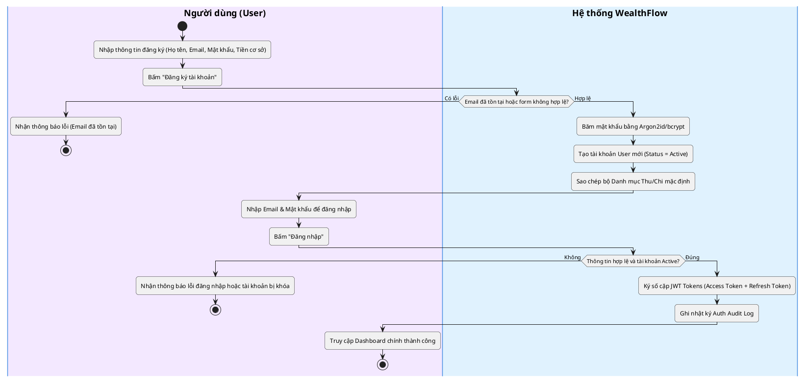

---

### AD02: Quy trình Ghi nhận Chi tiêu, Hạch toán Kép & Kiểm soát Ngân sách
- **Use Case liên quan:** `UC03` (Ghi nhận giao dịch), `UC05` (Kiểm soát ngân sách), `SYS03` (Sự kiện kiểm tra ngân sách).
- **Quy tắc nghiệp vụ:** `BR01` (Kế toán kép), `BR06` (Bất biến sổ cái), `BR07` (Công thức ngân sách), `BR08` (Cảnh báo 80%/100%), `BR13` (Idempotency).
- **Phân làn Actor:**
  - **Làn 1 (Trái):** `Người dùng (User)`
  - **Làn 2 (Phải):** `Hệ thống WealthFlow (System)`

#### Sơ đồ Mermaid (Swimlanes từ Trái sang Phải)

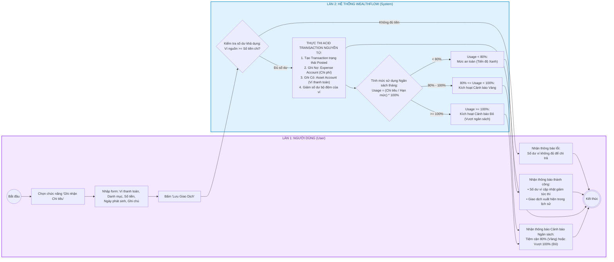

<b>Xem mã PlantUML chính quy (dùng xuất ảnh nộp báo cáo Word)</b>

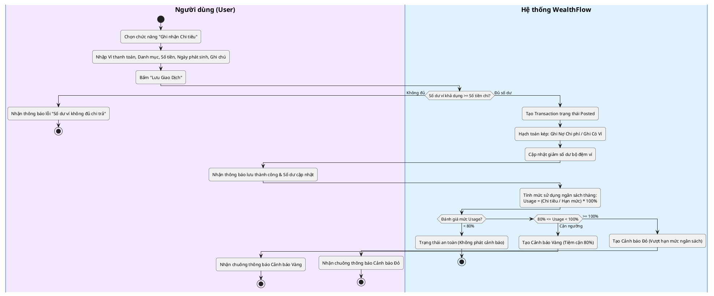

---

### AD03: Quy trình Chuyển tiền Nội bộ & Đảo Giao dịch (Reversal)
- **Use Case liên quan:** `UC03` (Quản lý giao dịch).
- **Quy tắc nghiệp vụ:** `BR01` (Kế toán kép), `BR05` (Chuyển tiền không ảnh hưởng Thu/Chi), `BR06` (Bất biến và Đảo giao dịch), `BR13` (Idempotency).
- **Phân làn Actor:**
  - **Làn 1 (Trái):** `Người dùng (User)`
  - **Làn 2 (Phải):** `Hệ thống WealthFlow (System)`

#### Sơ đồ Mermaid (Swimlanes từ Trái sang Phải)

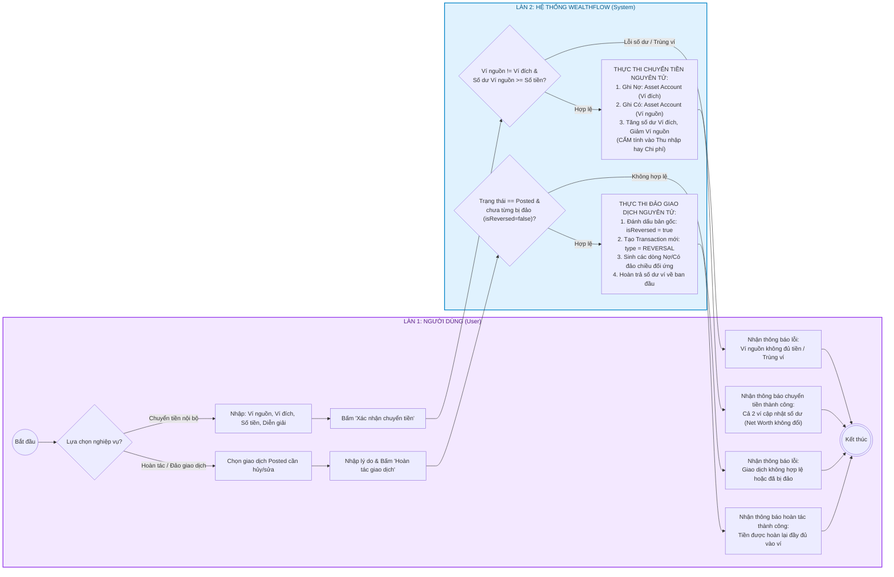

<b>Xem mã PlantUML chính quy (dùng xuất ảnh nộp báo cáo Word)</b>

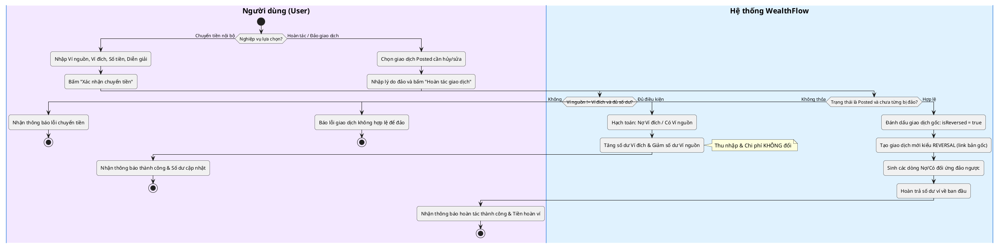

---

### AD04: Quy trình Xử lý Giao dịch Định kỳ Tự động (Subscription Cron)
- **Use Case liên quan:** `UC04` (Giao dịch định kỳ), `SYS02` (Tiến trình quét subscription).
- **Quy tắc nghiệp vụ:** `BR07` (Ngân sách), `BR09` (Tính toán ngày neo và lùi ngày cuối tháng).
- **Phân làn Actor (3 Cột từ Trái sang Phải):**
  - **Làn 1 (Trái):** `Bộ lập lịch nền (SYS02 Scheduler)`
  - **Làn 2 (Giữa):** `Hệ thống WealthFlow (System)`
  - **Làn 3 (Phải):** `Người dùng (User)`

#### Sơ đồ Mermaid (Swimlanes từ Trái sang Phải)

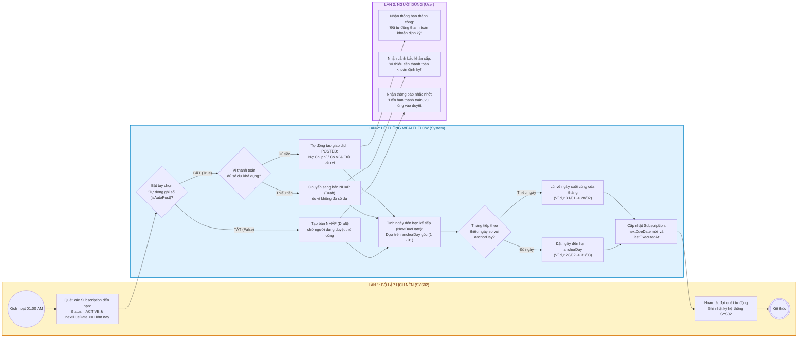

<b>Xem mã PlantUML chính quy (dùng xuất ảnh nộp báo cáo Word)</b>

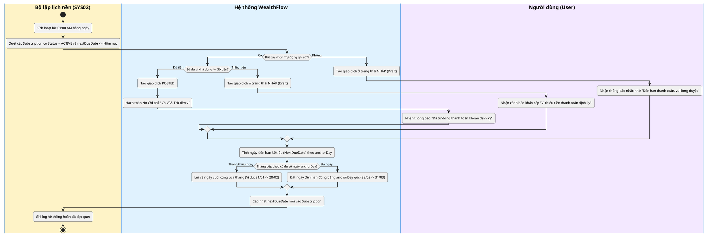

---

### AD05: Quy trình Khởi tạo Khoản vay & Thanh toán Trả nợ Vi mô
- **Use Case liên quan:** `UC06` (Khởi tạo khoản vay), `UC07` (Thanh toán trả nợ).
- **Quy tắc nghiệp vụ:** `BR09` (Lịch trả nợ), `BR10` (Phân định Nợ vs Chi phí), `BR17` (Nguyên lý kế toán vi mô cho Vay mượn).
- **Phân làn Actor:**
  - **Làn 1 (Trái):** `Người vay / Người dùng (Borrower / User)`
  - **Làn 2 (Phải):** `Hệ thống WealthFlow (System)`

#### Sơ đồ Mermaid (Swimlanes từ Trái sang Phải)

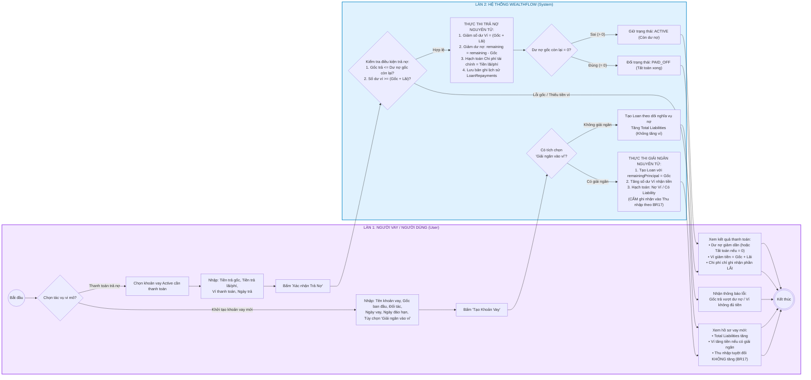

<b>Xem mã PlantUML chính quy (dùng xuất ảnh nộp báo cáo Word)</b>

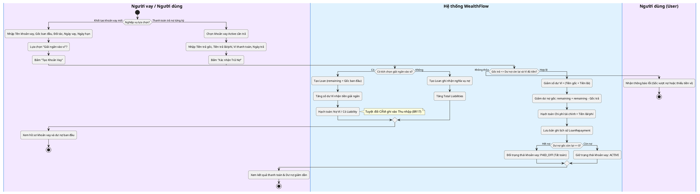

---

### AD06: Quy trình Quản lý Vàng Tích lũy & Tính toán Sức khỏe Net Worth
- **Use Case liên quan:** `UC08` (Tài sản vàng), `UC10` (Dashboard sức khỏe tài chính & Net Worth).
- **Quy tắc nghiệp vụ:** `BR02` (Vốn chủ sở hữu), `BR03` & `BR04` (Định giá vàng), `BR16` (Công thức Net Worth), `BR18` (An toàn tỷ lệ tiết kiệm).
- **Phân làn Actor:**
  - **Làn 1 (Trái):** `Người dùng (User)`
  - **Làn 2 (Phải):** `Hệ thống WealthFlow (System)`

#### Sơ đồ Mermaid (Swimlanes từ Trái sang Phải)

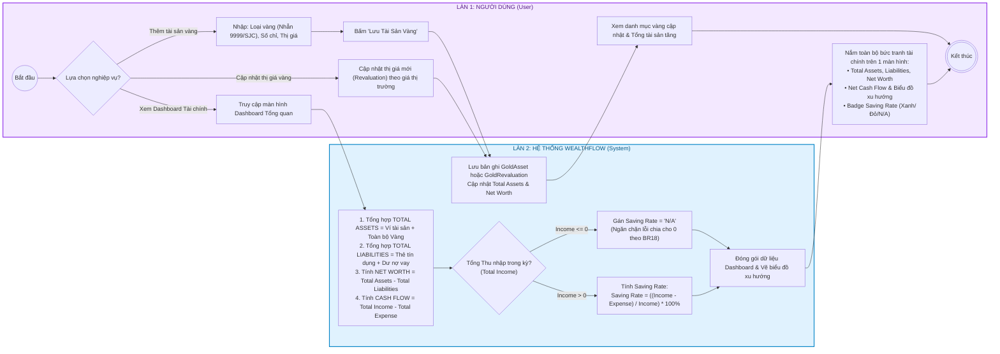

<b>Xem mã PlantUML chính quy (dùng xuất ảnh nộp báo cáo Word)</b>

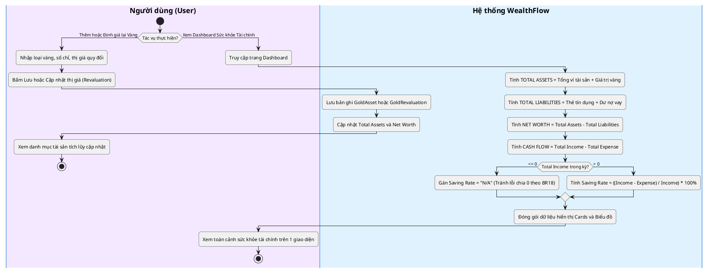

---

### AD07: Quy trình Báo cáo Đối soát Sổ cái & Xuất Dữ liệu CSV An toàn
- **Use Case liên quan:** `UC11` (Báo cáo & Xuất dữ liệu).
- **Quy tắc nghiệp vụ:** `BR01` (Kế toán kép), `BR12` (Đối soát số dư), `BR14` (Kiểm toán), `BR18` (Chuẩn mã hóa UTF-8 BOM).
- **Phân làn Actor:**
  - **Làn 1 (Trái):** `Người dùng (User)`
  - **Làn 2 (Phải):** `Hệ thống WealthFlow (System)`

#### Sơ đồ Mermaid (Swimlanes từ Trái sang Phải)

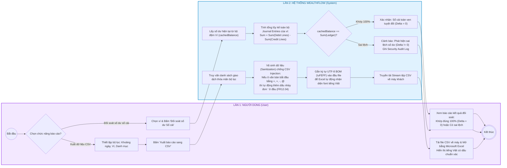

<b>Xem mã PlantUML chính quy (dùng xuất ảnh nộp báo cáo Word)</b>

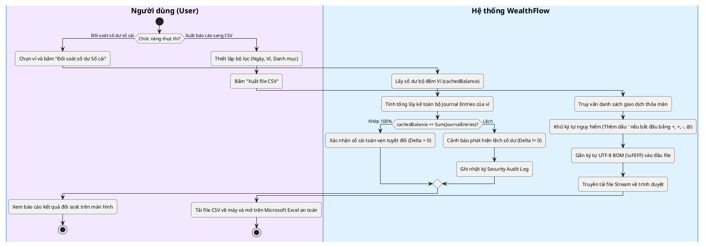

---

### AD08: Quy trình Quản trị Người dùng, Khóa Tài khoản & Phát Thông báo
- **Use Case liên quan:** `UC12` (Quản trị người dùng & Thống kê vĩ mô), `UC13` (Cấu hình hệ thống & Phát thông báo).
- **Quy tắc nghiệp vụ:** `BR11` (Bảo vệ quyền riêng tư người dùng), `BR13` (Quản trị cấu hình & Kiểm toán hành chính).
- **Phân làn Actor (3 Cột từ Trái sang Phải):**
  - **Làn 1 (Trái):** `Quản trị viên (Admin A02)`
  - **Làn 2 (Giữa):** `Hệ thống WealthFlow (System)`
  - **Làn 3 (Phải):** `Người dùng hệ thống (End-User)`

#### Sơ đồ Mermaid (Swimlanes từ Trái sang Phải)

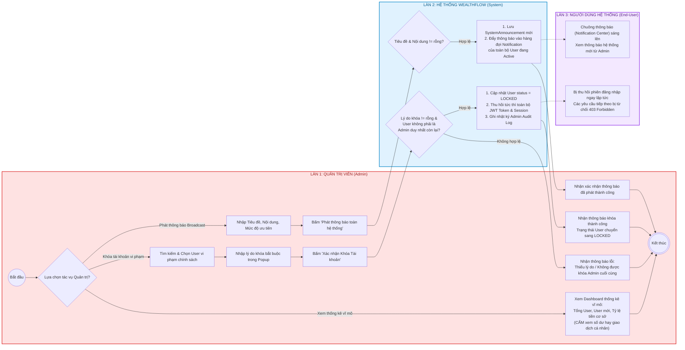

<b>Xem mã PlantUML chính quy (dùng xuất ảnh nộp báo cáo Word)</b>

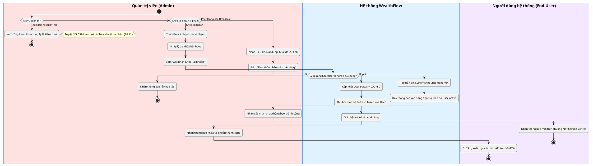

---

## 4. Ma trận Phân bổ Làn bơi & Use Cases (Swimlane Allocation Matrix)

| Mã Sơ đồ | Tên Quy trình Nghiệp vụ | Làn 1 (Bên trái) | Làn 2 (Ở giữa) | Làn 3 (Bên phải) | Use Cases bao phủ |
| :---: | :--- | :--- | :--- | :--- | :---: |
| **AD01** | Đăng ký & Xác thực Tài khoản | `Người dùng (User)` | `Hệ thống WealthFlow` | *(Không có)* | `UC01`, `UC02` |
| **AD02** | Ghi nhận Chi tiêu & Ngân sách | `Người dùng (User)` | `Hệ thống WealthFlow` | *(Không có)* | `UC03`, `UC05` |
| **AD03** | Chuyển tiền & Đảo Giao dịch | `Người dùng (User)` | `Hệ thống WealthFlow` | *(Không có)* | `UC03` |
| **AD04** | Giao dịch Định kỳ Tự động | `Bộ lập lịch (SYS02)` | `Hệ thống WealthFlow` | `Người dùng (User)` | `UC04`, `SYS02` |
| **AD05** | Vay nợ Vi mô & Thanh toán | `Người vay / User` | `Hệ thống WealthFlow` | *(Không có)* | `UC06`, `UC07` |
| **AD06** | Quản lý Vàng & Net Worth | `Người dùng (User)` | `Hệ thống WealthFlow` | *(Không có)* | `UC08`, `UC10` |
| **AD07** | Đối soát Sổ cái & Xuất CSV | `Người dùng (User)` | `Hệ thống WealthFlow` | *(Không có)* | `UC11` |
| **AD08** | Quản trị & Phát Thông báo | `Quản trị viên (Admin)` | `Hệ thống WealthFlow` | `Người dùng (User)` | `UC12`, `UC13` |

---

## 5. Kết luận và Bước kế tiếp trong Tiến trình Unified Process

Tài liệu **Activity Diagrams with Actor Swimlanes** trên đã chuẩn hóa toàn bộ luồng nghiệp vụ theo đúng mẫu phân làn tác nhân (Actor Swimlanes) trực quan, mạch lạc, dễ hiểu cho cả sinh viên, giảng viên và hội đồng nghiệm thu.

Theo tiến trình Unified Process (luồng kỹ nghệ *Analysis & Design*), sau khi đã hoàn thiện Use Case Diagram và Activity Diagram, bước tiếp theo là:
1. **Sequence Diagrams (Sơ đồ Tuần tự):** Mô hình hóa thông điệp truyền nhận giữa các đối tượng phân tích:
   $$\text{Actor} \longrightarrow \text{Boundary/Controller} \longrightarrow \text{Control/Service} \longrightarrow \text{Entity/Repository} \longrightarrow \text{Database}$$
2. **Design Class Diagram (Sơ đồ Lớp thiết kế):** Định nghĩa các thuộc tính, phương thức, quan hệ kết tập và kế thừa chi tiết.
3. **Database Schema / ERD:** Thiết kế cơ sở dữ liệu vật lý PostgreSQL cho mô hình kế toán kép và microfinance.
