# Sơ đồ Hoạt động Phân làn (Activity Diagrams with Swimlanes) - WealthFlow

> **Quy chuẩn Mô hình hóa:** Chuẩn UML 2.5 Activity Diagram & Định dạng Bản đồ Quy trình phân làn (*Activity Map / Swimlanes*) tương thích hoàn toàn với ProcessOn, Visual Paradigm, Enterprise Architect.  
> **Tham chiếu chuẩn:** [SRS.md](../SRS.md) v2.1 (13 Core Use Cases, 15 FRs, 18 BRs, SYS01-SYS03) | [usecase_diagram.md](./usecase_diagram.md) | [class_diagram.md](./class_diagram.md) | [sequence_diagram.md](./sequence_diagram.md)

---

## 1. Tiêu chuẩn Kỹ nghệ & Hệ thống Ký hiệu Mô hình hóa

Sơ đồ Hoạt động phân làn (Activity Diagram with Swimlanes) trong tài liệu này mô hình hóa động học toàn bộ luồng nghiệp vụ cốt lõi của hệ thống **WealthFlow** theo chuẩn UML 2.5 và định dạng trực quan **ProcessOn Activity Map**:

### 1.1 Hệ thống Ký hiệu Trực quan (Constituent Elements)
1. **Nút Khởi đầu & Kết thúc (Initial & Final Nodes):**
   - *Khởi đầu (Initial Node):* Điểm bắt đầu quy trình, ký hiệu hình tròn đặc màu đen (`●`).
   - *Kết thúc hoạt động (Activity Final Node):* Điểm hoàn tất quy trình, ký hiệu vòng tròn kép đồng tâm (`◎`).
2. **Hành động & Luồng Điều khiển (Activities & Action Flows):**
   - *Hành động (Action State):* Thể hiện đơn vị xử lý nguyên tử, ký hiệu hộp chữ nhật bo góc chứa mô tả Động từ + Danh từ.
   - *Luồng điều khiển (Action Flow):* Kết nối trình tự giữa các hành động, ký hiệu bằng mũi tên nét liền hướng từ trước ra sau.
3. **Nút Quyết định & Nút Gộp (Decision & Merge Nodes):**
   - *Nút Quyết định (Decision Node):* Rẽ nhánh có điều kiện (1 vào, nhiều ra), ký hiệu hình quả trám (`◇`) kèm điều kiện bảo vệ `[Guard Condition]`.
   - *Nút Gộp (Merge Node):* Gom nhiều nhánh rẽ hội tụ về một luồng (nhiều vào, 1 ra), ký hiệu hình quả trám (`◇`) theo quan hệ "OR".
4. **Vòng lặp Khắc phục Lỗi (Loopback Flow):**
   - Khi phát sinh lỗi nhập liệu hoặc sai thông tin, mũi tên rẽ nhánh quay trở lại bước nhập trước đó để người dùng chỉnh sửa.
5. **Nút Đồng bộ Song song (Fork & Join Nodes):**
   - *Fork Node:* Tách một luồng thành các luồng chạy song song (thanh ngang đặc).
   - *Join Node:* Chờ tất cả luồng song song hoàn tất để hợp nhất thành một luồng duy nhất.
6. **Làn bơi Phân làn Trách nhiệm (Swimlanes):**
   - Chia sơ đồ thành các cột dọc song song đại diện cho từng tác nhân (Người dùng, Hệ thống, Bộ lập lịch, Dịch vụ bên thứ ba), phân định rõ trách nhiệm và các điểm chuyển giao (Handoffs).

### 1.2 Quy chuẩn Định dạng & Tính Truy vết Hai chiều (Traceability)
- **Định dạng Vector SVG Trực tiếp:** Toàn bộ 11 sơ đồ hoạt động được kết xuất sẵn dưới dạng ảnh Vector SVG chất lượng cao lưu tại [./activity_diagram/](./activity_diagram/), hiển thị sắc nét tức thì trên GitHub và VS Code Markdown Preview.
- **Tính Truy vết Nghiệp vụ:** Từng sơ đồ đều có siêu liên kết dẫn trực tiếp tới các định danh trong [SRS.md](../SRS.md): 13 Core Use Cases ([UC01](../SRS.md#uc01)–[UC13](../SRS.md#uc13)), 15 nhóm [FR01](../SRS.md#fr01)–[FR15](../SRS.md#fr15), 18 quy tắc [BR01](../SRS.md#br01)–[BR18](../SRS.md#br18) và 3 tác vụ nền tự động [SYS01](../SRS.md#sys01)–[SYS03](../SRS.md#sys03).

---

## 2. Danh mục 11 Quy trình Hoạt động Phân làn

| Mã Sơ đồ | Tên Quy trình Nghiệp vụ (Activity Map) | Use Cases bao phủ | Các Làn bơi (Swimlanes theo thứ tự từ Trái sang Phải) | Ảnh Vector Trực quan |
| :---: | :--- | :---: | :--- | :---: |
| **AD01** | Đăng ký & Xác thực Người dùng | [UC01](../SRS.md#uc01) | `Người dùng (User / Guest)` → `Hệ thống WealthFlow (System)` | [ad01.svg](./activity_diagram/ad01.svg) |
| **AD02** | Quản lý Tài khoản Thanh toán & Ví tiền (Số dư mở sổ) | [UC02](../SRS.md#uc02) | `Người dùng (User)` → `Hệ thống WealthFlow (System)` | [ad02.svg](./activity_diagram/ad02.svg) |
| **AD03** | Ghi nhận Chi tiêu, Hạch toán Kép & Kiểm soát Ngân sách | [UC03](../SRS.md#uc03), [UC05](../SRS.md#uc05) | `Người dùng (User)` → `Hệ thống WealthFlow (System)` | [ad03.svg](./activity_diagram/ad03.svg) |
| **AD04** | Chuyển tiền Nội bộ, Quy đổi Ngoại tệ & Đảo Giao dịch | [UC03](../SRS.md#uc03), [UC04](../SRS.md#uc04) | `Người dùng (User)` → `Hệ thống WealthFlow` → `Dịch vụ Tỷ giá (A03 API)` | [ad04.svg](./activity_diagram/ad04.svg) |
| **AD05** | Thiết lập & Xử lý Giao dịch Định kỳ Tự động (Subscription & Cron) | [UC04](../SRS.md#uc04), [SYS02](../SRS.md#sys02) | `Người dùng (User)` → `Hệ thống WealthFlow (System)` → `Bộ lập lịch (SYS02 lúc 00:05)` | [ad05.svg](./activity_diagram/ad05.svg) |
| **AD06** | Khởi tạo Khoản vay & Thanh toán Trả nợ Vi mô *(Microfinance)* | [UC06](../SRS.md#uc06), [UC07](../SRS.md#uc07) | `Người vay / Người dùng` → `Hệ thống WealthFlow (System)` | [ad06.svg](./activity_diagram/ad06.svg) |
| **AD07** | Mua bán & Tích lũy Tài sản Vàng, Tích hợp Thị giá | [UC08](../SRS.md#uc08) | `Người dùng (User)` → `Hệ thống WealthFlow (System)` → `Dịch vụ Thị giá Vàng (A04 API)` | [ad07.svg](./activity_diagram/ad07.svg) |
| **AD08** | Quản lý Mục tiêu Tiết kiệm & Khóa tiền Earmarking | [UC09](../SRS.md#uc09) | `Người dùng (User)` → `Hệ thống WealthFlow (System)` | [ad08.svg](./activity_diagram/ad08.svg) |
| **AD09** | Dashboard Sức khỏe Net Worth & Snapshot Nền | [UC10](../SRS.md#uc10), [SYS03](../SRS.md#sys03) | `Người dùng (User)` → `Hệ thống WealthFlow (System)` → `Bộ lập lịch (SYS03 lúc 23:59:59)` | [ad09.svg](./activity_diagram/ad09.svg) |
| **AD10** | Báo cáo Đối soát Sổ cái & Xuất Dữ liệu CSV An toàn | [UC11](../SRS.md#uc11) | `Người dùng (User)` → `Hệ thống WealthFlow (System)` | [ad10.svg](./activity_diagram/ad10.svg) |
| **AD11** | Quản trị Người dùng, Khóa Tài khoản & Phát Thông báo | [UC12](../SRS.md#uc12), [UC13](../SRS.md#uc13) | `Quản trị viên (Admin A02)` → `Hệ thống WealthFlow` → `Người dùng (End-User)` | [ad11.svg](./activity_diagram/ad11.svg) |

---

## 3. Nội dung Chi tiết các Sơ đồ Hoạt động Phân làn

---

### AD01: Quy trình Đăng ký & Xác thực Người dùng
- **Ánh xạ Use Cases:** [UC01](../SRS.md#uc01) (Đăng ký & Xác thực người dùng).
- **Yêu cầu Chức năng:** [FR01](../SRS.md#fr01), [FR15](../SRS.md#fr15).
- **Quy tắc Nghiệp vụ:** [BR11](../SRS.md#br11) (Bảo mật phiên JWT/Argon2id).
- **Phân làn Thực thi (Swimlanes):**
  - **Làn 1:** `Người dùng (User / Guest)` - Khách vãng lai đăng ký tài khoản mới hoặc người dùng đăng nhập hệ thống.
  - **Làn 2:** `Hệ thống WealthFlow (System)` - Kiểm tra tính duy nhất email, băm mật khẩu Argon2id, gán danh mục mặc định, thẩm định đăng nhập và ký phát cặp Token JWT an toàn.

#### Sơ đồ Hoạt động Trực quan (Vector SVG)
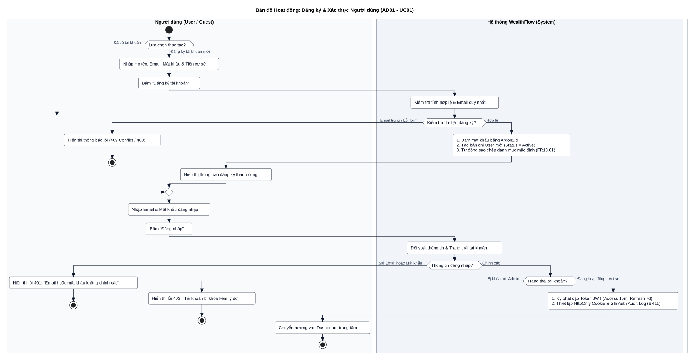

---

### AD02: Quy trình Quản lý Tài khoản Thanh toán & Ví tiền (Khởi tạo số dư mở sổ)
- **Ánh xạ Use Cases:** [UC02](../SRS.md#uc02) (Quản lý ví và số dư mở sổ).
- **Yêu cầu Chức năng:** [FR02](../SRS.md#fr02), [FR15](../SRS.md#fr15).
- **Quy tắc Nghiệp vụ:** [BR01](../SRS.md#br01) (Kế toán kép), [BR02](../SRS.md#br02) (Số dư mở sổ đối ứng Vốn chủ sở hữu - Equity).
- **Phân làn Thực thi (Swimlanes):**
  - **Làn 1:** `Người dùng (User)` - Nhập thông tin cấu hình ví mới (Tên ví, loại ví, tiền tệ, số dư ban đầu).
  - **Làn 2:** `Hệ thống WealthFlow (System)` - Mở Transaction CSDL, khởi tạo ví `Active`, tự động sinh bút toán kép đối ứng Equity nếu số dư $> 0$.

#### Sơ đồ Hoạt động Trực quan (Vector SVG)
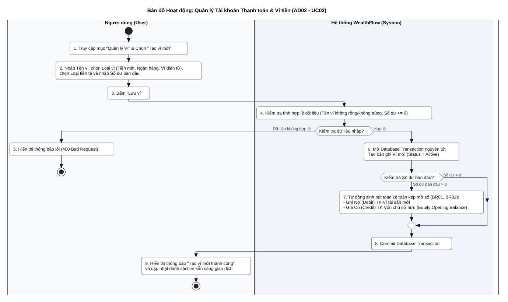

---

### AD03: Quy trình Ghi nhận Chi tiêu, Hạch toán Kép & Kiểm soát Ngân sách
- **Ánh xạ Use Cases:** [UC03](../SRS.md#uc03) (Ghi nhận giao dịch tài chính), [UC05](../SRS.md#uc05) (Thiết lập và cảnh báo ngân sách).
- **Yêu cầu Chức năng:** [FR03](../SRS.md#fr03), [FR04](../SRS.md#fr04), [FR05](../SRS.md#fr05), [FR06](../SRS.md#fr06), [FR15](../SRS.md#fr15).
- **Quy tắc Nghiệp vụ:** [BR01](../SRS.md#br01) (Kế toán kép), [BR03](../SRS.md#br03) (Nguyên tử hóa giao dịch), [BR04](../SRS.md#br04) (Kiểm soát âm ví), [BR06](../SRS.md#br06) (Cảnh báo ngưỡng ngân sách 80% - 100%).
- **Phân làn Thực thi (Swimlanes):**
  - **Làn 1:** `Người dùng (User)` - Nhập dữ liệu giao dịch chi tiêu, nhận phản hồi số dư và cảnh báo ngân sách.
  - **Làn 2:** `Hệ thống WealthFlow (System)` - Kiểm tra số dư khả dụng (BR04), thực thi Transaction ACID kép (Nợ Chi phí / Có Ví) và kiểm tra hạn mức ngân sách tháng (BR06).

#### Sơ đồ Hoạt động Trực quan (Vector SVG)
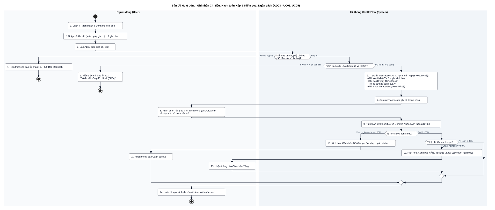

---

### AD04: Quy trình Chuyển tiền Nội bộ, Quy đổi Ngoại tệ & Đảo Giao dịch
- **Ánh xạ Use Cases:** [UC03](../SRS.md#uc03) (Ghi nhận giao dịch), [UC04](../SRS.md#uc04) (Đảo giao dịch chuyển tiền).
- **Yêu cầu Chức năng:** [FR03](../SRS.md#fr03), [FR04](../SRS.md#fr04), [FR15](../SRS.md#fr15).
- **Quy tắc Nghiệp vụ:** [BR01](../SRS.md#br01) (Kế toán kép), [BR04](../SRS.md#br04) (Số dư ví nguồn), [BR07](../SRS.md#br07) (Cơ chế Đảo giao dịch - Reversal, cấm xóa cứng), [BR08](../SRS.md#br08) (Quy đổi đa tiền tệ).
- **Phân làn Thực thi (Swimlanes):**
  - **Làn 1:** `Người dùng (User)` - Chọn 2 ví, xác nhận số tiền quy đổi, yêu cầu đảo giao dịch.
  - **Làn 2:** `Hệ thống WealthFlow` - Tính toán tỷ giá, hạch toán đối ứng Nợ Ví đích / Có Ví nguồn, tạo bút toán đảo.
  - **Làn 3:** `Dịch vụ Tỷ giá (A03 API)` - Cung cấp tỷ giá hối đoái liên ngân hàng thời gian thực.

#### Sơ đồ Hoạt động Trực quan (Vector SVG)
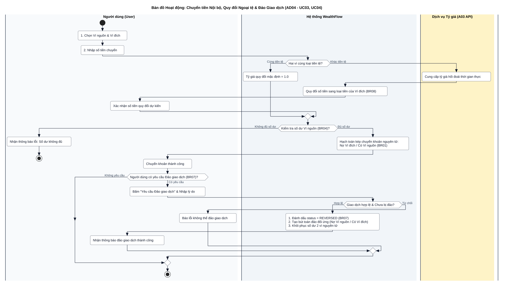

---

### AD05: Quy trình Thiết lập & Xử lý Giao dịch Định kỳ Tự động (Subscription & Cron)
- **Ánh xạ Use Cases:** [UC04](../SRS.md#uc04) (Thiết lập & Xử lý giao dịch định kỳ), [SYS02](../SRS.md#sys02) (Tiến trình quét hóa đơn định kỳ hằng ngày lúc 00:05).
- **Yêu cầu Chức năng:** [FR06](../SRS.md#fr06) (Quản lý giao dịch định kỳ), [FR15](../SRS.md#fr15) (Kiểm soát toàn vẹn dữ liệu).
- **Quy tắc Nghiệp vụ:** [BR01](../SRS.md#br01) (Kế toán kép), [BR04](../SRS.md#br04) (Kiểm tra số dư ví), [BR06](../SRS.md#br06) (Cập nhật tiến độ ngân sách), [BR09](../SRS.md#br09) (Quy tắc Ngày neo & Xử lý tháng thiếu ngày), [BR13](../SRS.md#br13) (Khóa chống trùng lặp Idempotency-Key).
- **Phân làn Thực thi (Swimlanes):**
  - **Làn 1:** `Người dùng (User)` - Thiết lập lịch định kỳ (chu kỳ, ngày neo, tùy chọn tự động ghi sổ/nhắc nhở), nhận thông báo giao dịch thành công hoặc cảnh báo thiếu số dư.
  - **Làn 2:** `Hệ thống WealthFlow (System)` - Thẩm định dữ liệu, sinh Idempotency-Key (BR13), hạch toán kép (BR01), kiểm soát ngân sách (BR06), tính ngày neo kế tiếp (BR09).
  - **Làn 3:** `Bộ lập lịch (SYS02 lúc 00:05)` - Kích hoạt Cron Job tự động hằng ngày quét các khoản đến hạn.

#### Sơ đồ Hoạt động Trực quan (Vector SVG)
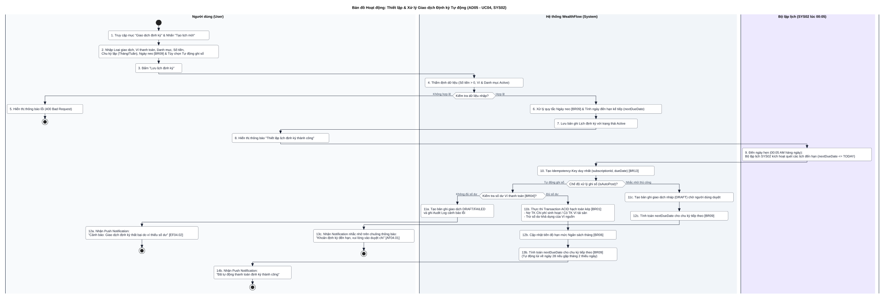

---

### AD06: Quy trình Khởi tạo Khoản vay & Thanh toán Trả nợ Vi mô (Microfinance)
- **Ánh xạ Use Cases:** [UC06](../SRS.md#uc06) (Quản lý khoản vay nợ vi mô), [UC07](../SRS.md#uc07) (Thực hiện trả nợ và theo dõi lịch hoàn vốn).
- **Yêu cầu Chức năng:** [FR09](../SRS.md#fr09), [FR15](../SRS.md#fr15).
- **Quy tắc Nghiệp vụ:** [BR01](../SRS.md#br01) (Kế toán kép), [BR04](../SRS.md#br04) (Số dư ví trả nợ), [BR05](../SRS.md#br05) & [BR17](../SRS.md#br17) (Bút toán trả nợ 3 dòng: Tách bạch Nợ gốc không tính vào chi phí sinh hoạt, Chỉ lãi vay tính vào chi phí).
- **Phân làn Thực thi (Swimlanes):**
  - **Làn 1:** `Người vay / Người dùng` - Khởi tạo hồ sơ vay, thực hiện thanh toán từng kỳ.
  - **Làn 2:** `Hệ thống WealthFlow (System)` - Lập lịch trả nợ, giải ngân, phân bổ bút toán trả nợ 3 dòng, cập nhật trạng thái SETTLED.

#### Sơ đồ Hoạt động Trực quan (Vector SVG)
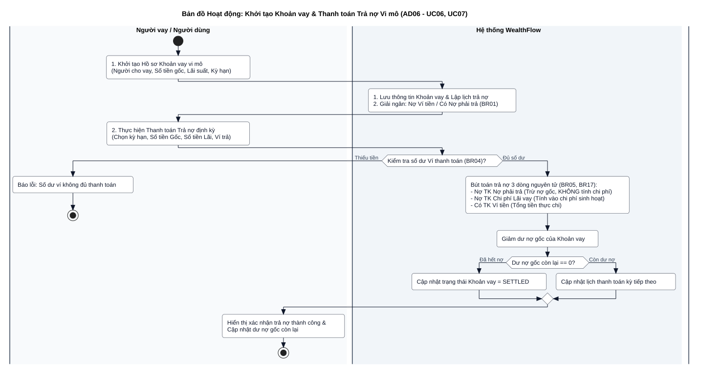

---

### AD07: Quy trình Mua bán & Tích lũy Tài sản Vàng, Tích hợp Thị giá
- **Ánh xạ Use Cases:** [UC08](../SRS.md#uc08) (Quản lý tài sản tích lũy ngoài ví - Vàng).
- **Yêu cầu Chức năng:** [FR08](../SRS.md#fr08), [FR15](../SRS.md#fr15).
- **Quy tắc Nghiệp vụ:** [BR01](../SRS.md#br01) (Kế toán kép), [BR02](../SRS.md#br02) (Hạch toán lãi/lỗ chênh lệch giá khi thanh lý vàng), [BR16](../SRS.md#br16) (Giá trị thị trường vàng đóng góp vào Tổng tài sản).
- **Phân làn Thực thi (Swimlanes):**
  - **Làn 1:** `Người dùng (User)` - Chọn mua vàng mới hoặc thanh lý vàng hiện có.
  - **Làn 2:** `Hệ thống WealthFlow (System)` - Kiểm tra số dư ví, hạch toán kép kế toán, cập nhật Total Assets.
  - **Làn 3:** `Dịch vụ Thị giá Vàng (A04 API)` - Cung cấp đơn giá niêm yết thời gian thực (SJC, DOJI, PNJ) kèm cơ chế Fallback nhập thủ công.

#### Sơ đồ Hoạt động Trực quan (Vector SVG)
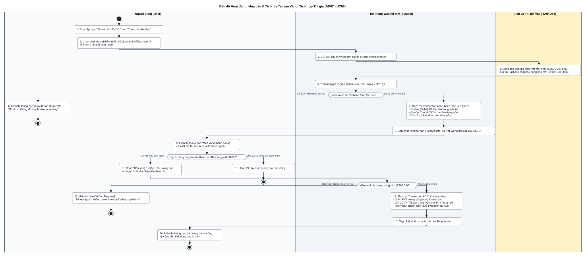

---

### AD08: Quy trình Quản lý Mục tiêu Tiết kiệm & Khóa tiền Earmarking
- **Ánh xạ Use Cases:** [UC09](../SRS.md#uc09) (Quản lý mục tiêu tích lũy tài chính).
- **Yêu cầu Chức năng:** [FR07](../SRS.md#fr07), [FR15](../SRS.md#fr15).
- **Quy tắc Nghiệp vụ:** [BR10](../SRS.md#br10) (Earmarking giữ chỗ nguồn tiền ví; cấm tài sản ảo/vàng; bảo đảm Tổng tài sản và Net Worth không đổi).
- **Phân làn Thực thi (Swimlanes):**
  - **Làn 1:** `Người dùng (User)` - Tạo mục tiêu, nạp tiền phân bổ hoặc rút tiền về ví.
  - **Làn 2:** `Hệ thống WealthFlow (System)` - Thẩm định nguồn trích (BR10), thực thi Earmarking khóa tiền ví và cập nhật tiến độ (%).

#### Sơ đồ Hoạt động Trực quan (Vector SVG)
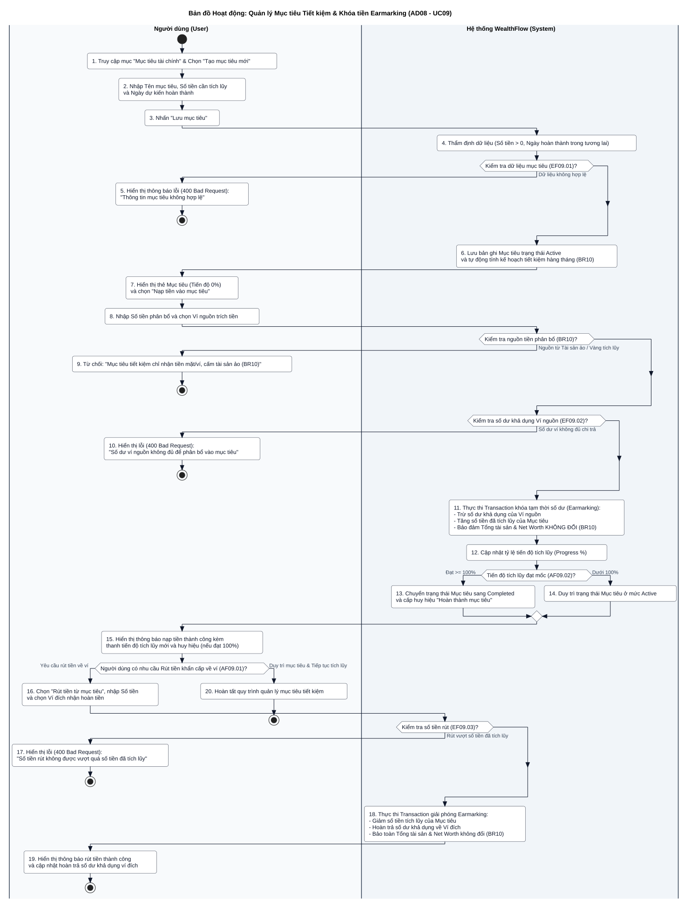

---

### AD09: Quy trình Dashboard Sức khỏe Net Worth & Snapshot Nền (SYS03 lúc 23:59:59)
- **Ánh xạ Use Cases:** [UC10](../SRS.md#uc10) (Xem Dashboard sức khỏe tài chính & Net Worth), [SYS03](../SRS.md#sys03) (Tiến trình chụp snapshot tài sản cuối ngày).
- **Yêu cầu Chức năng:** [FR08](../SRS.md#fr08), [FR10](../SRS.md#fr10), [FR11](../SRS.md#fr11).
- **Quy tắc Nghiệp vụ:** [BR05](../SRS.md#br05) (Dư nợ khoản vay), [BR14](../SRS.md#br14) (Khớp đúng số dư sổ cái 100%), [BR16](../SRS.md#br16) (Công thức Net Worth), [BR18](../SRS.md#br18) (Công thức Saving Rate, triệt tiêu lỗi chia cho 0).
- **Phân làn Thực thi (Swimlanes):**
  - **Làn 1:** `Người dùng (User)` - Xem thẻ KPI, biểu đồ xu hướng, bật/tắt Privacy Mode hoặc đổi kỳ khảo sát.
  - **Làn 2:** `Hệ thống WealthFlow (System)` - Truy vấn tổng hợp song song, tính Net Worth & Saving Rate, lưu snapshot.
  - **Làn 3:** `Bộ lập lịch (SYS03 lúc 23:59:59)` - Kích hoạt Cron Job tự động hằng đêm lưu lịch sử Net Worth.

#### Sơ đồ Hoạt động Trực quan (Vector SVG)
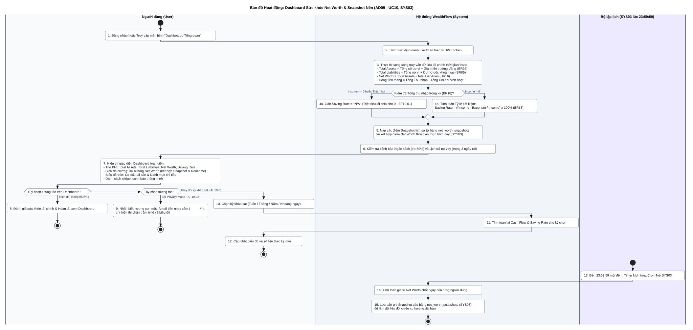

---

### AD10: Quy trình Báo cáo Đối soát Sổ cái & Xuất Dữ liệu CSV An toàn
- **Ánh xạ Use Cases:** [UC11](../SRS.md#uc11) (Xuất báo cáo tài chính và đối soát sổ cái).
- **Yêu cầu Chức năng:** [FR11](../SRS.md#fr11), [FR12](../SRS.md#fr12), [FR15](../SRS.md#fr15).
- **Quy tắc Nghiệp vụ:** [BR01](../SRS.md#br01) (Cân đối thử kép Nợ == Có), [BR16](../SRS.md#br16) (Bảo mật chống CSV Injection và chuẩn UTF-8 BOM).
- **Phân làn Thực thi (Swimlanes):**
  - **Làn 1:** `Người dùng (User)` - Chọn bộ lọc tài khoản, tải file CSV.
  - **Làn 2:** `Hệ thống WealthFlow (System)` - Kiểm tra Trial Balance, khử độc ký tự nguy hiểm, xuất file.

#### Sơ đồ Hoạt động Trực quan (Vector SVG)
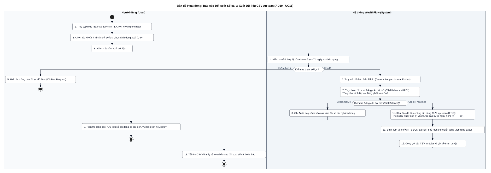

---

### AD11: Quy trình Quản trị Người dùng, Khóa Tài khoản & Phát Thông báo
- **Ánh xạ Use Cases:** [UC12](../SRS.md#uc12) (Quản trị tài khoản người dùng và bảo mật hệ thống), [UC13](../SRS.md#uc13) (Phát thông báo hệ thống toàn diện).
- **Yêu cầu Chức năng:** [FR13](../SRS.md#fr13), [FR14](../SRS.md#fr14), [FR15](../SRS.md#fr15), [SYS01](../SRS.md#sys01).
- **Quy tắc Nghiệp vụ:** [BR11](../SRS.md#br11) (Cách ly dữ liệu cá nhân tuyệt đối đối với Admin), [BR18](../SRS.md#br18) (Quy trình khóa tài khoản an toàn & thu hồi JWT).
- **Phân làn Thực thi (Swimlanes):**
  - **Làn 1:** `Quản trị viên (Admin A02)` - Xem Dashboard vĩ mô, nhập lý do khóa tài khoản hoặc soạn thông báo broadcast.
  - **Làn 2:** `Hệ thống WealthFlow (System)` - Thẩm định quyền Admin, thu hồi phiên làm việc, tạo thông báo hàng loạt.
  - **Làn 3:** `Người dùng (End-User)` - Bị chặn truy cập tức thì (403) nếu bị khóa; hoặc nhận thông báo chuông hệ thống.

#### Sơ đồ Hoạt động Trực quan (Vector SVG)
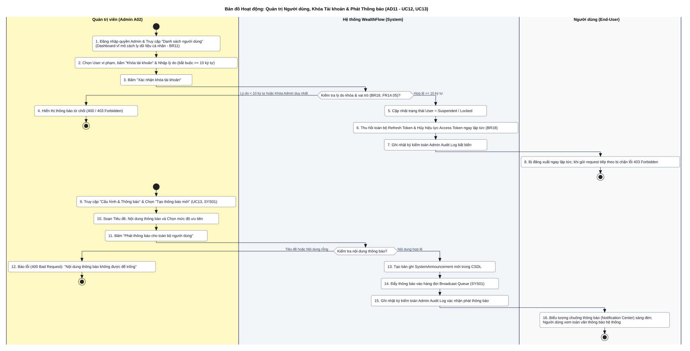

---

## 4. Bảng Ma trận Đối soát Chức năng & Ràng buộc Kỹ thuật

Bảng đối soát xác nhận mọi quy trình nghiệp vụ đã được mô hình hóa đầy đủ trong 11 Sơ đồ Hoạt động phân làn:

| Use Case | Tên Use Case | Sơ đồ Hoạt động | Quy tắc Nghiệp vụ thực thi | Cơ chế Kiểm soát Ngoại lệ & Bảo mật |
| :--- | :--- | :---: | :--- | :--- |
| [UC01](../SRS.md#uc01) | Đăng ký & Xác thực người dùng | **AD01** | [BR11](../SRS.md#br11) | Băm mật khẩu Argon2id, chống trùng Email, HttpOnly Cookie. |
| [UC02](../SRS.md#uc02) | Quản lý ví & số dư mở sổ | **AD02** | [BR01](../SRS.md#br01), [BR02](../SRS.md#br02) | Bút toán mở sổ cân bằng vốn chủ sở hữu (Equity). |
| [UC03](../SRS.md#uc03) | Ghi nhận giao dịch tài chính | **AD03**, **AD04** | [BR01](../SRS.md#br01), [BR03](../SRS.md#br03), [BR04](../SRS.md#br04) | Giao dịch CSDL ACID nguyên tử; chặn hoặc cảnh báo âm ví. |
| [UC04](../SRS.md#uc04) | Thiết lập & Xử lý giao dịch định kỳ | **AD04**, **AD05** | [BR07](../SRS.md#br07), [BR09](../SRS.md#br09), [BR13](../SRS.md#br13), [SYS02](../SRS.md#sys02) | Bút toán đảo đối ứng (`REVERSED`), xử lý ngày neo cuối tháng (lùi 28/02), Idempotency-Key, tiến trình tự động lúc 00:05. |
| [UC05](../SRS.md#uc05) | Thiết lập & cảnh báo ngân sách | **AD03** | [BR06](../SRS.md#br06) | Cảnh báo ngưỡng 80% (Vàng) và 100% (Đỏ) tức thời khi nhập chi tiêu. |
| [UC06](../SRS.md#uc06) | Quản lý khoản vay vi mô | **AD06** | [BR01](../SRS.md#br01) | Hạch toán giải ngân vào ví và ghi nhận nợ phải trả. |
| [UC07](../SRS.md#uc07) | Trả nợ & theo dõi lịch hoàn vốn | **AD06** | [BR05](../SRS.md#br05), [BR17](../SRS.md#br17) | Hạch toán 3 dòng: Trừ nợ gốc (không vào chi phí) + Lãi vay (vào chi phí). |
| [UC08](../SRS.md#uc08) | Tích lũy tài sản vàng | **AD07** | [BR01](../SRS.md#br01), [BR02](../SRS.md#br02), [BR16](../SRS.md#br16) | Tích hợp A04 Gold API, định giá theo thị trường, hỗ trợ fallback thủ công. |
| [UC09](../SRS.md#uc09) | Quản lý mục tiêu tiết kiệm | **AD08** | [BR10](../SRS.md#br10) | Earmark tiền mặt trong ví; nghiêm cấm gán tài sản ảo/vàng vào mục tiêu. |
| [UC10](../SRS.md#uc10) | Dashboard tài chính cá nhân đa chiều | **AD09** | [BR05](../SRS.md#br05), [BR14](../SRS.md#br14), [BR16](../SRS.md#br16), [BR18](../SRS.md#br18), [SYS03](../SRS.md#sys03) | Net Worth thời gian thực; đối chiếu xu hướng qua snapshot 23:59:59; triệt tiêu chia cho 0. |
| [UC11](../SRS.md#uc11) | Báo cáo đối soát sổ cái & Xuất CSV | **AD10** | [BR01](../SRS.md#br01), [BR16](../SRS.md#br16) | Đối soát Bảng cân đối thử; khử độc CSV injection (`'`) và UTF-8 BOM. |
| [UC12](../SRS.md#uc12) | Quản trị tài khoản người dùng | **AD11** | [BR11](../SRS.md#br11), [BR18](../SRS.md#br18) | Admin cách ly dữ liệu cá nhân; khóa tài khoản thu hồi phiên JWT ngay lập tức. |
| [UC13](../SRS.md#uc13) | Phát thông báo hệ thống toàn diện | **AD11** | [SYS01](../SRS.md#sys01) | Broadcast thông báo toàn hệ thống lưu vào hàng đợi thông báo. |
