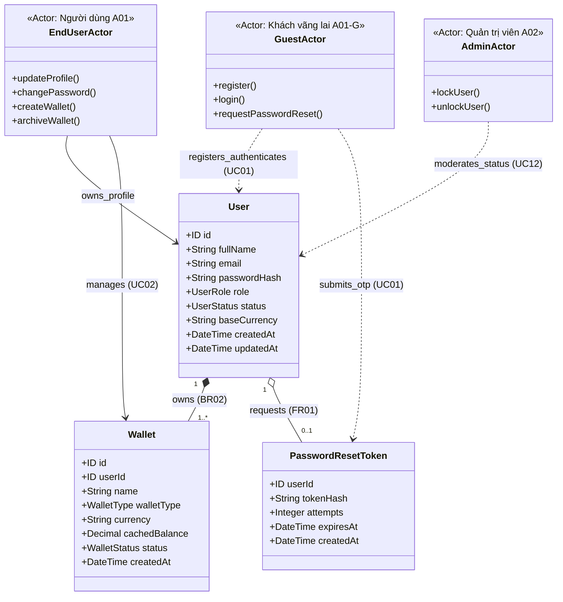
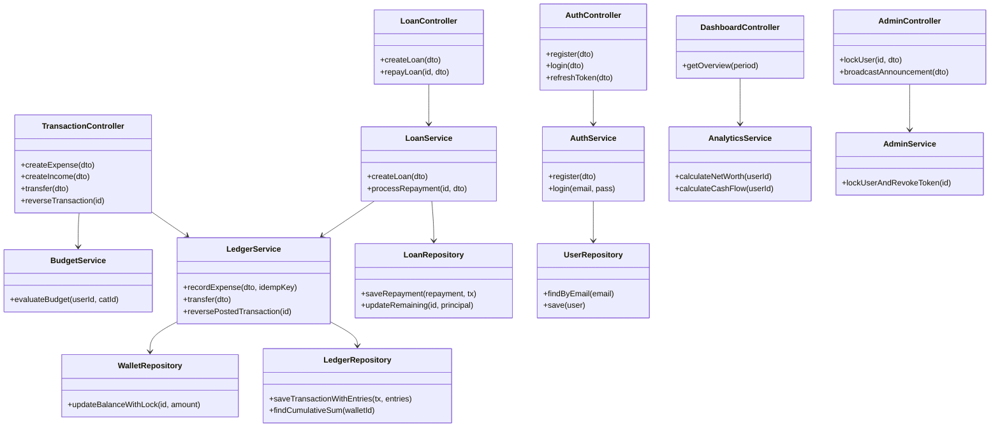

# Sơ đồ Lớp (Class Diagram) - WealthFlow

> Tham chiếu: [SRS.md](../SRS.md) v2.1 | [Sequence Diagrams](./sequence_diagram.md)

---

## 1. Sơ đồ Thực thể Nghiệp vụ (Domain Model)

Để đảm bảo tính trực quan, không gian hiển thị rộng rãi và dễ theo dõi các ràng buộc nghiệp vụ, mô hình thực thể của WealthFlow được phân rã theo **6 cụm phân hệ nghiệp vụ cốt lõi** (tiếp cận theo Domain-Driven Design / Bounded Contexts). 

Mỗi phân hệ làm rõ:
- **Tác nhân (Actors)** tham gia tương tác trực tiếp với phân hệ.
- **Thực thể dữ liệu (Entities)** cùng thuộc tính và kiểu dữ liệu chuẩn xác.
- **Thuyết minh nghiệp vụ & Quy tắc thiết kế (Business Rules - BR)** chi phối phân hệ.

---

### 1.1. Phân hệ Định danh, Người dùng & Ví tiền (Identity & Wallet Management)

> **Tham chiếu nghiệp vụ:** [FR01](../SRS.md#fr01), [FR02](../SRS.md#fr02), [FR04](../SRS.md#fr04) | **Use Cases:** [UC01](../SRS.md#uc01), [UC02](../SRS.md#uc02).

#### Sơ đồ Thực thể (Domain Plot):

#### Thuyết minh Nghiệp vụ & Quy tắc thiết kế (Business Rules):

1. **Tác nhân tham gia (Actors):**
   - **`Khách vãng lai (A01-G)`**: Tương tác với hệ thống khi chưa có phiên đăng nhập hợp lệ. Thực hiện đăng ký tài khoản mới (`FR01`), xác thực đăng nhập để nhận JWT Token, hoặc yêu cầu gửi mã OTP đặt lại mật khẩu qua email (`UC01`).
   - **`Người dùng (A01)`**: Chủ sở hữu tài khoản sau khi đăng nhập thành công. Quản lý thông tin hồ sơ cá nhân, đổi mật khẩu, thiết lập đồng tiền cơ sở (`baseCurrency`), tạo mới, cập nhật hoặc đóng các ví tiền nguồn (`UC02`, `FR02`).
   - **`Quản trị viên (A02)`**: Quản lý vòng đời tài khoản người dùng (Khóa `LOCKED` / Mở khóa `ACTIVE`), thu hồi hiệu lực token phiên tức thì khi phát hiện hành vi bất thường (`UC12`, `FR13`).  
     *Ràng buộc bảo mật tuyệt đối (`UR10`):* Quản trị viên không được cấp quyền xem số dư, tên ví hay bất kỳ dữ liệu sổ sách tài chính cá nhân nào của người dùng.

2. **Ràng buộc nghiệp vụ giữa các thực thể:**
   - **Quan hệ sở hữu và khởi tạo ví (`User "1" *-- "1..*" Wallet` - `BR02`):**
     - Khi một tài khoản được đăng ký thành công, hệ thống tự động khởi tạo ít nhất một ví tiền mặt mặc định (`CASH`, tiền tệ `VND`) để người dùng có thể bắt đầu ghi chép ngay lập tức.
     - Người dùng có thể tạo thêm nhiều ví thuộc các phân loại khác nhau: Tiền mặt (`CASH`), Tài khoản ngân hàng (`BANK`), Ví điện tử MoMo/ZaloPay (`E_WALLET`), Sổ tiết kiệm (`SAVINGS`), Thẻ tín dụng (`CREDIT`).
     - Mỗi ví có thể sử dụng đồng tiền (`currency`) độc lập với đồng tiền cơ sở của người dùng (ví dụ: User dùng `VND` nhưng có thể mở thêm ví ngoại tệ `USD` hoặc `EUR`). Khi lên báo cáo tổng hợp, hệ thống quy đổi theo tỷ giá snapshot tại thời điểm giao dịch (`BR15`).
   - **Bảo toàn lịch sử ví, không xóa cứng (`BR02`):**
     - Ví tiền đã từng phát sinh giao dịch trong lịch sử sổ cái tuyệt đối **không được phép xóa cứng (`Hard Delete`)** khỏi cơ sở dữ liệu.
     - Khi người dùng không còn sử dụng ví, hệ thống chỉ cập nhật trạng thái `status` thành `ARCHIVED` (đóng ví) để bảo toàn tính toàn vẹn và khả năng kiểm toán của sổ cái kế toán kép.
   - **Cơ chế OTP đặt lại mật khẩu (`PasswordResetToken` - `FR01`):**
     - Mã OTP 6 chữ số được mã hóa một chiều (`tokenHash`) trước khi lưu trữ, có thời hạn hiệu lực tối đa là 10 phút (`expiresAt`).
     - Trường `attempts` đếm số lần nhập sai. Nếu người dùng nhập sai quá 5 lần (`attempts >= 5`), mã OTP sẽ bị vô hiệu hóa ngay lập tức nhằm ngăn chặn triệt để tấn công vét cạn (brute-force).

---

## 2. Sơ đồ Lớp Thiết kế Chi tiết (BCE Architecture)

Phân bổ trách nhiệm theo mô hình **Boundary - Control - Entity** qua 3 tầng:

---

## 3. Bảng Ánh xạ Nhanh (Traceability)

| Phân hệ | Boundary (Controller) | Control (Service) | Entity (Repository) | Use Case & Sequence |
| :--- | :--- | :--- | :--- | :---: |
| **Xác thực** | `AuthController` | `AuthService` | `UserRepository` | `UC01` (SQ01) |
| **Sổ cái & Ví** | `TransactionController`, `WalletController` | `LedgerService` | `LedgerRepository`, `WalletRepository` | `UC02, UC03` (SQ02, SQ03) |
| **Ngân sách** | `TransactionController` | `BudgetService` | `BudgetRepository` | `UC05` (SQ02) |
| **Định kỳ** | *(SYS Cron)* | `SubscriptionWorker` | `SubscriptionRepository` | `UC04` (SQ04) |
| **Vay nợ** | `LoanController` | `LoanService` | `LoanRepository` | `UC06, UC07` (SQ05) |
| **Tài sản & Net Worth** | `DashboardController`, `GoldController` | `AnalyticsService`, `GoldService` | `AssetRepository` | `UC08, UC10` (SQ06) |
| **Đối soát & CSV** | `ReportController` | `ReconciliationService`, `ExportService` | `LedgerRepository` | `UC11` (SQ07) |
| **Quản trị** | `AdminController` | `AdminService`, `NotificationService` | `AdminRepository` | `UC12, UC13` (SQ08) |
