# Sơ đồ Lớp (Class Diagram) - WealthFlow

> **Tham chiếu tài liệu:** [SRS.md](../SRS.md) v2.1 | [Sequence Diagrams](./sequence_diagram.md) | [Activity Diagrams](./activity_diagram.md)

---

## 1. Sơ đồ Thực thể Nghiệp vụ (Domain Model)

*(Nội dung phần này sẽ được cập nhật và chuẩn hóa toàn diện sau khi hoàn thiện chi tiết 6 phân hệ thiết kế lớp BCE).*

---

## 2. Sơ đồ Lớp Thiết kế Chi tiết (BCE Architecture)

Mô hình phân bổ trách nhiệm hướng đối tượng được thiết kế theo kiến trúc **Boundary - Control - Entity (BCE)** (Ivar Jacobson / UP-RUP):
- **Boundary (Tầng Biên / Giao diện)**: Tiếp nhận yêu cầu từ Actor (REST Controllers tiếp nhận HTTP requests, Schedulers/Workers tiếp nhận trigger nền).
- **Control (Tầng Điều khiển / Dịch vụ Nghiệp vụ)**: Thực thi logic tài chính, điều phối giao dịch nguyên tử ACID và kiểm soát các quy tắc nghiệp vụ ([BR01] - [BR18]).
- **Entity (Tầng Thực thể & Lưu trữ Bền vững)**: Gồm các Rich Domain Entities mang dữ liệu và hành vi nghiệp vụ, kết hợp cùng Repositories trừu tượng hóa thao tác CSDL.

### 2.0. Danh mục Sơ đồ Lớp Trực quan (Vector SVG Catalog)

Toàn bộ các sơ đồ lớp được kết xuất thành ảnh Vector SVG chất lượng cao lưu tại [./class_diagram/](./class_diagram/), nền trắng tương phản cao, hiển thị tức thì và bảo đảm 100% không bị quá tải hay sụp đổ Markdown Renderer:

| Mã Phân hệ | Tên Phân hệ Nghiệp vụ (BCE Context) | Use Cases bao phủ | Các Lớp Trọng tâm | Ảnh Vector Trực quan |
| :---: | :--- | :---: | :--- | :---: |
| **CD01** | Phân hệ 1: Định danh, Xác thực & Quản trị Tài khoản | [UC01](../SRS.md#uc01), [UC12](../SRS.md#uc12) | `AuthController`, `AuthService`, `User`, `AdminService` | [cd01_identity_access.svg](./class_diagram/cd01_identity_access.svg) |
| **CD02** | Phân hệ 2: Quản lý Ví tài sản & Số dư Mở sổ | [UC02](../SRS.md#uc02) | `WalletController`, `WalletService`, `Wallet`, `ILedgerEquityPort` | [cd02_wallet_management.svg](./class_diagram/cd02_wallet_management.svg) |
| **CD03** | Phân hệ 3: Ghi nhận Giao dịch Thu chi & Sổ cái Kế toán kép | [UC03](../SRS.md#uc03) | `TransactionController`, `LedgerService`, `FinancialTransaction`, `JournalEntry` | [cd03_double_entry_ledger.svg](./class_diagram/cd03_double_entry_ledger.svg) |
| **CD04** | Phân hệ 4: Báo cáo Đối soát Sổ cái & Xuất CSV An toàn | [UC11](../SRS.md#uc11) | `ReportController`, `ReconciliationService`, `ExportService`, `TrialBalanceReport` | [cd04_reconciliation_csv.svg](./class_diagram/cd04_reconciliation_csv.svg) |
| **CD05** | Phân hệ 5: Quản lý Giao dịch Định kỳ Tự động | [UC04](../SRS.md#uc04), [SYS02](../SRS.md#sys02) | `RecurringTransactionController`, `RecurringExecutionWorker`, `RecurringRule`, `ILedgerPostPort` | [cd05_recurring_transaction.svg](./class_diagram/cd05_recurring_transaction.svg) |

---

### 2.1. Phân hệ 1: Định danh, Xác thực & Quản trị Tài khoản (Identity, Authentication & User Management Context)

> **Tham chiếu nghiệp vụ:** [FR01](../SRS.md#fr01), [FR13](../SRS.md#fr13), [FR15](../SRS.md#fr15)  
> **Use Cases:** [UC01](../SRS.md#uc01) (Đăng ký, Đăng nhập, Quên mật khẩu OTP), [UC12](../SRS.md#uc12) (Quản trị tài khoản & Khóa người dùng)  
> **Sequence Diagrams:** [SQ01](./sequence_diagram/sq01_auth_jwt.md), [SQ08](./sequence_diagram/sq08_admin_user_broadcast.md)  
> **Quy tắc cốt lõi:** [BR11](../SRS.md#br11) (Quyền riêng tư Admin & Cô lập dữ liệu cá nhân)

#### Sơ đồ Lớp Trực quan (Vector SVG):

#### Thuyết minh Chi tiết Trách nhiệm & Phương thức Nghiệp vụ (Class Responsibilities):

1. **Tầng Boundary (Biên tiếp nhận):**
   - **`AuthController`**: Tiếp nhận và điều hướng toàn bộ các yêu cầu phi trạng thái (stateless) từ Khách vãng lai (`GuestActor`) và Người dùng (`EndUserActor`): đăng ký tài khoản mới (`register`), xác thực đăng nhập cấp phát cặp JWT Token (`login`), làm mới Token (`refreshToken`), gửi yêu cầu quên mật khẩu OTP (`requestPasswordReset`) và xác thực OTP đặt lại mật khẩu (`verifyOtpAndResetPassword`).
   - **`UserController`**: Tiếp nhận các yêu cầu quản lý hồ sơ cá nhân của Người dùng sau khi đã xác thực token JWT hợp lệ: xem thông tin cá nhân (`getProfile`), đổi họ tên/tiền tệ cơ sở (`updateProfile`), đổi mật khẩu (`changePassword`).
   - **`AdminController`**: Cung cấp giao diện API quản trị cho Quản trị viên (`AdminActor`): tra cứu danh sách người dùng (`getUsers`), thực thi khóa tài khoản khẩn cấp kèm lý do (`lockUser`), mở khóa (`unlockUser`), truy vết nhật ký kiểm toán hệ thống (`getAuditLogs`).

2. **Tầng Control (Điều khiển & Xử lý nghiệp vụ):**
   - **`AuthService`**: Trung tâm xử lý an ninh và định danh. 
     - Áp dụng thuật toán **Argon2id** với tham số an toàn để băm mật khẩu người dùng trước khi lưu trữ (`FR01`).
     - Sinh mã OTP 6 chữ số ngẫu nhiên an toàn (CSPRNG), băm một chiều lưu vào `PasswordResetToken` với thời hạn hiệu lực chính xác 10 phút. Kiểm soát biến `attempts`, nếu nhập sai quá 5 lần thì hủy mã OTP để triệt tiêu tấn công Brute-force.
     - Sinh cặp JWT Token: Access Token (thời hạn 15 phút, chứa claims định danh `userId`, `role`) và Refresh Token (thời hạn 7 ngày, lưu trữ trong Cookie an toàn `HttpOnly; Secure; SameSite=Strict`).
   - **`UserService`**: Quản lý thông tin hồ sơ và đồng tiền cơ sở (`baseCurrency`). Kiểm tra mật khẩu cũ trước khi cho phép cập nhật mật khẩu mới.
   - **`AdminService`**: Thực thi quy trình quản trị người dùng theo chuẩn an ninh:
     - Khi thực thi khóa tài khoản (`lockUserAccount`), phương thức vừa cập nhật `status = LOCKED` trong CSDL, vừa gọi sang `AuthService.revokeUserTokens(userId)` để thu hồi ngay lập tức mọi phiên làm việc JWT đang hoạt động của người dùng bị khóa ([FR13](../SRS.md#fr13)).
     - Tự động ghi nhận một bản ghi kiểm toán bất biến vào `AdminAuditLog` gồm `adminId`, `targetUserId`, `action = 'LOCK_USER'`, `reason` và thời điểm xảy ra.
     - **Ràng buộc cách ly tuyệt đối ([BR11](../SRS.md#br11)):** `AdminService` hoàn toàn không có bất kỳ kết nối hay tham chiếu nào đến các Service tài chính cá nhân (`WalletService`, `LedgerService`), bảo đảm Quản trị viên tuyệt đối không thể đọc hay can thiệp vào số dư và giao dịch cá nhân của người dùng.

3. **Tầng Entity & Persistence (Thực thể & Kho lưu trữ bền vững):**
   - **`User` (Rich Domain Entity)**: Thực thể trung tâm đại diện cho chủ sở hữu tài khoản. Chứa các phương thức tự thẩm định như `validatePassword()`, `lock()`, `unlock()`, `isActive()`.
   - **`PasswordResetToken`**: Thực thể chứa mã OTP đã băm, thời hạn `expiresAt`, biến đếm `attempts`, kèm phương thức tự kiểm tra `verifyOtp()`, `isExpired()`, `isExceededAttempts()`.
   - **`AdminAuditLog`**: Thực thể lưu trữ bất biến phục vụ truy vết pháp lý và giám sát an ninh hệ thống.
   - **`UserRepository`, `PasswordResetRepository`, `AuditLogRepository`**: Đóng gói toàn bộ câu lệnh truy vấn CSDL, cung cấp giao diện trừu tượng hóa việc lưu trữ bền vững.

### 2.2. Phân hệ 2: Quản lý Ví tài sản & Số dư Mở sổ (Wallet Management Context - UC02)

> **Tham chiếu nghiệp vụ:** [FR02](../SRS.md#fr02), [FR04](../SRS.md#fr04), [FR15](../SRS.md#fr15)  
> **Use Case:** [UC02](../SRS.md#uc02) (Quản lý ví tài sản & số dư mở sổ)  
> **Sequence Diagram:** [SQ02](./sequence_diagram/sq02_expense_budget.md#1-thông-tin-chung-summary), [SQ03](./sequence_diagram/sq03_transfer_reversal.md#1-thông-tin-chung-summary)  
> **Quy tắc cốt lõi:** [BR01](../SRS.md#br01) (Bút toán mở sổ Vốn chủ sở hữu), [BR02](../SRS.md#br02) (Cấm xóa cứng ví đã có giao dịch), [BR04](../SRS.md#br04) (Chặn âm ví, trừ thẻ tín dụng)

#### Sơ đồ Lớp Trực quan (Vector SVG):

> 🔗 **Liên kết ánh xạ liên phân hệ:** Cổng `ILedgerEquityPort` được hiện thực hóa bởi `LedgerService` tại [Phân hệ 3 (Sổ cái Kế toán kép)](#23-phân-hệ-3-ghi-nhận-giao-dịch-thu-chi--sổ-cái-kế-toán-kép-double-entry-ledger-context---uc03) nhằm hạch toán đối ứng số dư đầu kỳ vào tài khoản Vốn chủ sở hữu (`Equity`).

#### Thuyết minh Trách nhiệm & Phương thức Nghiệp vụ (Class Responsibilities - UC02):

1. **`WalletController` (Boundary):** Tiếp nhận yêu cầu mở ví, xem danh sách ví, đóng ví (`archiveWallet`) và điều chỉnh số dư đối soát (`adjustBalance`).
2. **`WalletService` (Control):**
   - **Mở ví kèm số dư ban đầu ([BR01](../SRS.md#br01), [BR02](../SRS.md#br02)):** Khi tạo ví có `openingBalance > 0`, service gọi qua cổng `ILedgerEquityPort` sang phân hệ Sổ cái để sinh một bút toán kế toán kép cân bằng đối ứng: Ghi Nợ (Debit) Ví tài sản và Ghi Có (Credit) Vốn chủ sở hữu (`Equity`).
   - **Bảo toàn lịch sử ví, cấm xóa cứng ([BR02](../SRS.md#br02)):** Khi người dùng muốn xóa ví, `WalletService` gọi `WalletRepository.hasTransactions()`. Nếu ví đã từng phát sinh giao dịch trong lịch sử sổ cái, hệ thống từ chối xóa cứng (`Hard Delete`) mà chuyển trạng thái sang `ARCHIVED` (đóng ví) để bảo toàn khả năng kiểm toán.
   - **Thẩm định chặn âm ví ([BR04](../SRS.md#br04)):** Phương thức `validateWalletAvailable()` chặn các giao dịch chi vượt số dư đối với tiền mặt, ngân hàng, ví điện tử; chỉ riêng ví Thẻ tín dụng (`CREDIT`) mới được phép mang số dư âm trong hạn mức thấu chi.
3. **`Wallet` (Rich Domain Entity):** Tự đóng gói logic biến động số dư qua `deposit()`, `withdraw()`, tự kiểm tra khả năng chi trả qua `canWithdraw()` và chuyển trạng thái qua `archive()`.
4. **`WalletRepository` (Persistence):** Hỗ trợ phương thức `findWithLock(id)` áp dụng khóa mức dòng (`SELECT ... FOR UPDATE`) để ngăn ngừa Race Condition khi phát sinh giao dịch đồng thời ([BR13](../SRS.md#br13)).

---

### 2.3. Phân hệ 3: Ghi nhận Giao dịch Thu chi & Sổ cái Kế toán kép (Double-Entry Ledger Context - UC03)

> **Tham chiếu nghiệp vụ:** [FR03](../SRS.md#fr03), [FR04](../SRS.md#fr04), [FR15](../SRS.md#fr15)  
> **Use Case:** [UC03](../SRS.md#uc03) (Ghi nhận giao dịch tài chính thu chi & chuyển tiền)  
> **Sequence Diagrams:** [SQ02](./sequence_diagram/sq02_expense_budget.md), [SQ03](./sequence_diagram/sq03_transfer_reversal.md)  
> **Quy tắc cốt lõi:** [BR01](../SRS.md#br01) (Cân bằng Nợ/Có kép), [BR06](../SRS.md#br06) (Bút toán đảo `REVERSED`), [BR12](../SRS.md#br12) (ACID nguyên tử), [BR13](../SRS.md#br13) (Idempotency chống trùng), [BR15](../SRS.md#br15) (Tỷ giá snapshot & Bình quân gia quyền)

#### Sơ đồ Lớp Trực quan (Vector SVG):

> 🔗 **Liên kết ánh xạ liên phân hệ:**
> - Cổng `IWalletLockPort` được liên kết trực tiếp với `WalletRepository` tại [Phân hệ 2 (Quản lý Ví)](#22-phân-hệ-2-quản-lý-ví-tài-sản--số-dư-mở-sổ-wallet-management-context---uc02), đồng thời trường `walletId` của `JournalEntry` tham chiếu đến thực thể `Wallet`.
> - Cổng `IExchangeRatePort` cung cấp tỷ giá hối đoái snapshot và tính bình quân gia quyền ([BR15](../SRS.md#br15)).

#### Thuyết minh Trách nhiệm & Phương thức Nghiệp vụ (Class Responsibilities - UC03):

1. **`TransactionController` (Boundary):** Cổng tiếp nhận toàn bộ các giao dịch tài chính thu chi, chuyển tiền liên ví và yêu cầu đảo giao dịch. Bắt buộc nhận `Idempotency-Key` từ HTTP header để chống gửi trùng lặp ([BR13](../SRS.md#br13)).
2. **`LedgerService` (Control - Trọng tâm Kế toán kép & ACID):**
   - **Nguyên tắc kế toán kép bất biến ([BR01](../SRS.md#br01)):** Mọi phát sinh thu, chi, chuyển tiền đều được phân rã thành tối thiểu 2 dòng `JournalEntry` (Nợ / Có). Phương thức `validateDoubleEntry()` bảo đảm $\sum Debit = \sum Credit$; nếu phát hiện mất cân bằng dù chỉ 1 đồng, toàn bộ thao tác bị hủy bỏ và Rollback tức thì.
   - **Giao dịch nguyên tử ACID & Khóa dòng ([BR12](../SRS.md#br12), [BR13](../SRS.md#br13)):** Tương tác với ví thông qua cổng `IWalletLockPort` với lệnh khóa mức dòng (`SELECT ... FOR UPDATE`), đồng thời lưu vết vào `IdempotencyRepository` để loại bỏ triệt để xung đột Race Condition khi người dùng bấm đúp.
   - **Cơ chế đảo giao dịch an toàn ([BR06](../SRS.md#br06)):** Giao dịch đã ở trạng thái `POSTED` tuyệt đối không được sửa hay xóa; phương thức `reversePostedTransaction()` tạo ra một giao dịch mới mang trạng thái `REVERSED` với các dòng Nợ/Có đối ứng ngược lại hoàn toàn, tự trỏ đến `originalTransactionId`.
3. **`IExchangeRatePort` (Control / Port):** Cung cấp giao diện tỷ giá đa tiền tệ ([BR15](../SRS.md#br15)). Ghi nhận snapshot tỷ giá tại thời điểm phát sinh giao dịch và áp dụng phương pháp bình quân gia quyền khi xuất ngoại tệ khỏi ví.
4. **`FinancialTransaction` (Rich Entity / Aggregate Root):** Đóng gói toàn bộ các dòng sổ cái cấu thành (`JournalEntry`). Tự kiểm tra cân bằng Nợ/Có qua `validateBalance()` và tự sinh bút toán đảo đối ứng qua `createReversal()`.

---

### 2.4. Phân hệ 4: Báo cáo Đối soát Sổ cái & Xuất CSV An toàn (Ledger Reconciliation & Secure CSV Export Context - UC11)

> **Tham chiếu nghiệp vụ:** [FR11](../SRS.md#fr11), [FR12](../SRS.md#fr12), [FR15](../SRS.md#fr15)  
> **Use Case:** [UC11](../SRS.md#uc11) (Báo cáo đối soát sổ cái & Xuất dữ liệu CSV)  
> **Sequence Diagram:** [SQ07](./sequence_diagram/sq07_reconciliation_csv.md)  
> **Quy tắc cốt lõi:** [BR01](../SRS.md#br01) (Cân bằng Bảng cân đối thử Trial Balance), [BR14](../SRS.md#br14) (Tách biệt trạng thái giao dịch: chỉ đối soát giao dịch `POSTED`), [BR16](../SRS.md#br16) (Khử độc CSV Formula Injection & UTF-8 BOM)

#### Sơ đồ Lớp Trực quan (Vector SVG):

> 🔗 **Liên kết ánh xạ liên phân hệ:** Cổng truy vấn `ILedgerQueryPort` được hiện thực hóa trực tiếp bởi `LedgerRepository` tại [Phân hệ 3 (Sổ cái Kế toán kép)](#23-phân-hệ-3-ghi-nhận-giao-dịch-thu-chi--sổ-cái-kế-toán-kép-double-entry-ledger-context---uc03).

#### Thuyết minh Trách nhiệm & Phương thức Nghiệp vụ (Class Responsibilities - UC11):

1. **`ReportController` (Boundary):** Tiếp nhận yêu cầu kiểm toán đối soát sổ sách và yêu cầu xuất báo cáo tài chính ra file CSV an toàn.
2. **`ReconciliationService` (Control - Đối soát Bảng cân đối thử):**
   - **Kiểm soát tính cân bằng toàn vẹn ([BR01](../SRS.md#br01), [NFR03.01](../SRS.md#nfr0301)):** Tổng hợp số dư của toàn bộ 5 loại tài khoản (Tài sản, Nợ phải trả, Vốn chủ sở hữu, Doanh thu, Chi phí) tại ngày chốt sổ `asOfDate`.
   - **Tách biệt trạng thái giao dịch ([BR14](../SRS.md#br14)):** Báo cáo chỉ tổng hợp các giao dịch đã ghi sổ (`POSTED`) và các dòng đảo đối ứng (`REVERSED`), hoàn toàn loại trừ các giao dịch nháp (`DRAFT`). Phương thức `checkEquilibrium()` xác nhận $\sum Debit = \sum Credit$ đạt tỷ lệ chính xác tuyệt đối 100.000%.
3. **`ExportService` (Control - Xuất CSV Bảo mật):**
   - **Khử độc CSV Formula Injection ([BR16](../SRS.md#br16)):** Tự động duyệt qua từng ô dữ liệu chuỗi (mô tả, tên danh mục, tên ví). Nếu phát hiện ký tự bắt đầu là `=, +, -, @, \t, \r`, phương thức `sanitizeCsvField()` tự động chèn thêm ký tự nháy đơn `'` ở đầu để ngăn chặn triệt để mã độc thực thi khi mở file trên Microsoft Excel hoặc LibreOffice.
   - **Chuẩn hóa hiển thị tiếng Việt:** Tự động chèn 3 bytes BOM UTF-8 (`\xEF\xBB\xBF`) vào đầu tệp CSV để phần mềm bảng tính mở trực tiếp không bị lỗi font tiếng Việt.
4. **`TrialBalanceReport` & `AccountTrialBalanceRow` (Value Objects):** Các đối tượng giá trị mang kết quả kiểm toán, không có định danh độc lập, bảo đảm tính bất biến của báo cáo đối soát.

---

### 2.5. Phân hệ 5: Quản lý Giao dịch Định kỳ Tự động (Recurring Transaction Context - UC04, SYS02)

> **Tham chiếu nghiệp vụ:** [FR06](../SRS.md#fr06), [FR15](../SRS.md#fr15)  
> **Use Case:** [UC04](../SRS.md#uc04) (Thiết lập & Xử lý giao dịch định kỳ), [SYS02](../SRS.md#sys02) (Tiến trình quét subscription nền 00:05 hàng ngày)  
> **Sequence Diagram:** [SQ04](./sequence_diagram/sq04_subscription_cron.md)  
> **Quy tắc cốt lõi:** [BR09](../SRS.md#br09) (Quy tắc ngày neo cuối tháng thiếu ngày), [BR12](../SRS.md#br12) (ACID nguyên tử), [BR13](../SRS.md#br13) (Khóa chống lặp `subscriptionId, dueDate`)

#### Sơ đồ Lớp Trực quan (Vector SVG):

> 🔗 **Liên kết ánh xạ liên phân hệ:**
> - Cổng `ILedgerPostPort` gọi sang [Phân hệ 3 (Sổ cái Kế toán kép)](#23-phân-hệ-3-ghi-nhận-giao-dịch-thu-chi--sổ-cái-kế-toán-kép-double-entry-ledger-context---uc03) để tự động sinh giao dịch chi tiêu kế toán kép ở trạng thái `POSTED` (nếu đủ tiền và bật Auto-Post) hoặc tạo bản nháp `DRAFT`.
> - Cổng `IWalletQueryPort` liên kết với [Phân hệ 2 (Quản lý Ví)](#22-phân-hệ-2-quản-lý-ví-tài-sản--số-dư-mở-sổ-wallet-management-context---uc02) để kiểm tra số dư ví và thẩm định tính khả dụng khi đổi ví ([AF04.03](../SRS.md#af0403)).
> - Cổng `INotificationPort` gọi sang phân hệ Thông báo ([SYS01](../SRS.md#sys01), [UC13](../SRS.md#uc13)) để đẩy thông báo thành công hoặc cảnh báo ví thiếu tiền đến người dùng.

#### Thuyết minh Trách nhiệm & Phương thức Nghiệp vụ (Class Responsibilities - UC04, SYS02):

1. **Tầng Boundary (Biên tiếp nhận & Khởi chạy Tác vụ):**
   - **`RecurringTransactionController`**: Cung cấp giao diện RESTful API cho Người dùng (`EndUserActor`): tạo quy tắc định kỳ (`createRecurring`), xem danh sách theo trạng thái (`getRecurringList`), tạm dừng (`pauseRecurring`), tái kích hoạt (`resumeRecurring`), hủy lịch (`cancelRecurring`) và chuyển đổi ví thanh toán liên kết (`changeWallet` theo [AF04.03](../SRS.md#af0403)).
   - **`RecurringSchedulerJob`**: Điểm tiếp nhận kích hoạt từ bộ lập lịch hệ thống (`SchedulerActor` - tiến trình `SYS02` chạy định kỳ lúc 00:05 hàng ngày). Đóng vai trò cầu nối kích hoạt tác vụ xử lý hàng loạt của `RecurringExecutionWorker`.

2. **Tầng Control (Dịch vụ Điều khiển & Tiến trình Xử lý Nền):**
   - **`RecurringTransactionService`**: Xử lý các nghiệp vụ tương tác trực tiếp của người dùng. Thẩm định số tiền $> 0$, kiểm tra ví thanh toán hợp lệ và tính toán ngày đến hạn đầu tiên (`calculateInitialDueDate`) theo ngày bắt đầu và chu kỳ lặp.
   - **`RecurringExecutionWorker` (Trọng tâm Cron Batch Engine):**
     - **Quét các khoản đến hạn:** Truy vấn toàn bộ các quy tắc định kỳ đang ở trạng thái `ACTIVE` có `nextDueDate <= currentDate`.
     - **Chống xử lý trùng lặp ([BR13](../SRS.md#br13)):** Tự động sinh khóa định danh duy nhất theo cặp `Idempotency-Key = (recurringRuleId, dueDate)` để bảo đảm mỗi kỳ định kỳ chỉ sinh đúng 1 giao dịch duy nhất.
     - **Kiểm soát thanh toán & Rẽ nhánh thông minh ([BR09](../SRS.md#br09)):**
       - Nếu `isAutoPost == true`: Kiểm tra số dư ví qua `IWalletQueryPort`. Nếu đủ tiền $\rightarrow$ gọi `ILedgerPostPort.postRecurringExpense()` để ghi nhận giao dịch `POSTED` và trừ số dư ví, đồng thời đẩy thông báo thành công. Nếu thiếu tiền $\rightarrow$ tạo giao dịch nháp `DRAFT` và đẩy cảnh báo khẩn cấp ([EF04.02](../SRS.md#ef0402)).
       - Nếu `isAutoPost == false`: Tự động tạo giao dịch nháp `DRAFT` và gửi thông báo nhắc nhở duyệt chi trả ([AF04.01](../SRS.md#af0401)).
     - **Thuật toán Ngày neo Tháng thiếu ngày ([BR09](../SRS.md#br09), [TC-F06.01-P](../SRS.md#tc-f06)):** Gọi phương thức `calculateNextDueDate()`: nếu ngày neo là 29, 30, hoặc 31 nhưng tháng kế tiếp không đủ ngày (ví dụ tháng 2 chỉ có 28 ngày), hệ thống tự động lùi ngày đến hạn về ngày cuối tháng (28/02), đồng thời **bảo lưu nguyên vẹn ngày neo gốc** (anchorDay = 31) cho các tháng tiếp theo.

3. **Tầng Entity & Persistence (Thực thể miền & Lưu trữ):**
   - **`RecurringRule` (Rich Domain Entity / Aggregate Root):** Đóng gói trọn vẹn thông tin lịch định kỳ: chu kỳ (`RecurrenceFrequency`), ngày neo (`anchorDay`), trạng thái (`RecurringStatus`), cờ `isAutoPost`. Chứa các phương thức tự thay đổi trạng thái `pause()`, `resume()`, `cancel()`, `changeWallet()` và tự tính toán ngày đến hạn tiếp theo.
   - **`RecurringExecutionLog`**: Thực thể lưu trữ vết thực thi lịch sử của từng kỳ chạy (ngày dự kiến, thời điểm thực tế, mã giao dịch sinh ra, trạng thái `ExecutionStatus`, thông báo lỗi nếu có).
   - **`RecurringRuleRepository` & `RecurringExecutionLogRepository`**: Cung cấp giao diện truy vấn chuyên biệt phục vụ quét theo ngày đến hạn (`findDueRules`) và cập nhật lịch trình sau thực thi (`updateExecutionSchedule`).

---

## 3. Bảng Ánh xạ Nhanh (Traceability)

*(Nội dung phần này sẽ được tổng hợp đầy đủ sau khi hoàn tất thiết kế chi tiết các phân hệ).*
