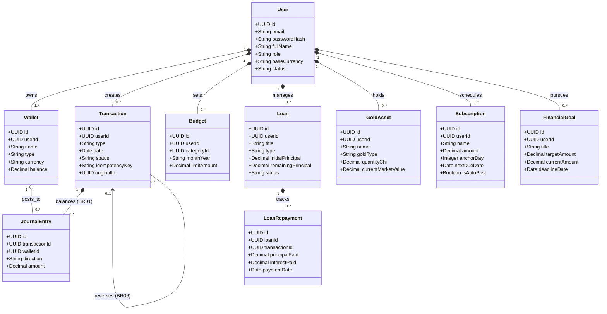

# Sơ đồ Lớp (Class Diagram) - WealthFlow

> Tham chiếu: [SRS.md](../SRS.md) v2.1 | [Sequence Diagrams](./sequence_diagram.md)

---

## 1. Sơ đồ Thực thể Nghiệp vụ (Domain Model)

Sơ đồ thể hiện các thực thể dữ liệu chính và mối quan hệ theo nguyên tắc kế toán kép và quản lý tài sản:

---

## 2. Sơ đồ Lớp Thiết kế Chi tiết (BCE Architecture)

Phân bổ trách nhiệm theo mô hình **Boundary - Control - Entity** qua 3 tầng:

---

## 3. Bảng Ánh xạ Nhanh (Traceability)

| Phân hệ | Boundary (Controller) | Control (Service) | Entity (Repository) | Use Case & Sequence |
| :--- | :--- | :--- | :--- | :---: |
| **Xác thực** | `AuthController` | `AuthService` | `UserRepository` | `UC01` (SQ01) |
| **Sổ cái & Ví** | `TransactionController`, `WalletController` | `LedgerService` | `LedgerRepository`, `WalletRepository` | `UC02, UC03` (SQ02, SQ03) |
| **Ngân sách** | `TransactionController` | `BudgetService` | `BudgetRepository` | `UC05` (SQ02) |
| **Định kỳ** | *(SYS Cron)* | `SubscriptionWorker` | `SubscriptionRepository` | `UC04` (SQ04) |
| **Vay nợ** | `LoanController` | `LoanService` | `LoanRepository` | `UC06, UC07` (SQ05) |
| **Tài sản & Net Worth** | `DashboardController`, `GoldController` | `AnalyticsService`, `GoldService` | `AssetRepository` | `UC08, UC10` (SQ06) |
| **Đối soát & CSV** | `ReportController` | `ReconciliationService`, `ExportService` | `LedgerRepository` | `UC11` (SQ07) |
| **Quản trị** | `AdminController` | `AdminService`, `NotificationService` | `AdminRepository` | `UC12, UC13` (SQ08) |
