# Sơ đồ Lớp (Class Diagram) - WealthFlow

> **Tham chiếu tài liệu:** [SRS.md](../SRS.md) v2.1 | [Sequence Diagrams](./sequence_diagram.md) | [Activity Diagrams](./activity_diagram.md)

---

## 1. Sơ đồ Thực thể Nghiệp vụ (Domain Model)

Sơ đồ Thực thể Miền (Domain Model) thể hiện bức tranh toàn cảnh về cấu trúc thực thể, quan hệ kết tập (Aggregation) và hợp thành (Composition) xuyên suốt toàn bộ hệ thống tài chính cá nhân **WealthFlow**:

#### Sơ đồ Thực thể Miền Trực quan (Vector SVG):

#### Danh mục Cụm Thực thể Nghiệp vụ Cốt lõi (Domain Aggregates & Entities):

1. **`User` (Aggregate Root)**: Chủ tài khoản trung tâm, nắm giữ quyền sở hữu toàn bộ các tài nguyên tài chính. Áp dụng quy tắc cô lập dữ liệu người dùng tuyệt đối ([BR11](../SRS.md#br11)).
2. **`Wallet` (Entity)**: Đại diện cho tài khoản tài sản (Tiền mặt, Ngân hàng, Ví MoMo/ZaloPay, Thẻ tín dụng). Quản lý số dư, chặn âm ví ([BR04](../SRS.md#br04)), và đóng băng ví đã phát sinh giao dịch ([BR02](../SRS.md#br02)).
3. **`FinancialTransaction` & `JournalEntry` (Aggregate Root)**: Trọng tâm kế toán kép ([BR01](../SRS.md#br01)), đảm bảo mọi phát sinh đều phân rã thành tối thiểu 2 dòng Nợ/Có cân bằng $\sum Debit = \sum Credit$. Đóng gói cơ chế bất biến và sinh bút toán đảo `REVERSED` ([BR06](../SRS.md#br06)).
4. **`Category` (Entity)**: Phân loại danh mục thu chi, hỗ trợ danh mục chuẩn hệ thống và danh mục tùy chỉnh của người dùng.
5. **`RecurringRule` (Entity)**: Cấu hình lịch định kỳ, tự động tính ngày neo cuối tháng thiếu ngày ([BR09](../SRS.md#br09)) và tích hợp khóa chống lặp `(subscriptionId, dueDate)` ([BR13](../SRS.md#br13)).
6. **`Budget` (Entity)**: Hạn mức chi tiêu tháng theo danh mục ([BR07](../SRS.md#br07)), tính tỷ lệ sử dụng trên chi tiêu ròng và phát cảnh báo tiệm cận 80% / vượt mức 100% ([BR08](../SRS.md#br08)).
7. **`Loan` & `RepaymentScheduleItem` (Aggregate Root)**: Quản lý nghĩa vụ nợ vi mô (Đi vay / Cho vay). Bóc tách thanh toán thành nợ gốc và lãi vay, cấm hạch toán vay vào thu nhập ([BR17](../SRS.md#br17)).
8. **`GoldHolding` & `GoldTransaction` (Aggregate Root)**: Tài sản vàng tích lũy ngoài ví. Quản lý khối lượng chỉ vàng, giá vốn bình quân gia quyền ([BR15](../SRS.md#br15)) và định giá lại thị trường (Mark-to-Market).
9. **`FinancialGoal` & `GoalAllocation` (Aggregate Root)**: Mục tiêu tích lũy logic ([BR10](../SRS.md#br10)), tích hợp cơ chế khóa quỹ Earmarking tại ví tài sản.
10. **`NetWorthSnapshot` (Entity)**: Bản ghi bất biến chụp ảnh tài sản ròng lúc 23:59:59 hàng ngày ([SYS03](../SRS.md#sys03)), phục vụ vẽ biểu đồ xu hướng tài sản ([BR16](../SRS.md#br16)).
11. **`Notification` (Entity)**: Trung tâm thông báo người dùng, tiếp nhận cảnh báo ngân sách, nhắc nợ và thông cáo diện rộng từ Quản trị viên ([BR18](../SRS.md#br18)).

---

## 2. Sơ đồ Lớp Thiết kế Chi tiết (Kiến trúc BCE + D)

Mô hình phân bổ trách nhiệm hướng đối tượng được thiết kế theo kiến trúc mở rộng **Boundary - Control - Entity - DataAccess (BCE + D)**:
- **Boundary (Tầng Biên / Giao diện)**: Tiếp nhận yêu cầu từ Actor (REST Controllers tiếp nhận HTTP requests, Schedulers/Workers tiếp nhận trigger nền).
- **Control (Tầng Điều khiển / Dịch vụ Nghiệp vụ)**: Thực thi logic tài chính, điều phối giao dịch nguyên tử ACID và kiểm soát các quy tắc nghiệp vụ ([BR01] - [BR18]).
- **Entity (Tầng Thực thể Miền)**: Gồm các Rich Domain Entities & Value Objects mang dữ liệu và hành vi nghiệp vụ nội tại (như `User`, `Wallet`, `FinancialTransaction`).
- **DataAccess (Tầng Truy cập CSDL / DAO)**: Chuyên trách bắn các câu lệnh truy vấn CSDL (SQL queries, khóa dòng bi quan `SELECT ... FOR UPDATE`, map dữ liệu quan hệ sang đối tượng), quy chuẩn theo mẫu thiết kế **Data Access Object (hậu tố `*DAO`)**.

### 2.0. Danh mục Sơ đồ Lớp Trực quan (Vector SVG Catalog)

Toàn bộ các sơ đồ lớp được kết xuất thành ảnh Vector SVG chất lượng cao lưu tại [./class_diagram/](./class_diagram/), mã nguồn Mermaid độc lập tại [./class_diagram/sources/](./class_diagram/sources/), nền trắng tương phản cao, hiển thị tức thì và bảo đảm 100% không bị quá tải hay sụp đổ Markdown Renderer:

| Mã Phân hệ | Tên Phân hệ Nghiệp vụ (BCE + D Context) | Use Cases bao phủ | Các Lớp Trọng tâm | Ảnh Vector Trực quan |
| :---: | :--- | :---: | :--- | :---: |
| **CD00** | Sơ đồ Thực thể Nghiệp vụ Tổng thể (Domain Model) | Toàn hệ thống | `User`, `Wallet`, `FinancialTransaction`, `Loan`, `GoldHolding`, `FinancialGoal` | [cd00_domain_model.svg](./class_diagram/cd00_domain_model.svg) |
| **CD01** | Phân hệ 1: Định danh, Xác thực & Quản trị Tài khoản | [UC01](../SRS.md#uc01), [UC12](../SRS.md#uc12) | `AuthController`, `AuthService`, `User`, `UserDAO` | [cd01_identity_access.svg](./class_diagram/cd01_identity_access.svg) |
| **CD02** | Phân hệ 2: Quản lý Ví tài sản & Số dư Mở sổ | [UC02](../SRS.md#uc02) | `WalletController`, `WalletService`, `Wallet`, `WalletDAO` | [cd02_wallet_management.svg](./class_diagram/cd02_wallet_management.svg) |
| **CD03** | Phân hệ 3: Ghi nhận Giao dịch Thu chi & Sổ cái Kế toán kép | [UC03](../SRS.md#uc03) | `TransactionController`, `LedgerService`, `FinancialTransaction`, `LedgerDAO` | [cd03_double_entry_ledger.svg](./class_diagram/cd03_double_entry_ledger.svg) |
| **CD04** | Phân hệ 4: Báo cáo Đối soát Sổ cái & Xuất CSV An toàn | [UC11](../SRS.md#uc11) | `ReportController`, `ReconciliationService`, `AuditLogDAO`, `TrialBalanceReport` | [cd04_reconciliation_csv.svg](./class_diagram/cd04_reconciliation_csv.svg) |
| **CD05** | Phân hệ 5: Quản lý Giao dịch Định kỳ Tự động | [UC04](../SRS.md#uc04), [SYS02](../SRS.md#sys02) | `RecurringTransactionController`, `RecurringExecutionWorker`, `RecurringRule`, `RecurringRuleDAO` | [cd05_recurring_transaction.svg](./class_diagram/cd05_recurring_transaction.svg) |
| **CD06** | Phân hệ 6: Thiết lập & Kiểm soát Ngân sách Chi tiêu | [UC05](../SRS.md#uc05), [SYS03](../SRS.md#sys03) | `BudgetController`, `BudgetService`, `Budget`, `BudgetDAO` | [cd06_budget_planning.svg](./class_diagram/cd06_budget_planning.svg) |
| **CD07** | Phân hệ 7: Quản lý Khoản vay Vi mô & Phân bổ Gốc/Lãi | [UC06](../SRS.md#uc06), [UC07](../SRS.md#uc07) | `LoanController`, `LoanService`, `Loan`, `LoanDAO` | [cd07_microfinance_loans.svg](./class_diagram/cd07_microfinance_loans.svg) |
| **CD08** | Phân hệ 8: Tích lũy Tài sản Vàng & Định giá Thị trường | [UC08](../SRS.md#uc08) | `GoldController`, `GoldAssetService`, `GoldHolding`, `GoldHoldingDAO` | [cd08_gold_asset_market.svg](./class_diagram/cd08_gold_asset_market.svg) |
| **CD09** | Phân hệ 9: Mục tiêu Tiết kiệm & Khóa tiền Earmarking | [UC09](../SRS.md#uc09) | `GoalController`, `GoalSavingService`, `FinancialGoal`, `FinancialGoalDAO` | [cd09_goal_saving_earmark.svg](./class_diagram/cd09_goal_saving_earmark.svg) |
| **CD10** | Phân hệ 10: Dashboard Sức khỏe Net Worth & Snapshot Nền | [UC10](../SRS.md#uc10), [SYS03](../SRS.md#sys03) | `AnalyticsDashboardController`, `NetWorthAnalyticsService`, `NetWorthSnapshot`, `NetWorthSnapshotDAO` | [cd10_networth_analytics.svg](./class_diagram/cd10_networth_analytics.svg) |
| **CD11** | Phân hệ 11: Quản trị & Broadcast Thông báo | [UC13](../SRS.md#uc13), [SYS01](../SRS.md#sys01) | `NotificationController`, `AdminBroadcastService`, `Notification`, `NotificationDAO` | [cd11_notification_broadcast.svg](./class_diagram/cd11_notification_broadcast.svg) |

---

### 2.1. Phân hệ 1: Định danh, Xác thực & Quản trị Tài khoản (Identity, Authentication & User Management Context)

> **Tham chiếu nghiệp vụ:** [FR01](../SRS.md#fr01), [FR13](../SRS.md#fr13), [FR15](../SRS.md#fr15)  
> **Use Cases:** [UC01](../SRS.md#uc01) (Đăng ký, Đăng nhập, Quên mật khẩu OTP), [UC12](../SRS.md#uc12) (Quản trị tài khoản & Khóa người dùng)  
> **Sequence Diagrams:** [SQ01](./sequence_diagram/sq01_auth_jwt.md), [SQ08](./sequence_diagram/sq08_admin_user_broadcast.md)  
> **Quy tắc cốt lõi:** [BR11](../SRS.md#br11) (Quyền riêng tư Admin & Cô lập dữ liệu cá nhân)

#### Sơ đồ Lớp Trực quan (Vector SVG):

#### Thuyết minh Chi tiết Trách nhiệm & Phương thức Nghiệp vụ (Class Responsibilities):

1. **Tầng Boundary (Biên tiếp nhận):**
   - **`AuthController`**: Tiếp nhận và điều hướng toàn bộ các yêu cầu phi trạng thái (stateless) từ Khách vãng lai (`GuestActor`) và Người dùng (`EndUserActor`): đăng ký tài khoản mới (`register`), xác thực đăng nhập cấp phát cặp JWT Token (`login`), làm mới Token (`refreshToken`), gửi yêu cầu quên mật khẩu OTP (`requestPasswordReset`) và xác thực OTP đặt lại mật khẩu (`verifyOtpAndResetPassword`).
   - **`UserController`**: Tiếp nhận các yêu cầu quản lý hồ sơ cá nhân của Người dùng sau khi đã xác thực token JWT hợp lệ: xem thông tin cá nhân (`getProfile`), đổi họ tên/tiền tệ cơ sở (`updateProfile`), đổi mật khẩu (`changePassword`).
   - **`AdminController`**: Cung cấp giao diện API quản trị cho Quản trị viên (`AdminActor`): tra cứu danh sách người dùng (`getUsers`), thực thi khóa tài khoản khẩn cấp kèm lý do (`lockUser`), mở khóa (`unlockUser`), truy vết nhật ký kiểm toán hệ thống (`getAuditLogs`).

2. **Tầng Control (Điều khiển & Xử lý nghiệp vụ):**
   - **`AuthService`**: Trung tâm xử lý an ninh và định danh. 
     - Áp dụng thuật toán **Argon2id** với tham số an toàn để băm mật khẩu người dùng trước khi lưu trữ (`FR01`).
     - Sinh mã OTP 6 chữ số ngẫu nhiên an toàn (CSPRNG), băm một chiều lưu vào `PasswordResetToken` với thời hạn hiệu lực chính xác 10 phút. Kiểm soát biến `attempts`, nếu nhập sai quá 5 lần thì hủy mã OTP để triệt tiêu tấn công Brute-force.
     - Sinh cặp JWT Token: Access Token (thời hạn 15 phút, chứa claims định danh `userId`, `role`) và Refresh Token (thời hạn 7 ngày, lưu trữ trong Cookie an toàn `HttpOnly; Secure; SameSite=Strict`).
   - **`UserService`**: Quản lý thông tin hồ sơ và đồng tiền cơ sở (`baseCurrency`). Kiểm tra mật khẩu cũ trước khi cho phép cập nhật mật khẩu mới.
   - **`AdminService`**: Thực thi quy trình quản trị người dùng theo chuẩn an ninh:
     - Khi thực thi khóa tài khoản (`lockUserAccount`), phương thức vừa cập nhật `status = LOCKED` trong CSDL, vừa gọi sang `AuthService.revokeUserTokens(userId)` để thu hồi ngay lập tức mọi phiên làm việc JWT đang hoạt động của người dùng bị khóa ([FR13](../SRS.md#fr13)).
     - Tự động ghi nhận một bản ghi kiểm toán bất biến vào `AdminAuditLog` gồm `adminId`, `targetUserId`, `action = 'LOCK_USER'`, `reason` và thời điểm xảy ra.
     - **Ràng buộc cách ly tuyệt đối ([BR11](../SRS.md#br11)):** `AdminService` hoàn toàn không có bất kỳ kết nối hay tham chiếu nào đến các Service tài chính cá nhân (`WalletService`, `LedgerService`), bảo đảm Quản trị viên tuyệt đối không thể đọc hay can thiệp vào số dư và giao dịch cá nhân của người dùng.

3. **Tầng Entity (Thực thể Miền & Giá trị):**
   - **`User` (Rich Domain Entity)**: Thực thể trung tâm đại diện cho chủ sở hữu tài khoản. Chứa các phương thức tự thẩm định như `validatePassword()`, `lock()`, `unlock()`, `isActive()`.
   - **`PasswordResetToken`**: Thực thể chứa mã OTP đã băm, thời hạn `expiresAt`, biến đếm `attempts`, kèm phương thức tự kiểm tra `verifyOtp()`, `isExpired()`, `isExceededAttempts()`.
   - **`AdminAuditLog`**: Thực thể lưu trữ bất biến phục vụ truy vết pháp lý và giám sát an ninh hệ thống.

4. **Tầng DataAccess (Truy cập CSDL - DAOs):**
   - **`UserDAO`**: Thực thi câu lệnh SQL truy vấn/lưu bảng `users` (`findById`, `findByEmail`, `existsByEmail`, `save`, `updateStatus`, `findUsers`).
   - **`PasswordResetDAO`**: Thao tác bảng `password_reset_tokens` (`findByUserId`, `save`, `deleteByUserId`).
   - **`AuditLogDAO`**: Thao tác ghi và đọc bảng nhật ký kiểm toán quản trị `admin_audit_logs`.

### 2.2. Phân hệ 2: Quản lý Ví tài sản & Số dư Mở sổ (Wallet Management Context - UC02)

> **Tham chiếu nghiệp vụ:** [FR02](../SRS.md#fr02), [FR04](../SRS.md#fr04), [FR15](../SRS.md#fr15)  
> **Use Case:** [UC02](../SRS.md#uc02) (Quản lý ví tài sản & số dư mở sổ)  
> **Sequence Diagram:** [SQ02](./sequence_diagram/sq02_expense_budget.md#1-thông-tin-chung-summary), [SQ03](./sequence_diagram/sq03_transfer_reversal.md#1-thông-tin-chung-summary)  
> **Quy tắc cốt lõi:** [BR01](../SRS.md#br01) (Bút toán mở sổ Vốn chủ sở hữu), [BR02](../SRS.md#br02) (Cấm xóa cứng ví đã có giao dịch), [BR04](../SRS.md#br04) (Chặn âm ví, trừ thẻ tín dụng)

#### Sơ đồ Lớp Trực quan (Vector SVG):

> 🔗 **Liên kết ánh xạ liên phân hệ:** Cổng `ILedgerEquityPort` được hiện thực hóa bởi `LedgerService` tại [Phân hệ 3 (Sổ cái Kế toán kép)](#23-phân-hệ-3-ghi-nhận-giao-dịch-thu-chi--sổ-cái-kế-toán-kép-double-entry-ledger-context---uc03) nhằm hạch toán đối ứng số dư đầu kỳ vào tài khoản Vốn chủ sở hữu (`Equity`).

#### Thuyết minh Trách nhiệm & Phương thức Nghiệp vụ (Class Responsibilities - UC02):

1. **`WalletController` (Boundary):** Tiếp nhận yêu cầu mở ví, xem danh sách ví, đóng ví (`archiveWallet`) và điều chỉnh số dư đối soát (`adjustBalance`).
2. **`WalletService` (Control):**
   - **Mở ví kèm số dư ban đầu ([BR01](../SRS.md#br01), [BR02](../SRS.md#br02)):** Khi tạo ví có `openingBalance > 0`, service gọi qua cổng `ILedgerEquityPort` sang phân hệ Sổ cái để sinh một bút toán kế toán kép cân bằng đối ứng: Ghi Nợ (Debit) Ví tài sản và Ghi Có (Credit) Vốn chủ sở hữu (`Equity`).
   - **Bảo toàn lịch sử ví, cấm xóa cứng ([BR02](../SRS.md#br02)):** Khi người dùng muốn xóa ví, `WalletService` gọi `WalletDAO.hasTransactions()`. Nếu ví đã từng phát sinh giao dịch trong lịch sử sổ cái, hệ thống từ chối xóa cứng (`Hard Delete`) mà chuyển trạng thái sang `ARCHIVED` (đóng ví) để bảo toàn khả năng kiểm toán.
   - **Thẩm định chặn âm ví ([BR04](../SRS.md#br04)):** Phương thức `validateWalletAvailable()` chặn các giao dịch chi vượt số dư đối với tiền mặt, ngân hàng, ví điện tử; chỉ riêng ví Thẻ tín dụng (`CREDIT`) mới được phép mang số dư âm trong hạn mức thấu chi.
3. **`Wallet` (Rich Domain Entity):** Tự đóng gói logic biến động số dư qua `deposit()`, `withdraw()`, tự kiểm tra khả năng chi trả qua `canWithdraw()` và chuyển trạng thái qua `archive()`.
4. **`WalletDAO` (DataAccess):** Thao tác bảng `wallets`, hỗ trợ phương thức `findWithLock(id)` áp dụng khóa mức dòng (`SELECT ... FOR UPDATE`) để ngăn ngừa Race Condition khi phát sinh giao dịch đồng thời ([BR13](../SRS.md#br13)).

---

### 2.3. Phân hệ 3: Ghi nhận Giao dịch Thu chi & Sổ cái Kế toán kép (Double-Entry Ledger Context - UC03)

> **Tham chiếu nghiệp vụ:** [FR03](../SRS.md#fr03), [FR04](../SRS.md#fr04), [FR15](../SRS.md#fr15)  
> **Use Case:** [UC03](../SRS.md#uc03) (Ghi nhận giao dịch tài chính thu chi & chuyển tiền)  
> **Sequence Diagrams:** [SQ02](./sequence_diagram/sq02_expense_budget.md), [SQ03](./sequence_diagram/sq03_transfer_reversal.md)  
> **Quy tắc cốt lõi:** [BR01](../SRS.md#br01) (Cân bằng Nợ/Có kép), [BR06](../SRS.md#br06) (Bút toán đảo `REVERSED`), [BR12](../SRS.md#br12) (ACID nguyên tử), [BR13](../SRS.md#br13) (Idempotency chống trùng), [BR15](../SRS.md#br15) (Tỷ giá snapshot & Bình quân gia quyền)

#### Sơ đồ Lớp Trực quan (Vector SVG):

> 🔗 **Liên kết ánh xạ liên phân hệ:**
> - Cổng `IWalletLockPort` được liên kết trực tiếp với `WalletDAO` tại [Phân hệ 2 (Quản lý Ví)](#22-phân-hệ-2-quản-lý-ví-tài-sản--số-dư-mở-sổ-wallet-management-context---uc02), đồng thời trường `walletId` của `JournalEntry` tham chiếu đến thực thể `Wallet`.
> - Cổng `IExchangeRatePort` cung cấp tỷ giá hối đoái snapshot và tính bình quân gia quyền ([BR15](../SRS.md#br15)).

#### Thuyết minh Trách nhiệm & Phương thức Nghiệp vụ (Class Responsibilities - UC03):

1. **`TransactionController` (Boundary):** Cổng tiếp nhận toàn bộ các giao dịch tài chính thu chi, chuyển tiền liên ví và yêu cầu đảo giao dịch. Bắt buộc nhận `Idempotency-Key` từ HTTP header để chống gửi trùng lặp ([BR13](../SRS.md#br13)).
2. **`LedgerService` (Control - Trọng tâm Kế toán kép & ACID):**
   - **Nguyên tắc kế toán kép bất biến ([BR01](../SRS.md#br01)):** Mọi phát sinh thu, chi, chuyển tiền đều được phân rã thành tối thiểu 2 dòng `JournalEntry` (Nợ / Có). Phương thức `validateDoubleEntry()` bảo đảm $\sum Debit = \sum Credit$; nếu phát hiện mất cân bằng dù chỉ 1 đồng, toàn bộ thao tác bị hủy bỏ và Rollback tức thì.
   - **Giao dịch nguyên tử ACID & Khóa dòng ([BR12](../SRS.md#br12), [BR13](../SRS.md#br13)):** Tương tác với ví thông qua cổng `IWalletLockPort` với lệnh khóa mức dòng (`SELECT ... FOR UPDATE`), đồng thời lưu vết vào `IdempotencyDAO` để loại bỏ triệt để xung đột Race Condition khi người dùng bấm đúp.
   - **Cơ chế đảo giao dịch an toàn ([BR06](../SRS.md#br06)):** Giao dịch đã ở trạng thái `POSTED` tuyệt đối không được sửa hay xóa; phương thức `reversePostedTransaction()` tạo ra một giao dịch mới mang trạng thái `REVERSED` với các dòng Nợ/Có đối ứng ngược lại hoàn toàn, tự trỏ đến `originalTransactionId`.
3. **`IExchangeRatePort` (Control / Port):** Cung cấp giao diện tỷ giá đa tiền tệ ([BR15](../SRS.md#br15)). Ghi nhận snapshot tỷ giá tại thời điểm phát sinh giao dịch và áp dụng phương pháp bình quân gia quyền khi xuất ngoại tệ khỏi ví.
4. **`FinancialTransaction` & `JournalEntry` (Rich Entities / Aggregate Root):** Đóng gói toàn bộ các dòng sổ cái cấu thành. Tự kiểm tra cân bằng Nợ/Có qua `validateBalance()` và tự sinh bút toán đảo đối ứng qua `createReversal()`.
5. **Tầng DataAccess (Truy cập CSDL - DAOs):**
   - **`LedgerDAO`**: Quản lý lưu trữ nguyên tử các bảng `financial_transactions` và `journal_entries` theo chuẩn ACID ([BR12](../SRS.md#br12)).
   - **`CategoryDAO`**: Thao tác bảng `categories` (truy vấn danh mục theo người dùng, kiểm tra trạng thái hoạt động).
   - **`IdempotencyDAO`**: Thao tác bảng `idempotency_records` để kiểm tra và lưu vết khóa trùng lặp ([BR13](../SRS.md#br13)).

---

### 2.4. Phân hệ 4: Báo cáo Đối soát Sổ cái & Xuất CSV An toàn (Ledger Reconciliation & Secure CSV Export Context - UC11)

> **Tham chiếu nghiệp vụ:** [FR11](../SRS.md#fr11), [FR12](../SRS.md#fr12), [FR15](../SRS.md#fr15)  
> **Use Case:** [UC11](../SRS.md#uc11) (Báo cáo đối soát sổ cái & Xuất dữ liệu CSV)  
> **Sequence Diagram:** [SQ07](./sequence_diagram/sq07_reconciliation_csv.md)  
> **Quy tắc cốt lõi:** [BR01](../SRS.md#br01) (Cân bằng Bảng cân đối thử Trial Balance), [BR14](../SRS.md#br14) (Tách biệt trạng thái giao dịch: chỉ đối soát giao dịch `POSTED`), [BR16](../SRS.md#br16) (Khử độc CSV Formula Injection & UTF-8 BOM)

#### Sơ đồ Lớp Trực quan (Vector SVG):

> 🔗 **Liên kết ánh xạ liên phân hệ:** Cổng truy vấn `ILedgerQueryPort` được hiện thực hóa trực tiếp bởi `LedgerDAO` tại [Phân hệ 3 (Sổ cái Kế toán kép)](#23-phân-hệ-3-ghi-nhận-giao-dịch-thu-chi--sổ-cái-kế-toán-kép-double-entry-ledger-context---uc03).

#### Thuyết minh Trách nhiệm & Phương thức Nghiệp vụ (Class Responsibilities - UC11):

1. **`ReportController` (Boundary):** Tiếp nhận yêu cầu kiểm toán đối soát sổ sách và yêu cầu xuất báo cáo tài chính ra file CSV an toàn.
2. **`ReconciliationService` (Control - Đối soát Bảng cân đối thử):**
   - **Kiểm soát tính cân bằng toàn vẹn ([BR01](../SRS.md#br01), [NFR03.01](../SRS.md#nfr0301)):** Tổng hợp số dư của toàn bộ 5 loại tài khoản (Tài sản, Nợ phải trả, Vốn chủ sở hữu, Doanh thu, Chi phí) tại ngày chốt sổ `asOfDate`.
   - **Tách biệt trạng thái giao dịch ([BR14](../SRS.md#br14)):** Báo cáo chỉ tổng hợp các giao dịch đã ghi sổ (`POSTED`) và các dòng đảo đối ứng (`REVERSED`), hoàn toàn loại trừ các giao dịch nháp (`DRAFT`). Phương thức `checkEquilibrium()` xác nhận $\sum Debit = \sum Credit$ đạt tỷ lệ chính xác tuyệt đối 100.000%.
3. **`ExportService` (Control - Xuất CSV Bảo mật):**
   - **Khử độc CSV Formula Injection ([BR16](../SRS.md#br16)):** Tự động duyệt qua từng ô dữ liệu chuỗi (mô tả, tên danh mục, tên ví). Nếu phát hiện ký tự bắt đầu là `=, +, -, @, \t, \r`, phương thức `sanitizeCsvField()` tự động chèn thêm ký tự nháy đơn `'` ở đầu để ngăn chặn triệt để mã độc thực thi khi mở file trên Microsoft Excel hoặc LibreOffice.
   - **Chuẩn hóa hiển thị tiếng Việt:** Tự động chèn 3 bytes BOM UTF-8 (`\xEF\xBB\xBF`) vào đầu tệp CSV để phần mềm bảng tính mở trực tiếp không bị lỗi font tiếng Việt.
4. **`TrialBalanceReport`, `AccountTrialBalanceRow`, `ExportTransactionRow` (Value Objects):** Các đối tượng giá trị mang kết quả kiểm toán và dòng xuất báo cáo, không có định danh độc lập, bảo đảm tính bất biến.
5. **`AuditLogDAO` (DataAccess):** Thao tác ghi vết nhật ký xuất báo cáo vào bảng `export_audit_logs` (`saveExportAudit`) gồm mã người dùng, số lượng dòng, hash file SHA-256 và IP client để truy vết an ninh dữ liệu ([BR16](../SRS.md#br16)).

---

### 2.5. Phân hệ 5: Quản lý Giao dịch Định kỳ Tự động (Recurring Transaction Context - UC04, SYS02)

> **Tham chiếu nghiệp vụ:** [FR06](../SRS.md#fr06), [FR15](../SRS.md#fr15)  
> **Use Case:** [UC04](../SRS.md#uc04) (Thiết lập & Xử lý giao dịch định kỳ), [SYS02](../SRS.md#sys02) (Tiến trình quét subscription nền 00:05 hàng ngày)  
> **Sequence Diagram:** [SQ04](./sequence_diagram/sq04_subscription_cron.md)  
> **Quy tắc cốt lõi:** [BR09](../SRS.md#br09) (Quy tắc ngày neo cuối tháng thiếu ngày), [BR12](../SRS.md#br12) (ACID nguyên tử), [BR13](../SRS.md#br13) (Khóa chống lặp `subscriptionId, dueDate`)

#### Sơ đồ Lớp Trực quan (Vector SVG):

> 🔗 **Liên kết ánh xạ liên phân hệ:**
> - Cổng `ILedgerPostPort` gọi sang [Phân hệ 3 (Sổ cái Kế toán kép)](#23-phân-hệ-3-ghi-nhận-giao-dịch-thu-chi--sổ-cái-kế-toán-kép-double-entry-ledger-context---uc03) để tự động sinh giao dịch chi tiêu kế toán kép ở trạng thái `POSTED` (nếu đủ tiền và bật Auto-Post) hoặc tạo bản nháp `DRAFT`.
> - Cổng `IWalletQueryPort` liên kết với [Phân hệ 2 (Quản lý Ví)](#22-phân-hệ-2-quản-lý-ví-tài-sản--số-dư-mở-sổ-wallet-management-context---uc02) để kiểm tra số dư ví và thẩm định tính khả dụng khi đổi ví ([AF04.03](../SRS.md#af0403)).
> - Cổng `INotificationPort` gọi sang phân hệ Thông báo ([SYS01](../SRS.md#sys01), [UC13](../SRS.md#uc13)) để đẩy thông báo thành công hoặc cảnh báo ví thiếu tiền đến người dùng.

#### Thuyết minh Trách nhiệm & Phương thức Nghiệp vụ (Class Responsibilities - UC04, SYS02):

1. **Tầng Boundary (Biên tiếp nhận & Khởi chạy Tác vụ):**
   - **`RecurringTransactionController`**: Cung cấp giao diện RESTful API cho Người dùng (`EndUserActor`): tạo quy tắc định kỳ (`createRecurring`), xem danh sách theo trạng thái (`getRecurringList`), tạm dừng (`pauseRecurring`), tái kích hoạt (`resumeRecurring`), hủy lịch (`cancelRecurring`) và chuyển đổi ví thanh toán liên kết (`changeWallet` theo [AF04.03](../SRS.md#af0403)).
   - **`RecurringSchedulerJob`**: Điểm tiếp nhận kích hoạt từ bộ lập lịch hệ thống (`SchedulerActor` - tiến trình `SYS02` chạy định kỳ lúc 00:05 hàng ngày). Đóng vai trò cầu nối kích hoạt tác vụ xử lý hàng loạt của `RecurringExecutionWorker`.

2. **Tầng Control (Dịch vụ Điều khiển & Tiến trình Xử lý Nền):**
   - **`RecurringTransactionService`**: Xử lý các nghiệp vụ tương tác trực tiếp của người dùng. Thẩm định số tiền $> 0$, kiểm tra ví thanh toán hợp lệ và tính toán ngày đến hạn đầu tiên (`calculateInitialDueDate`) theo ngày bắt đầu và chu kỳ lặp.
   - **`RecurringExecutionWorker` (Trọng tâm Cron Batch Engine):**
     - **Quét các khoản đến hạn:** Truy vấn toàn bộ các quy tắc định kỳ đang ở trạng thái `ACTIVE` có `nextDueDate <= currentDate`.
     - **Chống xử lý trùng lặp ([BR13](../SRS.md#br13)):** Tự động sinh khóa định danh duy nhất theo cặp `Idempotency-Key = (recurringRuleId, dueDate)` để bảo đảm mỗi kỳ định kỳ chỉ sinh đúng 1 giao dịch duy nhất.
     - **Kiểm soát thanh toán & Rẽ nhánh thông minh ([BR09](../SRS.md#br09)):**
       - Nếu `isAutoPost == true`: Kiểm tra số dư ví qua `IWalletQueryPort`. Nếu đủ tiền $\rightarrow$ gọi `ILedgerPostPort.postRecurringExpense()` để ghi nhận giao dịch `POSTED` và trừ số dư ví, đồng thời đẩy thông báo thành công. Nếu thiếu tiền $\rightarrow$ tạo giao dịch nháp `DRAFT` và đẩy cảnh báo khẩn cấp ([EF04.02](../SRS.md#ef0402)).
       - Nếu `isAutoPost == false`: Tự động tạo giao dịch nháp `DRAFT` và gửi thông báo nhắc nhở duyệt chi trả ([AF04.01](../SRS.md#af0401)).
     - **Thuật toán Ngày neo Tháng thiếu ngày ([BR09](../SRS.md#br09), [TC-F06.01-P](../SRS.md#tc-f06)):** Gọi phương thức `calculateNextDueDate()`: nếu ngày neo là 29, 30, hoặc 31 nhưng tháng kế tiếp không đủ ngày (ví dụ tháng 2 chỉ có 28 ngày), hệ thống tự động lùi ngày đến hạn về ngày cuối tháng (28/02), đồng thời **bảo lưu nguyên vẹn ngày neo gốc** (anchorDay = 31) cho các tháng tiếp theo.

3. **Tầng Entity (Thực thể Miền):**
   - **`RecurringRule` (Rich Domain Entity / Aggregate Root):** Đóng gói trọn vẹn thông tin lịch định kỳ: chu kỳ (`RecurrenceFrequency`), ngày neo (`anchorDay`), trạng thái (`RecurringStatus`), cờ `isAutoPost`. Chứa các phương thức tự thay đổi trạng thái `pause()`, `resume()`, `cancel()`, `changeWallet()` và tự tính toán ngày đến hạn tiếp theo.
   - **`RecurringExecutionLog`**: Thực thể lưu trữ vết thực thi lịch sử của từng kỳ chạy (ngày dự kiến, thời điểm thực tế, mã giao dịch sinh ra, trạng thái `ExecutionStatus`, thông báo lỗi nếu có).

4. **Tầng DataAccess (Truy cập CSDL - DAOs):**
   - **`RecurringRuleDAO`**: Quản lý truy vấn và lưu trữ bảng cấu hình giao dịch định kỳ (tìm các quy tắc đến hạn `findDueRules`, cập nhật lịch trình `updateExecutionSchedule`).
   - **`RecurringExecutionLogDAO`**: Lưu trữ vết thực thi lịch sử của từng kỳ chạy vào bảng nhật ký thực thi.

---

### 2.6. Phân hệ 6: Thiết lập & Kiểm soát Ngân sách Chi tiêu (Budget Planning Context - UC05, SYS03)

> **Tham chiếu nghiệp vụ:** [FR05](../SRS.md#fr05), [FR15](../SRS.md#fr15)  
> **Use Case:** [UC05](../SRS.md#uc05) (Thiết lập & Kiểm soát ngân sách chi tiêu), [SYS03](../SRS.md#sys03) (Kiểm tra cảnh báo ngân sách theo sự kiện giao dịch)  
> **Sequence Diagram:** [SQ02](./sequence_diagram/sq02_expense_budget.md)  
> **Quy tắc cốt lõi:** [BR07](../SRS.md#br07) (Hạn mức ngân sách tháng & Chi tiêu ròng), [BR08](../SRS.md#br08) (Ngưỡng cảnh báo Vàng 80% / Đỏ 100% & Chống trùng lặp), [BR14](../SRS.md#br14) (Loại trừ giao dịch nháp DRAFT)

#### Sơ đồ Lớp Trực quan (Vector SVG):

> 🔗 **Liên kết ánh xạ liên phân hệ:**
> - Cổng `IBudgetLedgerPort` liên kết trực tiếp với [Phân hệ 3 (Sổ cái Kế toán kép)](#23-phân-hệ-3-ghi-nhận-giao-dịch-thu-chi--sổ-cái-kế-toán-kép-double-entry-ledger-context---uc03) để truy vấn tổng chi tiêu ròng của danh mục trong tháng ($\text{NetExpense} = \text{Expense} - \text{Reversals}$).
> - Cổng `IBudgetNotificationPort` liên kết với [Phân hệ 11 (Quản trị & Broadcast Thông báo)](#211-phân-hệ-11-quản-trị--broadcast-thông-báo-notification-broadcast-context---uc13-sys01) để tự động sinh thông báo cảnh báo mức Vàng (80%) và mức Đỏ (100%).

#### Thuyết minh Trách nhiệm & Phương thức Nghiệp vụ (Class Responsibilities - UC05, SYS03):

1. **Tầng Boundary (Biên tiếp nhận & Khởi chạy Tác vụ):**
   - **`BudgetController`**: Cung cấp các điểm cuối RESTful API cho Người dùng (`EndUserActor`): thiết lập hạn mức ngân sách mới (`createBudget`), xem danh sách ngân sách kèm tỷ lệ sử dụng tháng (`getBudgets`), xem chi tiết (`getBudgetDetail`), điều chỉnh hạn mức (`updateBudget`), xóa ngân sách (`deleteBudget`) và xem báo cáo tổng hợp tỷ lệ chi tiêu (`getBudgetSummary`).
   - **`BudgetCheckSchedulerJob`**: Tác vụ nền quét định kỳ kiểm tra các danh mục tiệm cận hạn mức ([SYS03](../SRS.md#sys03)), hỗ trợ cơ chế quét lại đầu tháng mới.

2. **Tầng Control (Dịch vụ Điều khiển Nghiệp vụ & Cổng Tương tác):**
   - **`BudgetService`**: Trung tâm kiểm soát trần chi tiêu của người dùng:
     - **Thẩm định hạn mức ([BR07](../SRS.md#br07)):** Đảm bảo `limitAmount > 0`, mỗi danh mục chỉ có duy nhất 1 ngân sách hoạt động trong 1 tháng xác định.
     - **Tính toán chi tiêu ròng ([BR07](../SRS.md#br07), [BR14](../SRS.md#br14)):** Gọi `IBudgetLedgerPort.getMonthlyCategoryNetExpense()` để lấy chính xác tổng phát sinh Nợ tài khoản chi phí trừ đi các dòng bút toán đảo đối ứng `REVERSED`; hoàn toàn loại trừ các giao dịch nháp `DRAFT` và chuyển tiền nội bộ.
     - **Kiểm soát cảnh báo & Chống trùng lặp ([BR08](../SRS.md#br08)):** Tính toán tỷ lệ sử dụng $Usage = \frac{NetExpense}{LimitAmount} \times 100\%$. Nếu $80\% \le Usage < 100\%$ và `isYellowAlertSent == false`, phát cảnh báo Vàng và đánh dấu cờ; nếu $Usage \ge 100\%$ và `isRedAlertSent == false`, phát cảnh báo Đỏ và đồng thời đánh dấu cả cờ Vàng lẫn Đỏ để không phát lặp.
   - **`IBudgetLedgerPort` & `IBudgetNotificationPort` (Ports):** Tách rời phụ thuộc trực tiếp giữa phân hệ Ngân sách với Sổ cái và Trung tâm thông báo.

3. **Tầng Entity (Thực thể Miền & Giá trị):**
   - **`Budget` (Rich Domain Entity)**: Thực thể đại diện cho cam kết ngân sách danh mục. Tự tính toán tỷ lệ phần trăm qua `calculateUsage()`, cập nhật số tiền đã chi `updateSpent()`, đánh giá cấp độ cảnh báo qua `evaluateAlertLevel()` và quản lý cờ trạng thái phát cảnh báo.
   - **`BudgetUsageVO` (Value Object)**: Đối tượng giá trị bất biến đóng gói dữ liệu tiến độ ngân sách trả về giao diện người dùng.

4. **Tầng DataAccess (Truy cập CSDL - DAOs):**
   - **`BudgetDAO`**: Quản lý truy vấn và lưu trữ bảng `budgets` (`save`, `findById`, `findByCategoryAndMonth`, `findByUserAndMonth`, `updateSpentAndAlerts`, `deleteById`).

---

### 2.7. Phân hệ 7: Quản lý Khoản vay Vi mô & Phân bổ Gốc/Lãi (Microfinance Loans Context - UC06, UC07)

> **Tham chiếu nghiệp vụ:** [FR07](../SRS.md#fr07), [FR08](../SRS.md#fr08), [FR15](../SRS.md#fr15)  
> **Use Cases:** [UC06](../SRS.md#uc06) (Quản lý khoản vay và nghĩa vụ nợ vi mô), [UC07](../SRS.md#uc07) (Ghi nhận thanh toán trả nợ vay)  
> **Sequence Diagram:** [SQ05](./sequence_diagram/sq05_microfinance_loan.md)  
> **Quy tắc cốt lõi:** [BR17](../SRS.md#br17) (Nguyên tắc kế toán vi mô: phân rã gốc/lãi, cấm ghi nhận vay vào thu nhập), [BR04](../SRS.md#br04) (Chặn âm ví khi chi trả), [BR12](../SRS.md#br12) (ACID nguyên tử), [BR16](../SRS.md#br16) (Dư nợ gốc tính vào Tổng nợ Liabilities)

#### Sơ đồ Lớp Trực quan (Vector SVG):

> 🔗 **Liên kết ánh xạ liên phân hệ:**
> - Cổng `ILoanLedgerPort` gọi sang [Phân hệ 3 (Sổ cái Kế toán kép)](#23-phân-hệ-3-ghi-nhận-giao-dịch-thu-chi--sổ-cái-kế-toán-kép-double-entry-ledger-context---uc03) để tự động sinh bút toán kế toán kép giải ngân vay và thanh toán trả nợ.
> - Cổng `ILoanWalletPort` liên kết với [Phân hệ 2 (Quản lý Ví)](#22-phân-hệ-2-quản-lý-ví-tài-sản--số-dư-mở-sổ-wallet-management-context---uc02) để thẩm định số dư ví chi trả nợ và khóa mức dòng.
> - Cổng `ILoanNotificationPort` gọi sang [Phân hệ 11 (Thông báo)](#211-phân-hệ-11-quản-trị--broadcast-thông-báo-notification-broadcast-context---uc13-sys01) để gửi thông báo nhắc hạn trả nợ trong vòng 3 ngày ([SYS03](../SRS.md#sys03)).

#### Thuyết minh Trách nhiệm & Phương thức Nghiệp vụ (Class Responsibilities - UC06, UC07):

1. **Tầng Boundary (Biên tiếp nhận & Khởi chạy Tác vụ):**
   - **`LoanController`**: Tiếp nhận các yêu cầu khởi tạo hồ sơ vay nợ (`createLoan`), truy vấn danh sách theo phân loại Đi vay/Cho vay (`getLoans`), xem chi tiết hồ sơ nợ (`getLoanDetail`), xem bảng lịch trả góp (`getRepaymentSchedule`) và ghi nhận giao dịch trả nợ từng kỳ (`recordRepayment`).
   - **`LoanReminderSchedulerJob`**: Tiến trình nền chạy lúc 08:00 sáng hàng ngày ([SYS03](../SRS.md#sys03)) để quét toàn bộ các khoản vay đang `ACTIVE` có kỳ trả nợ đến hạn trong vòng 3 ngày tới và phát thông báo nhắc nhở kịp thời.

2. **Tầng Control (Dịch vụ Điều khiển Nghiệp vụ Tài chính Vi mô):**
   - **`LoanService`**: Trung tâm xử lý nghiệp vụ tín dụng vi mô:
     - **Khởi tạo khoản vay & Hạch toán giải ngân ([BR17](../SRS.md#br17)):** 
       - Khi tạo khoản Đi vay (`BORROWING`) có giải ngân vào ví, service gọi `ILoanLedgerPort.postLoanDisbursement()` sinh bút toán kép: Ghi Nợ Ví tài sản (tăng tiền) và Ghi Có Khoản nợ phải trả (`Liability`). **Tuyệt đối cấm ghi nhận số tiền vay nhận được vào Thu nhập (Income).**
       - Khi tạo khoản Cho vay (`LENDING`), hạch toán: Ghi Nợ Khoản phải thu (`Loan Receivable`) và Ghi Có Ví tài sản (giảm tiền ví).
     - **Thanh toán trả nợ & Bóc tách gốc/lãi ([BR17](../SRS.md#br17), [SQ05](./sequence_diagram/sq05_microfinance_loan.md)):**
       - Kiểm tra tính hợp lệ: `principalPaid <= remainingPrincipal`, số dư ví chi trả $\ge principalPaid + interestPaid$ ([BR04](../SRS.md#br04)).
       - Phân rã nguyên tử: Dòng trả gốc làm giảm nghĩa vụ Nợ phải trả (`DEBIT LIABILITY_LOAN`), dòng trả lãi và phí được hạch toán vào Chi phí tài chính (`DEBIT EXPENSE_FINANCIAL_INTEREST`), đối ứng giảm số dư ví chi trả (`CREDIT ASSET_WALLET`).
       - Tự động tất toán: Khi `remainingPrincipal` giảm về chính xác bằng `0`, service tự động chuyển trạng thái khoản nợ sang `PAID_OFF` (Đã tất toán).

3. **Tầng Entity (Thực thể Miền & Lịch Trả nợ):**
   - **`Loan` (Rich Domain Entity / Aggregate Root)**: Đại diện cho hợp đồng vay nợ vi mô. Chứa logic nghiệp vụ tự giảm trừ dư nợ qua `applyRepayment()`, tự kiểm tra trạng thái tất toán qua `isPaidOff()`, và tính toán số tiền trả góp hàng tháng `calculateMonthlyInstallment()`.
   - **`RepaymentScheduleItem` (Entity)**: Bản ghi từng kỳ trong kế hoạch trả nợ (gốc dự kiến, lãi dự kiến, số tiền thực trả, trạng thái kỳ `PENDING`, `PARTIAL`, `PAID`, `OVERDUE`).
   - **`RepaymentReceiptVO` (Value Object)**: Chứng từ biên lai xác nhận thanh toán kỳ trả góp.

4. **Tầng DataAccess (Truy cập CSDL - DAOs):**
   - **`LoanDAO`**: Quản lý bảng `loans`, hỗ trợ phương thức khóa mức dòng `findWithLock(id)` ngăn chặn thanh toán trả nợ đồng thời dẫn đến âm dư nợ.
   - **`RepaymentScheduleDAO`**: Quản lý bảng kế hoạch trả nợ `loan_repayment_schedules`.
   - **`LoanRepaymentLogDAO`**: Lưu trữ nhật ký các lần trả nợ thực tế để đối soát kiểm toán.

---

### 2.8. Phân hệ 8: Tích lũy Tài sản Vàng & Định giá Thị trường (Gold Asset Market Context - UC08)

> **Tham chiếu nghiệp vụ:** [FR09](../SRS.md#fr09), [FR15](../SRS.md#fr15)  
> **Use Case:** [UC08](../SRS.md#uc08) (Quản lý tài sản tích lũy ngoài ví - Vàng)  
> **Sequence Diagram:** [SQ06](./sequence_diagram/sq06_gold_networth.md)  
> **Quy tắc cốt lõi:** [BR01](../SRS.md#br01) (Hoán đổi cấu trúc tài sản Nợ Vàng / Có Tiền), [BR15](../SRS.md#br15) (Xuất kho theo Bình quân gia quyền), [BR16](../SRS.md#br16) (Định giá thị trường Mark-to-Market đưa vào Net Worth)

#### Sơ đồ Lớp Trực quan (Vector SVG):

> 🔗 **Liên kết ánh xạ liên phân hệ:**
> - Cổng `IGoldLedgerPort` gọi sang [Phân hệ 3 (Sổ cái Kế toán kép)](#23-phân-hệ-3-ghi-nhận-giao-dịch-thu-chi--sổ-cái-kế-toán-kép-double-entry-ledger-context---uc03) để hạch toán hoán đổi cấu trúc tài sản khi mua vàng và ghi nhận lãi/lỗ vốn khi bán vàng.
> - Cổng `IGoldPriceFeedPort` kết nối dịch vụ ngoài lấy dữ liệu thị giá vàng niêm yết (SJC, DOJI).

#### Thuyết minh Trách nhiệm & Phương thức Nghiệp vụ (Class Responsibilities - UC08):

1. **Tầng Boundary (Biên tiếp nhận & Khởi chạy Tác vụ):**
   - **`GoldController`**: Cung cấp giao diện API ghi nhận mua vàng tích lũy (`buyGold`), bán vàng thu tiền về ví (`sellGold`), cập nhật thị giá thị trường thủ công (`revalueGold`), truy vấn kho vàng cá nhân (`getGoldHoldings`) và xem báo cáo tổng hợp danh mục vàng (`getGoldValuationSummary`).
   - **`GoldPriceSyncSchedulerJob`**: Tác vụ nền tự động lấy tỷ giá/thị giá vàng định kỳ từ cổng `IGoldPriceFeedPort` để cập nhật vào bảng dữ liệu lịch sử giá.

2. **Tầng Control (Dịch vụ Điều khiển Nghiệp vụ Tài sản Vàng):**
   - **`GoldAssetService`**: Xử lý logic kế toán và định giá danh mục vàng:
     - **Mua vàng & Bình quân gia quyền ([BR01](../SRS.md#br01), [BR15](../SRS.md#br15)):** Khi người dùng mua vàng, service tính toán đơn giá mua bình quân gia quyền mới: $\text{NewAvgCost} = \frac{\text{OldTotalCost} + \text{BuyCost}}{\text{OldQuantity} + \text{BuyQuantity}}$, sau đó gọi `IGoldLedgerPort.postGoldPurchase()` để hạch toán kép: Ghi Nợ Tài sản Vàng (`ASSET_GOLD`) và Ghi Có Ví tiền trích mua (`ASSET_WALLET`). Nghiệp vụ này hoàn toàn không làm thay đổi Thu nhập hay Chi phí sinh hoạt.
     - **Bán vàng & Hiện thực hóa Lãi/Lỗ vốn ([BR15](../SRS.md#br15)):** Khi xuất bán, giá vốn xuất kho được giải phóng đúng bằng $\text{QuantitySold} \times \text{WeightedAvgCost}$. Chênh lệch giữa giá bán thực tế và giá vốn được hạch toán vào Doanh thu tài chính (nếu Lãi) hoặc Chi phí tài chính (nếu Lỗ).
     - **Định giá thị trường Mark-to-Market ([BR16](../SRS.md#br16)):** Cập nhật giá trị hiện thực của kho vàng dựa trên giá thị trường mới nhất để phục vụ tính toán chính xác Tài sản ròng (Net Worth).

3. **Tầng Entity (Thực thể Miền & Giao dịch Vàng):**
   - **`GoldHolding` (Rich Domain Entity / Aggregate Root)**: Đại diện cho kho tích lũy từng loại vàng (SJC 1 lượng, Nhẫn trơn 9999, Vàng 24K). Đóng gói logic tự tính toán giá vốn bình quân gia quyền `applyPurchase()`, tự trừ kho khi bán `applySale()`, và tính toán lãi/lỗ chưa thực hiện `getUnrealizedGainLoss()`.
   - **`GoldTransaction` (Entity)**: Bản ghi từng giao dịch mua, bán hoặc định giá lại gắn liền với kho vàng.
   - **`GoldPortfolioSummaryVO` & `GoldSaleReceiptVO` (Value Objects)**: Đối tượng giá trị phản hồi hiệu quả đầu tư danh mục vàng.

4. **Tầng DataAccess (Truy cập CSDL - DAOs):**
   - **`GoldHoldingDAO`**: Thao tác bảng `gold_holdings`.
   - **`GoldTransactionDAO`**: Thao tác bảng nhật ký mua bán `gold_transactions`.
   - **`GoldPriceDAO`**: Lưu trữ và truy vấn bảng lịch sử thị giá vàng `gold_price_history`.

---

### 2.9. Phân hệ 9: Mục tiêu Tiết kiệm & Khóa tiền Earmarking (Goal Saving Earmark Context - UC09)

> **Tham chiếu nghiệp vụ:** [FR10](../SRS.md#fr10), [FR15](../SRS.md#fr15)  
> **Use Case:** [UC09](../SRS.md#uc09) (Quản lý mục tiêu tích lũy tài chính)  
> **Sequence Diagram:** Tham chiếu luồng nghiệp vụ Earmarking trong [SQ02](./sequence_diagram/sq02_expense_budget.md)  
> **Quy tắc cốt lõi:** [BR10](../SRS.md#br10) (Mục tiêu tài chính là công cụ phân bổ logic, công thức tiến độ & tích lũy tháng), [BR04](../SRS.md#br04) (Số dư khả dụng trừ đi tiền khóa Earmark)

#### Sơ đồ Lớp Trực quan (Vector SVG):

> 🔗 **Liên kết ánh xạ liên phân hệ:** Cổng `IGoalWalletPort` liên kết trực tiếp với [Phân hệ 2 (Quản lý Ví)](#22-phân-hệ-2-quản-lý-ví-tài-sản--số-dư-mở-sổ-wallet-management-context---uc02) để thực thi khóa tiền logic (`earmarkBalance`) và giải phóng tiền (`releaseEarmark`), bảo đảm số dư khả dụng của ví luôn tuân thủ [BR04](../SRS.md#br04).

#### Thuyết minh Trách nhiệm & Phương thức Nghiệp vụ (Class Responsibilities - UC09):

1. **Tầng Boundary (Biên tiếp nhận):**
   - **`GoalController`**: Cung cấp các giao diện API quản lý mục tiêu tài chính: khởi tạo mục tiêu mới (`createGoal`), nạp tiền phân bổ tích lũy vào mục tiêu (`allocateFunds`), rút vốn tích lũy về ví (`withdrawFunds`), truy vấn danh sách theo tiến độ (`getGoals`) và xem chi tiết mục tiêu (`getGoalDetail`).

2. **Tầng Control (Dịch vụ Điều khiển Nghiệp vụ Mục tiêu Tích lũy):**
   - **`GoalSavingService`**:
     - **Bản chất logic phi tiền tệ ([BR10](../SRS.md#br10)):** Mục tiêu tài chính là công cụ theo dõi kế hoạch, không tự động sinh ra tiền và không làm tăng tổng tài sản của người dùng trên hệ thống.
     - **Cơ chế Khóa tiền Earmarking ([BR04](../SRS.md#br04), [BR10](../SRS.md#br10)):** Khi người dùng nạp tiền vào mục tiêu từ ví tài sản liên kết, service gọi `IGoalWalletPort.checkAvailableBalance()`. Nếu đủ tiền, hệ thống tăng số dư khóa `earmarkedAmount` tại ví, bảo đảm người dùng không thể chi tiêu vượt quá số dư khả dụng còn lại ($\text{Available} = \text{Balance} - \text{Earmarked}$).
     - **Tính toán tiến độ & Khuyến nghị tích lũy hàng tháng ([BR10](../SRS.md#br10)):**
       - Tiến độ: $Progress = \frac{CurrentAmount}{TargetAmount} \times 100\%$.
       - Mục tiêu tích lũy tháng: $\text{MonthlySavingTarget} = \frac{\text{TargetAmount} - \text{CurrentAmount}}{\text{Số tháng còn lại đến TargetDate}}$.
     - **Tất toán mục tiêu:** Khi $Progress \ge 100\%$, mục tiêu tự động đánh dấu trạng thái `REACHED`. Nếu người dùng hủy mục tiêu trước hạn, toàn bộ số tiền Earmarking được giải phóng nguyên vẹn về ví tài sản.

3. **Tầng Entity (Thực thể Miền & Phân bổ Mục tiêu):**
   - **`FinancialGoal` (Rich Domain Entity / Aggregate Root)**: Thực thể đại diện cho mục tiêu tài chính (mua nhà, mua xe, quỹ khẩn cấp). Chứa các phương thức tự tăng giảm số dư tích lũy qua `allocate()`, `withdraw()`, tự tính toán tỷ lệ hoàn thành qua `calculateProgress()`, và tính số tiền cần tiết kiệm mỗi tháng.
   - **`GoalAllocation` (Entity)**: Bản ghi từng đợt nạp hoặc rút vốn của mục tiêu tích lũy.
   - **`GoalAllocationReceiptVO` (Value Object)**: Biên lai phản hồi kết quả phân bổ vốn.

4. **Tầng DataAccess (Truy cập CSDL - DAOs):**
   - **`FinancialGoalDAO`**: Quản lý bảng `financial_goals`, hỗ trợ phương thức khóa dòng `findWithLock(id)`.
   - **`GoalAllocationDAO`**: Quản lý bảng lịch sử phân bổ `goal_allocations`.

---

### 2.10. Phân hệ 10: Dashboard Sức khỏe Net Worth & Snapshot Nền (Net Worth Analytics Context - UC10, SYS03)

> **Tham chiếu nghiệp vụ:** [FR10](../SRS.md#fr10), [FR11](../SRS.md#fr11), [FR14](../SRS.md#fr14), [FR15](../SRS.md#fr15)  
> **Use Case:** [UC10](../SRS.md#uc10) (Xem Dashboard sức khỏe tài chính & Net Worth), [SYS03](../SRS.md#sys03) (Chụp snapshot Net Worth lúc 23:59:59 hàng ngày)  
> **Sequence Diagram:** [SQ06](./sequence_diagram/sq06_gold_networth.md)  
> **Quy tắc cốt lõi:** [BR16](../SRS.md#br16) (Xác định Net Worth = Total Assets - Total Liabilities), [BR18](../SRS.md#br18) (Dòng tiền thuần Cash Flow & Tỷ lệ tiết kiệm Saving Rate an toàn)

#### Sơ đồ Lớp Trực quan (Vector SVG):

> 🔗 **Liên kết ánh xạ liên phân hệ:**
> - Cổng `ISnapshotAssetPort` tổng hợp tài sản từ [Phân hệ 2 (Ví tài sản)](#22-phân-hệ-2-quản-lý-ví-tài-sản--số-dư-mở-sổ-wallet-management-context---uc02) và [Phân hệ 8 (Vàng)](#28-phân-hệ-8-tích-lũy-tài-sản-vàng--định-giá-thị-trường-gold-asset-market-context---uc08).
> - Cổng `ISnapshotLiabilityPort` tổng hợp dư nợ thẻ tín dụng từ [Phân hệ 2](#22-phân-hệ-2-quản-lý-ví-tài-sản--số-dư-mở-sổ-wallet-management-context---uc02) và dư nợ các khoản vay vi mô từ [Phân hệ 7](#27-phân-hệ-7-quản-lý-khoản-vay-vi-mô--phân-bổ-gốclãi-microfinance-loans-context---uc06-uc07).
> - Cổng `ISnapshotLedgerPort` lấy tổng thu nhập và chi phí trong kỳ từ [Phân hệ 3 (Sổ cái Kế toán kép)](#23-phân-hệ-3-ghi-nhận-giao-dịch-thu-chi--sổ-cái-kế-toán-kép-double-entry-ledger-context---uc03).

#### Thuyết minh Trách nhiệm & Phương thức Nghiệp vụ (Class Responsibilities - UC10, SYS03):

1. **Tầng Boundary (Biên tiếp nhận & Khởi chạy Tác vụ):**
   - **`AnalyticsDashboardController`**: Cung cấp các điểm cuối RESTful API cho Người dùng (`EndUserActor`): xem tổng quan cấu trúc tài sản ròng (`getNetWorthOverview`), xem biểu đồ xu hướng Net Worth theo chuỗi thời gian (`getNetWorthTrend`), xem phân tích dòng tiền và tỷ lệ tiết kiệm (`getCashFlowAnalysis`) và tra cứu bảng điểm đánh giá sức khỏe tài chính (`getFinancialHealthScorecard`).
   - **`DailySnapshotSchedulerJob`**: Tiến trình nền chạy lúc 23:59:59 hàng ngày ([SYS03](../SRS.md#sys03)) để kích hoạt tác vụ chụp ảnh toàn bộ số dư và dư nợ của mọi người dùng đang hoạt động trong hệ thống.

2. **Tầng Control (Dịch vụ Điều khiển Nghiệp vụ Phân tích Tài chính):**
   - **`NetWorthAnalyticsService`**: Trọng tâm phân tích và đo lường sức khỏe tài chính:
     - **Công thức Tài sản ròng bất biến ([BR16](../SRS.md#br16)):**
       $$\text{Net Worth} = \text{Total Assets} - \text{Total Liabilities}$$
       - $\text{Total Assets}$: Tổng số dư toàn bộ các ví tài sản (tiền mặt, ngân hàng, ví điện tử) + Giá trị định giá thị trường hiện tại của kho vàng tích lũy. Tiền đã có trong ví chỉ tính đúng 1 lần duy nhất.
       - $\text{Total Liabilities}$: Tổng số dư âm của các ví nợ (thẻ tín dụng) + Tổng dư nợ gốc còn lại của toàn bộ các khoản vay vi mô đang `ACTIVE`.
     - **Dòng tiền & Xử lý an toàn Tỷ lệ tiết kiệm ([BR18](../SRS.md#br18)):**
       - Dòng tiền thuần: $\text{Net Cash Flow} = \text{Total Income} - \text{Total Expense}$.
       - Tỷ lệ tiết kiệm: $\text{Saving Rate} = \frac{\text{Net Cash Flow}}{\text{Total Income}} \times 100\%$.
       - **Bảo vệ chia cho 0:** Nếu $\text{Total Income} \le 0$, hệ thống không thực hiện phép chia mà trả về trạng thái `NOT_APPLICABLE` (N/A) để ngăn ngừa lỗi sập hệ thống toán học, đồng thời hiển thị cảnh báo thâm hụt nếu chi tiêu $> 0$.
     - **Thang đo Sức khỏe Tài chính (Financial Health Scoring):** Tổng hợp tỷ lệ nợ trên thu nhập (DTI), số tháng dự phòng thanh khoản và tỷ lệ tiết kiệm để xếp hạng sức khỏe tài chính (`EXCELLENT`, `GOOD`, `FAIR`, `CRITICAL`).

3. **Tầng Entity (Thực thể Miền & Báo cáo Giá trị):**
   - **`NetWorthSnapshot` (Domain Entity)**: Thực thể lưu trữ bất biến ảnh chụp tài sản ròng theo từng ngày, phục vụ kết xuất chuỗi dữ liệu vẽ biểu đồ xu hướng.
   - **`NetWorthBreakdownVO`, `CashFlowReportVO`, `FinancialHealthScoreVO` (Value Objects)**: Các đối tượng giá trị phản hồi đa chiều cho giao diện Dashboard.

4. **Tầng DataAccess (Truy cập CSDL - DAOs):**
   - **`NetWorthSnapshotDAO`**: Quản lý truy vấn và lưu trữ hàng loạt bảng `net_worth_snapshots`.

---

### 2.11. Phân hệ 11: Quản trị & Broadcast Thông báo (Notification Broadcast Context - UC13, SYS01)

> **Tham chiếu nghiệp vụ:** [FR13](../SRS.md#fr13), [FR15](../SRS.md#fr15)  
> **Use Case:** [UC13](../SRS.md#uc13) (Cấu hình hệ thống & Phát thông báo người dùng), [SYS01](../SRS.md#sys01) (Xử lý hàng đợi phát thông báo nền & WebSocket)  
> **Sequence Diagram:** [SQ08](./sequence_diagram/sq08_admin_user_broadcast.md)  
> **Quy tắc cốt lõi:** [BR11](../SRS.md#br11) (Cô lập dữ liệu & Quyền riêng tư Admin), [BR18](../SRS.md#br18) (Kỹ thuật Fan-out thông báo diện rộng an toàn)

#### Sơ đồ Lớp Trực quan (Vector SVG):

> 🔗 **Liên kết ánh xạ liên phân hệ:** Phân hệ Thông báo là điểm tiếp nhận trung tâm của toàn bộ các sự kiện cảnh báo từ: Phân hệ 6 (Cảnh báo vượt ngân sách), Phân hệ 7 (Cảnh báo đến hạn trả nợ), Phân hệ 5 (Báo cáo kết quả chạy giao dịch định kỳ) và Phân hệ 1 (Thông báo đặt lại mật khẩu OTP).

#### Thuyết minh Trách nhiệm & Phương thức Nghiệp vụ (Class Responsibilities - UC13, SYS01):

1. **Tầng Boundary (Biên tiếp nhận & Khởi chạy Tác vụ):**
   - **`NotificationController`**: Cung cấp giao diện API cho Người dùng (`EndUserActor`): tra cứu hộp thư thông báo cá nhân (`getNotifications`), đánh dấu một thông báo đã đọc (`markAsRead`), đánh dấu tất cả đã đọc (`markAllAsRead`) và lấy số lượng thông báo chưa đọc hiển thị lên biểu tượng chuông (`getUnreadCount`).
   - **`AdminBroadcastController`**: Cung cấp giao diện API cho Quản trị viên (`AdminActor`): phát hành thông báo toàn hệ thống (`broadcastAnnouncement`), xem danh sách thông cáo đã phát hành (`getAnnouncements`), cập nhật tham số cấu hình hệ thống (`updateSystemConfig`) và xem cấu hình hiện hành (`getSystemConfigs`).
   - **`NotificationBroadcastWorker`**: Tiến trình nền tiếp nhận và xử lý hàng đợi đẩy thông báo qua WebSocket/Push Notification đến các phiên client đang trực tuyến.

2. **Tầng Control (Dịch vụ Điều khiển Nghiệp vụ Thông báo & Quản trị Hệ thống):**
   - **`NotificationService`**: Tiếp nhận và quản lý vòng đời thông báo của từng người dùng, hỗ trợ đẩy sự kiện chuông thời gian thực.
   - **`AdminBroadcastService` (Kỹ thuật Fan-out diện rộng theo [SQ08](./sequence_diagram/sq08_admin_user_broadcast.md)):**
     - Lưu bản ghi thông cáo gốc vào bảng `system_announcements`.
     - Thực thi kỹ thuật phân phối **Fan-out** hàng loạt đến toàn bộ người dùng có trạng thái `ACTIVE` thông qua câu lệnh SQL tối ưu (`saveFanoutBatch`), loại bỏ hoàn toàn nguy cơ nghẽn bộ nhớ khi số lượng người dùng tăng cao.
   - **`ISystemConfigPort` (Port):** Cung cấp giao diện truy xuất cấu hình tham số hệ thống động kèm bộ đệm (In-memory Cache).

3. **Tầng Entity (Thực thể Miền & Thông báo):**
   - **`Notification` (Rich Domain Entity)**: Thực thể đại diện cho thông báo cá nhân của người dùng. Chứa phương thức tự cập nhật thời điểm đọc `markRead()` và tự thẩm định tính khẩn cấp `isCritical()`.
   - **`SystemAnnouncement` (Entity)**: Bản ghi thông cáo quản trị hệ thống do Admin khởi tạo.
   - **`SystemConfiguration` (Entity)**: Bản ghi cấu hình tham số động của hệ thống (hạn mức tối đa, thời gian hiệu lực OTP, cờ bật tắt tính năng).
   - **`BroadcastResultVO` (Value Object)**: Kết quả phân phối thông cáo diện rộng.

4. **Tầng DataAccess (Truy cập CSDL - DAOs):**
   - **`NotificationDAO`**: Quản lý truy vấn và lưu trữ bảng `notifications`, hỗ trợ batching fan-out.
   - **`AnnouncementDAO`**: Thao tác bảng `system_announcements`.
   - **`SystemConfigDAO`**: Quản lý bảng cấu hình tham số `system_configurations`.

---

## 3. Bảng Ánh xạ Nhanh (Traceability Matrix)

Bảng ma trận truy vết tổng hợp hai chiều thể hiện sự gắn kết chặt chẽ giữa 13 Use Cases, 15 Yêu cầu Chức năng (FR), 18 Quy tắc Nghiệp vụ (BR), 3 Tiến trình Nền (SYS) với toàn bộ các thành phần lớp kiến trúc BCE + D:

| Phân hệ (CD) | Use Cases bao phủ | Yêu cầu Chức năng (FR) | Quy tắc Nghiệp vụ (BR) | Tầng Boundary (Controllers & Schedulers) | Tầng Control (Services & Ports) | Tầng Entity (Domain Entities & VOs) | Tầng DataAccess (DAOs) |
| :---: | :--- | :--- | :--- | :--- | :--- | :--- | :--- |
| **CD00** | Toàn hệ thống | [FR01](../SRS.md#fr01) - [FR15](../SRS.md#fr15) | [BR01](../SRS.md#br01) - [BR18](../SRS.md#br18) | *(Toàn bộ Boundary)* | *(Toàn bộ Control)* | `User`, `Wallet`, `FinancialTransaction`, `Loan`, `GoldHolding`, `FinancialGoal` | *(Toàn bộ DAOs)* |
| **CD01** | [UC01](../SRS.md#uc01), [UC12](../SRS.md#uc12) | [FR01](../SRS.md#fr01), [FR13](../SRS.md#fr13), [FR15](../SRS.md#fr15) | [BR11](../SRS.md#br11) | `AuthController`, `UserController`, `AdminController` | `AuthService`, `UserService`, `AdminService` | `User`, `PasswordResetToken`, `AdminAuditLog` | `UserDAO`, `PasswordResetDAO`, `AuditLogDAO` |
| **CD02** | [UC02](../SRS.md#uc02) | [FR02](../SRS.md#fr02), [FR04](../SRS.md#fr04), [FR15](../SRS.md#fr15) | [BR01](../SRS.md#br01), [BR02](../SRS.md#br02), [BR04](../SRS.md#br04) | `WalletController` | `WalletService`, `ILedgerEquityPort` | `Wallet`, `WalletBalanceAdjustmentVO` | `WalletDAO` |
| **CD03** | [UC03](../SRS.md#uc03) | [FR03](../SRS.md#fr03), [FR04](../SRS.md#fr04), [FR15](../SRS.md#fr15) | [BR01](../SRS.md#br01), [BR06](../SRS.md#br06), [BR12](../SRS.md#br12), [BR13](../SRS.md#br13), [BR15](../SRS.md#br15) | `TransactionController` | `LedgerService`, `IWalletLockPort`, `IExchangeRatePort` | `FinancialTransaction`, `JournalEntry`, `Category`, `ExchangeRateSnapshotVO` | `LedgerDAO`, `CategoryDAO`, `IdempotencyDAO` |
| **CD04** | [UC11](../SRS.md#uc11) | [FR11](../SRS.md#fr11), [FR12](../SRS.md#fr12), [FR15](../SRS.md#fr15) | [BR01](../SRS.md#br01), [BR14](../SRS.md#br14), [BR16](../SRS.md#br16) | `ReportController` | `ReconciliationService`, `ExportService`, `ILedgerQueryPort` | `TrialBalanceReport`, `AccountTrialBalanceRow`, `ExportTransactionRow` | `AuditLogDAO`, `LedgerDAO` (Port Impl) |
| **CD05** | [UC04](../SRS.md#uc04), [SYS02](../SRS.md#sys02) | [FR06](../SRS.md#fr06), [FR15](../SRS.md#fr15) | [BR09](../SRS.md#br09), [BR12](../SRS.md#br12), [BR13](../SRS.md#br13) | `RecurringTransactionController`, `RecurringSchedulerJob` | `RecurringTransactionService`, `RecurringExecutionWorker`, `ILedgerPostPort`, `IWalletQueryPort`, `INotificationPort` | `RecurringRule`, `RecurringExecutionLog` | `RecurringRuleDAO`, `RecurringExecutionLogDAO` |
| **CD06** | [UC05](../SRS.md#uc05), [SYS03](../SRS.md#sys03) | [FR05](../SRS.md#fr05), [FR15](../SRS.md#fr15) | [BR07](../SRS.md#br07), [BR08](../SRS.md#br08), [BR14](../SRS.md#br14) | `BudgetController`, `BudgetCheckSchedulerJob` | `BudgetService`, `IBudgetLedgerPort`, `IBudgetNotificationPort` | `Budget`, `BudgetUsageVO` | `BudgetDAO` |
| **CD07** | [UC06](../SRS.md#uc06), [UC07](../SRS.md#uc07) | [FR07](../SRS.md#fr07), [FR08](../SRS.md#fr08), [FR15](../SRS.md#fr15) | [BR04](../SRS.md#br04), [BR12](../SRS.md#br12), [BR16](../SRS.md#br16), [BR17](../SRS.md#br17) | `LoanController`, `LoanReminderSchedulerJob` | `LoanService`, `ILoanLedgerPort`, `ILoanWalletPort`, `ILoanNotificationPort` | `Loan`, `RepaymentScheduleItem`, `RepaymentReceiptVO` | `LoanDAO`, `RepaymentScheduleDAO`, `LoanRepaymentLogDAO` |
| **CD08** | [UC08](../SRS.md#uc08) | [FR09](../SRS.md#fr09), [FR15](../SRS.md#fr15) | [BR01](../SRS.md#br01), [BR15](../SRS.md#br15), [BR16](../SRS.md#br16) | `GoldController`, `GoldPriceSyncSchedulerJob` | `GoldAssetService`, `IGoldLedgerPort`, `IGoldPriceFeedPort` | `GoldHolding`, `GoldTransaction`, `GoldPortfolioSummaryVO`, `GoldSaleReceiptVO` | `GoldHoldingDAO`, `GoldTransactionDAO`, `GoldPriceDAO` |
| **CD09** | [UC09](../SRS.md#uc09) | [FR10](../SRS.md#fr10), [FR15](../SRS.md#fr15) | [BR04](../SRS.md#br04), [BR10](../SRS.md#br10) | `GoalController` | `GoalSavingService`, `IGoalWalletPort` | `FinancialGoal`, `GoalAllocation`, `GoalAllocationReceiptVO` | `FinancialGoalDAO`, `GoalAllocationDAO` |
| **CD10** | [UC10](../SRS.md#uc10), [SYS03](../SRS.md#sys03) | [FR10](../SRS.md#fr10), [FR11](../SRS.md#fr11), [FR14](../SRS.md#fr14), [FR15](../SRS.md#fr15) | [BR16](../SRS.md#br16), [BR18](../SRS.md#br18) | `AnalyticsDashboardController`, `DailySnapshotSchedulerJob` | `NetWorthAnalyticsService`, `ISnapshotAssetPort`, `ISnapshotLiabilityPort`, `ISnapshotLedgerPort` | `NetWorthSnapshot`, `NetWorthBreakdownVO`, `CashFlowReportVO`, `FinancialHealthScoreVO` | `NetWorthSnapshotDAO` |
| **CD11** | [UC13](../SRS.md#uc13), [SYS01](../SRS.md#sys01) | [FR13](../SRS.md#fr13), [FR15](../SRS.md#fr15) | [BR11](../SRS.md#br11), [BR18](../SRS.md#br18) | `NotificationController`, `AdminBroadcastController`, `NotificationBroadcastWorker` | `NotificationService`, `AdminBroadcastService`, `ISystemConfigPort` | `Notification`, `SystemAnnouncement`, `SystemConfiguration`, `BroadcastResultVO` | `NotificationDAO`, `AnnouncementDAO`, `SystemConfigDAO` |

---

