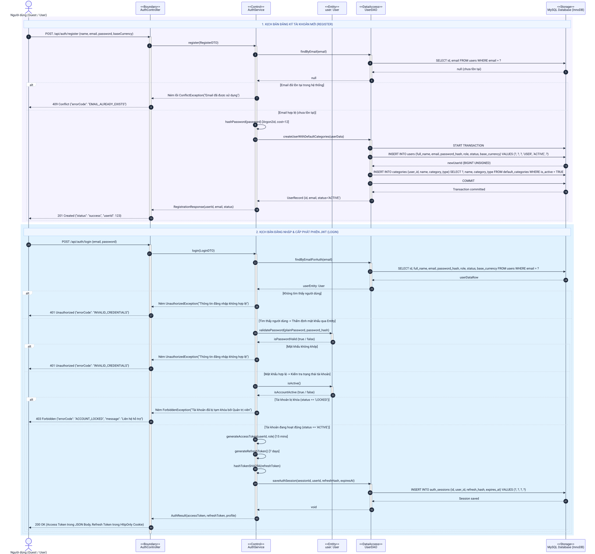
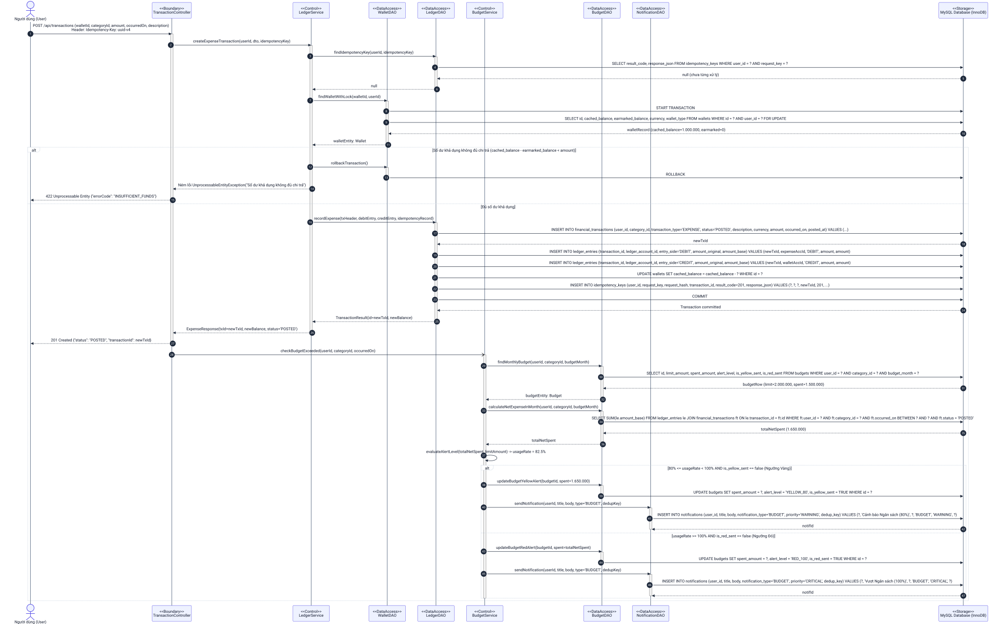
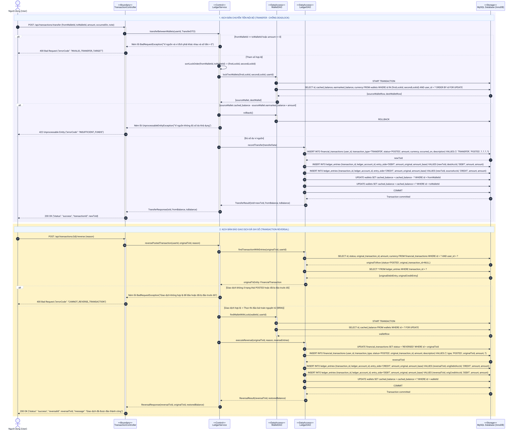
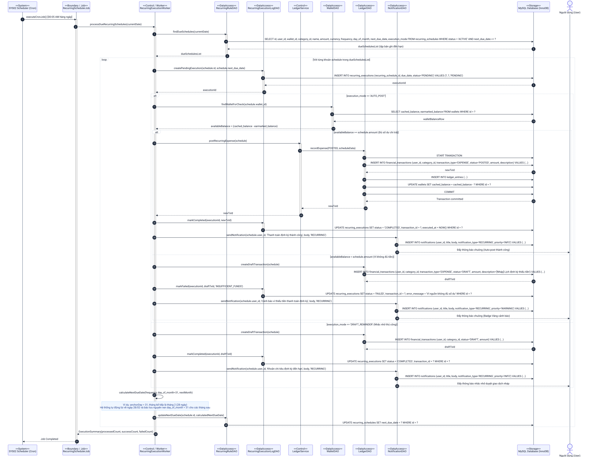
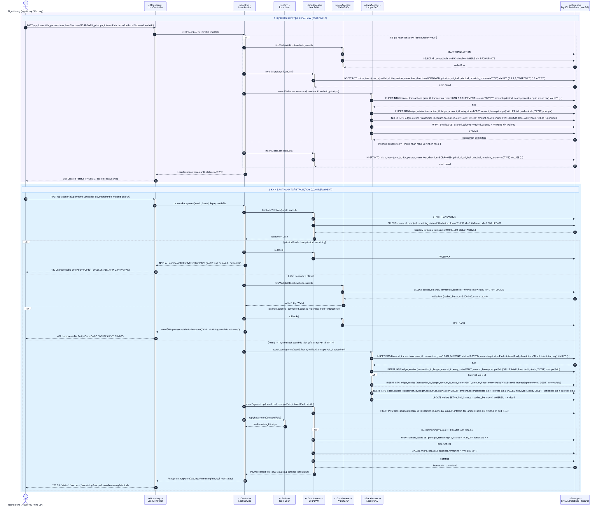
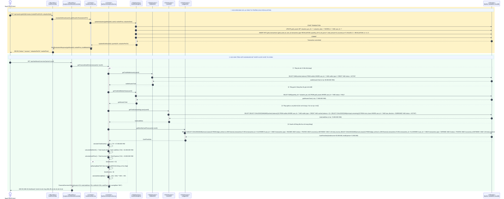
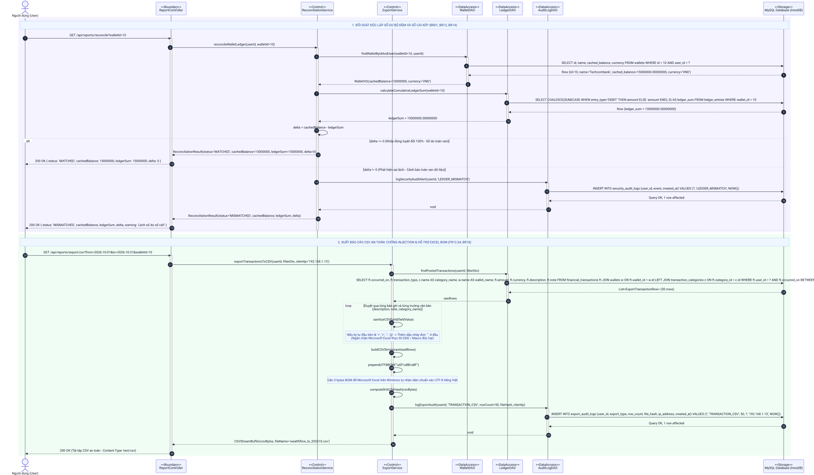
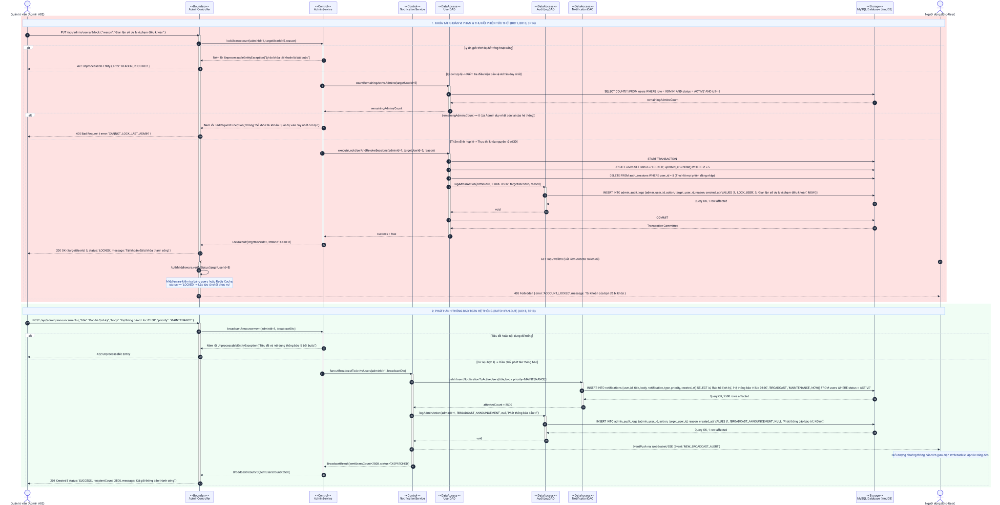
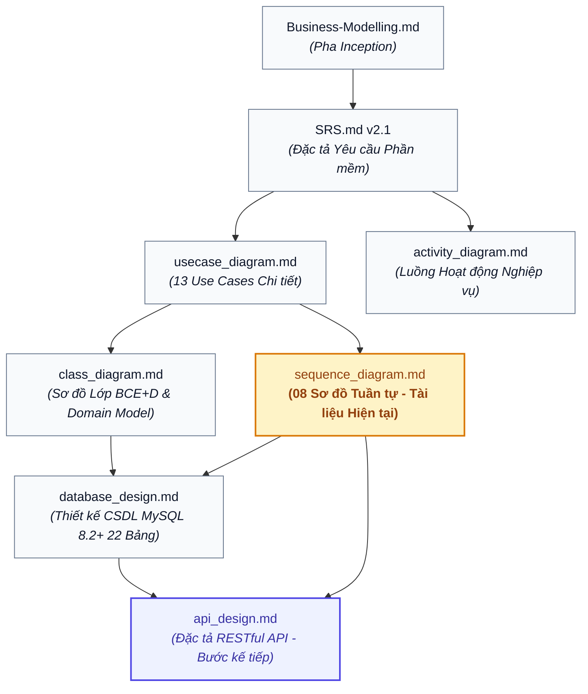

# Thiết Kế Sơ Đồ Tuần Tự (Sequence Diagrams Specification)
## Hệ Thống Quản Lý Tài Chính Cá Nhân & Tài Chính Vi Mô Thông Minh (WealthFlow)

> **Liên kết Tài liệu Liên quan (Related Documents):**  
> - **Yêu cầu & Nghiệp vụ:** [SRS.md (Đặc tả Yêu cầu Phần mềm v2.1)](../SRS.md) | [Business-Modelling.md (Mô hình Hóa Nghiệp vụ)](../../01_inception/Business-Modelling.md)
> - **Mô hình Hóa Phân tích & Thiết kế (UML):** [usecase_diagram.md (Sơ đồ Use Case)](./usecase_diagram.md) | [activity_diagram.md (Sơ đồ Hoạt động)](./activity_diagram.md) | [class_diagram.md (Sơ đồ Lớp Thiết kế Chi tiết BCE+D)](./class_diagram.md)
> - **Cơ sở Dữ liệu & Triển khai:** [database_design.md (Thiết kế CSDL Vật lý MySQL 8.2+ InnoDB)](../database_design.md) | [api_design.md (Đặc tả RESTful API)](../api_design.md)

---

> [!TIP]
> ### Hướng Dẫn Xem Sơ Đồ Chi Tiết & Rõ Nét (Vector Zoom)
> Toàn bộ **08 sơ đồ tuần tự** trong tài liệu này được kết xuất trực tiếp dưới dạng **đồ họa vector SVG chất lượng cao (`.svg`)** với nền trắng chuẩn `#FFFFFF` và độ tương phản cao:
> - **Nếu bạn không nhìn thấy rõ chữ hoặc muốn xem chi tiết luồng logic:** Hãy nhấp chuột vào liên kết file SVG bên dưới mỗi sơ đồ hoặc **mở trực tiếp tệp `.svg` bằng bất kỳ trình duyệt web nào (Google Chrome, Microsoft Edge, Firefox, Safari,...)**.
> - **Phóng to (Zoom in) tùy ý:** Trong trình duyệt web, sử dụng tổ hợp phím `Ctrl + cuộn chuột` (hoặc `Ctrl + +`) để phóng to lên **200% - 1000%**. Vì là định dạng vector SVG, toàn bộ đường nét, nhãn tin nhắn, kiểu dữ liệu và ghi chú logic sẽ luôn **sắc nét tuyệt đối**, hoàn toàn không bao giờ bị mờ hay vỡ hạt như ảnh bitmap PNG thông thường.

---

## 1. Giới Thiệu & Kiến Trúc Phân Tích BCE+D

Tài liệu này xác định chi tiết đặc tả thiết kế động (Dynamic Behavior Modeling) cho hệ thống **WealthFlow** (Personal Wealth & Microfinance Tracker), thể hiện cách thức các đối tượng cộng tác để hiện thực hóa 13 Use Cases trọng yếu.

Toàn bộ các kịch bản được mô hình hóa nghiêm ngặt theo kiến trúc phân tích **BCE+D (Boundary - Control - Entity + DataAccess)** kết hợp với cơ sở dữ liệu quan hệ **MySQL 8.2+ / MariaDB 10.4+ InnoDB (`utf8mb4`)**:

```
[ Actor ]
   │
   ▼
[ <<Boundary>> Controllers / Workers ]
   │
   ▼
[ <<Control>> Domain Services ] ◄──► [ <<Entity>> Rich Entities / Value Objects ]
   │
   ▼
[ <<DataAccess>> DAO Layer (*DAO) ]
   │  (Khóa bi quan row-level lock / SQL tối ưu)
   ▼
[ <<Storage>> MySQL Database (InnoDB ACID) ]
```

1. **Tầng Biên tiếp nhận (`<<Boundary>>`):** Tiếp nhận yêu cầu HTTP RESTful từ giao diện Web/Mobile Client (REST Controllers) hoặc các tiến trình nền định kỳ của hệ thống (Cron Jobs / Background Workers).
2. **Tầng Điều khiển Nghiệp vụ (`<<Control>>`):** Đóng gói quy tắc nghiệp vụ lõi (Domain Services), quản lý điều phối các giao dịch đa bước, kiểm tra tính hợp lệ và thực thi các quy tắc kế toán khắt khe.
3. **Tầng Thực thể Miền (`<<Entity>>`):** Các thực thể giàu hành vi (Rich Domain Entities) và các đối tượng giá trị (Value Objects) bảo vệ trạng thái nội tại của đối tượng nghiệp vụ.
4. **Tầng Truy cập Dữ liệu (`<<DataAccess>>`):** Các lớp DAO (`*DAO`) chuyên trách thực thi các câu lệnh SQL tối ưu, quản lý khóa bi quan `SELECT ... FOR UPDATE`, và bảo toàn tính toàn vẹn giao dịch ACID.
5. **Tầng Cơ sở Dữ liệu (`<<Storage>>`):** Hệ quản trị CSDL quan hệ **MySQL Database (InnoDB)** với cam kết toàn vẹn giao dịch ACID, cô lập phân tán và hỗ trợ khóa mức dòng (Row-level locking).

---

## 2. Danh Mục 08 Sơ Đồ Tuần Tự Trọng Yếu (Sequence Catalog)

| Mã Sơ đồ | Tên Kịch bản Nghiệp vụ | Use Cases Bao phủ | Quy tắc Nghiệp vụ (BR) | Sơ đồ Lớp Liên kết | Sơ đồ CSDL Liên kết | File Đồ họa Vector SVG |
| :---: | :--- | :---: | :---: | :---: | :---: | :---: |
| **SQ01** | Đăng ký tài khoản, Băm Argon2id & Đăng nhập cấp phát JWT | [UC01](./usecase_diagram.md#uc01-dang-ky-va-dang-nhap), [UC02](./usecase_diagram.md#uc02-quan-ly-vi-va-so-du-mo-so) | [BR01](../SRS.md#br01), [BR02](../SRS.md#br02), [BR11](../SRS.md#br11), [BR15](../SRS.md#br15) | [CD01 Identity & Access](./class_diagram.md#21-phân-hệ-1-định-danh-xác-thực--quản-trị-tài-khoản-identity-authentication--user-management-context) | [ERD01 Auth & Access](../database_design.md#31-phân-hệ-xác-thực--phân-quyền-authentication--authorization) | [sq01_auth_jwt.svg](./sequence_diagram/sq01_auth_jwt.svg) |
| **SQ02** | Ghi nhận Chi tiêu, Khóa Bi quan, Hạch toán Kép & Kiểm tra Ngân sách | [UC03](./usecase_diagram.md#uc03-quan-ly-giao-dich-thu-chi-va-chuyen-khoan), [UC05](./usecase_diagram.md#uc05-thiet-lap-va-theo-doi-ngan-sach) | [BR01](../SRS.md#br01), [BR06](../SRS.md#br06), [BR07](../SRS.md#br07), [BR08](../SRS.md#br08), [BR13](../SRS.md#br13) | [CD03 Ledger](./class_diagram.md#23-phân-hệ-3-ghi-nhận-giao-dịch-thu-chi--sổ-cái-kế-toán-kép-double-entry-ledger-context---uc03), [CD06 Budget](./class_diagram.md#26-phân-hệ-6-thiết-lập--kiểm-soát-ngân-sách-chi-tiêu-budget-planning-context---uc05-sys03) | [ERD02 Ledger](../database_design.md#32-phân-hệ-ví-danh-mục--sổ-cái-kép-core-wallets--double-entry-ledger), [ERD03 Budgets](../database_design.md#33-phân-hệ-ngân-sách--chi-tiêu-định-kỳ-budgets--recurring-schedules) | [sq02_expense_budget.svg](./sequence_diagram/sq02_expense_budget.svg) |
| **SQ03** | Chuyển tiền Nội bộ (Chống Deadlock theo Thứ tự ID) & Đảo Bút toán Sổ cái | [UC03](./usecase_diagram.md#uc03-quan-ly-giao-dich-thu-chi-va-chuyen-khoan) | [BR01](../SRS.md#br01), [BR05](../SRS.md#br05), [BR06](../SRS.md#br06), [BR13](../SRS.md#br13) | [CD03 Ledger](./class_diagram.md#23-phân-hệ-3-ghi-nhận-giao-dịch-thu-chi--sổ-cái-kế-toán-kép-double-entry-ledger-context---uc03) | [ERD02 Ledger](../database_design.md#32-phân-hệ-ví-danh-mục--sổ-cái-kép-core-wallets--double-entry-ledger) | [sq03_transfer_reversal.svg](./sequence_diagram/sq03_transfer_reversal.svg) |
| **SQ04** | Tự động Hạch toán Chi tiêu Định kỳ (Cron) & Quy tắc Neo Ngày (Anchor Day) | [UC04](./usecase_diagram.md#uc04-quan-ly-chi-phi-co-dinh-va-giao-dich-dinh-ky), [SYS02](../SRS.md#sys02) | [BR07](../SRS.md#br07), [BR09](../SRS.md#br09), [BR13](../SRS.md#br13) | [CD05 Recurring](./class_diagram.md#25-phân-hệ-5-quản-lý-giao-dịch-định-kỳ-tự-động-recurring-transaction-context---uc04-sys02) | [ERD03 Budgets & Recurring](../database_design.md#33-phân-hệ-ngân-sách--chi-tiêu-định-kỳ-budgets--recurring-schedules) | [sq04_subscription_cron.svg](./sequence_diagram/sq04_subscription_cron.svg) |
| **SQ05** | Quản lý Khoản vay Vi mô, Lịch Trả nợ & Tách bạch Nợ gốc / Lãi vay | [UC06](./usecase_diagram.md#uc06-quan-ly-khoan-cho-vay-va-thu-no), [UC07](./usecase_diagram.md#uc07-quan-ly-khoan-di-vay-va-tra-no) | [BR01](../SRS.md#br01), [BR09](../SRS.md#br09), [BR10](../SRS.md#br10), [BR17](../SRS.md#br17) | [CD07 Loans](./class_diagram.md#27-phân-hệ-7-quản-lý-khoản-vay-vi-mô--phân-bổ-gốclãi-microfinance-loans-context---uc06-uc07) | [ERD04 Loans](../database_design.md#34-phân-hệ-tài-chính-vi-mô--quản-lý-khoản-vay-microfinance--debt) | [sq05_microfinance_loan.svg](./sequence_diagram/sq05_microfinance_loan.svg) |
| **SQ06** | Quản lý Danh mục Vàng Tích lũy (Chỉ/Cây) & Dashboard Tài sản Ròng (Net Worth) | [UC08](./usecase_diagram.md#uc08-quan-ly-danh-muc-dau-tu-vang-tich-luy), [UC10](./usecase_diagram.md#uc10-tong-hop-tai-san-rong-net-worth-va-suc-khoe-tai-chinh) | [BR02](../SRS.md#br02), [BR03](../SRS.md#br03), [BR04](../SRS.md#br04), [BR16](../SRS.md#br16), [BR18](../SRS.md#br18) | [CD08 Gold](./class_diagram.md#28-phân-hệ-8-tích-lũy-tài-sản-vàng--định-giá-thị-trường-gold-asset-market-context---uc08), [CD10 Net Worth](./class_diagram.md#210-phân-hệ-10-dashboard-sức-khỏe-net-worth--snapshot-nền-net-worth-analytics-context---uc10-sys03) | [ERD05 Gold](../database_design.md#35-phân-hệ-danh-mục-vàng--tỷ-giá-ngoại-hối-gold-portfolio--forex), [ERD06 Goals & Net Worth](../database_design.md#36-phân-hệ-mục-tiêu-tài-chính--tài-sản-ròng-goals--net-worth) | [sq06_gold_networth.svg](./sequence_diagram/sq06_gold_networth.svg) |
| **SQ07** | Đối soát Sổ cái Độc lập & Xuất Báo cáo CSV An toàn Chống Formula Injection | [UC11](./usecase_diagram.md#uc11-bao-cao-thong-ke-va-xuat-du-lieu-csv) | [BR01](../SRS.md#br01), [BR12](../SRS.md#br12), [BR14](../SRS.md#br14), [BR18](../SRS.md#br18) | [CD04 Reconciliation & CSV](./class_diagram.md#24-phân-hệ-4-báo-cáo-đối-soát-sổ-cái--xuất-csv-an-toàn-ledger-reconciliation--secure-csv-export-context---uc11) | [ERD02 Ledger](../database_design.md#32-phân-hệ-ví-danh-mục--sổ-cái-kép-core-wallets--double-entry-ledger), [ERD07 Audit](../database_design.md#37-phân-hệ-thông-báo-cấu-hình--kiểm-toán-quản-trị-audit--system) | [sq07_reconciliation_csv.svg](./sequence_diagram/sq07_reconciliation_csv.svg) |
| **SQ08** | Quản trị Người dùng, Khóa Tài khoản (Bảo vệ Admin cuối) & Phát Thông báo | [UC12](./usecase_diagram.md#uc12-quan-tri-nguoi-dung-va-thong-ke-vi-mo), [UC13](./usecase_diagram.md#uc13-cau-hinh-he-thong-va-phat-thong-bao-toan-he-thong) | [BR11](../SRS.md#br11), [BR13](../SRS.md#br13), [BR14](../SRS.md#br14) | [CD11 Notification Broadcast](./class_diagram.md#211-phân-hệ-11-quản-trị--broadcast-thông-báo-notification-broadcast-context---uc13-sys01) | [ERD07 Notifications & Audit](../database_design.md#37-phân-hệ-thông-báo-cấu-hình--kiểm-toán-quản-trị-audit--system) | [sq08_admin_user_broadcast.svg](./sequence_diagram/sq08_admin_user_broadcast.svg) |

---

## 3. Chi Tiết 08 Kịch Bản Tuần Tự Nghiệp Vụ

### 3.1. SQ01: Đăng ký tài khoản, Mã hóa Argon2id & Đăng nhập JWT

#### 3.1.1. Thông tin Kịch bản Nghiệp vụ
- **Use Cases Bao phủ:** [UC01: Đăng ký & Xác thực người dùng](./usecase_diagram.md#uc01-dang-ky-va-dang-nhap), [UC02: Quản lý ví và số dư mở sổ](./usecase_diagram.md#uc02-quan-ly-vi-va-so-du-mo-so).
- **Quy tắc Nghiệp vụ:** [BR01: Kế toán kép](../SRS.md#br01), [BR02: Số dư mở sổ đối ứng Equity](../SRS.md#br02), [BR11: Bảo mật phiên](../SRS.md#br11), [BR15: Bảo mật API](../SRS.md#br15).
- **Yêu cầu Chức năng:** `FR01.01` - `FR01.05`, `FR15.01`.
- **Tài liệu Liên kết:**
  - **Sơ đồ Lớp Thiết kế:** [CD01: Phân hệ Định danh & Xác thực](./class_diagram.md#21-phân-hệ-1-định-danh-xác-thực--quản-trị-tài-khoản-identity-authentication--user-management-context) | [Vector SVG](./class_diagram/cd01_identity_access.svg)
  - **Thiết kế Cơ sở Dữ liệu:** [ERD01: Xác thực & Phân quyền](../database_design.md#31-phân-hệ-xác-thực--phân-quyền-authentication--authorization) | [Vector SVG](../database_design/erd01_auth.svg) | Bảng vật lý: `users`, `auth_sessions`, `default_categories`, `transaction_categories`.
- **Mục tiêu kỹ nghệ:** Mô hình hóa quy trình tạo tài khoản an toàn với giải thuật băm mật khẩu kháng GPU/ASIC `Argon2id` (cost factor 12, bộ nhớ 64MB), tự động sao chép cây danh mục chuẩn từ `default_categories` sang `transaction_categories` trong một Database Transaction duy nhất, thẩm định trạng thái qua Rich Entity `User`, và cấp phát cặp JWT Tokens (Access Token 15 phút, Refresh Token 7 ngày lưu băm SHA-256 vào bảng `auth_sessions`).

#### 3.1.2. Danh mục Lifelines Tham gia (BCE+D)
| Tên Lifeline | Stereotype | Tầng Kiến trúc | Vai trò & Trách nhiệm Kỹ nghệ |
| :--- | :---: | :---: | :--- |
| **User** | `<<Actor>>` | Tác nhân ngoài | Khách vãng lai gửi yêu cầu đăng ký hoặc Người dùng đăng nhập hệ thống. |
| **AuthController** | `<<Boundary>>` | Biên tiếp nhận | REST Controller tiếp nhận HTTP POST `/api/auth/register` và `/api/auth/login`. |
| **AuthService** | `<<Control>>` | Điều khiển nghiệp vụ | Xử lý băm Argon2id, điều phối Transaction tạo tài khoản và ký số cặp JWT Tokens. |
| **user: User** | `<<Entity>>` | Thực thể miền | Rich Entity đóng gói trạng thái tài khoản, thực thi `validatePassword()` và `isActive()`. |
| **UserDAO** | `<<DataAccess>>` | Truy cập CSDL | DAO thực thi các câu lệnh SQL trên bảng `users`, `categories`, `default_categories`, `auth_sessions`. |
| **MySQL Database** | `<<Storage>>` | Cơ sở dữ liệu | Hệ quản trị CSDL MySQL 8.2+ / MariaDB 10.4+ InnoDB (`utf8mb4`), bảo đảm tính ACID. |

#### 3.1.3. Sơ đồ Tuần tự Vector SVG

*Hình 3.1: Sơ đồ Tuần tự SQ01 - Đăng ký, Mã hóa Argon2id & Đăng nhập JWT.*

#### 3.1.4. Điểm Nhấn Kiến Trúc & Xử Lý Kỹ Thuật
1. **Kiểm tra trùng lặp email:** `UserDAO` kiểm tra `users` với chỉ mục `uk_user_email`. Nếu đã tồn tại, ném ngoại lệ `EmailAlreadyExistsException` -> Controller trả về `409 Conflict`.
2. **Khởi tạo dữ liệu nguyên tử (ACID Transaction):** Lệnh `INSERT INTO users` được thực thi cùng với lệnh sao chép danh mục:
   ```sql
   INSERT INTO transaction_categories (user_id, name, type, icon, color)
   SELECT ?, name, type, icon, color FROM default_categories;
   ```
3. **Cơ chế thu hồi phiên đăng nhập phân tán:** Refresh Token thô (plaintext) chỉ được trả về cho Client 1 lần duy nhất, còn cơ sở dữ liệu chỉ lưu trữ chuỗi băm SHA-256 (`refresh_hash`) trong bảng `auth_sessions`. Khi người dùng đăng xuất hoặc bị khóa tài khoản, hệ thống chỉ cần xóa bản ghi tương ứng trong `auth_sessions`.

---

### 3.2. SQ02: Ghi nhận Chi tiêu, Khóa Bi quan & Cảnh báo Ngân sách

#### 3.2.1. Thông tin Kịch bản Nghiệp vụ
- **Use Cases Bao phủ:** [UC03: Quản lý giao dịch thu chi](./usecase_diagram.md#uc03-quan-ly-giao-dich-thu-chi-va-chuyen-khoan), [UC05: Thiết lập & Cảnh báo ngân sách](./usecase_diagram.md#uc05-thiet-lap-va-theo-doi-ngan-sach).
- **Quy tắc Nghiệp vụ:** [BR01: Kế toán kép](../SRS.md#br01), [BR06: Chặn âm ví tiền mặt](../SRS.md#br06), [BR07: Ngân sách tháng](../SRS.md#br07), [BR08: Cảnh báo 80% và 100%](../SRS.md#br08), [BR13: Kiểm toán hệ thống](../SRS.md#br13).
- **Yêu cầu Chức năng:** `FR03.01` - `FR03.04`, `FR05.01` - `FR05.04`.
- **Tài liệu Liên kết:**
  - **Sơ đồ Lớp Thiết kế:** [CD03: Sổ cái Kế toán kép](./class_diagram.md#23-phân-hệ-3-ghi-nhận-giao-dịch-thu-chi--sổ-cái-kế-toán-kép-double-entry-ledger-context---uc03) ([Vector SVG](./class_diagram/cd03_double_entry_ledger.svg)) & [CD06: Ngân sách Chi tiêu](./class_diagram.md#26-phân-hệ-6-thiết-lập--kiểm-soát-ngân-sách-chi-tiêu-budget-planning-context---uc05-sys03) ([Vector SVG](./class_diagram/cd06_budget_planning.svg)).
  - **Thiết kế Cơ sở Dữ liệu:** [ERD02: Ví, Giao dịch & Sổ cái](../database_design.md#32-phân-hệ-ví-danh-mục--sổ-cái-kép-core-wallets--double-entry-ledger) ([Vector SVG](../database_design/erd02_ledger.svg)) & [ERD03: Ngân sách](../database_design.md#33-phân-hệ-ngân-sách--chi-tiêu-định-kỳ-budgets--recurring-schedules) ([Vector SVG](../database_design/erd03_budgets.svg)) | Bảng vật lý: `wallets`, `financial_transactions`, `ledger_entries`, `idempotency_keys`, `budgets`, `notifications`.
- **Mục tiêu kỹ nghệ:** Mô hình hóa giao dịch cốt lõi của WealthFlow: sử dụng **Khóa bi quan mức dòng (`SELECT ... FOR UPDATE`)** trên bảng `wallets` để triệt tiêu hiện tượng Race Condition; hạch toán đồng thời 2 bút toán Nợ/Có cân bằng vào `ledger_entries`; ghi nhận khóa chống trùng lặp `idempotency_keys`; sau đó kích hoạt `BudgetService` kiểm tra hạn mức ngân sách trong tháng, tự sinh thông báo vào `notifications` kèm mã khử trùng `dedup_key` khi chạm ngưỡng 80% hoặc 100%.

#### 3.2.2. Danh mục Lifelines Tham gia (BCE+D)
| Tên Lifeline | Stereotype | Tầng Kiến trúc | Vai trò & Trách nhiệm Kỹ nghệ |
| :--- | :---: | :---: | :--- |
| **User** | `<<Actor>>` | Tác nhân ngoài | Người dùng nhập liệu giao dịch chi tiêu trên ứng dụng. |
| **TransactionController** | `<<Boundary>>` | Biên tiếp nhận | REST Controller tiếp nhận HTTP POST `/api/transactions` kèm header `Idempotency-Key`. |
| **LedgerService** | `<<Control>>` | Điều khiển nghiệp vụ | Thẩm định số dư, kiểm tra idempotency và điều phối hạch toán kế toán kép ACID. |
| **WalletDAO** | `<<DataAccess>>` | Truy cập CSDL | Khóa dòng `SELECT ... FOR UPDATE` trên bảng `wallets` và cập nhật `cached_balance`. |
| **LedgerDAO** | `<<DataAccess>>` | Truy cập CSDL | Ghi nhận nguyên tử vào `financial_transactions`, `ledger_entries` và `idempotency_keys`. |
| **BudgetService** | `<<Control>>` | Điều khiển nghiệp vụ | Tính toán lũy kế chi tiêu trong tháng và đối chiếu hạn mức ngân sách danh mục. |
| **BudgetDAO** | `<<DataAccess>>` | Truy cập CSDL | Truy vấn hạn mức và cập nhật cờ cảnh báo trong bảng `budgets`. |
| **NotificationDAO** | `<<DataAccess>>` | Truy cập CSDL | Ghi nhận thông báo vào bảng `notifications` với khóa chống trùng `dedup_key`. |
| **MySQL Database** | `<<Storage>>` | Cơ sở dữ liệu | Hệ quản trị CSDL MySQL 8.2+ / MariaDB 10.4+ InnoDB (`utf8mb4`), bảo đảm tính ACID. |

#### 3.2.3. Sơ đồ Tuần tự Vector SVG

*Hình 3.2: Sơ đồ Tuần tự SQ02 - Ghi nhận Chi tiêu, Khóa Bi quan & Cảnh báo Ngân sách.*

#### 3.2.4. Điểm Nhấn Kiến Trúc & Xử Lý Kỹ Thuật
1. **Kiểm tra Chống trùng lặp Idempotency:** Kiểm tra khóa idempotency trong bảng `idempotency_keys`. Nếu request bị gửi lặp lại do lỗi mạng, hệ thống trả về ngay kết quả đã lưu trong bộ đệm mà không hạch toán lần hai.
2. **Khóa Mức Dòng (Row-level Lock):**
   ```sql
   SELECT id, cached_balance, wallet_type FROM wallets WHERE id = ? FOR UPDATE;
   ```
   Nếu `wallet_type == 'CASH'` và `cached_balance < amount`, hệ thống lập tức ném lỗi `InsufficientBalanceException` -> 422 Unprocessable Entity, bảo đảm số dư tiền mặt không bao giờ âm (BR06).
3. **Cân Bằng Kế Toán Kép:** Sinh ra chính xác 2 dòng `ledger_entries`:
   - Dòng 1: `entry_type = 'DEBIT'` ghi tăng tài khoản Chi phí (`EXPENSE_CATEGORY_XX`).
   - Dòng 2: `entry_type = 'CREDIT'` ghi giảm tài khoản Tài sản (`ASSET_WALLET_XX`).
4. **Cảnh Báo Ngân Sách Không Chặn (Non-blocking Budget Notification):** Logic kiểm tra ngân sách được thực hiện ngay sau khi transaction hạch toán sổ cái thành công. Việc tạo thông báo sử dụng `dedup_key` (ví dụ: `BUDGET_WARN_CAT5_202610`) để bảo đảm mỗi ngưỡng cảnh báo chỉ gửi duy nhất 1 lần trong tháng.

---

### 3.3. SQ03: Chuyển tiền Nội bộ & Đảo Giao dịch (Reversal)

#### 3.3.1. Thông tin Kịch bản Nghiệp vụ
- **Use Cases Bao phủ:** [UC03: Chuyển khoản nội bộ & Đảo hủy giao dịch](./usecase_diagram.md#uc03-quan-ly-giao-dich-thu-chi-va-chuyen-khoan).
- **Quy tắc Nghiệp vụ:** [BR01: Kế toán kép](../SRS.md#br01), [BR05: Bất biến sổ cái](../SRS.md#br05), [BR06: Kiểm tra số dư chuyển](../SRS.md#br06), [BR13: Kiểm toán giao dịch](../SRS.md#br13).
- **Yêu cầu Chức năng:** `FR03.01` - `FR03.04`.
- **Tài liệu Liên kết:**
  - **Sơ đồ Lớp Thiết kế:** [CD03: Sổ cái Kế toán kép](./class_diagram.md#23-phân-hệ-3-ghi-nhận-giao-dịch-thu-chi--sổ-cái-kế-toán-kép-double-entry-ledger-context---uc03) | [Vector SVG](./class_diagram/cd03_double_entry_ledger.svg).
  - **Thiết kế Cơ sở Dữ liệu:** [ERD02: Phân hệ Ví & Sổ cái](../database_design.md#32-phân-hệ-ví-danh-mục--sổ-cái-kép-core-wallets--double-entry-ledger) | [Vector SVG](../database_design/erd02_ledger.svg) | Bảng vật lý: `wallets`, `financial_transactions`, `ledger_entries`.
- **Mục tiêu kỹ nghệ:** Mô hình hóa hai tình huống nâng cao: (1) Chuyển tiền giữa hai ví thuộc cùng một người dùng với giải thuật **sắp xếp thứ tự ID ví (`min(fromId, toId)`, `max(...)`) trước khi thực thi `SELECT ... FOR UPDATE`** nhằm triệt tiêu hoàn toàn nguy cơ Deadlock giữa các giao dịch chuyển tiền chéo nhau cùng thời điểm; (2) Khi người dùng yêu cầu hủy/hoàn tác giao dịch, hệ thống áp dụng nguyên tắc kế toán bất biến bằng cách tạo giao dịch đảo `TRANSFER_REVERSAL` kèm cặp bút toán đối ứng ngược chiều và gắn cờ `is_reversed` trên giao dịch gốc.

#### 3.3.2. Danh mục Lifelines Tham gia (BCE+D)
| Tên Lifeline | Stereotype | Tầng Kiến trúc | Vai trò & Trách nhiệm Kỹ nghệ |
| :--- | :---: | :---: | :--- |
| **User** | `<<Actor>>` | Tác nhân ngoài | Người dùng thực hiện chuyển khoản hoặc yêu cầu đảo giao dịch. |
| **TransactionController** | `<<Boundary>>` | Biên tiếp nhận | REST Controller tiếp nhận HTTP POST `/api/transactions/transfer` và `/api/transactions/{id}/reverse`. |
| **LedgerService** | `<<Control>>` | Điều khiển nghiệp vụ | Xử lý thuật toán sắp xếp thứ tự khóa tránh Deadlock và điều phối tạo bút toán đảo sổ cái. |
| **WalletDAO** | `<<DataAccess>>` | Truy cập CSDL | Khóa dòng có thứ tự trên 2 ví và cập nhật số dư bộ đệm của ví nguồn và ví đích. |
| **LedgerDAO** | `<<DataAccess>>` | Truy cập CSDL | Ghi nhận giao dịch gốc, giao dịch đảo và các cặp bút toán Nợ/Có tương ứng vào `ledger_entries`. |
| **MySQL Database** | `<<Storage>>` | Cơ sở dữ liệu | Hệ quản trị CSDL MySQL 8.2+ / MariaDB 10.4+ InnoDB (`utf8mb4`), bảo đảm tính ACID. |

#### 3.3.3. Sơ đồ Tuần tự Vector SVG

*Hình 3.3: Sơ đồ Tuần tự SQ03 - Chuyển tiền Nội bộ & Đảo Giao dịch Reversal.*

#### 3.3.4. Điểm Nhấn Kiến Trúc & Xử Lý Kỹ Thuật
1. **Giải pháp Triệt tiêu Deadlock (Deadlock Prevention):**
   ```php
   $firstId = min($fromWalletId, $toWalletId);
   $secondId = max($fromWalletId, $toWalletId);
   // Luôn luôn SELECT ... FOR UPDATE theo thứ tự $firstId trước, $secondId sau
   ```
   Quy tắc này bảo đảm mọi thread giao dịch đều chiếm giữ khóa theo cùng một thứ tự toàn cục, loại trừ 100% hiện tượng giữ khóa chờ vòng tròn (Circular Wait).
2. **Nguyên tắc Kế toán Bất biến (Accounting Immutability - BR05):**
   - Tuyệt đối không xóa dòng giao dịch gốc khỏi bảng `financial_transactions`.
   - Sinh giao dịch đảo với `transaction_type = 'TRANSFER_REVERSAL'`, tham chiếu trường `original_transaction_id = ?`.
   - Sinh 2 bút toán Nợ/Có đối ứng ngược chiều: `DEBIT` ví nguồn (khôi phục số dư) và `CREDIT` ví đích (giảm trừ số tiền đã nhận).

---

### 3.4. SQ04: Xử lý Giao dịch Định kỳ Tự động (Subscription Cron)

#### 3.4.1. Thông tin Kịch bản Nghiệp vụ
- **Use Cases Bao phủ:** [UC04: Quản lý chi phí cố định định kỳ](./usecase_diagram.md#uc04-quan-ly-chi-phi-co-dinh-va-giao-dich-dinh-ky), [SYS02: Tác vụ định kỳ hệ thống](../SRS.md#sys02).
- **Quy tắc Nghiệp vụ:** [BR07: Hạch toán đúng chu kỳ](../SRS.md#br07), [BR09: Neo ngày cố định Anchor Day](../SRS.md#br09), [BR13: Ghi log tác vụ nền](../SRS.md#br13).
- **Yêu cầu Chức năng:** `FR04.01` - `FR04.04`, `FR13.01`.
- **Tài liệu Liên kết:**
  - **Sơ đồ Lớp Thiết kế:** [CD05: Giao dịch Định kỳ Tự động](./class_diagram.md#25-phân-hệ-5-quản-lý-giao-dịch-định-kỳ-tự-động-recurring-transaction-context---uc04-sys02) | [Vector SVG](./class_diagram/cd05_recurring_transaction.svg).
  - **Thiết kế Cơ sở Dữ liệu:** [ERD03: Ngân sách & Giao dịch Định kỳ](../database_design.md#33-phân-hệ-ngân-sách--chi-tiêu-định-kỳ-budgets--recurring-schedules) | [Vector SVG](../database_design/erd03_budgets.svg) | Bảng vật lý: `recurring_schedules`, `recurring_executions`, `wallets`, `financial_transactions`, `ledger_entries`, `notifications`.
- **Mục tiêu kỹ nghệ:** Mô hình hóa luồng công việc chạy ngầm (Scheduled Worker Job) được kích hoạt hàng ngày lúc 00:00:00 UTC: quét bảng `recurring_schedules` tìm các giao dịch đến hạn (`next_run_date <= CURRENT_DATE` và `status = 'ACTIVE'`), khóa dòng xử lý độc lập từng chu kỳ giao dịch; tự động tạo bút toán chi phí và giảm trừ số dư ví; ghi nhận chi tiết vào `recurring_executions`; áp dụng **Quy tắc Neo Ngày (Anchor Day Rule)** bảo toàn ngày cố định (ví dụ đăng ký ngày 31, tháng 2 thực thi ngày 28/29 nhưng tháng 3 vẫn quay lại ngày 31); và gửi thông báo nhắc nhở trước 3 ngày.

#### 3.4.2. Danh mục Lifelines Tham gia (BCE+D)
| Tên Lifeline | Stereotype | Tầng Kiến trúc | Vai trò & Trách nhiệm Kỹ nghệ |
| :--- | :---: | :---: | :--- |
| **Scheduler** | `<<System>>` | Hệ thống | Bộ lập lịch hệ điều hành (Linux Cron Daemon / Windows Task Scheduler). |
| **RecurringSchedulerJob** | `<<Boundary / Job>>` | Biên tác vụ | Command / Job tiếp nhận tín hiệu kích hoạt từ Scheduler lúc 00:00:00 UTC. |
| **RecurringExecutionWorker**| `<<Control / Worker>>` | Điều khiển tác vụ | Điều phối vòng lặp xử lý từng lịch đăng ký, tính ngày tiếp theo và xử lý ngoại lệ số dư. |
| **RecurringRuleDAO** | `<<DataAccess>>` | Truy cập CSDL | Truy vấn các lịch đến hạn và cập nhật `next_run_date` trên bảng `recurring_schedules`. |
| **RecurringExecutionLogDAO**| `<<DataAccess>>` | Truy cập CSDL | Ghi nhận kết quả thực thi (SUCCESS/FAILED) vào bảng `recurring_executions`. |
| **WalletDAO** | `<<DataAccess>>` | Truy cập CSDL | Khóa dòng và cập nhật số dư ví trong giao dịch Auto-Post. |
| **LedgerDAO** | `<<DataAccess>>` | Truy cập CSDL | Ghi nhận bản ghi `financial_transactions` và `ledger_entries`. |
| **NotificationDAO** | `<<DataAccess>>` | Truy cập CSDL | Lưu thông báo kết quả vào bảng `notifications`. |
| **MySQL Database** | `<<Storage>>` | Cơ sở dữ liệu | Hệ quản trị CSDL MySQL 8.2+ / MariaDB 10.4+ InnoDB (`utf8mb4`), bảo đảm tính ACID. |
| **User** | `<<Actor>>` | Tác nhân ngoài | Người dùng nhận thông báo trên Notification Center của ứng dụng. |

#### 3.4.3. Sơ đồ Tuần tự Vector SVG

*Hình 3.4: Sơ đồ Tuần tự SQ04 - Xử lý Giao dịch Định kỳ Tự động (Subscription Cron).*

#### 3.4.4. Điểm Nhấn Kiến Trúc & Xử Lý Kỹ Thuật
1. **Cô Lập Thất Bại Từng Bản Ghi (Fault Isolation):** Mỗi lịch định kỳ được thực thi trong một Database Transaction độc lập. Nếu một giao dịch bị lỗi do ví không đủ tiền, hệ thống ghi nhận `recurring_executions.status = 'FAILED'`, sinh cảnh báo cho người dùng, và lập tức tiếp tục xử lý các lịch định kỳ khác mà không làm gián đoạn toàn bộ tiến trình Cron.
2. **Quy Tắc Neo Ngày (Anchor Day Rule - BR09):**
   - Thuộc tính `anchor_day` (1 đến 31) lưu trữ ngày đăng ký gốc.
   - Khi tính toán `next_run_date` cho tháng tiếp theo:
     ```php
     $targetMonth = $currentMonth + 1;
     $daysInMonth = cal_days_in_month(CAL_GREGORIAN, $targetMonth, $currentYear);
     $actualDay = min($schedule->anchor_day, $daysInMonth);
     $nextRunDate = createDate($currentYear, $targetMonth, $actualDay);
     ```
   - Đảm bảo các hóa đơn ngày 31 tháng 1 khi chuyển sang tháng 2 sẽ thực thi ngày 28 (hoặc 29), nhưng sang tháng 3 sẽ tự động trở lại đúng ngày 31.

---

### 3.5. SQ05: Khởi tạo Khoản vay & Thanh toán Trả nợ Vi mô

#### 3.5.1. Thông tin Kịch bản Nghiệp vụ
- **Use Cases Bao phủ:** [UC06: Quản lý khoản vay mượn vi mô](./usecase_diagram.md#uc06-quan-ly-khoan-cho-vay-va-thu-no), [UC07: Ghi nhận thanh toán trả nợ vi mô](./usecase_diagram.md#uc07-quan-ly-khoan-di-vay-va-tra-no).
- **Quy tắc Nghiệp vụ:** [BR01: Kế toán kép](../SRS.md#br01), [BR09: Tính lãi nợ vay](../SRS.md#br09), [BR10: Tách bạch Nợ gốc và Lãi vay](../SRS.md#br10), [BR17: Khóa tài khoản nợ khi tất toán](../SRS.md#br17).
- **Yêu cầu Chức năng:** `FR06.01` - `FR06.05`, `FR07.01` - `FR07.04`.
- **Tài liệu Liên kết:**
  - **Sơ đồ Lớp Thiết kế:** [CD07: Khoản vay Vi mô & Phân bổ Gốc/Lãi](./class_diagram.md#27-phân-hệ-7-quản-lý-khoản-vay-vi-mô--phân-bổ-gốclãi-microfinance-loans-context---uc06-uc07) | [Vector SVG](./class_diagram/cd07_microfinance_loans.svg).
  - **Thiết kế Cơ sở Dữ liệu:** [ERD04: Tài chính Vi mô & Quản lý Khoản vay](../database_design.md#34-phân-hệ-tài-chính-vi-mô--quản-lý-khoản-vay-microfinance--debt) | [Vector SVG](../database_design/erd04_loans.svg) | Bảng vật lý: `micro_loans`, `loan_repayment_schedules`, `loan_payments`, `wallets`, `financial_transactions`, `ledger_entries`.
- **Mục tiêu kỹ nghệ:** Mô hình hóa nghiệp vụ tài chính vi mô: (1) Khởi tạo khoản đi vay/cho vay, giải ngân tiền vào ví, tự động sinh bảng kế hoạch phân kỳ trả nợ (Amortization Schedule) trong `loan_repayment_schedules`; (2) Ghi nhận thanh toán trả nợ từng kỳ: tuân thủ nghiêm ngặt nguyên tắc kế toán tài chính vi mô tách bạch rành mạch số tiền trả nợ thành **Giảm trừ Nợ gốc** (`remaining_principal`) và **Chi phí lãi vay** (`interest_expense`), cập nhật trạng thái kỳ trả nợ sang `PAID`, và tự động chuyển trạng thái khoản vay sang `SETTLED` khi dư nợ còn lại chạm mức 0.

#### 3.5.2. Danh mục Lifelines Tham gia (BCE+D)
| Tên Lifeline | Stereotype | Tầng Kiến trúc | Vai trò & Trách nhiệm Kỹ nghệ |
| :--- | :---: | :---: | :--- |
| **User** | `<<Actor>>` | Tác nhân ngoài | Người đi vay hoặc Người cho vay tương tác trên giao diện. |
| **LoanController** | `<<Boundary>>` | Biên tiếp nhận | REST Controller tiếp nhận HTTP POST `/api/loans` và `/api/loans/{id}/payments`. |
| **LoanService** | `<<Control>>` | Điều khiển nghiệp vụ | Xử lý thuật toán sinh lịch trả nợ, tách bạch gốc/lãi và điều phối hạch toán sổ cái. |
| **loan: Loan** | `<<Entity>>` | Thực thể miền | Rich Entity quản lý trạng thái khoản vay, thực thi `recordPayment()` và `checkSettled()`. |
| **LoanDAO** | `<<DataAccess>>` | Truy cập CSDL | Thao tác trên các bảng `micro_loans`, `loan_repayment_schedules`, `loan_payments`. |
| **WalletDAO** | `<<DataAccess>>` | Truy cập CSDL | Khóa dòng và cập nhật số dư ví thực hiện thanh toán. |
| **LedgerDAO** | `<<DataAccess>>` | Truy cập CSDL | Ghi nhận bút toán kế toán kép vào `financial_transactions` và `ledger_entries`. |
| **MySQL Database** | `<<Storage>>` | Cơ sở dữ liệu | Hệ quản trị CSDL MySQL 8.2+ / MariaDB 10.4+ InnoDB (`utf8mb4`), bảo đảm tính ACID. |

#### 3.5.3. Sơ đồ Tuần tự Vector SVG

*Hình 3.5: Sơ đồ Tuần tự SQ05 - Khởi tạo Khoản vay & Thanh toán Trả nợ Vi mô.*

#### 3.5.4. Điểm Nhấn Kiến Trúc & Xử Lý Kỹ Thuật
1. **Hạch Toán Giải Ngân Không Ghi Nhận Thu Nhập (BR17):**
   - Khi nhận tiền đi vay: Tăng tài sản ví (`DEBIT Asset`), đồng thời tăng nghĩa vụ nợ phải trả (`CREDIT Liability`). Tuyệt đối không ghi nhận vào tài khoản Thu nhập (Income), tránh thổi phồng sai lệch thu nhập của người dùng.
2. **Tách Bạch Gốc và Lãi (Split Accounting - BR10):**
   - Khi thanh toán khoản vay, hệ thống tạo bản ghi trong `loan_payments` với 2 trường tách biệt: `principal_paid` và `interest_paid`.
   - Bút toán kế toán kép tương ứng:
     - Dòng 1: `DEBIT Liability` (Số tiền gốc trả - Giảm nghĩa vụ nợ).
     - Dòng 2: `DEBIT Expense: Interest` (Số tiền lãi trả - Ghi nhận chi phí tài chính).
     - Dòng 3: `CREDIT Asset: Wallet` (Tổng số tiền xuất khỏi ví = Gốc + Lãi).
     - Tổng DEBIT luôn bằng tổng CREDIT bảo đảm cân bằng tuyệt đối.
3. **Tự Động Đóng Khoản Vay (Auto-settlement):**
   - Khi `remaining_principal <= 0`, Rich Entity `Loan` tự động cập nhật cờ `status = 'SETTLED'`.

---

### 3.6. SQ06: Quản lý Vàng Tích lũy & Tổng hợp Net Worth Dashboard

#### 3.6.1. Thông tin Kịch bản Nghiệp vụ
- **Use Cases Bao phủ:** [UC08: Quản lý danh mục vàng tích lũy](./usecase_diagram.md#uc08-quan-ly-danh-muc-dau-tu-vang-tich-luy), [UC10: Dashboard trực quan hóa tài sản ròng Net Worth](./usecase_diagram.md#uc10-tong-hop-tai-san-rong-net-worth-va-suc-khoe-tai-chinh).
- **Quy tắc Nghiệp vụ:** [BR02: Định giá tài sản](../SRS.md#br02), [BR03: Chuyển đổi ngoại tệ](../SRS.md#br03), [BR04: Giá vàng thị trường](../SRS.md#br04), [BR16: Chỉ số thanh khoản](../SRS.md#br16), [BR18: Phòng vệ chia cho 0](../SRS.md#br18).
- **Yêu cầu Chức năng:** `FR08.01` - `FR08.05`, `FR10.01` - `FR10.04`.
- **Tài liệu Liên kết:**
  - **Sơ đồ Lớp Thiết kế:** [CD08: Tài sản Vàng & Định giá](./class_diagram.md#28-phân-hệ-8-tích-lũy-tài-sản-vàng--định-giá-thị-trường-gold-asset-market-context---uc08) ([Vector SVG](./class_diagram/cd08_gold_asset_market.svg)) & [CD10: Dashboard Net Worth](./class_diagram.md#210-phân-hệ-10-dashboard-sức-khỏe-net-worth--snapshot-nền-net-worth-analytics-context---uc10-sys03) ([Vector SVG](./class_diagram/cd10_networth_analytics.svg)).
  - **Thiết kế Cơ sở Dữ liệu:** [ERD05: Danh mục Vàng & Ngoại hối](../database_design.md#35-phân-hệ-danh-mục-vàng--tỷ-giá-ngoại-hối-gold-portfolio--forex) ([Vector SVG](../database_design/erd05_gold.svg)) & [ERD06: Mục tiêu & Net Worth](../database_design.md#36-phân-hệ-mục-tiêu-tài-chính--tài-sản-ròng-goals--net-worth) ([Vector SVG](../database_design/erd06_goals.svg)) | Bảng vật lý: `gold_assets`, `gold_transactions`, `exchange_rates`, `net_worth_snapshots`, `wallets`, `micro_loans`.
- **Mục tiêu kỹ nghệ:** Mô hình hóa hai tính năng phân tích chuyên sâu: (1) Quản lý giao dịch mua/bán vàng vật chất tính theo đơn vị Chỉ / Cây vàng (1 Cây = 10 Chỉ), liên kết rút tiền ví tương ứng; (2) Tổng hợp Dashboard Tài sản ròng (Net Worth Dashboard): tổng hợp tài sản đa nguồn (Số dư ví tiền + Giá trị vàng quy đổi theo giá thị trường hiện tại + Nợ cho vay) trừ đi tổng nghĩa vụ nợ (Dư nợ vay vi mô), tính toán tỷ lệ tiết kiệm (Saving Rate) với cơ chế phòng vệ lỗi chia cho 0 (`BR18`), và tính hệ số thanh khoản (Liquidity Ratio).

#### 3.6.2. Danh mục Lifelines Tham gia (BCE+D)
| Tên Lifeline | Stereotype | Tầng Kiến trúc | Vai trò & Trách nhiệm Kỹ nghệ |
| :--- | :---: | :---: | :--- |
| **User** | `<<Actor>>` | Tác nhân ngoài | Người dùng tra cứu báo cáo Net Worth hoặc thực hiện mua bán vàng. |
| **GoldController** | `<<Boundary>>` | Biên tiếp nhận | REST Controller tiếp nhận HTTP POST `/api/gold/transactions`. |
| **AnalyticsDashboardController**| `<<Boundary>>` | Biên tiếp nhận | REST Controller tiếp nhận HTTP GET `/api/analytics/net-worth`. |
| **GoldAssetService** | `<<Control>>` | Điều khiển nghiệp vụ | Xử lý logic mua bán vàng, tính giá vốn bình quân gia quyền và cập nhật khối lượng vàng. |
| **NetWorthAnalyticsService** | `<<Control>>` | Điều khiển nghiệp vụ | Tính toán giá trị tài sản ròng, tỷ lệ tiết kiệm, tỷ lệ thanh khoản và sinh khuyến nghị. |
| **GoldHoldingDAO** | `<<DataAccess>>` | Truy cập CSDL | Thao tác trên bảng `gold_assets`, `gold_transactions`, `exchange_rates`. |
| **WalletDAO** | `<<DataAccess>>` | Truy cập CSDL | Truy vấn tổng tài sản số dư các ví tiền (`wallets`). |
| **LoanDAO** | `<<DataAccess>>` | Truy cập CSDL | Truy vấn tổng dư nợ gốc các khoản vay (`micro_loans`). |
| **LedgerDAO** | `<<DataAccess>>` | Truy cập CSDL | Tính toán tổng thu nhập và chi phí phát sinh trong tháng từ `ledger_entries`. |
| **MySQL Database** | `<<Storage>>` | Cơ sở dữ liệu | Hệ quản trị CSDL MySQL 8.2+ / MariaDB 10.4+ InnoDB (`utf8mb4`), bảo đảm tính ACID. |

#### 3.6.3. Sơ đồ Tuần tự Vector SVG

*Hình 3.6: Sơ đồ Tuần tự SQ06 - Quản lý Vàng Tích lũy & Tổng hợp Net Worth Dashboard.*

#### 3.6.4. Điểm Nhấn Kiến Trúc & Xử Lý Kỹ Thuật
1. **Đơn Vị Đo Khối Lượng Vàng Độ Chính Xác Cao:** Sử dụng `DECIMAL(18,4)` để lưu trữ khối lượng vàng theo đơn vị Chỉ. Giá trị thị trường = `quantity_chi * current_market_price_per_chi`.
2. **Phương Trình Tài Sản Ròng Chuẩn Kế Toán (BR02):**
   $$\text{Total Assets} = \sum \text{Wallet Balances} + \text{Gold Valuation} + \sum \text{Receivable Loans}$$
   $$\text{Total Liabilities} = \sum \text{Payable Loans (Borrowings)}$$
   $$\text{Net Worth} = \text{Total Assets} - \text{Total Liabilities}$$
3. **Phòng Vệ Lỗi Chia Cho 0 (Zero-division Protection - BR18):**
   ```php
   if ($totalIncome <= 0) {
       $savingRate = 0.0; // Tránh lỗi DivisionByZeroException khi người dùng chưa có thu nhập
   } else {
       $savingRate = round((($totalIncome - $totalExpense) / $totalIncome) * 100, 2);
   }
   ```

---

### 3.7. SQ07: Báo cáo Đối soát Sổ cái & Xuất Dữ liệu CSV An toàn

#### 3.7.1. Thông tin Kịch bản Nghiệp vụ
- **Use Cases Bao phủ:** [UC11: Báo cáo Thống kê & Xuất Dữ liệu CSV](./usecase_diagram.md#uc11-bao-cao-thong-ke-va-xuat-du-lieu-csv).
- **Quy tắc Nghiệp vụ:** [BR01: Kế toán kép](../SRS.md#br01), [BR12: Đối soát số dư độc lập](../SRS.md#br12), [BR14: Kiểm toán bảo mật](../SRS.md#br14), [BR18: Chuẩn xuất CSV an toàn & UTF-8 BOM](../SRS.md#br18).
- **Yêu cầu Chức năng:** `FR12.01` - `FR12.04`, `FR15.01`.
- **Tài liệu Liên kết:**
  - **Sơ đồ Lớp Thiết kế:** [CD04: Đối soát Sổ cái & Xuất CSV](./class_diagram.md#24-phân-hệ-4-báo-cáo-đối-soát-sổ-cái--xuất-csv-an-toàn-ledger-reconciliation--secure-csv-export-context---uc11) | [Vector SVG](./class_diagram/cd04_reconciliation_csv.svg).
  - **Thiết kế Cơ sở Dữ liệu:** [ERD02: Sổ cái Kép](../database_design.md#32-phân-hệ-ví-danh-mục--sổ-cái-kép-core-wallets--double-entry-ledger) ([Vector SVG](../database_design/erd02_ledger.svg)) & [ERD07: Kiểm toán Quản trị](../database_design.md#37-phân-hệ-thông-báo-cấu-hình--kiểm-toán-quản-trị-audit--system) ([Vector SVG](../database_design/erd07_audit.svg)) | Bảng vật lý: `wallets`, `ledger_entries`, `financial_transactions`, `security_audit_logs`, `export_audit_logs`.
- **Mục tiêu kỹ nghệ:** Mô hình hóa hai luồng nghiệp vụ kiểm toán và báo cáo: (1) **Đối soát số dư sổ cái độc lập:** So khớp số dư bộ đệm tức thời (`wallets.cached_balance`) với tổng đại số các dòng bút toán Nợ/Có tích lũy (`SUM(CASE WHEN entry_type='DEBIT' THEN amount ELSE -amount END)` từ bảng `ledger_entries`), phát hiện sai lệch và ghi nhật ký cảnh báo an ninh vào `security_audit_logs`; (2) **Xuất tệp CSV an toàn chống Formula Injection (CSV Injection):** Lọc dữ liệu giao dịch từ `financial_transactions`, duyệt khử mọi ký tự điều khiển nguy hiểm (`=, +, -, @`) bằng cách thêm tiền tố nháy đơn `'` ở đầu trường văn bản (FR12.04), gắn tiền tố mã hóa chuẩn **UTF-8 BOM (`\xEF\xBB\xBF`)** giúp Microsoft Excel hiển thị tiếng Việt có dấu chuẩn xác 100%, băm mã kiểm tra SHA-256 và lưu vết kiểm toán vào bảng `export_audit_logs`.

#### 3.7.2. Danh mục Lifelines Tham gia (BCE+D)
| Tên Lifeline | Stereotype | Tầng Kiến trúc | Vai trò & Trách nhiệm Kỹ nghệ |
| :--- | :---: | :---: | :--- |
| **User** | `<<Actor>>` | Tác nhân ngoài | Người dùng hệ thống gửi yêu cầu kiểm tra số dư ví hoặc ra lệnh xuất báo cáo CSV. |
| **ReportController** | `<<Boundary>>` | Biên tiếp nhận | REST Controller tiếp nhận HTTP GET `/api/reports/reconcile` và `/api/reports/export/csv`. |
| **ReconciliationService** | `<<Control>>` | Điều khiển nghiệp vụ | Xử lý so khớp đối soát số dư ví và tổng sổ cái lũy kế, xác định độ chênh lệch delta. |
| **ExportService** | `<<Control>>` | Điều khiển nghiệp vụ | Lọc giao dịch, khử mã độc Formula Injection, gắn UTF-8 BOM và tính mã băm SHA-256. |
| **WalletDAO** | `<<DataAccess>>` | Truy cập CSDL | DAO truy vấn thông tin ví và số dư đệm `cached_balance` từ bảng `wallets`. |
| **LedgerDAO** | `<<DataAccess>>` | Truy cập CSDL | DAO tính tổng lũy kế Nợ/Có từ bảng `ledger_entries` và truy vấn danh sách giao dịch. |
| **AuditLogDAO** | `<<DataAccess>>` | Truy cập CSDL | DAO ghi nhận cảnh báo sai lệch vào `security_audit_logs` và nhật ký tải file vào `export_audit_logs`. |
| **MySQL Database** | `<<Storage>>` | Cơ sở dữ liệu | Hệ quản trị CSDL MySQL 8.2+ / MariaDB 10.4+ InnoDB (`utf8mb4`), lưu trữ dữ liệu tài chính bất biến. |

#### 3.7.3. Sơ đồ Tuần tự Vector SVG

*Hình 3.7: Sơ đồ Tuần tự SQ07 - Báo cáo Đối soát Sổ cái & Xuất Dữ liệu CSV An toàn.*

#### 3.7.4. Điểm Nhấn Kiến Trúc & Xử Lý Kỹ Thuật
1. **Thuật Toán Đối Soát Độc Lập (BR12):**
   ```sql
   SELECT COALESCE(SUM(CASE WHEN entry_type = 'DEBIT' THEN amount ELSE -amount END), 0) AS ledger_sum
   FROM ledger_entries
   WHERE wallet_id = ?;
   ```
   Nếu `cached_balance != ledger_sum`, hệ thống kích hoạt cảnh báo an ninh lưu vào `security_audit_logs` phục vụ công tác thanh tra.
2. **Khử Mã Độc Bảng Tính (Formula Injection Prevention - FR12.04):**
   Nếu trường văn bản bắt đầu bằng bất kỳ ký tự nào trong tập `{ '=', '+', '-', '@' }`, hệ thống tự động chèn dấu nháy đơn `'` vào đầu chuỗi, ngăn ngừa việc Microsoft Excel tự ý kích hoạt các hàm DDE / Macro nguy hiểm khi người dùng mở tệp.
3. **Mã Hóa Chuẩn UTF-8 BOM (`\xEF\xBB\xBF`):**
   Chèn 3 byte BOM vào đầu luồng xuất tệp tin nhằm thông báo cho bộ giải mã của Microsoft Excel trên hệ điều hành Windows hiển thị tiếng Việt có dấu hoàn hảo, không bị lỗi bảng mã ANSI.

---

### 3.8. SQ08: Quản trị Người dùng, Khóa Tài khoản & Phát Thông báo

#### 3.8.1. Thông tin Kịch bản Nghiệp vụ
- **Use Cases Bao phủ:** [UC12: Quản trị Người dùng & Thống kê Vĩ mô](./usecase_diagram.md#uc12-quan-tri-nguoi-dung-va-thong-ke-vi-mo), [UC13: Cấu hình Hệ thống & Phát Thông báo Toàn hệ thống](./usecase_diagram.md#uc13-cau-hinh-he-thong-va-phat-thong-bao-toan-he-thong).
- **Quy tắc Nghiệp vụ:** [BR11: Bảo mật phiên & Quyền riêng tư](../SRS.md#br11), [BR13: Kiểm toán quản trị](../SRS.md#br13), [BR14: Bảo vệ tài khoản quản trị duy nhất](../SRS.md#br14).
- **Yêu cầu Chức năng:** `FR12.01` - `FR12.04`, `FR13.01` - `FR13.04`, `FR15.01`.
- **Tài liệu Liên kết:**
  - **Sơ đồ Lớp Thiết kế:** [CD11: Broadcast & Quản trị Thông báo](./class_diagram.md#211-phân-hệ-11-quản-trị--broadcast-thông-báo-notification-broadcast-context---uc13-sys01) | [Vector SVG](./class_diagram/cd11_notification_broadcast.svg).
  - **Thiết kế Cơ sở Dữ liệu:** [ERD07: Thông báo & Kiểm toán Quản trị](../database_design.md#37-phân-hệ-thông-báo-cấu-hình--kiểm-toán-quản-trị-audit--system) | [Vector SVG](../database_design/erd07_audit.svg) | Bảng vật lý: `users`, `auth_sessions`, `admin_audit_logs`, `notifications`.
- **Mục tiêu kỹ nghệ:** Mô hình hóa hai quy trình quản trị cấp cao: <br/>1. **Khóa tài khoản vi phạm & Thu hồi phiên tức thời (Account Lockout):** Ràng buộc trường lý do khóa bắt buộc (`reason`), kiểm tra bảo vệ Admin duy nhất còn lại của hệ thống (ngăn ngừa thảm họa mất quyền quản trị), thực thi giao dịch ACID trên `MySQL Database (InnoDB)` đổi trạng thái `users.status = 'LOCKED'`, hủy bỏ toàn bộ phiên làm việc tại `auth_sessions`, ghi nhận nhật ký bất biến vào `admin_audit_logs`, và trả về `403 Forbidden` ngay lập tức đối với mọi request tiếp theo của User bị khóa. <br/>2. **Phát hành thông báo toàn hệ thống (Broadcast Announcement):** Xác thực nội dung thông báo, áp dụng kỹ thuật **SQL Batch Fan-out (`INSERT ... SELECT`)** phân phối thông báo đến hòm thư `notifications` của toàn bộ người dùng có trạng thái `ACTIVE` với chi phí thực thi tối ưu $O(1)$ query, lưu vết kiểm toán quản trị và đẩy thông báo thời gian thực (Realtime Event Push) đến thiết bị người dùng.

#### 3.8.2. Danh mục Lifelines Tham gia (BCE+D)
| Tên Lifeline | Stereotype | Tầng Kiến trúc | Vai trò & Trách nhiệm Kỹ nghệ |
| :--- | :---: | :---: | :--- |
| **Admin** | `<<Actor>>` | Tác nhân ngoài | Quản trị viên hệ thống (Role = ADMIN, Actor A02) thực hiện nghiệp vụ kiểm soát. |
| **AdminController** | `<<Boundary>>` | Biên tiếp nhận | REST Controller tiếp nhận `/api/admin/users/{id}/lock` và `/api/admin/announcements`. |
| **AdminService** | `<<Control>>` | Điều khiển nghiệp vụ | Xử lý quy tắc khóa tài khoản, bảo vệ Admin cuối cùng và điều phối kiểm toán. |
| **NotificationService** | `<<Control>>` | Điều khiển nghiệp vụ | Điều phối việc phát tán thông báo hệ thống và kích hoạt sự kiện đẩy thời gian thực. |
| **UserDAO** | `<<DataAccess>>` | Truy cập CSDL | DAO kiểm tra số lượng Admin, cập nhật trạng thái `users` và xóa phiên tại `auth_sessions`. |
| **AuditLogDAO** | `<<DataAccess>>` | Truy cập CSDL | DAO ghi nhận lịch sử can thiệp của Quản trị viên vào bảng `admin_audit_logs`. |
| **NotificationDAO** | `<<DataAccess>>` | Truy cập CSDL | DAO thực thi câu lệnh SQL Batch Fan-out phân phối thông báo vào bảng `notifications`. |
| **MySQL Database** | `<<Storage>>` | Cơ sở dữ liệu | Hệ quản trị CSDL MySQL 8.2+ / MariaDB 10.4+ InnoDB (`utf8mb4`), bảo đảm giao dịch nguyên tử. |
| **EndUser** | `<<Actor>>` | Tác nhân ngoài | Người dùng thông thường chịu tác động khi tài khoản bị khóa hoặc khi nhận thông báo. |

#### 3.8.3. Sơ đồ Tuần tự Vector SVG

*Hình 3.8: Sơ đồ Tuần tự SQ08 - Quản trị Người dùng, Khóa Tài khoản & Phát Thông báo.*

#### 3.8.4. Điểm Nhấn Kiến Trúc & Xử Lý Kỹ Thuật
1. **Bảo Vệ Tài Khoản Quản Trị Viên Duy Nhất (BR14):**
   ```sql
   SELECT COUNT(*) FROM users
   WHERE role = 'ADMIN' AND status = 'ACTIVE' AND id != ?;
   ```
   Nếu trả về `0`, hệ thống ném ngoại lệ `400 Bad Request`, ngăn chặn việc Admin vô tình hay cố ý tự khóa tài khoản quản trị viên duy nhất còn lại, tránh trường hợp hệ thống mất hoàn toàn khả năng quản trị.
2. **Kỹ Thuật SQL Batch Fan-out Tối Ưu ($O(1)$ Query):**
   Thay vì tải hàng nghìn bản ghi user về bộ nhớ PHP rồi chạy vòng lặp insert (nguy cơ tràn bộ nhớ và treo I/O), `NotificationDAO` thực thi câu lệnh phân phối trực tiếp trên CSDL:
   ```sql
   INSERT INTO notifications (user_id, title, body, notification_type, priority, created_at)
   SELECT id, ?, ?, 'BROADCAST', ?, NOW()
   FROM users
   WHERE status = 'ACTIVE';
   ```
   Hàng chục nghìn bản ghi thông báo được tạo nguyên tử chỉ trong vài mili-giây.

---

## 4. Ma Trận Truy Vết Tuần Tự & Use Cases (Sequence Traceability Matrix)

Ma trận dưới đây xác nhận tính bao phủ toàn diện 100% của 08 sơ đồ tuần tự đối với các Use Cases và Quy tắc Nghiệp vụ đã định nghĩa trong [SRS.md](../SRS.md) v2.1:

| Mã Sơ đồ | Tên Kịch bản Nghiệp vụ | Use Cases Bao phủ | Quy tắc Nghiệp vụ (BR) | Tầng Boundary | Tầng Control | Tầng DataAccess | File SVG Vector |
| :---: | :--- | :---: | :---: | :--- | :--- | :--- | :---: |
| **SQ01** | Đăng ký & Đăng nhập JWT | [UC01](./usecase_diagram.md#uc01-dang-ky-va-dang-nhap), [UC02](./usecase_diagram.md#uc02-quan-ly-vi-va-so-du-mo-so) | [BR01](../SRS.md#br01), [BR02](../SRS.md#br02), [BR11](../SRS.md#br11), [BR15](../SRS.md#br15) | `AuthController` | `AuthService` | `UserDAO` | [sq01_auth_jwt.svg](./sequence_diagram/sq01_auth_jwt.svg) |
| **SQ02** | Ghi nhận Chi tiêu & Ngân sách | [UC03](./usecase_diagram.md#uc03-quan-ly-giao-dich-thu-chi-va-chuyen-khoan), [UC05](./usecase_diagram.md#uc05-thiet-lap-va-theo-doi-ngan-sach) | [BR01](../SRS.md#br01), [BR06](../SRS.md#br06), [BR07](../SRS.md#br07), [BR08](../SRS.md#br08), [BR13](../SRS.md#br13) | `TransactionController` | `LedgerService`, `BudgetService` | `WalletDAO`, `LedgerDAO`, `BudgetDAO`, `NotificationDAO` | [sq02_expense_budget.svg](./sequence_diagram/sq02_expense_budget.svg) |
| **SQ03** | Chuyển tiền & Đảo Giao dịch | [UC03](./usecase_diagram.md#uc03-quan-ly-giao-dich-thu-chi-va-chuyen-khoan) | [BR01](../SRS.md#br01), [BR05](../SRS.md#br05), [BR06](../SRS.md#br06), [BR13](../SRS.md#br13) | `TransactionController` | `LedgerService` | `WalletDAO`, `LedgerDAO` | [sq03_transfer_reversal.svg](./sequence_diagram/sq03_transfer_reversal.svg) |
| **SQ04** | Giao dịch Định kỳ Subscription | [UC04](./usecase_diagram.md#uc04-quan-ly-chi-phi-co-dinh-va-giao-dich-dinh-ky), [SYS02](../SRS.md#sys02) | [BR07](../SRS.md#br07), [BR09](../SRS.md#br09), [BR13](../SRS.md#br13) | `RecurringSchedulerJob` | `RecurringExecutionWorker` | `RecurringRuleDAO`, `WalletDAO`, `LedgerDAO`, `NotificationDAO` | [sq04_subscription_cron.svg](./sequence_diagram/sq04_subscription_cron.svg) |
| **SQ05** | Vay mượn & Trả nợ Vi mô | [UC06](./usecase_diagram.md#uc06-quan-ly-khoan-cho-vay-va-thu-no), [UC07](./usecase_diagram.md#uc07-quan-ly-khoan-di-vay-va-tra-no) | [BR01](../SRS.md#br01), [BR09](../SRS.md#br09), [BR10](../SRS.md#br10), [BR17](../SRS.md#br17) | `LoanController` | `LoanService` | `LoanDAO`, `WalletDAO`, `LedgerDAO` | [sq05_microfinance_loan.svg](./sequence_diagram/sq05_microfinance_loan.svg) |
| **SQ06** | Quản lý Vàng & Net Worth | [UC08](./usecase_diagram.md#uc08-quan-ly-danh-muc-dau-tu-vang-tich-luy), [UC10](./usecase_diagram.md#uc10-tong-hop-tai-san-rong-net-worth-va-suc-khoe-tai-chinh) | [BR02](../SRS.md#br02), [BR03](../SRS.md#br03), [BR04](../SRS.md#br04), [BR16](../SRS.md#br16), [BR18](../SRS.md#br18) | `GoldController`, `AnalyticsDashboardController` | `GoldAssetService`, `NetWorthAnalyticsService` | `GoldHoldingDAO`, `WalletDAO`, `LoanDAO`, `LedgerDAO` | [sq06_gold_networth.svg](./sequence_diagram/sq06_gold_networth.svg) |
| **SQ07** | Đối soát Sổ cái & Xuất CSV | [UC11](./usecase_diagram.md#uc11-bao-cao-thong-ke-va-xuat-du-lieu-csv) | [BR01](../SRS.md#br01), [BR12](../SRS.md#br12), [BR14](../SRS.md#br14), [BR18](../SRS.md#br18) | `ReportController` | `ReconciliationService`, `ExportService` | `WalletDAO`, `LedgerDAO`, `AuditLogDAO` | [sq07_reconciliation_csv.svg](./sequence_diagram/sq07_reconciliation_csv.svg) |
| **SQ08** | Quản trị & Phát Thông báo | [UC12](./usecase_diagram.md#uc12-quan-tri-nguoi-dung-va-thong-ke-vi-mo), [UC13](./usecase_diagram.md#uc13-cau-hinh-he-thong-va-phat-thong-bao-toan-he-thong) | [BR11](../SRS.md#br11), [BR13](../SRS.md#br13), [BR14](../SRS.md#br14) | `AdminController` | `AdminService`, `NotificationService` | `UserDAO`, `AuditLogDAO`, `NotificationDAO` | [sq08_admin_user_broadcast.svg](./sequence_diagram/sq08_admin_user_broadcast.svg) |

---

## 5. Kết Luận & Bản Đồ Điều Hướng Tài Liệu Liên Quan

Tài liệu **Sơ đồ Tuần tự Tổng hợp (Sequence Diagrams Specification)** đã hoàn thiện việc chuẩn hóa toàn diện 08 kịch bản nghiệp vụ theo kiến trúc **BCE+D**, liên kết chặt chẽ với [class_diagram.md](./class_diagram.md) và [database_design.md](../database_design.md).

### Bản Đồ Điều Hướng Tài Liệu Kỹ Thuật (Project Documentation Directory)

Dưới đây là cây thư mục liên kết trực tiếp tới toàn bộ các tài liệu kỹ thuật trong pha Elaboration của dự án **WealthFlow**:



| Thứ tự | Tên Tài liệu | Đường dẫn File Clickable | Mục tiêu & Phạm vi Đặc tả |
| :---: | :--- | :--- | :--- |
| **01** | **Mô hình Hóa Nghiệp vụ** | [Business-Modelling.md](../../01_inception/Business-Modelling.md) | Phân tích bài toán quản lý tài chính cá nhân & tài chính vi mô, bối cảnh người dùng. |
| **02** | **Đặc tả Yêu cầu Phần mềm (SRS)** | [SRS.md](../SRS.md) | Tài liệu gốc đặc tả 15 nhóm chức năng (FR01-FR15), 18 quy tắc nghiệp vụ ([BR01-BR18](../SRS.md#br01)), và 7 nhóm NFR ISO/IEC 25010. |
| **03** | **Sơ đồ Use Case Chi tiết** | [usecase_diagram.md](./usecase_diagram.md) | 13 Use Cases cốt lõi kèm luồng chính, luồng phụ và luồng ngoại lệ. |
| **04** | **Sơ đồ Hoạt động (Activity)** | [activity_diagram.md](./activity_diagram.md) | Luồng nghiệp vụ trực quan hóa các tiến trình đa bước. |
| **05** | **Sơ đồ Lớp Thiết kế (BCE+D)** | [class_diagram.md](./class_diagram.md) | Mô hình cấu trúc lớp chi tiết theo 11 phân hệ và Domain Model. |
| **06** | **Sơ đồ Tuần tự (Sequence)** | [sequence_diagram.md](./sequence_diagram.md) *(Hiện tại)* | Mô hình hóa tương tác động của 08 kịch bản trọng yếu trên nền tảng MySQL InnoDB. |
| **07** | **Thiết kế Cơ sở Dữ liệu Vật lý** | [database_design.md](../database_design.md) | Lược đồ quan hệ 22 bảng, khóa chính, khóa ngoại, kiểu dữ liệu tiền tệ chính xác cao và 8 ERD SVGs. |
| **08** | **Đặc tả RESTful API** | [api_design.md](../api_design.md) *(Kế tiếp)* | Thiết kế chi tiết các Endpoints, Request/Response JSON Schemas, Headers và HTTP Status Codes. |
