# TÀI LIỆU MÔ HÌNH HÓA SƠ ĐỒ TUẦN TỰ (SEQUENCE DIAGRAMS)
## HỆ THỐNG QUẢN LÝ TÀI CHÍNH CÁ NHÂN, TÀI SẢN VÀ TÀI CHÍNH VI MÔ (WEALTHFLOW)

**TRƯỜNG ĐẠI HỌC TÔN ĐỨC THẮNG**  
**KHOA CÔNG NGHỆ THÔNG TIN**  

- **Môn học:** Công nghệ phần mềm (Software Engineering)
- **Nhóm / Lớp:** Voz / N3
- **Giảng viên hướng dẫn:** ThS. Võ Thị Kim Anh
- **Thành viên nhóm:**
  - Võ Trịnh Quốc Huy
  - Võ Văn Khôi Nguyên
  - Nguyễn Thành Trung
  - Phan Nguyễn Tuấn Kiệt
- **Pha tiến trình:** Elaboration (Pha Tinh chế / Phân tích chi tiết)
- **Tài liệu tham chiếu:** [docs/02_elaboration/SRS.md](../SRS.md) v2.1, [usecase_diagram.md](./usecase_diagram.md), [activity_diagram.md](./activity_diagram.md)

---

## 1. Giới thiệu và Quy ước Mô hình hóa Tuần tự (Sequence Modeling Guidelines)

### 1.1 Vai trò của Sequence Diagram trong Pha Elaboration (UP / RUP)
Theo phương pháp luận Unified Process (Ian Sommerville - Chương 5: System Modeling), **Sequence Diagram (Sơ đồ Tuần tự)** là cầu nối trực tiếp giữa Pha Phân tích Yêu cầu (Analysis) và Pha Thiết kế Kiến trúc (Design):
1. **Hiện thực hóa Use Case (Use Case Realization):** Mô hình hóa cụ thể cách các đối tượng phần mềm tương tác với nhau để hoàn thành kịch bản của từng Use Case theo trục thời gian (từ trên xuống dưới).
2. **Phân bổ trách nhiệm theo mô hình BCE (Boundary - Control - Entity):**
   - **Boundary (Biên giới):** Tiếp nhận tương tác từ Actor, kiểm tra hợp lệ sơ bộ tại Client hoặc API Controller (`View`, `Controller`).
   - **Control (Điều khiển):** Chứa các quy tắc nghiệp vụ (Business Rules), điều phối luồng xử lý và tính toán (`Service`, `Engine`).
   - **Entity / Persistence (Thực thể & Dữ liệu):** Lưu trữ trạng thái nghiệp vụ và giao tiếp trực tiếp với cơ sở dữ liệu (`Repository`, `Database`).
3. **Làm rõ ranh giới giao dịch ACID:** Chỉ định rõ thời điểm mở giao dịch cơ sở dữ liệu (Transaction Begin), thời điểm xác nhận (Commit), và thời điểm hoàn tác (Rollback) khi phát sinh lỗi.

### 1.2 Bảng quy ước ký hiệu thông điệp chuẩn UML 2.5

| Thành phần | Cú pháp Mermaid | Cú pháp PlantUML | Ý nghĩa ngữ nghĩa |
| :--- | :---: | :---: | :--- |
| **Thông điệp đồng bộ (Synchronous Call)** | `->>` | `->` | Lời gọi hàm hoặc HTTP request đồng bộ (bên gọi đợi phản hồi). |
| **Thông điệp không đồng bộ (Asynchronous)** | `--)` | `->>` | Lời gọi bất đồng bộ, sự kiện nền hoặc đẩy thông báo hàng đợi. |
| **Thông điệp phản hồi (Reply / Return)** | `-->>` | `-->` | Kết quả trả về sau khi phương thức hoặc truy vấn hoàn tất. |
| **Kích hoạt thực thi (Activation Box)** | `activate / deactivate` | `activate / deactivate` | Khoảng thời gian đối tượng đang trực tiếp chiếm quyền xử lý. |
| **Khối rẽ nhánh điều kiện (Alternative)** | `alt ... else ... end` | `alt ... else ... end` | Rẽ nhánh điều kiện logic tương ứng với Guard Conditions. |
| **Khối tùy chọn (Optional)** | `opt ... end` | `opt ... end` | Hành động chỉ thực thi khi điều kiện thỏa mãn. |
| **Khối lặp (Loop)** | `loop ... end` | `loop ... end` | Lặp lại thao tác xử lý trên danh sách bản ghi. |

---

## 2. Danh mục 08 Sơ đồ Tuần tự Trọng yếu (Sequence Catalog)

| Mã Sơ đồ | Tên Kịch bản Tuần tự | Use Cases bao phủ | Các Đối tượng Lifeline tham gia |
| :---: | :--- | :---: | :--- |
| **SQ01** | Đăng ký tài khoản, Mã hóa mật khẩu & Đăng nhập cấp JWT | `UC01`, `UC02` | `User`, `AuthController`, `AuthService`, `UserRepository`, `Database` |
| **SQ02** | Ghi nhận Chi tiêu, Hạch toán Kép & Kiểm tra Ngân sách *(Lõi)* | `UC03`, `UC05` | `User`, `TransactionController`, `LedgerService`, `BudgetService`, `LedgerRepository`, `Database` |
| **SQ03** | Chuyển tiền Nội bộ & Đảo Giao dịch (Reversal) | `UC03` | `User`, `TransactionController`, `LedgerService`, `LedgerRepository`, `Database` |
| **SQ04** | Xử lý Giao dịch Định kỳ Tự động (Subscription Cron) | `UC04`, `SYS02` | `Scheduler`, `SubscriptionWorker`, `LedgerService`, `NotificationService`, `Database` |
| **SQ05** | Khởi tạo Khoản vay & Thanh toán Trả nợ Vi mô *(Microfinance)* | `UC06`, `UC07` | `Borrower`, `LoanController`, `LoanService`, `LedgerService`, `LoanRepository`, `Database` |
| **SQ06** | Quản lý Vàng Tích lũy & Tính toán Sức khỏe Net Worth Dashboard | `UC08`, `UC10` | `User`, `DashboardController`, `AnalyticsService`, `GoldService`, `Database` |
| **SQ07** | Báo cáo Đối soát Sổ cái & Xuất Dữ liệu CSV An toàn | `UC11` | `User`, `ReportController`, `ReconciliationService`, `ExportService`, `Database` |
| **SQ08** | Quản trị Người dùng, Khóa Tài khoản & Phát Thông báo | `UC12`, `UC13` | `Admin`, `AdminController`, `AdminService`, `NotificationService`, `Database` |

---

## 3. Nội dung Chi tiết các Sơ đồ Tuần tự

---

### SQ01: Đăng ký tài khoản, Mã hóa mật khẩu & Đăng nhập cấp JWT
- **Use Case liên quan:** `UC01` (Đăng ký & Xác thực), `UC02` (Quản lý ví).
- **Quy tắc nghiệp vụ:** `BR01` (Kế toán kép), `BR02` (Số dư đầu kỳ đối ứng Equity), `BR11` (Bảo mật phiên).
- **Kịch bản:** Người dùng gửi thông tin đăng ký -> Hệ thống kiểm tra trùng email -> Băm mật khẩu Argon2id -> Lưu bản ghi User Active -> Tự động sao chép danh mục mặc định -> Người dùng đăng nhập -> Xác thực mật khẩu -> Ký số cặp JWT Tokens (Access/Refresh).

#### Sơ đồ Mermaid

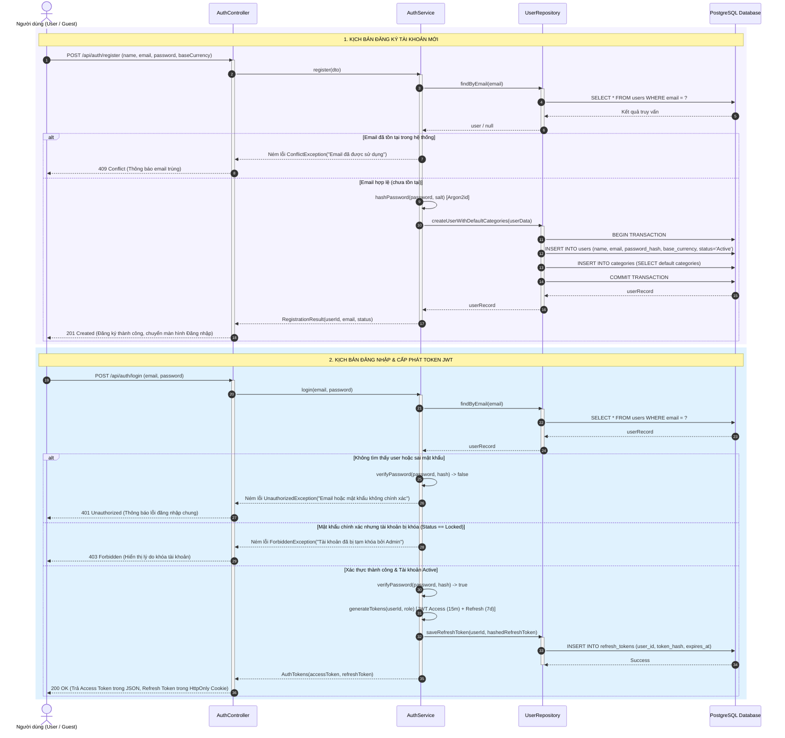

<b>Xem mã PlantUML tương ứng (dùng xuất ảnh nộp báo cáo Word)</b>

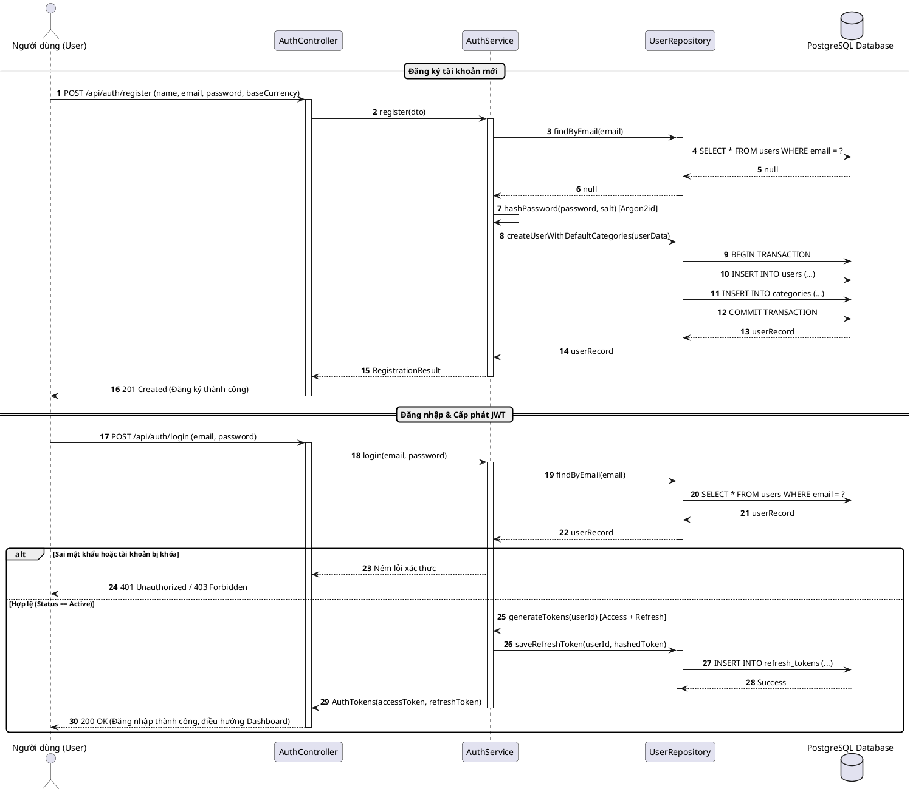

---

### SQ02: Ghi nhận Chi tiêu, Hạch toán Kép & Kiểm tra Ngân sách
- **Use Case liên quan:** `UC03` (Ghi nhận giao dịch), `UC05` (Kiểm soát ngân sách).
- **Quy tắc nghiệp vụ:** `BR01` (Kế toán kép), `BR06` (Bất biến sổ cái), `BR07` (Công thức ngân sách), `BR08` (Cảnh báo 80%/100%), `BR13` (Idempotency).
- **Kịch bản:** Người dùng gửi yêu cầu chi tiêu kèm `Idempotency-Key` -> Controller kiểm tra khóa chống trùng lặp -> LedgerService kiểm tra số dư ví khả dụng -> Mở Database Transaction nguyên tử -> Ghi nhận Transaction Posted -> Ghi 2 dòng Nợ/Có sổ cái -> Giảm số dư đệm ví -> Commit Transaction -> Kích hoạt BudgetService tính toán tỷ lệ ngân sách -> Sinh cảnh báo Vàng/Đỏ nếu vượt ngưỡng.

#### Sơ đồ Mermaid

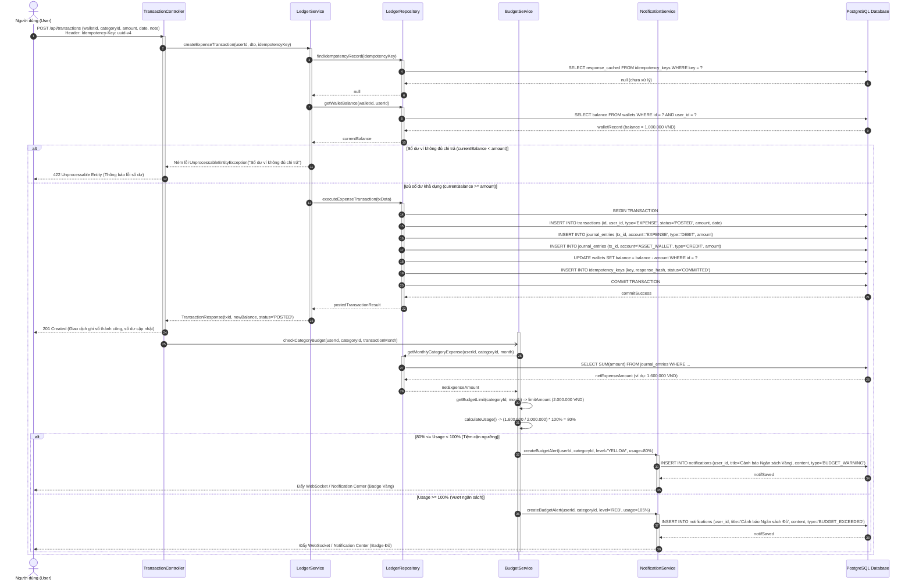

<b>Xem mã PlantUML tương ứng (dùng xuất ảnh nộp báo cáo Word)</b>

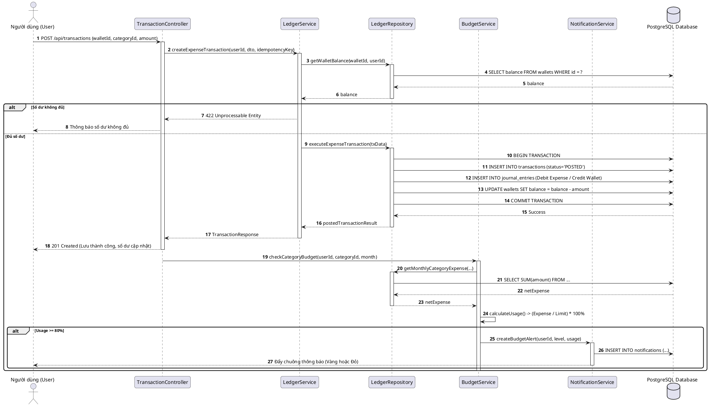

---

### SQ03: Chuyển tiền Nội bộ & Đảo Giao dịch (Reversal)
- **Use Case liên quan:** `UC03` (Quản lý giao dịch).
- **Quy tắc nghiệp vụ:** `BR01` (Kế toán kép), `BR05` (Chuyển tiền không ảnh hưởng Thu/Chi), `BR06` (Bất biến sổ cái & Đảo giao dịch), `BR13` (Idempotency).
- **Kịch bản:**
  - *Nhánh 1:* Chuyển tiền giữa 2 ví cùng chủ sở hữu -> Ghi Nợ Ví Đích / Ghi Có Ví Nguồn -> Cập nhật số dư 2 ví -> Net Worth và Thu/Chi không đổi.
  - *Nhánh 2:* Đảo giao dịch đã ghi sổ -> Kiểm tra bản gốc Posted và chưa bị đảo -> Đánh dấu `isReversed = true` -> Tạo giao dịch REVERSAL đối ứng ngược chiều nguyên tử -> Hoàn trả số dư ví về ban đầu.

#### Sơ đồ Mermaid

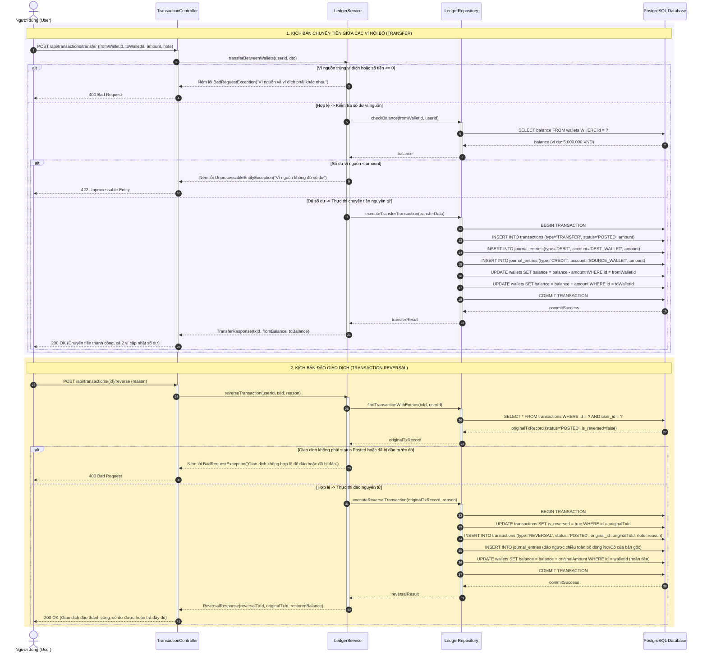

<b>Xem mã PlantUML tương ứng (dùng xuất ảnh nộp báo cáo Word)</b>

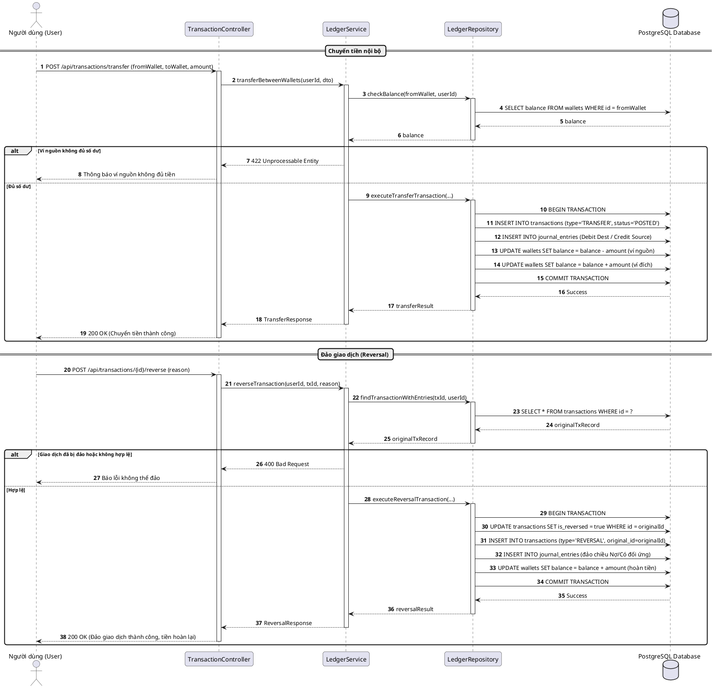

---

### SQ04: Xử lý Giao dịch Định kỳ Tự động (Subscription Cron)
- **Use Case liên quan:** `UC04` (Giao dịch định kỳ), `SYS02` (Tiến trình quét subscription).
- **Quy tắc nghiệp vụ:** `BR07` (Ngân sách), `BR09` (Tính toán ngày neo và lùi ngày cuối tháng).
- **Kịch bản:** Scheduler kích hoạt lúc 01:00 AM -> SubscriptionWorker quét danh sách Active đến hạn -> Kiểm tra chế độ `isAutoPost` và số dư ví -> Tự động ghi sổ Posted hoặc tạo bản nháp Draft -> Đẩy thông báo chuông cho User -> Tính toán ngày đến hạn kế tiếp `nextDueDate` (tự động lùi về ngày 28 cho tháng 2 nếu ngày neo là 29, 30, 31).

#### Sơ đồ Mermaid

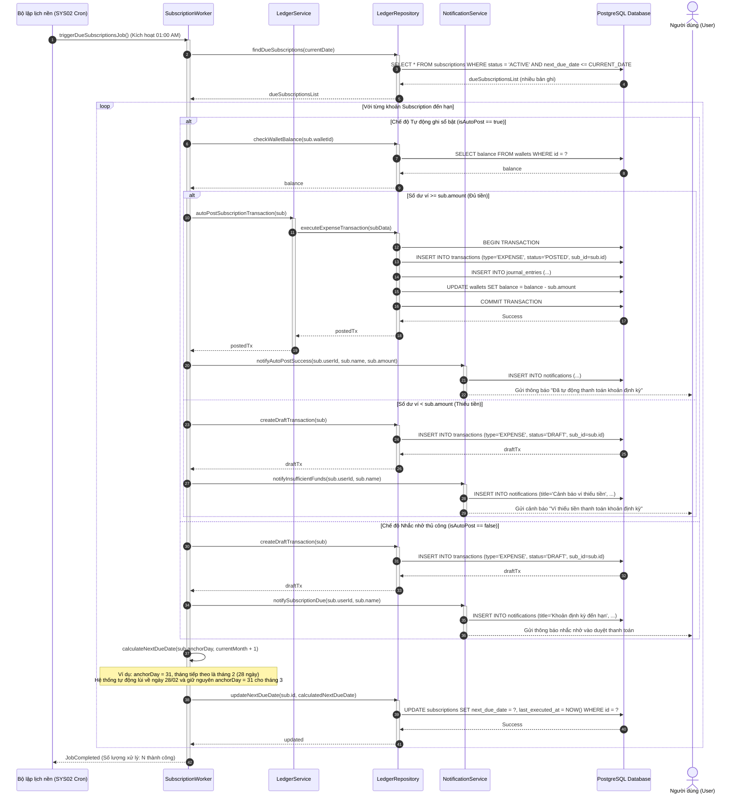

<b>Xem mã PlantUML tương ứng (dùng xuất ảnh nộp báo cáo Word)</b>

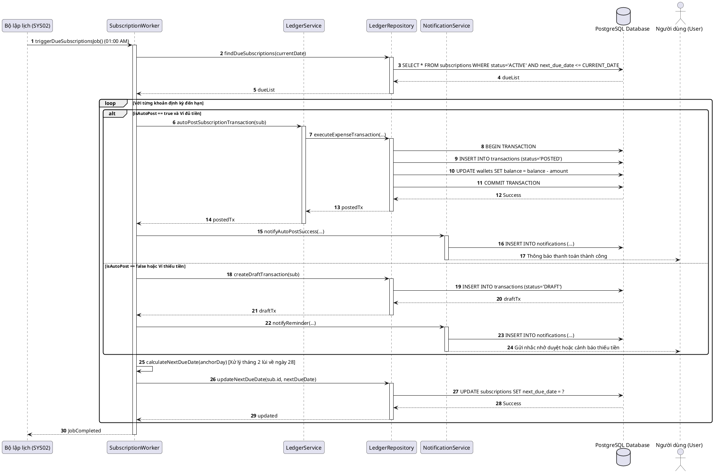

---

### SQ05: Khởi tạo Khoản vay & Thanh toán Trả nợ Vi mô (Microfinance)
- **Use Case liên quan:** `UC06` (Khởi tạo khoản vay), `UC07` (Thanh toán trả nợ).
- **Quy tắc nghiệp vụ:** `BR09` (Lịch trả nợ), `BR10` (Phân định Nợ vs Chi phí), `BR17` (Nguyên lý kế toán vi mô cho Vay mượn).
- **Kịch bản:**
  - *Nhánh 1:* Tạo khoản vay có giải ngân -> Tăng tiền ví và tăng Nợ phải trả (Total Liabilities), tuyệt đối cấm ghi nhận vào Thu nhập theo BR17.
  - *Nhánh 2:* Thanh toán trả nợ từng kỳ -> Bóc tách nợ gốc vs lãi/phí -> Giảm ví = Gốc + Lãi -> Giảm dư nợ gốc = Tiền gốc -> Chi phí tài chính = Tiền lãi -> Tự động chuyển `PAID_OFF` khi dư nợ $= 0$.

#### Sơ đồ Mermaid

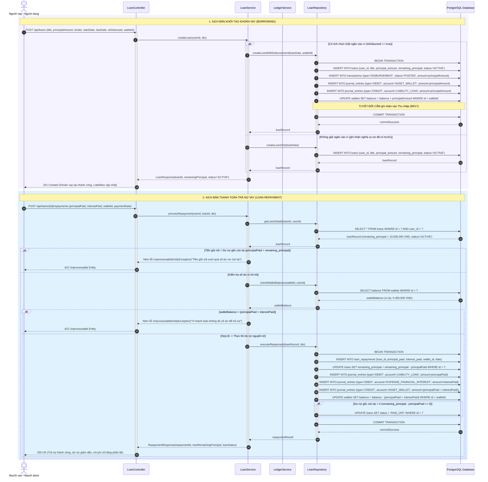

<b>Xem mã PlantUML tương ứng (dùng xuất ảnh nộp báo cáo Word)</b>

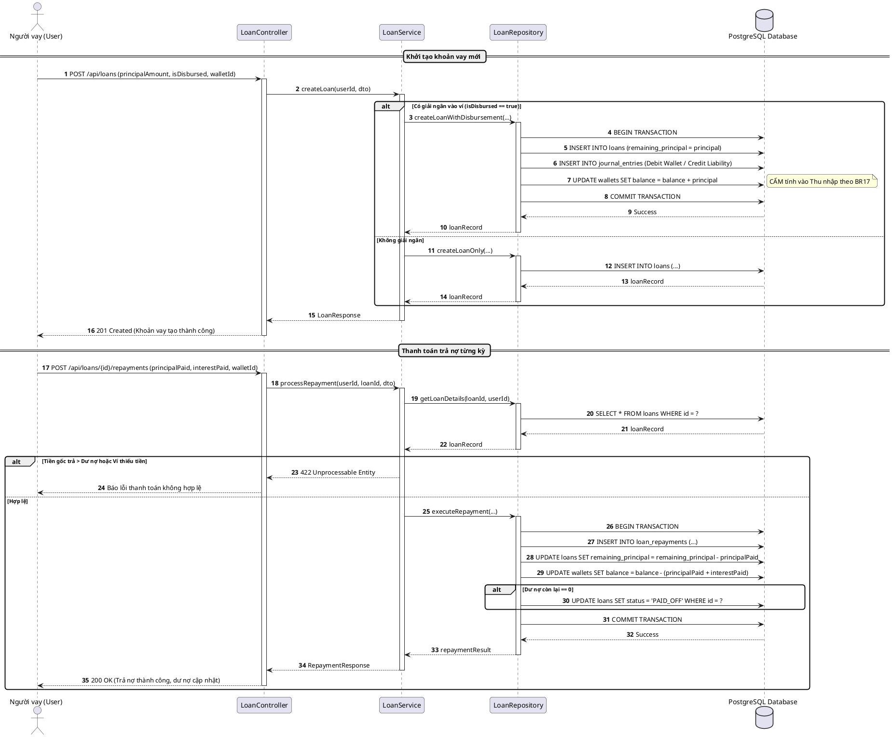

---

### SQ06: Quản lý Vàng Tích lũy & Tính toán Sức khỏe Net Worth Dashboard
- **Use Case liên quan:** `UC08` (Tài sản vàng), `UC10` (Dashboard sức khỏe tài chính & Net Worth).
- **Quy tắc nghiệp vụ:** `BR02` (Vốn chủ sở hữu), `BR03` & `BR04` (Định giá vàng), `BR16` (Công thức Net Worth), `BR18` (An toàn tỷ lệ tiết kiệm).
- **Kịch bản:** Người dùng thêm vàng hoặc cập nhật thị giá -> Hệ thống ghi nhận lịch sử Revaluation -> Người dùng truy cập Dashboard -> Hệ thống tổng hợp song song Total Assets (Ví + Vàng) và Total Liabilities (Thẻ tín dụng + Nợ vay) -> Tính Net Worth = Assets - Liabilities -> Tính Cash Flow = Income - Expense -> Tính toán an toàn Saving Rate (xử lý Thu nhập <= 0 trả về "N/A" tránh chia cho 0).

#### Sơ đồ Mermaid

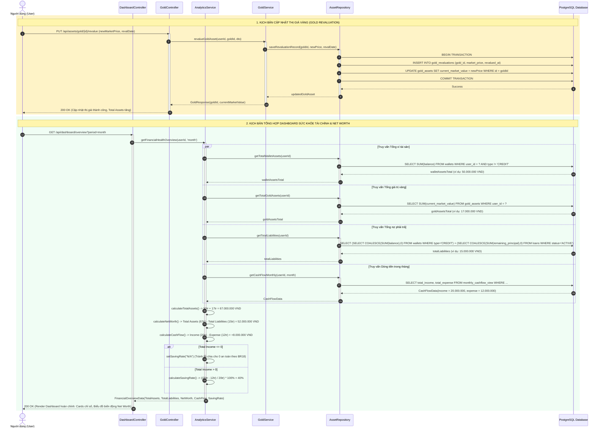

<b>Xem mã PlantUML tương ứng (dùng xuất ảnh nộp báo cáo Word)</b>

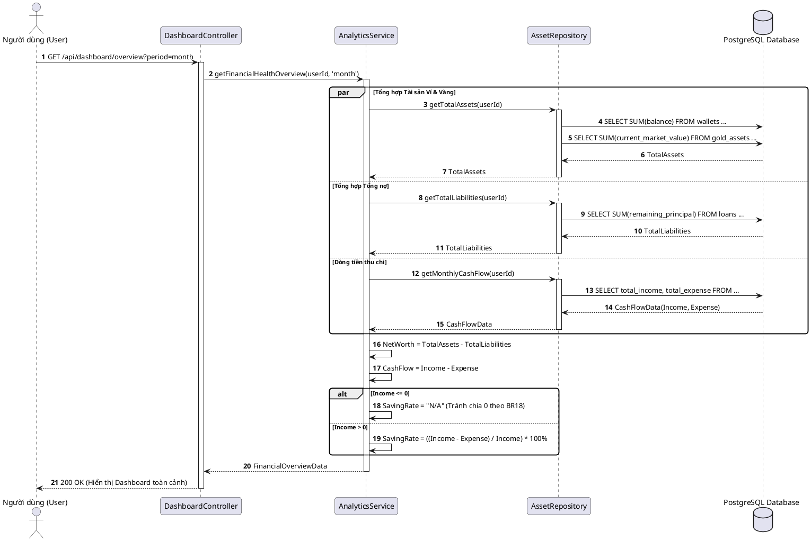

---

### SQ07: Báo cáo Đối soát Sổ cái & Xuất Dữ liệu CSV An toàn
- **Use Case liên quan:** `UC11` (Báo cáo & Xuất dữ liệu).
- **Quy tắc nghiệp vụ:** `BR01` (Kế toán kép), `BR12` (Đối soát số dư), `BR14` (Kiểm toán), `BR18` (Chuẩn mã hóa UTF-8 BOM).
- **Kịch bản:**
  - *Nhánh 1:* Đối soát số dư ví -> Lấy số dư bộ đệm ví so sánh với tổng đại số các dòng Nợ/Có sổ cái -> Khớp 100% (Delta = 0).
  - *Nhánh 2:* Xuất file CSV -> Lấy danh sách giao dịch -> Khử ký tự công thức nguy hiểm (`=, +, -, @`) phòng ngừa CSV Formula Injection -> Gắn ký tự UTF-8 BOM (`\uFEFF`) -> Trả Stream file CSV về trình duyệt.

#### Sơ đồ Mermaid

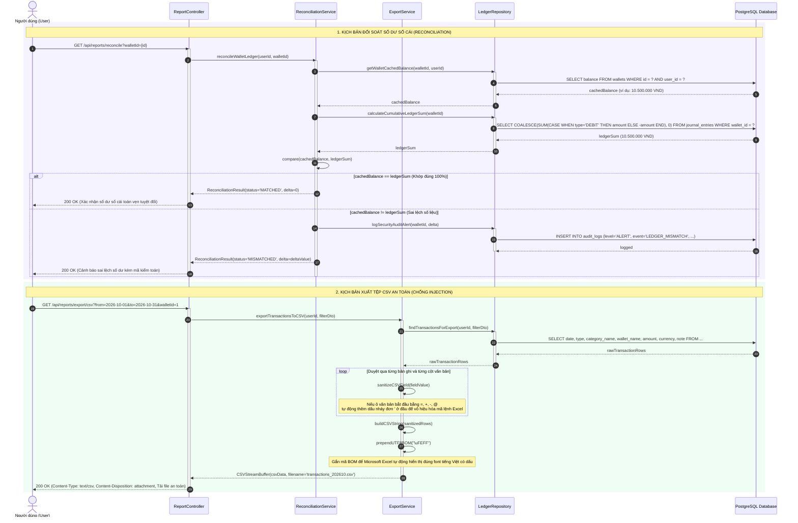

<b>Xem mã PlantUML tương ứng (dùng xuất ảnh nộp báo cáo Word)</b>

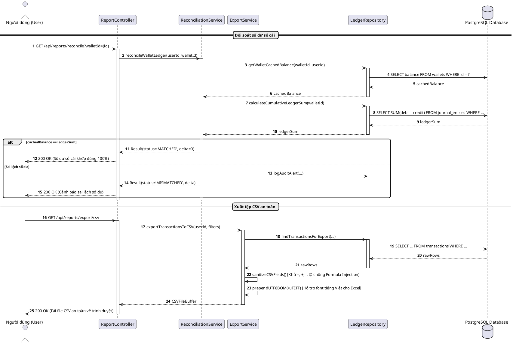

---

### SQ08: Quản trị Người dùng, Khóa Tài khoản & Phát Thông báo
- **Use Case liên quan:** `UC12` (Quản trị người dùng & Thống kê vĩ mô), `UC13` (Cấu hình hệ thống & Phát thông báo).
- **Quy tắc nghiệp vụ:** `BR11` (Bảo vệ quyền riêng tư người dùng), `BR13` (Quản trị cấu hình & Kiểm toán hành chính).
- **Kịch bản:**
  - *Nhánh 1:* Admin xem Dashboard vĩ mô -> Chỉ hiển thị tổng user, active, tiền cơ sở, tuyệt đối cách ly số dư cá nhân theo BR11.
  - *Nhánh 2:* Admin khóa tài khoản vi phạm -> Kiểm tra lý do khóa bắt buộc -> Kiểm tra không phải Admin cuối cùng -> Cập nhật trạng thái `LOCKED` -> Thu hồi toàn bộ Refresh Token của User -> Ghi nhật ký Admin Audit Log -> User bị đăng xuất ngay lập tức.
  - *Nhánh 3:* Admin phát thông báo Broadcast -> Lưu SystemAnnouncement -> Đẩy vào Notification của toàn bộ người dùng Active.

#### Sơ đồ Mermaid

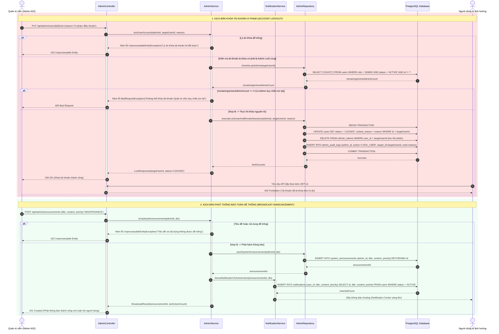

<b>Xem mã PlantUML tương ứng (dùng xuất ảnh nộp báo cáo Word)</b>

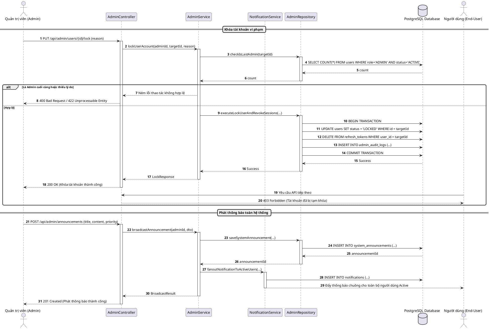

---

## 4. Ma trận Truy vết Tuần tự & Use Cases (Sequence Traceability Matrix)

| Mã Sơ đồ | Tên Kịch bản Tuần tự | Use Cases bao phủ | Quy tắc Nghiệp vụ (BR) | Các Lớp / Thành phần tham gia |
| :---: | :--- | :---: | :---: | :--- |
| **SQ01** | Đăng ký tài khoản, Mã hóa mật khẩu & Đăng nhập JWT | `UC01`, `UC02` | BR01, BR02, BR11, BR15 | `AuthController`, `AuthService`, `UserRepository` |
| **SQ02** | Ghi nhận Chi tiêu, Hạch toán Kép & Kiểm tra Ngân sách | `UC03`, `UC05` | BR01, BR06, BR07, BR08, BR13 | `TransactionController`, `LedgerService`, `BudgetService` |
| **SQ03** | Chuyển tiền Nội bộ & Đảo Giao dịch (Reversal) | `UC03` | BR01, BR05, BR06, BR13 | `TransactionController`, `LedgerService`, `LedgerRepository` |
| **SQ04** | Xử lý Giao dịch Định kỳ Tự động (Subscription Cron) | `UC04`, `SYS02` | BR07, BR09, BR13 | `SubscriptionWorker`, `LedgerService`, `NotificationService` |
| **SQ05** | Khởi tạo Khoản vay & Thanh toán Trả nợ Vi mô | `UC06`, `UC07` | BR09, BR10, BR17 | `LoanController`, `LoanService`, `LedgerService` |
| **SQ06** | Quản lý Vàng Tích lũy & Tính toán Sức khỏe Net Worth | `UC08`, `UC10` | BR02, BR03, BR04, BR16, BR18 | `DashboardController`, `AnalyticsService`, `GoldService` |
| **SQ07** | Báo cáo Đối soát Sổ cái & Xuất Dữ liệu CSV An toàn | `UC11` | BR01, BR12, BR14, BR18 | `ReportController`, `ReconciliationService`, `ExportService` |
| **SQ08** | Quản trị Người dùng, Khóa Tài khoản & Phát Thông báo | `UC12`, `UC13` | BR11, BR13, BR14 | `AdminController`, `AdminService`, `NotificationService` |

---

## 5. Kết luận và Bước kế tiếp trong Tiến trình Unified Process

Tài liệu **Sequence Diagrams** trên đã hoàn thành trọn vẹn việc mô hình hóa các lời gọi phương thức, luồng dữ liệu, tính nguyên tử của giao dịch (ACID) và ranh giới kiến trúc phân tầng BCE của hệ thống **WealthFlow**.

Theo tiến trình Unified Process (luồng kỹ nghệ *Analysis & Design*), sau khi đã hoàn tất Use Case Model, Activity Diagram và Sequence Diagram, các bước kế tiếp bao gồm:
1. **Design Class Diagram (Sơ đồ Lớp thiết kế):** Định nghĩa cụ thể tên lớp, thuộc tính, kiểu dữ liệu, các phương thức nghiệp vụ, quan hệ kế thừa và kết tập giữa các thành phần.
2. **Entity-Relationship Diagram & Database Schema (ERD & DB Schema):** Thiết kế chi tiết các bảng vật lý (Tables), khóa chính (Primary Keys), khóa ngoại (Foreign Keys), ràng buộc (Constraints) và chỉ mục (Indexes) trên hệ quản trị cơ sở dữ liệu PostgreSQL.
