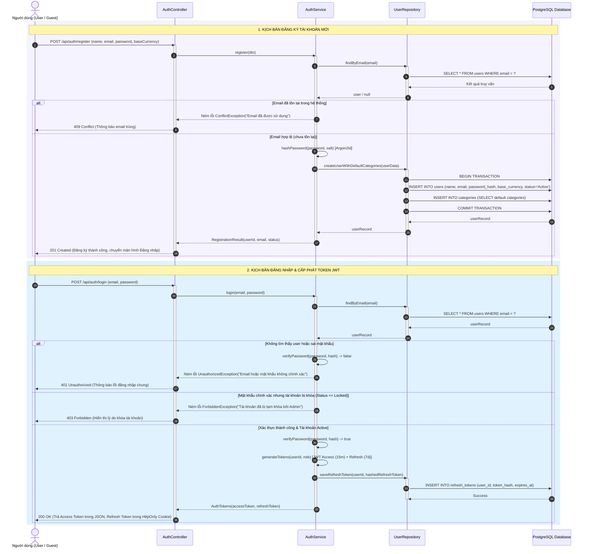
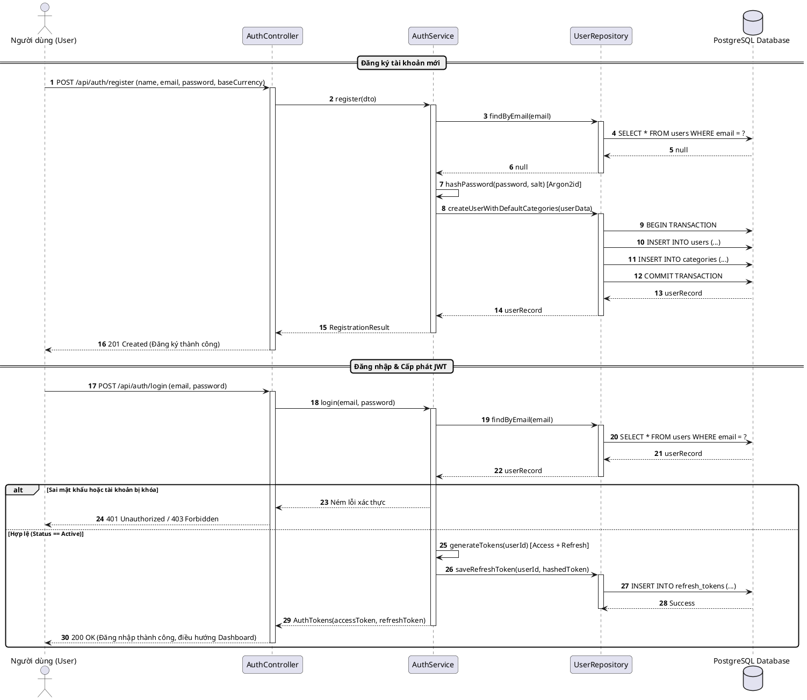

# SQ01: Đăng ký, Mã hóa Argon2id & Đăng nhập JWT

> Tham chiếu: [SRS.md](../../SRS.md) v2.1 | [sequence_diagram.md](../sequence_diagram.md) | [class_diagram.md](../class_diagram.md)

---

## 1. Thông tin Kịch bản Nghiệp vụ

| Thuộc tính | Chi tiết đặc tả |
| :--- | :--- |
| **Mã Sơ đồ** | **SQ01** |
| **Tên Kịch bản** | **Đăng ký tài khoản, Mã hóa mật khẩu Argon2id & Đăng nhập cấp phát JWT** |
| **Use Cases bao phủ** | `UC01` (Đăng ký & Xác thực người dùng), `UC02` (Quản lý ví và số dư mở sổ) |
| **Quy tắc Nghiệp vụ (BR)** | `BR01` (Kế toán kép), `BR02` (Số dư mở sổ đối ứng Equity), `BR11` (Bảo mật phiên & Cách ly dữ liệu), `BR15` (Bảo mật API) |
| **Yêu cầu Chức năng (FR)** | `FR01.01` - `FR01.05`, `FR15.01` |
| **Mục tiêu kỹ nghệ** | Mô hình hóa quy trình băm mật khẩu bảo mật (Argon2id/bcrypt), khởi tạo tài khoản Active nguyên tử, tự động sao chép danh mục thu/chi mặc định, và xác thực cấp cặp Token JWT (Access Token 15 phút, Refresh Token 7 ngày). |

---

## 2. Bảng Danh mục Đối tượng Tham gia (Lifelines)

| Tên Lifeline | Tầng Kiến trúc | Vai trò & Trách nhiệm |
| :--- | :---: | :--- |
| **User** | Actor | Khách vãng lai đăng ký hoặc Người dùng đăng nhập vào hệ thống. |
| **AuthController** | Boundary | Endpoint tiếp nhận HTTP POST `/api/auth/register` và `/api/auth/login`. |
| **AuthService** | Control | Xử lý logic băm mật khẩu, thẩm định tài khoản và ký số JWT. |
| **UserRepository** | Entity / Persistence | Truy vấn và lưu trữ thông tin thực thể User, RefreshToken. |
| **PostgreSQL Database** | Storage | Cơ sở dữ liệu quan hệ lưu trữ bản ghi và thực thi Transaction. |

---

## 3. Sơ đồ Tuần tự (Mermaid Sequence Diagram)

---

## 4. Mã nguồn PlantUML Tương ứng

<b>Nhấn để xem mã PlantUML chính quy (dùng xuất ảnh nộp báo cáo Word)</b>

---

## 5. Điều hướng Tài liệu
- **Về mục lục tổng quan:** [Tài liệu Tổng quan Sơ đồ Tuần tự](../sequence_diagram.md)
- **Kịch bản kế tiếp:** [SQ02: Ghi nhận Chi tiêu, Hạch toán Kép & Kiểm tra Ngân sách](./sq02_expense_budget.md)
