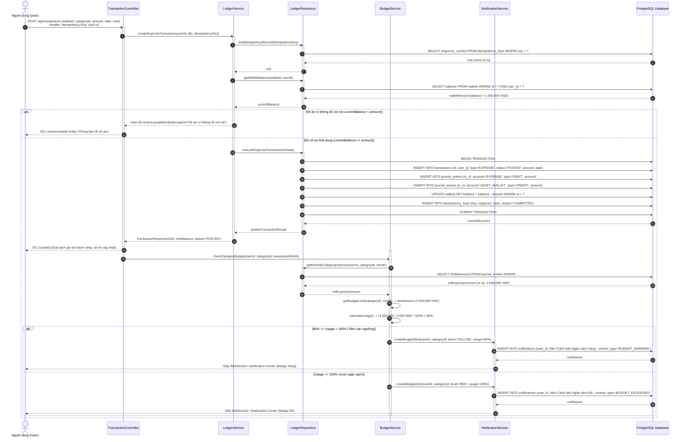
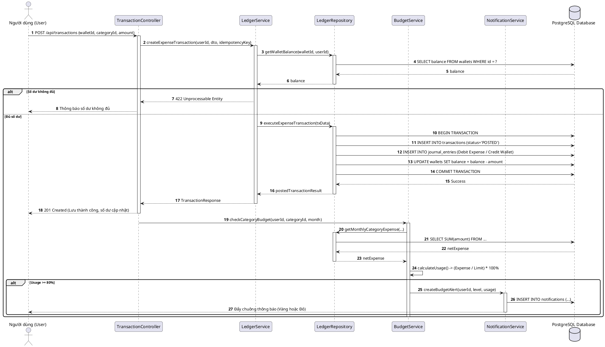

# SQ02: Ghi nhận Chi tiêu, Hạch toán Kép & Kiểm tra Ngân sách

> Tham chiếu: [SRS.md](../../SRS.md) v2.1 | [sequence_diagram.md](../sequence_diagram.md) | [class_diagram.md](../class_diagram.md)

---

## 1. Thông tin Kịch bản Nghiệp vụ

| Thuộc tính | Chi tiết đặc tả |
| :--- | :--- |
| **Mã Sơ đồ** | **SQ02** |
| **Tên Kịch bản** | **Ghi nhận Chi tiêu, Hạch toán Kép nguyên tử & Kiểm tra Ngân sách tháng** |
| **Use Cases bao phủ** | `UC03` (Ghi nhận giao dịch tài chính), `UC05` (Kiểm soát ngân sách chi tiêu), `SYS03` (Kiểm tra ngân sách) |
| **Quy tắc Nghiệp vụ (BR)** | `BR01` (Kế toán kép), `BR06` (Bất biến sổ cái), `BR07` (Công thức ngân sách), `BR08` (Cảnh báo 80%/100%), `BR13` (Idempotency) |
| **Yêu cầu Chức năng (FR)** | `FR03.01` - `FR03.04`, `FR05.01` - `FR05.03`, `FR15.01` |
| **Mục tiêu kỹ nghệ** | Mô hình hóa quy trình kiểm tra số dư ví khả dụng, chống trùng lặp mạng bằng `Idempotency-Key`, thực thi Transaction ACID hạch toán kép (Nợ Chi phí / Có Ví tài sản), cập nhật số dư đệm, và kích hoạt tác vụ kiểm tra hạn mức ngân sách để sinh thông báo Cảnh báo Vàng (80%) hoặc Cảnh báo Đỏ (100%). |

---

## 2. Bảng Danh mục Đối tượng Tham gia (Lifelines)

| Tên Lifeline | Tầng Kiến trúc | Vai trò & Trách nhiệm |
| :--- | :---: | :--- |
| **User** | Actor | Người dùng chủ động nhập liệu giao dịch chi tiêu trên giao diện. |
| **TransactionController** | Boundary | Tiếp nhận HTTP POST `/api/transactions` kèm header `Idempotency-Key`. |
| **LedgerService** | Control | Thẩm định số dư ví, chống trùng lặp và điều phối hạch toán kép. |
| **LedgerRepository** | Entity / Persistence | Mở transaction, lưu bản ghi Transaction, JournalEntries, cập nhật ví. |
| **BudgetService** | Control | Tính toán lũy kế chi tiêu ròng trong tháng và đối chiếu hạn mức ngân sách. |
| **NotificationService** | Control | Đẩy thông báo cảnh báo ngân sách vào cơ sở dữ liệu và WebSocket client. |
| **PostgreSQL Database** | Storage | Lưu trữ dữ liệu sổ cái và thực thi giao dịch ACID. |

---

## 3. Sơ đồ Tuần tự (Mermaid Sequence Diagram)

---

## 4. Mã nguồn PlantUML Tương ứng

<b>Nhấn để xem mã PlantUML chính quy (dùng xuất ảnh nộp báo cáo Word)</b>

---

## 5. Điều hướng Tài liệu
- **Kịch bản trước:** [SQ01: Đăng ký & Xác thực người dùng](./sq01_auth_jwt.md)
- **Về mục lục tổng quan:** [Tài liệu Tổng quan Sơ đồ Tuần tự](../sequence_diagram.md)
- **Kịch bản kế tiếp:** [SQ03: Chuyển tiền Nội bộ & Đảo Giao dịch](./sq03_transfer_reversal.md)
