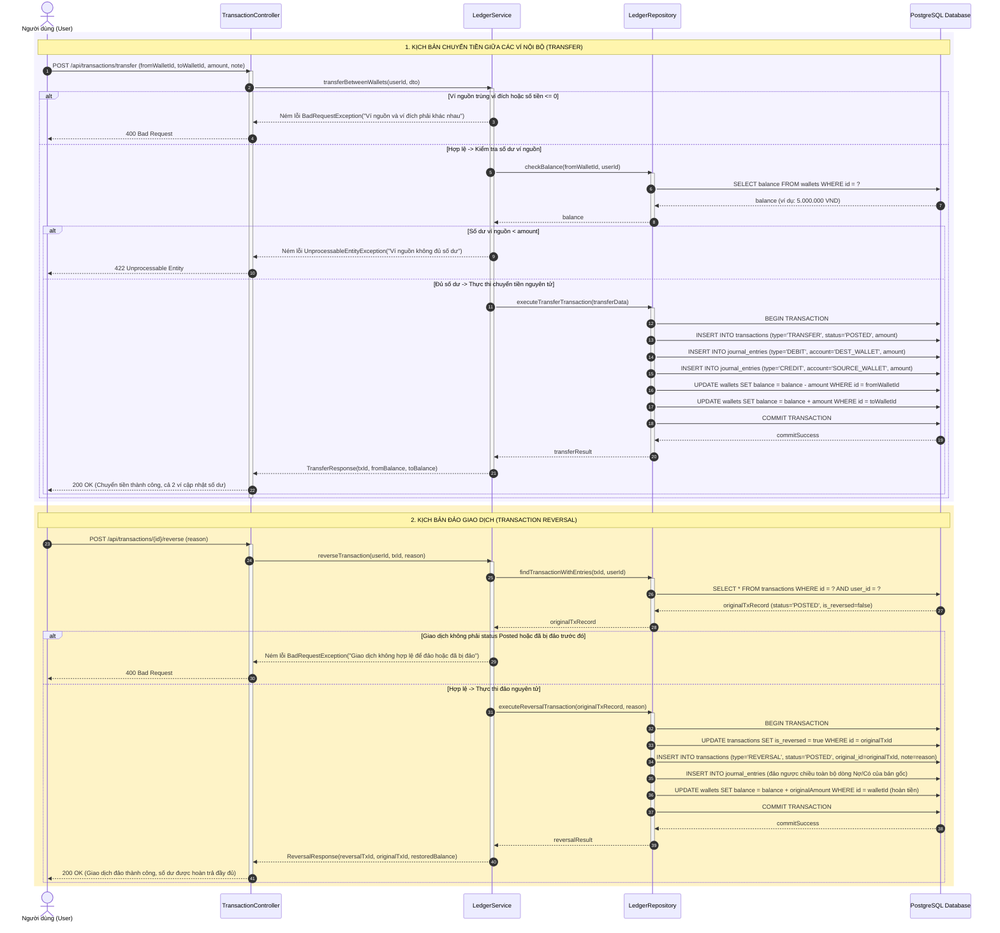
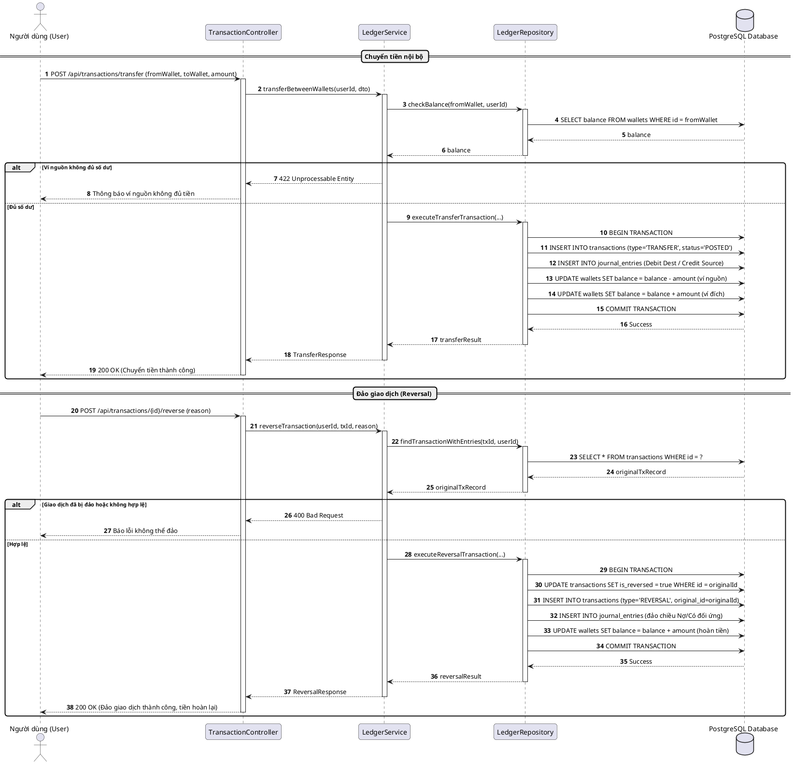

# SƠ ĐỒ TUẦN TỰ SQ03: CHUYỂN TIỀN NỘI BỘ & ĐẢO GIAO DỊCH (REVERSAL)
## PHÂN HỆ QUẢN LÝ THU CHI & NGÂN SÁCH (EXPENSE & BUDGET SUBSYSTEM)

**TRƯỜNG ĐẠI HỌC TÔN ĐỨC THẮNG - KHOA CÔNG NGHỆ THÔNG TIN**  
- **Môn học:** Công nghệ phần mềm (Software Engineering)
- **Đề tài:** Hệ thống Quản lý Tài chính Cá nhân, Tài sản và Tài chính Vi mô (WealthFlow)
- **Nhóm / Lớp:** Voz / N3
- **Tài liệu tham chiếu:** [SRS.md](../../SRS.md) v2.1 (UC03) và [sequence_diagram.md](../sequence_diagram.md)

---

## 1. Thông tin Kịch bản Nghiệp vụ

| Thuộc tính | Chi tiết đặc tả |
| :--- | :--- |
| **Mã Sơ đồ** | **SQ03** |
| **Tên Kịch bản** | **Chuyển tiền giữa các ví nội bộ & Đảo giao dịch (Reversal) bảo toàn kiểm toán** |
| **Use Cases bao phủ** | `UC03` (Ghi nhận & Quản lý giao dịch tài chính) |
| **Quy tắc Nghiệp vụ (BR)** | `BR01` (Kế toán kép), `BR05` (Chuyển tiền không ảnh hưởng Thu/Chi), `BR06` (Bất biến sổ cái & Đảo giao dịch), `BR13` (Idempotency) |
| **Yêu cầu Chức năng (FR)** | `FR03.01`, `FR03.03`, `FR03.04`, `FR15.01` |
| **Mục tiêu kỹ nghệ** | Mô hình hóa 2 luồng hạch toán đặc thù của kế toán: (1) Chuyển tiền nội bộ giữa 2 ví cùng chủ sở hữu (Ghi Nợ Ví Đích / Ghi Có Ví Nguồn, tuyệt đối không tính vào doanh số Thu nhập hay Chi phí) và (2) Đảo giao dịch Posted (tạo bút toán đảo ngược chiều đối ứng nguyên tử, liên kết `originalId`, hoàn trả số dư ví mà không xóa vật lý bản ghi cũ). |

---

## 2. Bảng Danh mục Đối tượng Tham gia (Lifelines)

| Tên Lifeline | Tầng Kiến trúc | Vai trò & Trách nhiệm |
| :--- | :---: | :--- |
| **User** | Actor | Người dùng thực hiện lệnh chuyển tiền hoặc yêu cầu đảo giao dịch đã ghi sổ. |
| **TransactionController** | Boundary | Tiếp nhận HTTP POST `/api/transactions/transfer` và `/api/transactions/{id}/reverse`. |
| **LedgerService** | Control | Kiểm tra quy tắc ví nguồn/đích, tính hợp lệ của giao dịch gốc và điều phối hạch toán. |
| **LedgerRepository** | Entity / Persistence | Thực thi Database Transaction nguyên tử ghi nhận các dòng Journal Entries. |
| **PostgreSQL Database** | Storage | Lưu trữ bất biến lịch sử sổ cái và cập nhật số dư các ví liên quan. |

---

## 3. Sơ đồ Tuần tự (Mermaid Sequence Diagram)

---

## 4. Mã nguồn PlantUML Tương ứng

<b>Nhấn để xem mã PlantUML chính quy (dùng xuất ảnh nộp báo cáo Word)</b>

---

## 5. Điều hướng Tài liệu
- **Kịch bản trước:** [SQ02: Ghi nhận Chi tiêu & Kiểm tra Ngân sách](./sq02_expense_budget.md)
- **Về mục lục tổng quan:** [Tài liệu Tổng quan Sơ đồ Tuần tự](../sequence_diagram.md)
- **Kịch bản kế tiếp:** [SQ04: Xử lý Giao dịch Định kỳ Tự động](./sq04_subscription_cron.md)
