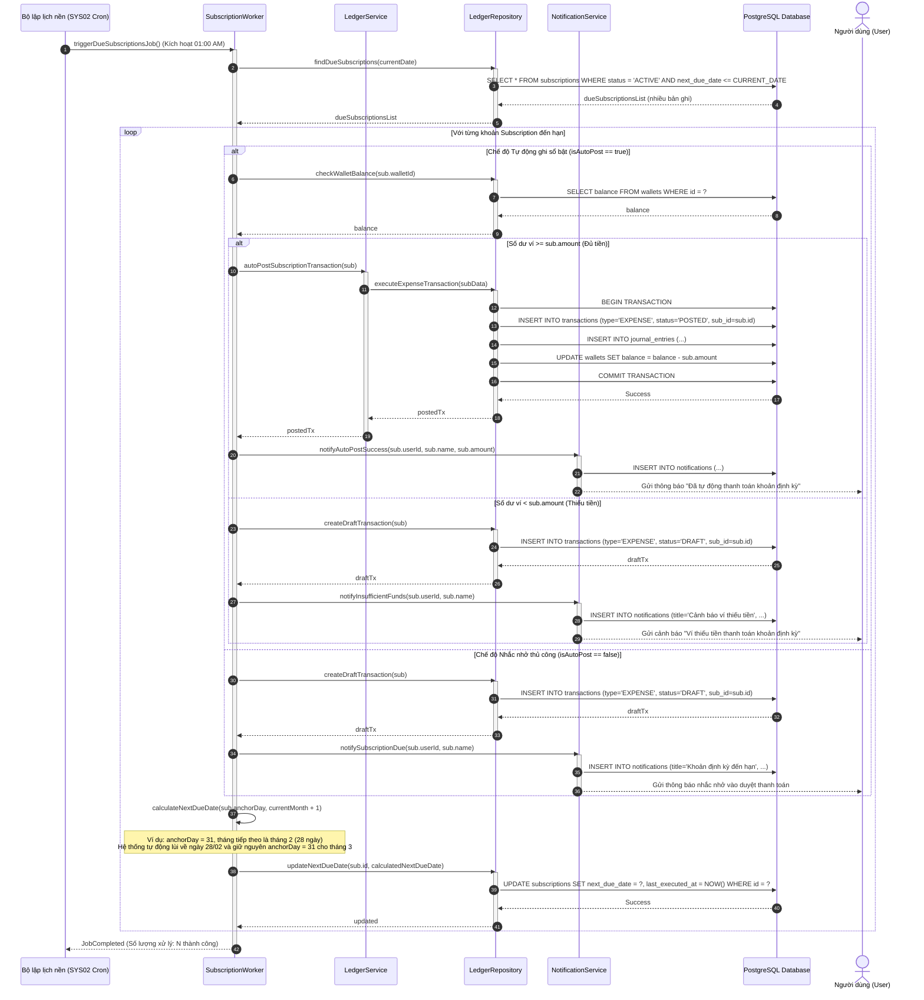
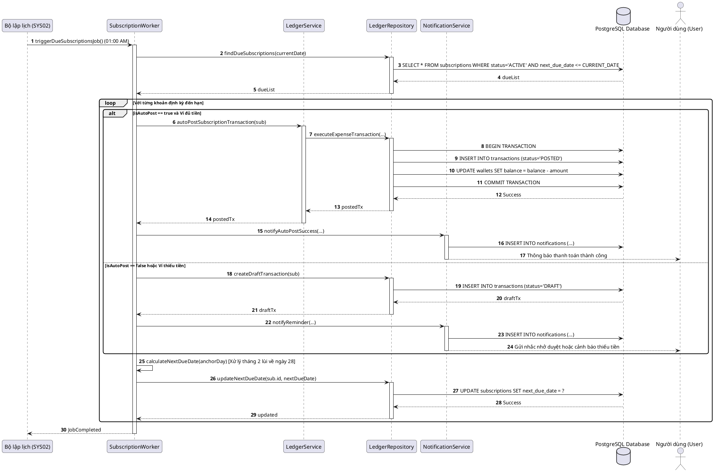

# SƠ ĐỒ TUẦN TỰ SQ04: XỬ LÝ GIAO DỊCH ĐỊNH KỲ TỰ ĐỘNG (SUBSCRIPTION CRON)
## PHÂN HỆ TIẾN TRÌNH NỀN & ĐỊNH KỲ (SCHEDULED SERVICES & SUBSCRIPTIONS)

**TRƯỜNG ĐẠI HỌC TÔN ĐỨC THẮNG - KHOA CÔNG NGHỆ THÔNG TIN**  
- **Môn học:** Công nghệ phần mềm (Software Engineering)
- **Đề tài:** Hệ thống Quản lý Tài chính Cá nhân, Tài sản và Tài chính Vi mô (WealthFlow)
- **Nhóm / Lớp:** Voz / N3
- **Tài liệu tham chiếu:** [SRS.md](../../SRS.md) v2.1 (UC04, SYS02) và [sequence_diagram.md](../sequence_diagram.md)

---

## 1. Thông tin Kịch bản Nghiệp vụ

| Thuộc tính | Chi tiết đặc tả |
| :--- | :--- |
| **Mã Sơ đồ** | **SQ04** |
| **Tên Kịch bản** | **Quét và xử lý tự động các khoản giao dịch định kỳ (Subscription) đến hạn bởi Scheduler** |
| **Use Cases bao phủ** | `UC04` (Thiết lập & Xử lý giao dịch định kỳ), `SYS02` (Tiến trình quét subscription nền) |
| **Quy tắc Nghiệp vụ (BR)** | `BR07` (Ngân sách chi tiêu), `BR09` (Tính toán ngày neo và lùi ngày cuối tháng) |
| **Yêu cầu Chức năng (FR)** | `FR06.01` - `FR06.03`, `FR15.01` |
| **Mục tiêu kỹ nghệ** | Mô hình hóa tiến trình Cron tự động kích hoạt lúc 01:00 AM hàng ngày: quét danh sách Active đến hạn, kiểm tra cờ `isAutoPost` và số dư ví chi trả, tự động ghi sổ Posted hoặc tạo bản nháp Draft, đẩy thông báo chuông cho User, và tự động tính toán ngày đến hạn tiếp theo (đặc biệt lùi về ngày 28 cho tháng 2 nếu ngày neo là 29, 30, 31). |

---

## 2. Bảng Danh mục Đối tượng Tham gia (Lifelines)

| Tên Lifeline | Tầng Kiến trúc | Vai trò & Trách nhiệm |
| :--- | :---: | :--- |
| **Bộ lập lịch (SYS02 Cron)** | Actor / System | Timer hệ thống kích hoạt worker theo lịch trình 01:00 AM hàng ngày. |
| **SubscriptionWorker** | Control | Điều phối tác vụ quét danh sách, kiểm tra điều kiện và tính toán chu kỳ tiếp theo. |
| **LedgerService** | Control | Thực thi tạo giao dịch chi phí tự động khi bật chế độ Auto-Post. |
| **LedgerRepository** | Entity / Persistence | Truy vấn các khoản Subscription đến hạn và lưu cập nhật ngày đến hạn. |
| **NotificationService** | Control | Đẩy thông báo thành công hoặc cảnh báo thiếu tiền vào Notification Center. |
| **PostgreSQL Database** | Storage | Lưu trữ các bản ghi Transactions, Subscriptions và Notifications. |
| **User** | Actor | Người dùng nhận thông báo trên chuông thông báo của ứng dụng. |

---

## 3. Sơ đồ Tuần tự (Mermaid Sequence Diagram)

---

## 4. Mã nguồn PlantUML Tương ứng

<b>Nhấn để xem mã PlantUML chính quy (dùng xuất ảnh nộp báo cáo Word)</b>

---

## 5. Điều hướng Tài liệu
- **Kịch bản trước:** [SQ03: Chuyển tiền Nội bộ & Đảo Giao dịch](./sq03_transfer_reversal.md)
- **Về mục lục tổng quan:** [Tài liệu Tổng quan Sơ đồ Tuần tự](../sequence_diagram.md)
- **Kịch bản kế tiếp:** [SQ05: Khởi tạo Khoản vay & Trả nợ Vi mô](./sq05_microfinance_loan.md)
