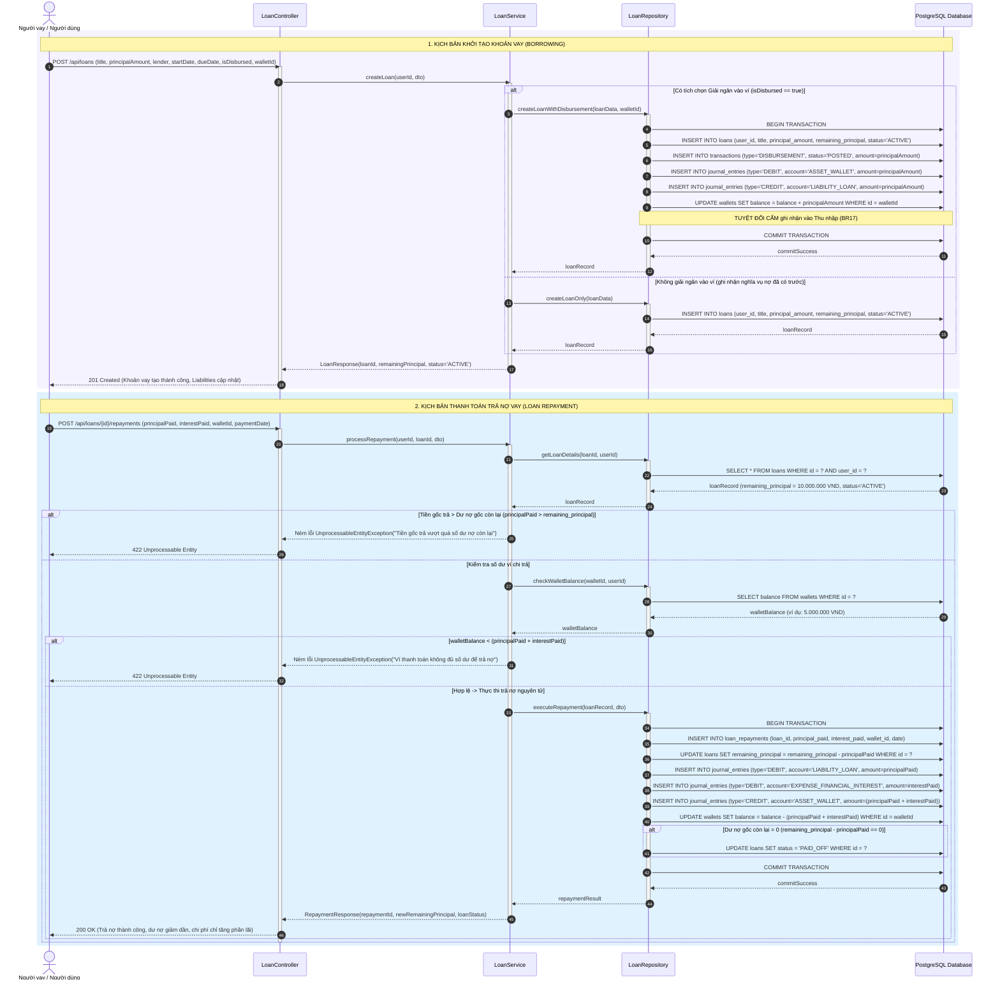
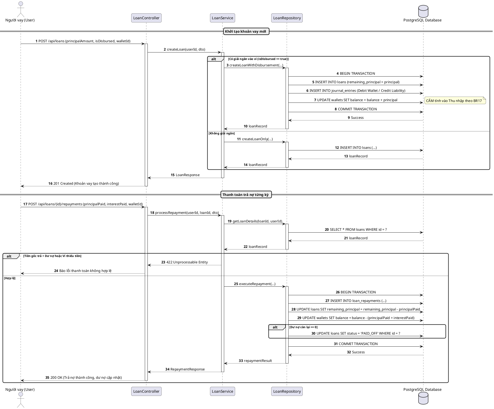

# SQ05: Khởi tạo Khoản vay & Thanh toán Trả nợ Vi mô

> Tham chiếu: [SRS.md](../../SRS.md) v2.1 | [sequence_diagram.md](../sequence_diagram.md) | [class_diagram.md](../class_diagram.md)

---

## 1. Thông tin Kịch bản Nghiệp vụ

| Thuộc tính | Chi tiết đặc tả |
| :--- | :--- |
| **Mã Sơ đồ** | **SQ05** |
| **Tên Kịch bản** | **Khởi tạo khoản vay vi mô (Borrowing) & Thanh toán trả nợ từng kỳ (Repayment)** |
| **Use Cases bao phủ** | `UC06` (Quản lý khoản vay và nghĩa vụ nợ vi mô), `UC07` (Ghi nhận thanh toán trả nợ vay) |
| **Quy tắc Nghiệp vụ (BR)** | `BR09` (Lịch trả nợ), `BR10` (Phân định Nợ vs Chi phí), `BR17` (Nguyên lý kế toán vi mô cho Vay mượn) |
| **Yêu cầu Chức năng (FR)** | `FR09.01` - `FR09.04`, `FR15.01` |
| **Mục tiêu kỹ nghệ** | Mô hình hóa 2 nghiệp vụ đặc thù của Tài chính vi mô: (1) Khởi tạo khoản vay có nhận tiền vào ví -> Tăng tiền ví và tăng Nợ phải trả (Total Liabilities), tuyệt đối cấm hạch toán vào Thu nhập (BR17); (2) Thanh toán trả nợ từng kỳ -> Bóc tách nợ gốc (làm giảm nợ phải trả và giảm tiền ví) so với tiền lãi/phí (hạch toán vào Chi phí tài chính và giảm tiền ví), cập nhật dư nợ giảm dần, tự động tất toán `PAID_OFF` khi dư nợ $= 0$. |

---

## 2. Bảng Danh mục Đối tượng Tham gia (Lifelines)

| Tên Lifeline | Tầng Kiến trúc | Vai trò & Trách nhiệm |
| :--- | :---: | :--- |
| **Người vay / User** | Actor | Người dùng tạo hồ sơ khoản vay hoặc thực hiện thanh toán trả nợ. |
| **LoanController** | Boundary | Endpoint tiếp nhận HTTP POST `/api/loans` và `/api/loans/{id}/repayments`. |
| **LoanService** | Control | Kiểm tra logic nghiệp vụ vi mô, bóc tách nợ gốc và tiền lãi. |
| **LoanRepository** | Entity / Persistence | Lưu trữ hồ sơ khoản vay, lịch sử trả nợ và cập nhật trạng thái `PAID_OFF`. |
| **PostgreSQL Database** | Storage | Thực thi các giao dịch hạch toán kép và lưu trữ bất biến sổ sách. |

---

## 3. Sơ đồ Tuần tự (Mermaid Sequence Diagram)

---

## 4. Mã nguồn PlantUML Tương ứng

<b>Nhấn để xem mã PlantUML chính quy (dùng xuất ảnh nộp báo cáo Word)</b>

---

## 5. Điều hướng Tài liệu
- **Kịch bản trước:** [SQ04: Xử lý Giao dịch Định kỳ Tự động](./sq04_subscription_cron.md)
- **Về mục lục tổng quan:** [Tài liệu Tổng quan Sơ đồ Tuần tự](../sequence_diagram.md)
- **Kịch bản kế tiếp:** [SQ06: Quản lý Vàng & Tổng hợp Net Worth Dashboard](./sq06_gold_networth.md)
