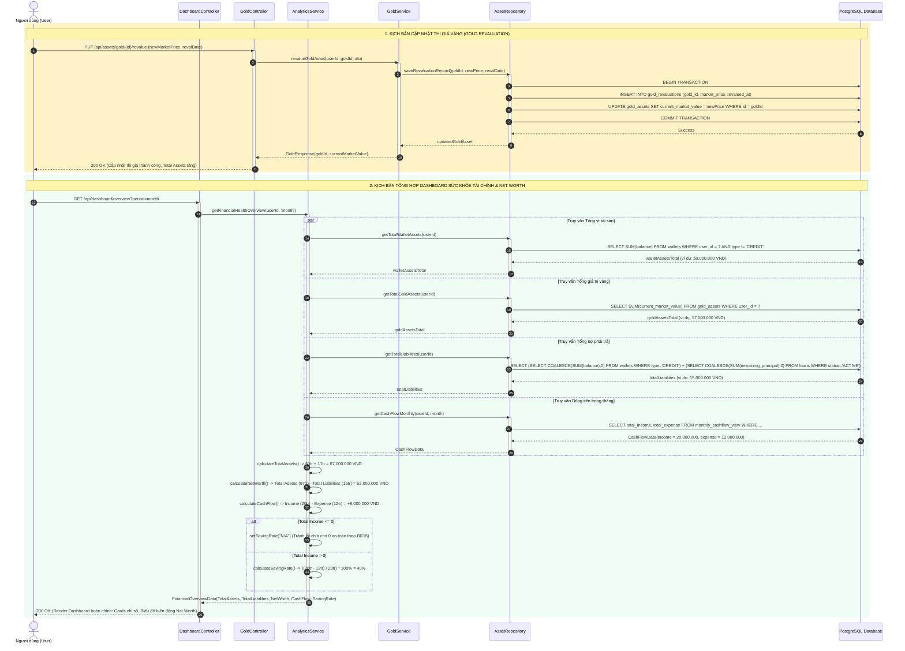
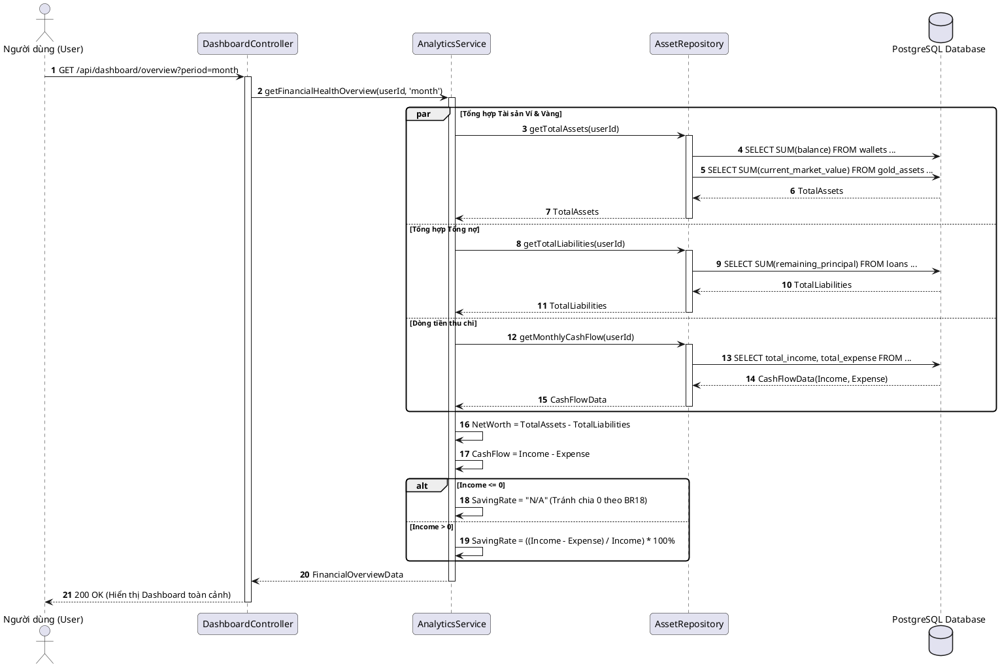

# SQ06: Quản lý Vàng & Tổng hợp Net Worth Dashboard

> Tham chiếu: [SRS.md](../../SRS.md) v2.1 | [sequence_diagram.md](../sequence_diagram.md) | [class_diagram.md](../class_diagram.md)

---

## 1. Thông tin Kịch bản Nghiệp vụ

| Thuộc tính | Chi tiết đặc tả |
| :--- | :--- |
| **Mã Sơ đồ** | **SQ06** |
| **Tên Kịch bản** | **Cập nhật thị giá vàng tích lũy (Revaluation) & Tổng hợp Dashboard Sức khỏe Tài chính Net Worth** |
| **Use Cases bao phủ** | `UC08` (Quản lý tài sản tích lũy ngoài ví - Vàng), `UC10` (Xem Dashboard sức khỏe tài chính & Net Worth) |
| **Quy tắc Nghiệp vụ (BR)** | `BR02` (Vốn chủ sở hữu), `BR03` & `BR04` (Định giá vàng), `BR16` (Công thức Net Worth), `BR18` (An toàn tỷ lệ tiết kiệm) |
| **Yêu cầu Chức năng (FR)** | `FR08.01` - `FR08.05`, `FR10.01` - `FR10.03`, `FR11.01` - `FR11.03`, `FR15.01` |
| **Mục tiêu kỹ nghệ** | Mô hình hóa 2 luồng xử lý: (1) Cập nhật thị giá mới cho vàng nhẫn 9999/SJC và lưu vết lịch sử Revaluation; (2) Truy vấn song song dữ liệu tài chính đa nguồn: Tổng số dư ví tài sản + Giá trị vàng thị trường $\rightarrow$ Total Assets; Tổng nợ thẻ tín dụng + Dư nợ gốc các khoản vay $\rightarrow$ Total Liabilities; Tính toán Net Worth = Total Assets - Total Liabilities; Tính Cash Flow; và xử lý an toàn ngoại lệ Saving Rate khi Thu nhập $\le 0$ trả về "N/A" theo BR18 tránh lỗi chia cho 0. |

---

## 2. Bảng Danh mục Đối tượng Tham gia (Lifelines)

| Tên Lifeline | Tầng Kiến trúc | Vai trò & Trách nhiệm |
| :--- | :---: | :--- |
| **User** | Actor | Người dùng cập nhật thị giá vàng hoặc mở xem màn hình Dashboard. |
| **DashboardController** | Boundary | Endpoint tiếp nhận HTTP GET `/api/dashboard/overview`. |
| **GoldController** | Boundary | Endpoint tiếp nhận HTTP PUT `/api/assets/gold/{id}/revalue`. |
| **AnalyticsService** | Control | Tổng hợp chỉ số tài chính, tính toán Net Worth, Cash Flow và Saving Rate. |
| **GoldService** | Control | Quản lý bản ghi vàng tích lũy và lưu trữ các phiên bản định giá lại. |
| **AssetRepository** | Entity / Persistence | Truy vấn đa nguồn số dư ví, tài sản vàng, dư nợ vay và doanh số thu/chi. |
| **PostgreSQL Database** | Storage | Cơ sở dữ liệu quan hệ cung cấp các bảng dữ liệu và view tổng hợp. |

---

## 3. Sơ đồ Tuần tự (Mermaid Sequence Diagram)

---

## 4. Mã nguồn PlantUML Tương ứng

<b>Nhấn để xem mã PlantUML chính quy (dùng xuất ảnh nộp báo cáo Word)</b>

---

## 5. Điều hướng Tài liệu
- **Kịch bản trước:** [SQ05: Khởi tạo Khoản vay & Trả nợ Vi mô](./sq05_microfinance_loan.md)
- **Về mục lục tổng quan:** [Tài liệu Tổng quan Sơ đồ Tuần tự](../sequence_diagram.md)
- **Kịch bản kế tiếp:** [SQ07: Báo cáo Đối soát Sổ cái & Xuất CSV](./sq07_reconciliation_csv.md)
