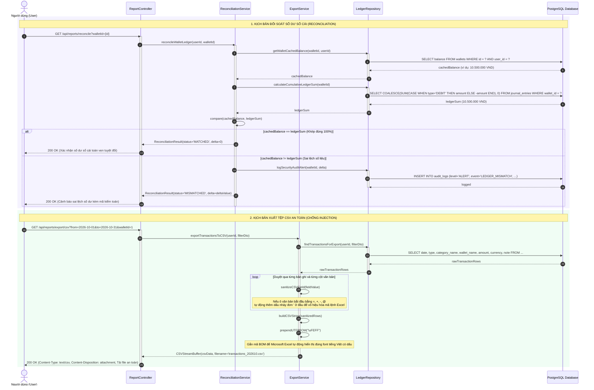
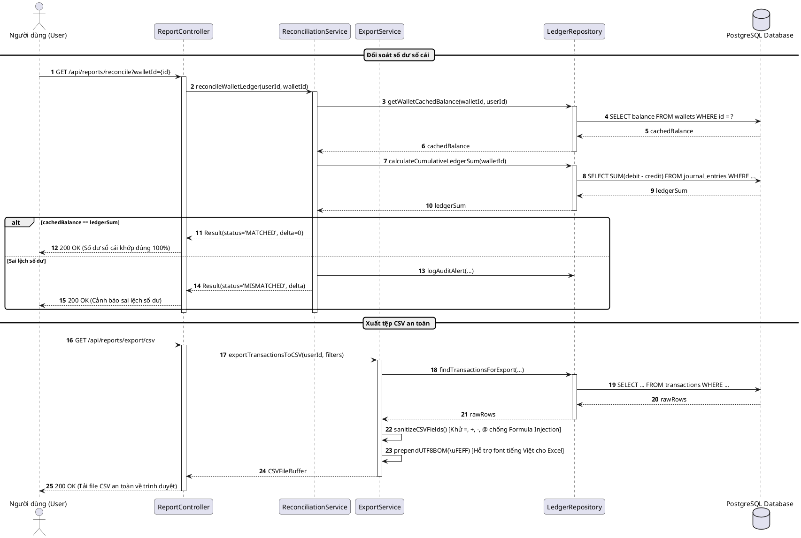

# SƠ ĐỒ TUẦN TỰ SQ07: ĐỐI SOÁT SỔ CÁI & XUẤT DỮ LIỆU CSV AN TOÀN
## PHÂN HỆ BÁO CÁO & ĐỐI SOÁT (REPORTING & RECONCILIATION SUBSYSTEM)

**TRƯỜNG ĐẠI HỌC TÔN ĐỨC THẮNG - KHOA CÔNG NGHỆ THÔNG TIN**  
- **Môn học:** Công nghệ phần mềm (Software Engineering)
- **Đề tài:** Hệ thống Quản lý Tài chính Cá nhân, Tài sản và Tài chính Vi mô (WealthFlow)
- **Nhóm / Lớp:** Voz / N3
- **Tài liệu tham chiếu:** [SRS.md](../../SRS.md) v2.1 (UC11) và [sequence_diagram.md](../sequence_diagram.md)

---

## 1. Thông tin Kịch bản Nghiệp vụ

| Thuộc tính | Chi tiết đặc tả |
| :--- | :--- |
| **Mã Sơ đồ** | **SQ07** |
| **Tên Kịch bản** | **Đối soát số dư sổ cái (Reconciliation) & Trích xuất tệp CSV an toàn chống Formula Injection** |
| **Use Cases bao phủ** | `UC11` (Báo cáo thống kê & Xuất dữ liệu CSV) |
| **Quy tắc Nghiệp vụ (BR)** | `BR01` (Kế toán kép), `BR12` (Đối soát số dư), `BR14` (Kiểm toán bảo mật), `BR18` (Chuẩn mã hóa UTF-8 BOM) |
| **Yêu cầu Chức năng (FR)** | `FR12.01` - `FR12.04`, `FR15.01` |
| **Mục tiêu kỹ nghệ** | Mô hình hóa 2 luồng: (1) Tính năng đối soát số dư độc lập: so sánh số dư bộ đệm ví với tổng đại số các dòng Nợ/Có sổ cái tích lũy, phát hiện sai lệch và ghi Security Audit Log nếu có; (2) Xuất tệp CSV: duyệt các trường văn bản, tự động trung hòa các ký tự công thức nguy hiểm (`=, +, -, @`) bằng cách thêm dấu nháy đơn `'` ở đầu (FR12.04), gắn tiền tố UTF-8 BOM (`\uFEFF`) để Microsoft Excel hiển thị tiếng Việt chuẩn xác và truyền tải an toàn. |

---

## 2. Bảng Danh mục Đối tượng Tham gia (Lifelines)

| Tên Lifeline | Tầng Kiến trúc | Vai trò & Trách nhiệm |
| :--- | :---: | :--- |
| **User** | Actor | Người dùng yêu cầu đối soát số dư ví hoặc ra lệnh xuất tệp CSV. |
| **ReportController** | Boundary | Endpoint tiếp nhận HTTP GET `/api/reports/reconcile` và `/api/reports/export/csv`. |
| **ReconciliationService** | Control | Tính toán đối soát, phát hiện độ lệch delta và ghi nhật ký kiểm toán. |
| **ExportService** | Control | Vệ sinh dữ liệu (Sanitization) chống injection, gắn BOM và đóng gói CSV Stream. |
| **LedgerRepository** | Entity / Persistence | Truy vấn tổng lũy kế các dòng JournalEntries và danh sách giao dịch. |
| **PostgreSQL Database** | Storage | Lưu trữ dữ liệu sổ cái bất biến và nhật ký kiểm toán hệ thống. |

---

## 3. Sơ đồ Tuần tự (Mermaid Sequence Diagram)

---

## 4. Mã nguồn PlantUML Tương ứng

<b>Nhấn để xem mã PlantUML chính quy (dùng xuất ảnh nộp báo cáo Word)</b>

---

## 5. Điều hướng Tài liệu
- **Kịch bản trước:** [SQ06: Quản lý Vàng & Tổng hợp Net Worth Dashboard](./sq06_gold_networth.md)
- **Về mục lục tổng quan:** [Tài liệu Tổng quan Sơ đồ Tuần tự](../sequence_diagram.md)
- **Kịch bản kế tiếp:** [SQ08: Quản trị Người dùng & Phát Thông báo](./sq08_admin_user_broadcast.md)
