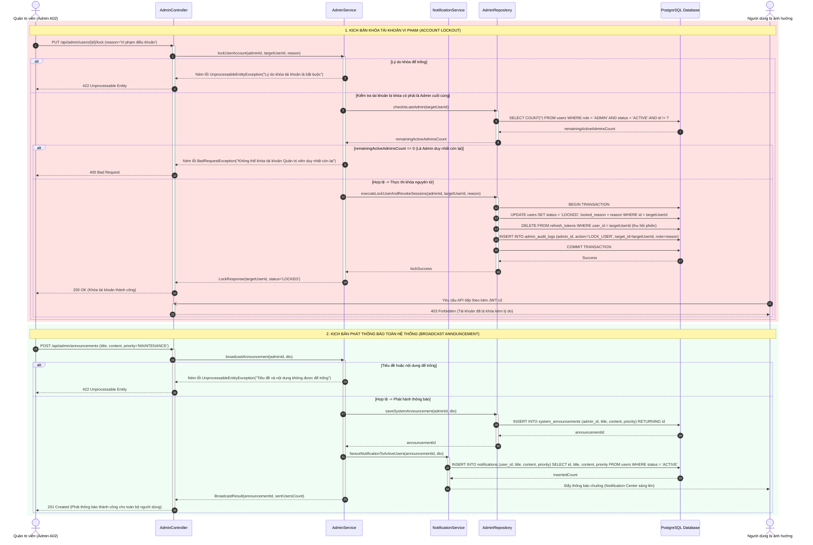
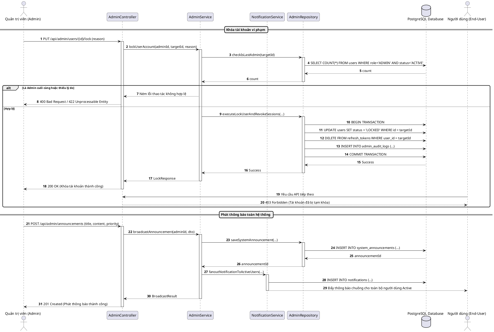

# SQ08: Quản trị Người dùng, Khóa Tài khoản & Phát Thông báo

> Tham chiếu: [SRS.md](../../SRS.md) v2.1 | [sequence_diagram.md](../sequence_diagram.md) | [class_diagram.md](../class_diagram.md)

---

## 1. Thông tin Kịch bản Nghiệp vụ

| Thuộc tính | Chi tiết đặc tả |
| :--- | :--- |
| **Mã Sơ đồ** | **SQ08** |
| **Tên Kịch bản** | **Quản trị Người dùng, Khóa Tài khoản & Phát Thông báo Toàn hệ thống** |
| **Use Cases bao phủ** | `UC12` (Quản trị người dùng & Thống kê vĩ mô), `UC13` (Cấu hình hệ thống & Phát thông báo) |
| **Quy tắc Nghiệp vụ (BR)** | `BR11` (Bảo mật phiên & Quyền riêng tư người dùng), `BR13` (Quản trị cấu hình & Kiểm toán hành chính), `BR14` (Kiểm toán bảo mật) |
| **Yêu cầu Chức năng (FR)** | `FR12.01` - `FR12.04`, `FR13.01` - `FR13.04` |
| **Mục tiêu kỹ nghệ** | Mô hình hóa quy trình quản trị người dùng, khóa tài khoản vi phạm an toàn (kiểm tra không cho phép tự khóa Admin duy nhất còn lại, thu hồi ngay lập tức toàn bộ Refresh Token, ghi nhật ký Admin Audit Log, trả về 403 Forbidden cho các request tiếp theo của User), và phát hành thông báo toàn hệ thống (Broadcast Announcement) đến hòm thư thông báo của tất cả người dùng Active. |

---

## 2. Bảng Danh mục Đối tượng Tham gia (Lifelines)

| Tên Lifeline | Tầng Kiến trúc | Vai trò & Trách nhiệm |
| :--- | :---: | :--- |
| **Admin** | Actor | Quản trị viên hệ thống (Role = ADMIN, Actor A02). |
| **AdminController** | Boundary | Endpoint tiếp nhận yêu cầu quản trị `/api/admin/users/...` và `/api/admin/announcements`. |
| **AdminService** | Control | Xử lý logic kiểm tra điều kiện Admin cuối cùng, thu hồi phiên và điều phối phát thông báo. |
| **NotificationService** | Control | Quản lý việc phân phối thông báo đến người dùng (fanout to active users). |
| **AdminRepository** | Entity / Persistence | Truy vấn và cập nhật trạng thái User, bảng RefreshToken, lưu AdminAuditLog và SystemAnnouncement. |
| **PostgreSQL Database** | Storage | Cơ sở dữ liệu quan hệ lưu trữ dữ liệu và thực thi Transaction nguyên tử. |
| **EndUser** | Actor | Người dùng thông thường bị ảnh hưởng khi tài khoản bị khóa hoặc khi nhận thông báo. |

---

## 3. Sơ đồ Tuần tự (Mermaid Sequence Diagram)

---

## 4. Đặc tả Chi tiết Các Khối Tương tác

### 4.1 Khóa Tài khoản Vi phạm & Thu hồi Phiên (Account Lockout)
1. **Kiểm tra nghiệp vụ tiền điều kiện:**
   - Trường lý do khóa (`locked_reason`) là bắt buộc để phục vụ công tác kiểm toán nội bộ và giải trình khi người dùng khiếu nại.
   - Hệ thống đếm số lượng tài khoản quản trị viên đang hoạt động (`role = 'ADMIN' AND status = 'ACTIVE' AND id != targetUserId`). Nếu kết quả bằng `0`, hệ thống từ chối hành động bằng mã `400 Bad Request` nhằm ngăn chặn trường hợp hệ thống mất toàn bộ quyền quản trị cấp cao.
2. **Thực thi giao dịch nguyên tử (ACID Transaction):**
   - Đổi trạng thái `users.status = 'LOCKED'`.
   - Xóa ngay lập tức mọi bản ghi trong `refresh_tokens` thuộc `targetUserId`. Khi đó, người dùng không thể xin cấp lại Access Token mới.
   - Khi Access Token hiện tại hết hạn (tối đa 15 phút) hoặc ngay tại lần truy vấn tiếp theo khi Middleware kiểm tra cờ trạng thái tài khoản, hệ thống sẽ lập tức từ chối với mã phản hồi `403 Forbidden`.
   - Ghi bản ghi vào `admin_audit_logs` để lưu vết người thực hiện, thời điểm và lý do.

### 4.2 Phát hành Thông báo Toàn hệ thống (Broadcast Announcement)
1. **Lưu trữ thông báo gốc:** Lưu bản ghi vào bảng `system_announcements` do Quản trị viên khởi tạo, kèm mức độ ưu tiên (`INFO`, `WARNING`, `MAINTENANCE`).
2. **Kỹ thuật Fan-out:** `NotificationService` phân phối thông báo hàng loạt vào bảng `notifications` cho tất cả người dùng có trạng thái `ACTIVE` thông qua câu lệnh SQL tối ưu (`INSERT INTO ... SELECT ...`), đảm bảo hiệu năng cao kể cả với quy mô hàng chục nghìn người dùng.

---

## 5. Mã Nguồn PlantUML Bổ trợ

<b>Nhấn để mở mã nguồn PlantUML (dùng để xuất ảnh nộp báo cáo Word)</b>

---

## 6. Điều hướng Tài liệu
- **Kịch bản trước:** [SQ07: Báo cáo Đối soát Sổ cái & Xuất Dữ liệu CSV An toàn](./sq07_reconciliation_csv.md)
- **Về mục lục tổng quan:** [Tài liệu Tổng quan Sơ đồ Tuần tự](../sequence_diagram.md)
