# Sơ đồ Use Case (Use Case Diagrams) - WealthFlow

> Tham chiếu: [SRS.md](../SRS.md) v2.1 (13 Core Use Cases) | [class_diagram.md](./class_diagram.md) | [sequence_diagram.md](./sequence_diagram.md)

---

## 1. Mục tiêu & Phạm vi Mô hình hóa (Objectives & Scope)

Tài liệu này đặc tả toàn diện mô hình ca sử dụng (Use Case Model) của hệ thống **WealthFlow: Quản trị Tài chính vi mô, Quản lý Chi tiêu và Tích lũy Tài sản Cá nhân** theo phương pháp luận Công nghệ Phần mềm chuẩn mực:
- **Tính truy vết hai chiều (Bidirectional Traceability):** Ánh xạ đầy đủ và nhất quán 100% với [SRS.md](../SRS.md) v2.1 bao gồm: 13 Core Use Cases ([UC01](../SRS.md#uc01) đến [UC13](../SRS.md#uc13)), 15 nhóm Yêu cầu Chức năng ([FR01](../SRS.md#fr01) đến [FR15](../SRS.md#fr15)), 18 Quy tắc Nghiệp vụ ([BR01](../SRS.md#br01) đến [BR18](../SRS.md#br18)) và 3 Tác vụ nền tự động ([SYS01](../SRS.md#sys01) đến [SYS03](../SRS.md#sys03)).
- **Phân tách trực quan & Rõ ràng (Granular Decomposition):** Mỗi ca sử dụng được mô hình hóa trong một biểu đồ con độc lập, trực quan, kèm theo thuyết minh nghiệp vụ chi tiết bao gồm tiền điều kiện, luồng cơ bản (Happy Path), các luồng thay thế (`AF`), và kiểm soát ngoại lệ (`EF`).
- **Chuẩn hóa Định danh:** Nghiêm ngặt tuân thủ hệ thống mã định danh chuẩn (`UR`, `BR`, `FR`, `UC`, `AF`, `EF`, `SYS`, `NFR`, `TC`), tuyệt đối không phát sinh ký hiệu tự chế.

---

## 2. Danh mục Tác nhân Hệ thống (Actors)

| Mã Tác nhân | Tên Tác nhân | Loại | Định nghĩa và Phạm vi tương tác |
| :---: | :--- | :---: | :--- |
| **A01** | **Người dùng (End-User)** | Chính (Primary) | Cá nhân sử dụng hệ thống để quản lý tài chính, ví tiền, thu chi, tài sản vàng tích lũy, vay nợ vi mô và xem báo cáo. |
| **A01-G** | **Khách vãng lai (Guest)** | Chính (Primary) | Người dùng chưa đăng nhập, chỉ có thể xem trang giới thiệu, thực hiện đăng ký tài khoản hoặc đăng nhập ([UC01](../SRS.md#uc01)). |
| **A02** | **Quản trị viên (System Admin)** | Quản trị (Admin) | Quản lý tài khoản người dùng (khóa/mở khóa), xem Dashboard thống kê vĩ mô, cấu hình hệ thống và phát thông báo ([UC12](../SRS.md#uc12), [UC13](../SRS.md#uc13)). Tuyệt đối không xem sổ sách cá nhân. |
| **A03** | **Exchange Rate Service** | Hỗ trợ (Secondary) | API nhà cung cấp tỷ giá hối đoái tiền tệ phục vụ quy đổi đa tiền tệ về đồng tiền cơ sở (`baseCurrency`). |
| **A04** | **Dịch vụ Thị giá Vàng (Gold Price API Provider)** | Hỗ trợ (Secondary) | Dịch vụ API bên ngoài cung cấp dữ liệu thị giá vàng (RESTful JSON API tổng hợp chuẩn hóa từ SJC, DOJI, PNJ) cho vàng nhẫn 9999 và vàng miếng SJC theo thời gian thực phục vụ định giá tài sản tích lũy ([UC08](../SRS.md#uc08)); hỗ trợ cơ chế tự động Fallback nhập thủ công khi mất kết nối. |
| **SYS** | **System Scheduler (Bộ lập lịch hệ thống)** | Nội bộ (Internal) | Bộ đếm thời gian và tiến trình chạy nền xử lý các tác vụ định kỳ tự động ([SYS01](../SRS.md#sys01) - [SYS03](../SRS.md#sys03)). |

---

## 3. Sơ đồ Use Case Tổng quan Toàn hệ thống (System Overview)

Sơ đồ tổng quan thể hiện kiến trúc phân hệ vĩ mô của hệ thống WealthFlow và mối quan hệ tương tác giữa các tác nhân (Actors) với **7 cụm phân hệ nghiệp vụ cốt lõi**:

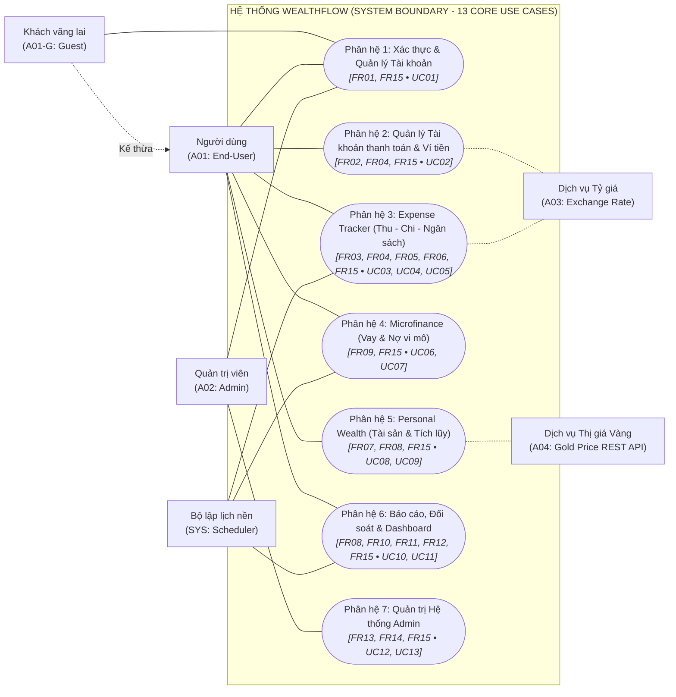

---

## 4. Sơ đồ Chi tiết theo Phân hệ Nghiệp vụ

---

### 4.1 Phân hệ 1: Xác thực & Quản lý Tài khoản (Authentication & Account Lifecycle)
*Nhóm Yêu cầu Chức năng ánh xạ:* [FR01](../SRS.md#fr01), [FR15](../SRS.md#fr15) | *Use Case trọng tâm:* [UC01](../SRS.md#uc01)

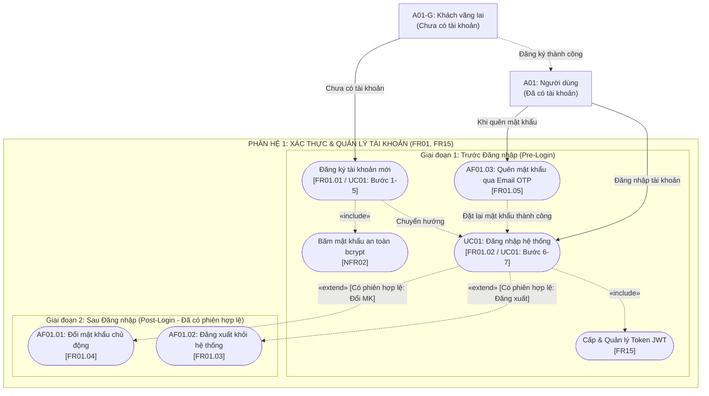

> **Thuyết minh nghiệp vụ phân hệ 1 (Xác thực & Tài khoản):**
>   - **Giai đoạn Trước Đăng nhập (Pre-Login):**
>     - **`Khách vãng lai (A01-G)`**: Chưa có tài khoản; thực hiện **`Đăng ký tài khoản mới`** (`FR01.01`, Bước 1–5 của `UC01`), bắt buộc băm mật khẩu bằng thuật toán `bcrypt` (`NFR02`). Đăng ký xong chuyển hướng sang màn hình Đăng nhập.
>     - **`Người dùng (A01)`**: Đã có tài khoản nhưng chưa đăng nhập:
>       - Nếu quên mật khẩu: Kích hoạt **`AF01.03: Quên mật khẩu qua Email OTP`** (`FR01.05`). Hệ thống gửi mã OTP 6 số qua email (hiệu lực 10 phút, tối đa 5 lần thử theo `EF01.05`) để đặt lại mật khẩu trước khi quay lại đăng nhập.
>       - Nếu nhớ mật khẩu: Thực hiện **`UC01: Đăng nhập hệ thống`** (`FR01.02`, Bước 6–7 của `UC01`), bắt buộc thẩm định và cấp cặp Token JWT (`FR15`).
>   - **Giai đoạn Sau Đăng nhập (Post-Login - Tiền điều kiện: Đang có phiên hợp lệ):**
>     - Chỉ sau khi đăng nhập thành công vào ứng dụng và có phiên làm việc JWT hợp lệ, người dùng mới có thể mở rộng thực hiện:
>       - **`AF01.01: Đổi mật khẩu chủ động`** (`FR01.04`): Tại trang Cài đặt cá nhân, nâng `tokenVersion` hủy các phiên cũ trên thiết bị khác.
>       - **`AF01.02: Đăng xuất khỏi hệ thống`** (`FR01.03`): Đưa Refresh Token vào Blacklist và xóa Cookie HttpOnly kết thúc phiên.

---

### 4.2 Phân hệ 2: Quản lý Tài khoản thanh toán & Ví tiền (Payment Accounts & Wallet Management)
*Nhóm Yêu cầu Chức năng ánh xạ:* [FR02](../SRS.md#fr02), [FR04](../SRS.md#fr04), [FR15](../SRS.md#fr15) | *Use Case trọng tâm:* [UC02](../SRS.md#uc02)

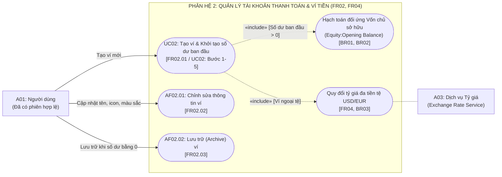

> **Thuyết minh nghiệp vụ phân hệ 2 (Quản lý Tài khoản thanh toán & Ví tiền):**
> - **Tiền điều kiện:** Tác nhân `Người dùng (A01)` bắt buộc phải có phiên đăng nhập hợp lệ (`FR15`).
> - **Các ca sử dụng & luồng sự kiện cốt lõi:**
>   - **`UC02: Tạo ví & Khởi tạo số dư ban đầu`** (`FR02.01`, Bước 1–5 của `UC02`): Hỗ trợ các loại ví: Tiền mặt, Ngân hàng, Ví điện tử (MoMo/ZaloPay), Tiết kiệm.
>     - Nếu số dư ban đầu $> 0$: Bắt buộc `«include»` tự động sinh bút toán kép đối ứng Ghi Nợ (Debit) tài khoản Ví mới và Ghi Có (Credit) tài khoản Vốn chủ sở hữu (`Equity:Opening Balance`) theo `BR01` và `BR02`.
>     - Nếu khởi tạo ví ngoại tệ (USD, EUR): Bắt buộc `«include»` truy vấn tỷ giá thời điểm từ `A03: Dịch vụ Tỷ giá` để quy đổi hiển thị giá trị tương đương theo đồng tiền cơ sở (`baseCurrency`, mặc định VND) theo `FR04` và `BR03`.
>   - **`AF02.01: Chỉnh sửa thông tin ví`** (`FR02.02`): Cho phép cập nhật tên ví, biểu tượng (icon) và màu sắc nhận diện; bảo toàn nguyên vẹn số dư và lịch sử sổ cái.
>   - **`AF02.02: Lưu trữ (Archive) ví`** (`FR02.03`): Chuyển trạng thái ví sang `Archived` (ẩn khỏi danh sách chọn nguồn tiền khi tạo giao dịch mới nhưng bảo toàn dữ liệu trong báo cáo lịch sử).
> - **Kiểm soát luồng ngoại lệ (Exception Handling):**
>   - `EF02.01`: Từ chối số dư mở sổ $< 0$ (`400 Bad Request`).
>   - `EF02.02`: Từ chối tên ví trùng lặp với ví đang hoạt động khác của người dùng (`409 Conflict`).
>   - `EF02.03`: Từ chối lưu trữ ví nếu số dư ví vẫn còn khác 0.
>   - `EF02.04`: Từ chối lưu trữ ví nếu ví đang được liên kết trong lịch định kỳ còn hiệu lực.

---

### 4.3 Phân hệ 3: Expense Tracker (Quản lý Thu - Chi, Định kỳ & Ngân sách)
*Nhóm Yêu cầu Chức năng ánh xạ:* [FR03](../SRS.md#fr03), [FR04](../SRS.md#fr04), [FR05](../SRS.md#fr05), [FR06](../SRS.md#fr06), [FR15](../SRS.md#fr15) | *Use Case trọng tâm:* [UC03](../SRS.md#uc03), [UC04](../SRS.md#uc04), [UC05](../SRS.md#uc05)

---

#### 4.3.1 Ca sử dụng UC03 – Ghi nhận & Quản lý giao dịch tài chính
*Ánh xạ chức năng:* [FR03](../SRS.md#fr03), [FR04](../SRS.md#fr04), [FR15](../SRS.md#fr15) | *Quy tắc nghiệp vụ:* [BR01](../SRS.md#br01), [BR04](../SRS.md#br04), [BR06](../SRS.md#br06), [BR12](../SRS.md#br12), [BR13](../SRS.md#br13), [BR15](../SRS.md#br15)

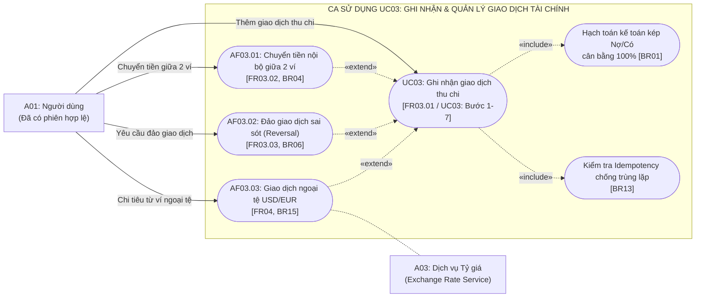

> **Thuyết minh nghiệp vụ UC03 (Ghi nhận & Quản lý giao dịch tài chính):**
> - **Tiền điều kiện:** Tác nhân `Người dùng (A01)` có phiên làm việc JWT hợp lệ (`FR15`) và có ít nhất một ví tài sản ở trạng thái hoạt động (`Active`).
> - **Luồng cơ bản (Ghi nhận thu/chi):** Người dùng nhập thông tin giao dịch chi tiêu/thu nhập. Hệ thống:
>   - Bắt buộc `«include»` kiểm tra `Idempotency-Key` (UUID v4) trong header theo `BR13`, chống trừ tiền trùng lặp khi mạng chập chờn (`EF03.01`).
>   - Bắt buộc `«include»` sinh cặp bút toán Nợ (Debit) và Có (Credit) kế toán kép bất biến, cân bằng tuyệt đối 100% ($\sum \text{Debit} = \sum \text{Credit}$) theo `BR01`.
>   - Cập nhật số dư bộ đệm của ví với khóa mức dòng (`SELECT FOR UPDATE`) theo `BR12`.
> - **Các luồng thay thế:**
>   - **`AF03.01: Chuyển tiền nội bộ giữa 2 ví`** (`FR03.02`, `BR04`): Ghi Nợ Ví đích và Ghi Có Ví nguồn; không làm thay đổi tổng tài sản và không ghi nhận vào thu/chi sinh hoạt.
>   - **`AF03.02: Đảo giao dịch (Reversal)`** (`FR03.03`, `BR06`): Tuyệt đối không xóa cứng (no hard delete); tự động sinh cặp bút toán đảo đối ứng `Reversed`, hoàn lại số dư ví và lưu vết kiểm toán.
>   - **`AF03.03: Giao dịch ngoại tệ`** (`FR04`, `BR15`): Khóa cứng snapshot tỷ giá hối đoái thời điểm từ `A03: Dịch vụ Tỷ giá` vào giao dịch để quy đổi ra đồng tiền cơ sở.
> - **Kiểm soát ngoại lệ:** `EF03.01` (Trùng khóa Idempotency), `EF03.02` (Số tiền $\le 0$ hoặc ngày tương lai), `EF03.03` (Số dư ví không đủ chi trả), `EF03.04` (Lỗi hệ thống Rollback 100%).

---

#### 4.3.2 Ca sử dụng UC04 – Thiết lập & Xử lý giao dịch định kỳ
*Ánh xạ chức năng:* [FR06](../SRS.md#fr06), [FR15](../SRS.md#fr15) | *Quy tắc nghiệp vụ:* [BR09](../SRS.md#br09), [BR12](../SRS.md#br12), [BR13](../SRS.md#br13) | *Tác vụ nền:* [SYS02](../SRS.md#sys02)

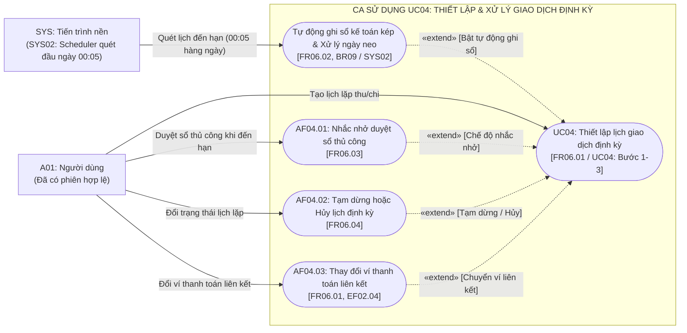

> **Thuyết minh nghiệp vụ UC04 (Thiết lập & Xử lý giao dịch định kỳ):**
> - **Tiền điều kiện:** `Người dùng (A01)` có phiên làm việc JWT hợp lệ (`FR15`); ví và danh mục liên kết đang ở trạng thái hoạt động (`Active`).
> - **Luồng cơ bản (Thiết lập lịch):** Người dùng cài đặt loại giao dịch, ví thanh toán, danh mục, số tiền, chu kỳ (Hàng tuần, Hàng tháng), ngày neo lặp và tùy chọn tự động ghi sổ. Hệ thống tính `nextDueDate` kế tiếp.
> - **Xử lý nền tự động (`SYS02`):** Tiến trình Cron `SYS02` chạy định kỳ vào **đầu ngày mới (00:05 AM hàng ngày)**:
>   - **Chế độ nhắc nhở thủ công (`AF04.01`):** Hệ thống phát thông báo nhắc nhở trước 1 ngày đến hạn để người dùng chủ động kiểm tra số dư và bấm xác nhận ghi sổ.
>   - **Chế độ tự động ghi sổ (`autoPost = true`):** `SYS02` thực hiện ghi sổ kế toán kép ngay đầu ngày đến hạn (00:05). Việc ghi sổ ngay đầu ngày giúp phản ánh kịp thời số dư thực tế trên ví/tài khoản WealthFlow, tránh trường hợp người dùng thấy số dư chưa bị trừ nên tiêu lẹm vào số tiền đó trước khi bên thứ 3 (chủ nhà, bên cung cấp dịch vụ) trừ tiền thực tế ngoài đời.
>   - Hệ thống tạo khóa chống xử lý lặp `(subscriptionId, dueDate)` theo `BR13`, kiểm tra số dư và tự động sinh bút toán kế toán kép ở trạng thái `Posted`.
>   - **Xử lý ngày neo (`BR09`):** Nếu ngày neo rơi vào tháng thiếu ngày (ví dụ ngày 31 rơi vào tháng 2 có 28 ngày), hệ thống tự động chạy vào ngày cuối cùng của tháng (28/02) và bảo lưu ngày neo 31 cho các tháng kế tiếp.
> - **Các luồng thay thế:**
>   - **`AF04.01: Nhắc nhở duyệt sổ thủ công`** (`FR06.03`): Nếu không bật tự động, hệ thống sinh thông báo nhắc nhở kèm nút "Xác nhận ghi sổ ngay" để người dùng chủ động duyệt.
>   - **`AF04.02: Tạm dừng hoặc Hủy lịch`** (`FR06.04`): Chuyển trạng thái sang `Paused` hoặc `Cancelled` để `SYS02` bỏ qua trong các chu kỳ sau.
>   - **`AF04.03: Thay đổi ví thanh toán liên kết`** (`FR06.01`, giải tỏa ràng buộc `EF02.04`): Cho phép người dùng chuyển lịch định kỳ sang một ví hoạt động khác; giải phóng hoàn toàn ràng buộc trên ví cũ, giúp người dùng chuyển hết số dư dư thừa (`AF03.01`) và tiến hành lưu trữ ví an toàn theo `AF02.02`.
> - **Kiểm soát ngoại lệ:** `EF04.01` (Tháng thiếu ngày tự động lùi về ngày cuối tháng), `EF04.02` (Ví không đủ tiền, chuyển trạng thái kỳ sang `Failed/Pending` và gửi thông báo khẩn cấp).

---

#### 4.3.3 Ca sử dụng UC05 – Thiết lập & Kiểm soát ngân sách chi tiêu
*Ánh xạ chức năng:* [FR05](../SRS.md#fr05), [FR15](../SRS.md#fr15) | *Quy tắc nghiệp vụ:* [BR07](../SRS.md#br07), [BR08](../SRS.md#br08) | *Tác vụ nền:* [SYS03](../SRS.md#sys03)

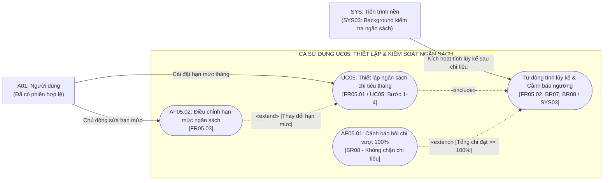

> **Thuyết minh nghiệp vụ UC05 (Thiết lập & Kiểm soát ngân sách chi tiêu):**
> - **Tiền điều kiện:** `Người dùng (A01)` có phiên làm việc JWT hợp lệ (`FR15`); có ít nhất một danh mục chi phí đang hoạt động.
> - **Luồng cơ bản (Thiết lập & Kiểm soát):**
>   - Người dùng cài đặt hạn mức chi tiêu cho danh mục trong tháng (ví dụ: Ăn uống 3.000.000 VND).
>   - Bắt buộc `«include»` tính toán tổng chi lũy kế từ đầu tháng đến thời điểm hiện tại và hiển thị thanh tiến độ trực quan với mã màu chuẩn (`NFR06`).
> - **Cơ chế cảnh báo ngưỡng tự động (`SYS03`):**
>   - Mỗi khi có giao dịch chi tiêu mới commit thành công (từ `UC03` hoặc `UC04`), tiến trình ngầm `SYS03` tự động tính lại % sử dụng trong vòng $\le 100\text{ ms}$ (`NFR01`):
>     - **Ngưỡng tiệm cận ($\ge 80\%$):** Đổi màu thanh tiến độ sang Vàng cam và bắn thông báo cảnh báo tiệm cận hạn mức (`BR07`).
>     - **Ngưỡng bội chi ($\ge 100\%$ - `AF05.01`):** Đổi màu thanh tiến độ sang Đỏ và gửi cảnh báo bội chi khẩn cấp theo `BR08`. **Hệ thống tuyệt đối không chặn giao dịch chi tiêu thực tế**, tuân thủ nghiêm ngặt ranh giới In-Scope của ứng dụng (§1.2).
> - **Luồng thay thế & Ngoại lệ:**
>   - **`AF05.02: Điều chỉnh hạn mức ngân sách`** (`FR05.03`): Cho phép người dùng linh hoạt tăng/giảm hạn mức trong tháng; hệ thống tự động tính lại tỷ lệ và đổi màu cảnh báo ngay lập tức.
>   - `EF05.01`: Từ chối hạn mức nhập vào $\le 0$ (`400 Bad Request`).
>   - `EF05.02`: Từ chối tạo trùng ngân sách cho cùng một danh mục trong cùng một tháng (`409 Conflict`).

---

### 4.4 Phân hệ 4: Microfinance (Quản lý Vay & Trả nợ vi mô)
*Nhóm Yêu cầu Chức năng ánh xạ:* [FR09](../SRS.md#fr09), [FR15](../SRS.md#fr15) | *Use Case trọng tâm:* [UC06](../SRS.md#uc06), [UC07](../SRS.md#uc07)

---

#### 4.4.1 Ca sử dụng UC06 – Khởi tạo & Quản lý khoản vay vi mô
*Ánh xạ chức năng:* [FR09](../SRS.md#fr09), [FR15](../SRS.md#fr15) | *Quy tắc nghiệp vụ:* [BR01](../SRS.md#br01), [BR05](../SRS.md#br05), [BR17](../SRS.md#br17) | *Tác vụ nền:* [SYS03](../SRS.md#sys03)

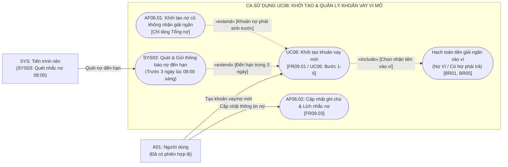

> **Thuyết minh nghiệp vụ UC06 (Khởi tạo & Quản lý khoản vay vi mô):**
> - **Tiền điều kiện:** Tác nhân `Người dùng (A01)` có phiên làm việc JWT hợp lệ (`FR15`).
> - **Luồng cơ bản (Tạo khoản vay mới):** Người dùng nhập tên khoản vay, chủ nợ/đối tác, số tiền nợ gốc, lãi suất (%/năm), ngày bắt đầu, ngày đáo hạn.
>   - **Ghi nhận giải ngân vào ví (`BR01`, `BR05`):** Nếu người dùng tích chọn nhận tiền vào ví tài sản, hệ thống tự động sinh bút toán kế toán kép: Ghi Nợ (Debit) Ví tài sản và Ghi Có (Credit) Tài khoản Nợ phải trả (`Liability:Loan`).
>   - **Tác động Dashboard:** Tổng tài sản (`Total Assets`) tăng, Tổng nợ (`Total Liabilities`) tăng cùng một lượng; **Tài sản ròng (`Net Worth`) tuyệt đối không đổi** và số tiền vay nhận về **không được tính vào Thu nhập** sinh hoạt theo `BR05`.
> - **Các luồng thay thế:**
>   - **`AF06.01: Khởi tạo nợ cũ không nhận giải ngân`**: Dành cho khoản nợ đã giải ngân từ trước khi sử dụng app. Hệ thống chỉ ghi nhận nợ gốc vào Tổng nợ để theo dõi nghĩa vụ trả nợ, không ghi tăng số dư ví.
>   - **`AF06.02: Cập nhật ghi chú & Lịch nhắc nợ`** (`FR09.03`): Người dùng chỉnh sửa thông tin liên hệ chủ nợ hoặc ghi chú kỳ hạn.
> - **Tác vụ nền hỗ trợ (`SYS03`):** Lúc 08:00 sáng hàng ngày, tiến trình `SYS03` quét các khoản nợ `Active` có ngày đáo hạn trong vòng 3 ngày tới để gửi thông báo nhắc nhở người dùng chuẩn bị nguồn tiền.
> - **Kiểm soát ngoại lệ:** `EF06.01` (Số tiền nợ gốc $\le 0$), `EF06.02` (Lãi suất $< 0$), `EF06.03` (Ngày đáo hạn trước ngày bắt đầu).
> - **Ranh giới In-Scope / Out-of-Scope (§1.2):** Hệ thống đóng vai trò sổ theo dõi nghĩa vụ nợ cá nhân; không thẩm định tín dụng, không thực hiện giải ngân tiền mặt ngoài đời.

---

#### 4.4.2 Ca sử dụng UC07 – Ghi nhận thanh toán trả nợ vay
*Ánh xạ chức năng:* [FR03](../SRS.md#fr03), [FR09](../SRS.md#fr09), [FR15](../SRS.md#fr15) | *Quy tắc nghiệp vụ:* [BR01](../SRS.md#br01), [BR05](../SRS.md#br05), [BR17](../SRS.md#br17)

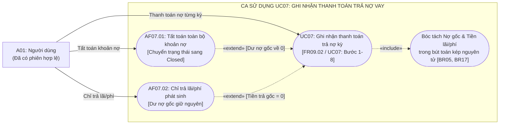

> **Thuyết minh nghiệp vụ UC07 (Ghi nhận thanh toán trả nợ vay):**
> - **Tiền điều kiện:** `Người dùng (A01)` có phiên làm việc JWT hợp lệ (`FR15`); khoản nợ ở trạng thái `Active` có dư nợ gốc $> 0$; ví thanh toán đủ số dư khả dụng.
> - **Luồng cơ bản (Thanh toán trả nợ kỳ):** Người dùng nhập Tiền trả gốc, Tiền lãi/phí và chọn ví thanh toán.
>   - **Bóc tách bắt buộc theo kế toán kép (`BR05`, `BR17`):** Hệ thống mở Database Transaction nguyên tử sinh 3 dòng sổ cái:
>     - **Ghi Nợ (Debit) Nợ phải trả (`Liability`):** Đúng bằng tiền trả gốc (làm giảm dư nợ vay và giảm Tổng nợ trên Dashboard).
>     - **Ghi Nợ (Debit) Chi phí lãi vay (`Expense:Interest`):** Tính vào chi phí sinh hoạt kỳ này.
>     - **Ghi Có (Credit) Ví thanh toán (`Asset:Wallet`):** Tổng tiền thanh toán (Gốc + Lãi).
>   - **Bảo toàn báo cáo ngân sách (`BR05`):** Tiền trả nợ gốc **không bị tính vào chi phí sinh hoạt** và không trừ vào hạn mức ngân sách chi tiêu tháng (`UC05`), bảo đảm báo cáo tài chính phản ánh đúng bản chất dòng tiền.
> - **Các luồng thay thế:**
>   - **`AF07.01: Tất toán toàn bộ khoản nợ`**: Khi người dùng thanh toán hết nợ và dư nợ gốc về đúng bằng $0$, hệ thống tự động đổi trạng thái khoản vay sang `Closed` (Đã hoàn tất nghĩa vụ nợ).
>   - **`AF07.02: Chỉ thanh toán tiền lãi/phí`**: Trường hợp chỉ đóng lãi kỳ mà chưa trả gốc (Tiền trả gốc $= 0$), hệ thống chỉ ghi Nợ Chi phí lãi / Có Ví, giữ nguyên số dư nợ gốc.
> - **Kiểm soát ngoại lệ:** `EF07.01` (Tiền trả gốc $>$ Dư nợ hiện tại), `EF07.02` (Số dư ví không đủ chi trả tổng tiền), `EF07.03` (Thao tác trên khoản nợ đã đóng `Closed`).

---

### 4.5 Phân hệ 5: Personal Wealth (Tài sản tích lũy & Mục tiêu tài chính)
*Nhóm Yêu cầu Chức năng ánh xạ:* [FR07](../SRS.md#fr07), [FR08](../SRS.md#fr08), [FR15](../SRS.md#fr15) | *Use Case trọng tâm:* [UC08](../SRS.md#uc08), [UC09](../SRS.md#uc09)

---

#### 4.5.1 Ca sử dụng UC08 – Quản lý tài sản tích lũy ngoài ví (Vàng)
*Ánh xạ chức năng:* [FR08](../SRS.md#fr08), [FR15](../SRS.md#fr15) | *Quy tắc nghiệp vụ:* [BR02](../SRS.md#br02), [BR16](../SRS.md#br16)

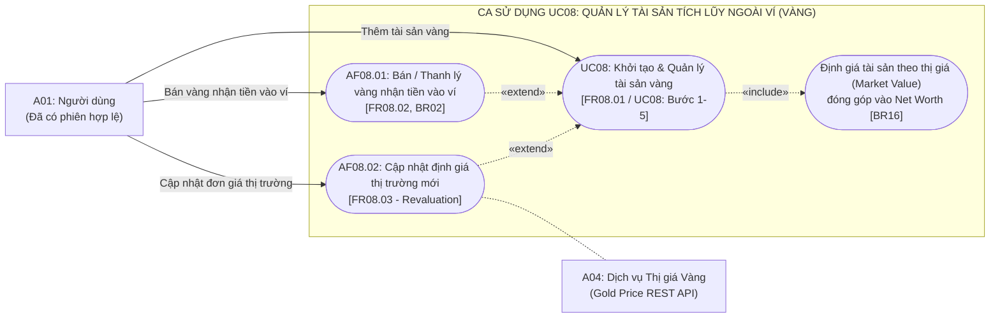

> **Thuyết minh nghiệp vụ UC08 (Quản lý tài sản tích lũy ngoài ví - Vàng):**
> - **Tiền điều kiện:** Tác nhân `Người dùng (A01)` có phiên làm việc JWT hợp lệ (`FR15`).
> - **Luồng cơ bản (Thêm tài sản vàng):** Người dùng nhập Loại vàng (Vàng nhẫn 9999 / Vàng miếng SJC), Số lượng (chỉ), Đơn giá mua và Đơn giá thị trường hiện tại. Hệ thống tự động gợi ý đơn giá tham chiếu thời điểm từ `A04: Dịch vụ Thị giá Vàng` (thông qua RESTful JSON API chuẩn hóa từ SJC/DOJI/PNJ).
>   - Bắt buộc `«include»` tính toán giá trị thị trường ($\text{Market Value} = \text{Số lượng} \times \text{Đơn giá hiện tại}$) đóng góp trực tiếp vào Tổng tài sản (`Total Assets`) và Tài sản ròng (`Net Worth`) theo `BR16`.
>   - Hiển thị lãi/lỗ danh nghĩa (Unrealized P&L) so với giá mua gốc.
> - **Các luồng thay thế:**
>   - **`AF08.01: Bán / Thanh lý vàng nhận tiền vào ví`** (`FR08.02`, `BR02`): Cho phép người dùng bán một phần hoặc toàn bộ số vàng sở hữu; hệ thống giảm số lượng vàng tương ứng, ghi nhận số tiền bán thực tế vào ví tài sản được chỉ định và hạch toán chênh lệch giá (Realized P&L).
>   - **`AF08.02: Cập nhật định giá thị trường mới (Revaluation)`** (`FR08.03`): Hệ thống tự động truy vấn giá niêm yết mới nhất qua RESTful JSON API từ `A04: Dịch vụ Thị giá Vàng` (chuẩn hóa tỷ giá SJC/DOJI/PNJ) để gợi ý cho người dùng xác nhận; nếu mất kết nối API hoặc giao dịch tại tiệm vàng địa phương, cơ chế Fallback cho phép người dùng tự điều chỉnh thủ công; hệ thống tự động tái tính toán lại Market Value và cập nhật Net Worth trên Dashboard tức thời.
> - **Kiểm soát ngoại lệ:** `EF08.01` (Khối lượng vàng hoặc đơn giá $\le 0$), `EF08.02` (Bán số lượng vượt quá khối lượng đang sở hữu).
> - **Ranh giới Out-of-Scope (§1.2):** Hệ thống chỉ tập trung vào tài sản vàng tích trữ có thị giá quy chuẩn; không mở rộng sang bất động sản, xe cộ để tránh bài toán khấu hao hao mòn bất khả thi.

---

#### 4.5.2 Ca sử dụng UC09 – Quản lý mục tiêu tích lũy tài chính
*Ánh xạ chức năng:* [FR07](../SRS.md#fr07), [FR15](../SRS.md#fr15) | *Quy tắc nghiệp vụ:* [BR10](../SRS.md#br10)

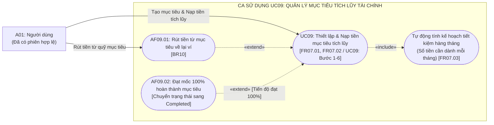

> **Thuyết minh nghiệp vụ UC09 (Quản lý mục tiêu tích lũy tài chính):**
> - **Tiền điều kiện:** `Người dùng (A01)` có phiên làm việc JWT hợp lệ (`FR15`); có ít nhất một ví tài sản có số dư khả dụng.
> - **Luồng cơ bản (Thiết lập mục tiêu & Nạp tiền tích lũy - Bước 1–6):**
>   - *Bước 1–3:* Người dùng nhập Tên mục tiêu (quỹ khẩn cấp, mua laptop, tích lũy mua xe), Số tiền cần đạt, Ngày hoàn thành dự kiến (`FR07.01`). Hệ thống bắt buộc `«include»` tính toán kế hoạch tiết kiệm: Số tháng còn lại và Số tiền cần dành trung bình mỗi tháng để đạt mục tiêu đúng hạn (`FR07.03`).
>   - *Bước 4–6:* Người dùng nạp tiền từ ví vào mục tiêu (`FR07.02`): Hệ thống tăng số dư tích lũy của mục tiêu và giảm số dư khả dụng của ví nguồn.
> - **Nguyên tắc chống tăng tài sản ảo (`BR10`):**
>   - Bản chất việc nạp tiền vào mục tiêu là **giữ chỗ (earmark) nguồn tiền**, **tuyệt đối không làm thay đổi Tổng tài sản (`Total Assets`) hay `Net Worth`** của người dùng.
> - **Các luồng thay thế:**
>   - **`AF09.01: Rút tiền từ mục tiêu về lại ví`** (`BR10`): Khi có nhu cầu đột xuất, người dùng có thể rút một phần tiền từ quỹ mục tiêu hoàn trả về số dư khả dụng của ví; Total Assets và Net Worth tiếp tục được bảo toàn theo `BR10`.
>   - **`AF09.02: Hoàn thành mục tiêu 100%`**: Khi khoản nạp mới đưa số tiền tích lũy đạt $\ge$ số tiền mục tiêu, hệ thống hiển thị thông báo chúc mừng và chuyển trạng thái mục tiêu sang `Completed`.
> - **Kiểm soát ngoại lệ:** `EF09.01` (Số tiền mục tiêu $\le 0$ hoặc ngày hoàn thành trong quá khứ), `EF09.02` (Ví nguồn không đủ số dư để nạp vào mục tiêu).

---

### 4.6 Phân hệ 6: Báo cáo, Đối soát & Dashboard Sức khỏe tài chính (Financial Reports, Reconciliation & Health Dashboard)
*Nhóm Yêu cầu Chức năng ánh xạ:* [FR08](../SRS.md#fr08), [FR10](../SRS.md#fr10), [FR11](../SRS.md#fr11), [FR12](../SRS.md#fr12), [FR15](../SRS.md#fr15) | *Use Case trọng tâm:* [UC10](../SRS.md#uc10), [UC11](../SRS.md#uc11)

---

#### 4.6.1 Ca sử dụng UC10 – Xem Dashboard sức khỏe tài chính & Net Worth
*Ánh xạ chức năng:* [FR08](../SRS.md#fr08), [FR10](../SRS.md#fr10), [FR11](../SRS.md#fr11), [FR15](../SRS.md#fr15) | *Quy tắc nghiệp vụ:* [BR14](../SRS.md#br14), [BR16](../SRS.md#br16), [BR18](../SRS.md#br18) | *Tác vụ nền:* [SYS03](../SRS.md#sys03)

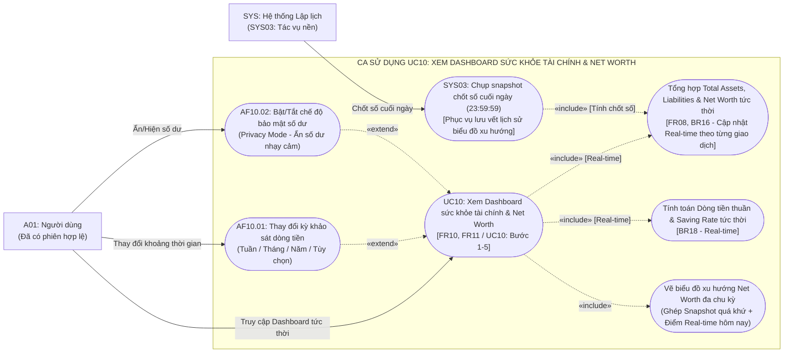

> **Thuyết minh nghiệp vụ UC10 (Xem Dashboard sức khỏe tài chính & Net Worth):**
> - **Tiền điều kiện:** Tác nhân `Người dùng (A01)` có phiên làm việc JWT hợp lệ (`FR15`).
> - **Cơ chế cập nhật dữ liệu (Phân biệt Real-time vs Historical Snapshot):**
>   - **Số liệu hiển thị tức thời (Real-time on-the-fly):** Toàn bộ các thẻ chỉ số cốt lõi (KPI Cards) gồm **Tổng tài sản (Total Assets)**, **Tổng nợ (Total Liabilities)**, **Tài sản ròng (Net Worth)**, **Dòng tiền thuần (Net Cash Flow)** và **Tỷ lệ tiết kiệm (Saving Rate)** được hệ thống tính toán trực tiếp từ số dư khả dụng/bộ đệm của ví (`currentBalance`) và giá trị tài sản thị trường tại thời điểm người dùng gửi yêu cầu. Mọi giao dịch thu/chi (`UC03`), trả nợ (`UC07`), định giá vàng (`UC08`) hay nạp tiền mục tiêu (`UC09`) vừa thực hiện xong đều **phản ánh ngay lập tức trên Dashboard** với độ trễ $\le 200\text{ ms}$ (`NFR01`), hoàn toàn không phải chờ đợi tiến trình cuối ngày.
>   - **Cơ chế biểu đồ xu hướng lịch sử (`SYS03`):** Tiến trình nền `SYS03` chạy định kỳ vào lúc **23:59:59 hàng ngày** nhằm mục đích duy nhất: chụp 1 bản ghi snapshot chốt số Net Worth cuối ngày lưu vào cơ sở dữ liệu (`net_worth_snapshots`). Biểu đồ đường xu hướng kết hợp chuỗi điểm snapshot lịch sử trong quá khứ với **điểm dữ liệu Net Worth thời gian thực của chính thời điểm hiện tại**, bảo đảm đường xu hướng luôn bám sát giao dịch mới nhất trong ngày mà không gây quá tải quét lại hàng ngàn bút toán sổ cái cũ.
> - **Luồng cơ bản (Happy Path - Bước 1–5):**
>   - Người dùng truy cập Dashboard chính. Hệ thống tổng hợp dữ liệu song song trong $\le 200\text{ ms}$ (`NFR01`):
>     - Bắt buộc `«include»` tổng hợp **Tổng tài sản** (số dư các ví + giá trị thị trường vàng theo `BR16`), **Tổng nợ** (dư nợ thẻ tín dụng + nợ gốc khoản vay theo `BR05`), và xác định **Tài sản ròng**: $\text{Net Worth} = \text{Total Assets} - \text{Total Liabilities}$ theo `BR16`. Số dư bảo đảm khớp đúng 100% với lũy kế sổ cái (`BR14`).
>     - Bắt buộc `«include»` tính toán **Dòng tiền thuần** ($\text{Net Cash Flow} = \text{Thu nhập} - \text{Chi phí}$) và **Tỷ lệ tiết kiệm**: $\text{Saving Rate} = \frac{\text{Thu nhập} - \text{Chi phí}}{\text{Thu nhập}} \times 100\%$ theo `BR18`.
>     - Bắt buộc `«include»` hiển thị biểu đồ xu hướng Net Worth (ghép snapshot lịch sử + điểm real-time) và biểu đồ tròn phân bổ chi tiêu/cơ cấu tài sản.
>   - Tích hợp widget cảnh báo ngân sách chi tiêu tiệm cận hạn mức ($\ge 80\%$) và lịch trả nợ sắp đến hạn trong vòng 3 ngày tới.
> - **Các luồng thay thế:**
>   - **`AF10.01: Thay đổi kỳ khảo sát dòng tiền`**: Người dùng chọn xem theo Tuần này, Tháng trước, Năm nay hoặc khoảng ngày tùy chọn; hệ thống tự động tái tính toán Thu nhập, Chi phí, Dòng tiền thuần và Saving Rate theo phạm vi thời gian được chọn.
>   - **`AF10.02: Bật/Tắt chế độ bảo mật số dư (Privacy Mode)`**: Người dùng nhấn icon con mắt trên Dashboard khi mở ứng dụng ở nơi công cộng; hệ thống che toàn bộ số dư và số tiền nhạy cảm bằng dấu `******`, chỉ giữ lại tỷ lệ phần trăm và biểu đồ cơ cấu.
> - **Kiểm soát ngoại lệ:** `EF10.01`: Khi kỳ khảo sát có Tổng thu nhập $\le 0$, hệ thống hiển thị Saving Rate là `"N/A"` theo `BR18`, triệt tiêu hoàn toàn lỗi chia cho 0 (`DivideByZeroException`).

---

#### 4.6.2 Ca sử dụng UC11 – Báo cáo thống kê, Đối soát số dư & Xuất dữ liệu CSV
*Ánh xạ chức năng:* [FR12](../SRS.md#fr12), [FR15](../SRS.md#fr15) | *Quy tắc nghiệp vụ:* [BR01](../SRS.md#br01), [BR11](../SRS.md#br11), [BR14](../SRS.md#br14) | *An toàn thông tin:* [OWASP Formula Injection](https://owasp.org/www-community/attacks/CSV_Injection)

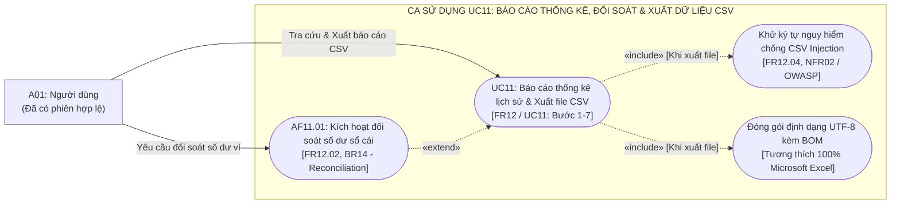

> **Thuyết minh nghiệp vụ UC11 (Báo cáo thống kê, Đối soát số dư & Xuất dữ liệu CSV):**
> - **Tiền điều kiện:** Tác nhân `Người dùng (A01)` có phiên làm việc JWT hợp lệ (`FR15`).
> - **Luồng cơ bản (Tra cứu & Xuất file CSV - Bước 1–7):**
>   - Người dùng áp dụng bộ lọc đa tiêu chí (khoảng ngày, ví tài khoản, danh mục thu/chi, loại giao dịch); hệ thống phân trang và trả về danh sách giao dịch kèm tổng thu/chi.
>   - Cho phép xem modal chi tiết từng bản ghi: số tiền nguyên tệ, tiền cơ sở, tỷ giá snapshot và các dòng Nợ/Có đối ứng (`BR01`).
>   - Khi người dùng nhấn "Xuất file CSV":
>     - Bắt buộc `«include»` kiểm tra và khử ký tự nguy hiểm (`=`, `+`, `-`, `@`) trong toàn bộ các trường văn bản tự do theo `FR12.04` và tiêu chuẩn OWASP, ngăn chặn triệt để tấn công CSV Formula Injection (`NFR02`).
>     - Bắt buộc `«include»` mã hóa tệp CSV chuẩn UTF-8 kèm tiền tố BOM (`\uFEFF`) bảo đảm hiển thị tiếng Việt có dấu chuẩn xác trên Microsoft Excel.
> - **Các luồng thay thế:**
>   - **`AF11.01: Kích hoạt đối soát số dư sổ cái (Reconciliation)`** (`FR12.02`, `BR14`): Người dùng nhấn nút đối soát cho một ví tài sản; hệ thống tự động tính tổng phát sinh Nợ/Có lịch sử của ví từ đầu đến hiện tại ($\sum \text{Debit} - \sum \text{Credit}$) và so khớp độc lập với số dư bộ đệm hiện hành (`currentBalance`); phản hồi thông báo đối soát khớp đúng 100%.
> - **Kiểm soát ngoại lệ:**
>   - `EF11.01`: Khoảng ngày lọc không hợp lệ (Từ ngày > Đến ngày) $\rightarrow$ Từ chối tìm kiếm (`400 Bad Request`).
>   - `EF11.02`: Không tìm thấy giao dịch thỏa mãn điều kiện lọc $\rightarrow$ Trả về mảng rỗng `200 OK` kèm thông báo thân thiện.
>   - `EF11.03`: Phát hiện chuỗi văn bản chứa công thức độc hại $\rightarrow$ Hệ thống tự động chèn dấu nháy đơn (`'`) vào đầu chuỗi theo chuẩn OWASP chống Formula Injection.

---

### 4.7 Phân hệ 7: Quản trị Hệ thống Admin (Admin Management)
*Nhóm Yêu cầu Chức năng ánh xạ:* [FR13](../SRS.md#fr13), [FR14](../SRS.md#fr14), [FR15](../SRS.md#fr15) | *Use Case trọng tâm:* [UC12](../SRS.md#uc12), [UC13](../SRS.md#uc13)

---

#### 4.7.1 Ca sử dụng UC12 – Quản trị người dùng & Dashboard vĩ mô
*Ánh xạ chức năng:* [FR14](../SRS.md#fr14), [FR15](../SRS.md#fr15) | *Quy tắc nghiệp vụ:* [BR11](../SRS.md#br11)

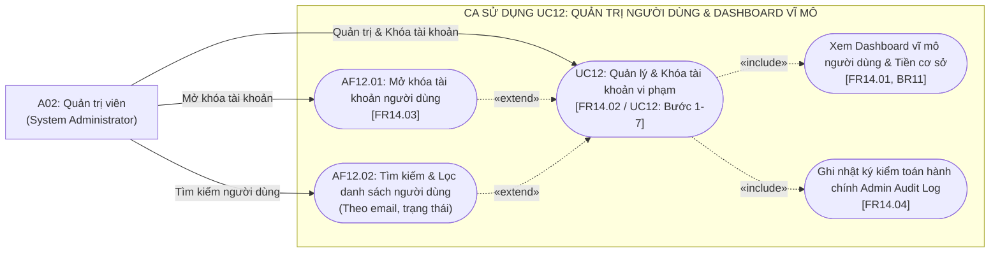

> **Thuyết minh nghiệp vụ UC12 (Quản trị người dùng & Dashboard vĩ mô):**
> - **Tiền điều kiện:** Tác nhân `Quản trị viên (A02)` đăng nhập thành công với tài khoản có vai trò `Admin` (`FR15`).
> - **Luồng cơ bản (Happy Path - Khóa tài khoản vi phạm - Bước 1–7):**
>   - Admin truy cập trang Quản trị. Hệ thống:
>     - Bắt buộc `«include»` hiển thị **Dashboard thống kê vĩ mô** (`FR14.01`): Tổng số người dùng, đăng ký mới trong tháng, tỷ lệ tài khoản `Active`/`Locked`, cơ cấu phân bố đồng tiền cơ sở (VND/USD/EUR). **Tuyệt đối không hiển thị số dư ví, danh mục chi tiêu hay giao dịch của người dùng theo quy định bảo mật riêng tư `BR11`**.
>     - Khi phát hiện tài khoản vi phạm điều khoản (spam dữ liệu, hành vi bất thường), Admin thực hiện khóa tài khoản kèm lý do bắt buộc (tối thiểu 10 ký tự theo `FR14.02`).
>     - Hệ thống cập nhật trạng thái người dùng sang `Locked`, thu hồi tức thời toàn bộ Refresh Token và Access Token (`NFR02`), ngăn chặn mọi phiên truy cập tiếp theo.
>     - Bắt buộc `«include»` ghi nhận giao dịch hành chính vào **Admin Audit Log** (`FR14.04`): Lưu vết thời điểm, ID Admin thực hiện, ID User bị khóa và lý do cụ thể.
> - **Các luồng thay thế:**
>   - **`AF12.01: Mở khóa tài khoản người dùng`** (`FR14.03`): Admin chọn tài khoản đang bị khóa và nhấn "Mở khóa"; hệ thống chuyển trạng thái sang `Active`, ghi nhận Admin Audit Log và cho phép người dùng đăng nhập lại.
>   - **`AF12.02: Tìm kiếm & Lọc danh sách người dùng`**: Hỗ trợ tìm kiếm nhanh theo địa chỉ email hoặc lọc phân trang theo trạng thái tài khoản.
> - **Kiểm soát ngoại lệ:**
>   - `EF12.01`: Khóa tài khoản nhưng để trống lý do $\rightarrow$ Từ chối thao tác (`400 Bad Request`).
>   - `EF12.02`: Admin cố gắng tự khóa chính mình hoặc vô hiệu hóa tài khoản Admin duy nhất còn lại của hệ thống $\rightarrow$ Chặn thao tác với mã `403 Forbidden` (`FR14.05`).
>   - `EF12.03`: Tài khoản Admin gửi request API nhằm xem số dư ví hoặc sổ cái giao dịch cá nhân của người dùng $\rightarrow$ Hệ thống chặn ngay lập tức với mã lỗi `403 Forbidden` (`BR11`).

---

#### 4.7.2 Ca sử dụng UC13 – Cấu hình hệ thống & Phát thông báo người dùng
*Ánh xạ chức năng:* [FR13](../SRS.md#fr13), [FR15](../SRS.md#fr15) | *Quy tắc nghiệp vụ:* [BR07](../SRS.md#br07), [BR08](../SRS.md#br08), [BR11](../SRS.md#br11)

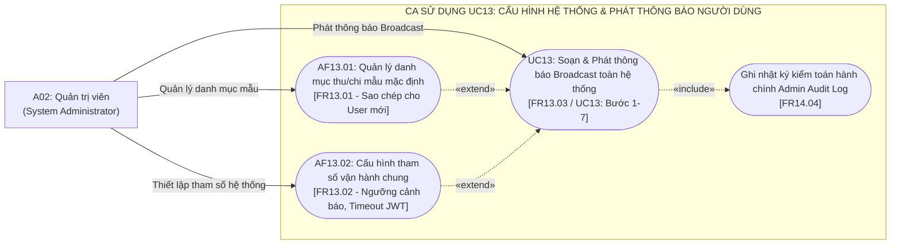

> **Thuyết minh nghiệp vụ UC13 (Cấu hình hệ thống & Phát thông báo người dùng):**
> - **Tiền điều kiện:** Tác nhân `Quản trị viên (A02)` có phiên làm việc Admin hợp lệ (`FR15`).
> - **Luồng cơ bản (Happy Path - Phát thông báo Broadcast - Bước 1–7):**
>   - Quản trị viên truy cập mục "Cấu hình & Thông báo hệ thống". Soạn thông báo phát thanh gồm Tiêu đề, Nội dung chi tiết và Mức độ ưu tiên (Thông tin / Cảnh báo / Bảo trì khẩn cấp) theo `FR13.03`.
>   - Nhấn "Phát thông báo cho toàn bộ người dùng". Hệ thống:
>     - Tạo bản ghi `SystemAnnouncement` mới.
>     - Đẩy thông báo vào hàng đợi Notification Center của 100% tài khoản người dùng đang ở trạng thái `Active`.
>     - Bắt buộc `«include»` ghi nhật ký kiểm toán **Admin Audit Log** để lưu vết trách nhiệm người phát thông báo.
>   - Người dùng khi đăng nhập hoặc đang mở ứng dụng sẽ thấy biểu tượng chuông sáng đèn và có thể click xem toàn văn nội dung thông báo.
> - **Các luồng thay thế:**
>   - **`AF13.01: Quản lý danh mục thu/chi mẫu mặc định`** (`FR13.01`): Quản trị viên khởi tạo hoặc hiệu chỉnh bộ danh mục mẫu (Ăn uống, Mua sắm, Lương...); khi người dùng mới đăng ký qua `UC01`, hệ thống tự động nhân bản bộ danh mục này cho người dùng mới.
>   - **`AF13.02: Cấu hình tham số vận hành chung`** (`FR13.02`): Quản trị viên điều chỉnh ngưỡng cảnh báo ngân sách mặc định (mặc định 80% theo `BR07`), thời gian timeout của Access Token/Refresh Token.
> - **Kiểm soát ngoại lệ:**
>   - `EF13.01`: Tiêu đề hoặc nội dung thông báo để trống $\rightarrow$ Từ chối phát thông báo (`400 Bad Request`).
>   - `EF13.02`: Giá trị tham số cấu hình nằm ngoài dải an toàn (ví dụ: ngưỡng ngân sách $< 10\%$ hoặc $> 100\%$) $\rightarrow$ Từ chối lưu cấu hình (`422 Unprocessable Entity`).

---

## 5. Ma trận Phân bố Use Case theo Gói Phân hệ (Package Allocation Matrix)

| Mã UC | Tên Use Case | Phân hệ Nghiệp vụ (Subsystem) | Mã FR Ánh xạ | Tác nhân chính / liên quan | Sơ đồ Xuất hiện |
| :---: | :--- | :--- | :---: | :--- | :---: |
| [**UC01**](../SRS.md#uc01) | Đăng ký, Đăng nhập & Quản lý phiên | 1. Xác thực & Quản lý Tài khoản | [FR01](../SRS.md#fr01), [FR15](../SRS.md#fr15) | A01-G (Khách), A01 (User), A02 (Admin) | [Mục 3](#3-sơ-đồ-use-case-tổng-quan-toàn-hệ-thống-system-overview), [Mục 4.1](#41-phân-hệ-1-xác-thực--quản-lý-tài-khoản-authentication--account-lifecycle) |
| [**UC02**](../SRS.md#uc02) | Khởi tạo tài khoản ví & Quản lý số dư ban đầu | 2. Quản lý Tài khoản thanh toán & Ví tiền | [FR02](../SRS.md#fr02), [FR04](../SRS.md#fr04), [FR15](../SRS.md#fr15) | A01 (User), A03 (Exchange Rate API) | [Mục 3](#3-sơ-đồ-use-case-tổng-quan-toàn-hệ-thống-system-overview), [Mục 4.2](#42-phân-hệ-2-quản-lý-tài-khoản-thanh-toán--ví-tiền-payment-accounts--wallet-management) |
| [**UC03**](../SRS.md#uc03) | Ghi nhận & Quản lý giao dịch tài chính | 3. Expense Tracker (Thu - Chi - Ngân sách) | [FR03](../SRS.md#fr03), [FR04](../SRS.md#fr04), [FR15](../SRS.md#fr15) | A01 (User), A03 (Exchange Rate API) | [Mục 3](#3-sơ-đồ-use-case-tổng-quan-toàn-hệ-thống-system-overview), [Mục 4.3.1](#431-ca-sử-dụng-uc03--ghi-nhận--quản-lý-giao-dịch-tài-chính) |
| [**UC04**](../SRS.md#uc04) | Thiết lập & Xử lý giao dịch định kỳ | 3. Expense Tracker (Thu - Chi - Ngân sách) | [FR06](../SRS.md#fr06), [FR15](../SRS.md#fr15) | A01 (User), SYS ([SYS02](../SRS.md#sys02) lúc 00:05) | [Mục 3](#3-sơ-đồ-use-case-tổng-quan-toàn-hệ-thống-system-overview), [Mục 4.3.2](#432-ca-sử-dụng-uc04--thiết-lập--xử-lý-giao-dịch-định-kỳ) |
| [**UC05**](../SRS.md#uc05) | Thiết lập & Kiểm soát ngân sách chi tiêu | 3. Expense Tracker (Thu - Chi - Ngân sách) | [FR05](../SRS.md#fr05), [FR15](../SRS.md#fr15) | A01 (User), SYS ([SYS03](../SRS.md#sys03) kiểm tra ngân sách) | [Mục 3](#3-sơ-đồ-use-case-tổng-quan-toàn-hệ-thống-system-overview), [Mục 4.3.3](#433-ca-sử-dụng-uc05--thiết-lập--kiểm-soát-ngân-sách-chi-tiêu) |
| [**UC06**](../SRS.md#uc06) | Khởi tạo & Quản lý khoản vay nợ vi mô | 4. Microfinance (Vay & Nợ vi mô) | [FR09](../SRS.md#fr09), [FR15](../SRS.md#fr15) | A01 (User), SYS ([SYS03](../SRS.md#sys03) nhắc nợ 08:00) | [Mục 3](#3-sơ-đồ-use-case-tổng-quan-toàn-hệ-thống-system-overview), [Mục 4.4.1](#441-ca-sử-dụng-uc06--khởi-tạo--quản-lý-khoản-vay-vi-mô) |
| [**UC07**](../SRS.md#uc07) | Ghi nhận thanh toán & Trả nợ vay vi mô | 4. Microfinance (Vay & Nợ vi mô) | [FR09](../SRS.md#fr09), [FR15](../SRS.md#fr15) | A01 (User) | [Mục 3](#3-sơ-đồ-use-case-tổng-quan-toàn-hệ-thống-system-overview), [Mục 4.4.2](#442-ca-sử-dụng-uc07--ghi-nhận-thanh-toán-trả-nợ-vay) |
| [**UC08**](../SRS.md#uc08) | Khởi tạo & Quản lý tài sản vàng tích lũy | 5. Personal Wealth (Tài sản & Tích lũy) | [FR08](../SRS.md#fr08), [FR15](../SRS.md#fr15) | A01 (User), A04 (Gold Price REST API) | [Mục 3](#3-sơ-đồ-use-case-tổng-quan-toàn-hệ-thống-system-overview), [Mục 4.5.1](#451-ca-sử-dụng-uc08--quản-lý-tài-sản-tích-lũy-ngoài-ví-vàng) |
| [**UC09**](../SRS.md#uc09) | Quản lý mục tiêu tích lũy tài chính | 5. Personal Wealth (Tài sản & Tích lũy) | [FR07](../SRS.md#fr07), [FR15](../SRS.md#fr15) | A01 (User) | [Mục 3](#3-sơ-đồ-use-case-tổng-quan-toàn-hệ-thống-system-overview), [Mục 4.5.2](#452-ca-sử-dụng-uc09--quản-lý-mục-tiêu-tích-lũy-tài-chính) |
| [**UC10**](../SRS.md#uc10) | Xem Dashboard sức khỏe tài chính & Net Worth | 6. Báo cáo, Đối soát & Dashboard | [FR08](../SRS.md#fr08), [FR10](../SRS.md#fr10), [FR11](../SRS.md#fr11), [FR15](../SRS.md#fr15) | A01 (User), SYS ([SYS03](../SRS.md#sys03) snapshot 23:59:59) | [Mục 3](#3-sơ-đồ-use-case-tổng-quan-toàn-hệ-thống-system-overview), [Mục 4.6.1](#461-ca-sử-dụng-uc10--xem-dashboard-sức-khỏe-tài-chính--net-worth) |
| [**UC11**](../SRS.md#uc11) | Báo cáo thống kê, Đối soát & Xuất file CSV | 6. Báo cáo, Đối soát & Dashboard | [FR12](../SRS.md#fr12), [FR15](../SRS.md#fr15) | A01 (User) | [Mục 3](#3-sơ-đồ-use-case-tổng-quan-toàn-hệ-thống-system-overview), [Mục 4.6.2](#462-ca-sử-dụng-uc11--báo-cáo-thống-kê-đối-soát-số-dư--xuất-dữ-liệu-csv) |
| [**UC12**](../SRS.md#uc12) | Quản trị người dùng & Dashboard vĩ mô | 7. Quản trị Hệ thống Admin | [FR14](../SRS.md#fr14), [FR15](../SRS.md#fr15) | A02 (Admin) | [Mục 3](#3-sơ-đồ-use-case-tổng-quan-toàn-hệ-thống-system-overview), [Mục 4.7.1](#471-ca-sử-dụng-uc12--quản-trị-người-dùng--dashboard-vĩ-mô) |
| [**UC13**](../SRS.md#uc13) | Cấu hình hệ thống & Phát thông báo người dùng | 7. Quản trị Hệ thống Admin | [FR13](../SRS.md#fr13), [FR15](../SRS.md#fr15) | A02 (Admin) | [Mục 3](#3-sơ-đồ-use-case-tổng-quan-toàn-hệ-thống-system-overview), [Mục 4.7.2](#472-ca-sử-dụng-uc13--cấu-hình-hệ-thống--phát-thông-báo-người-dùng) |
