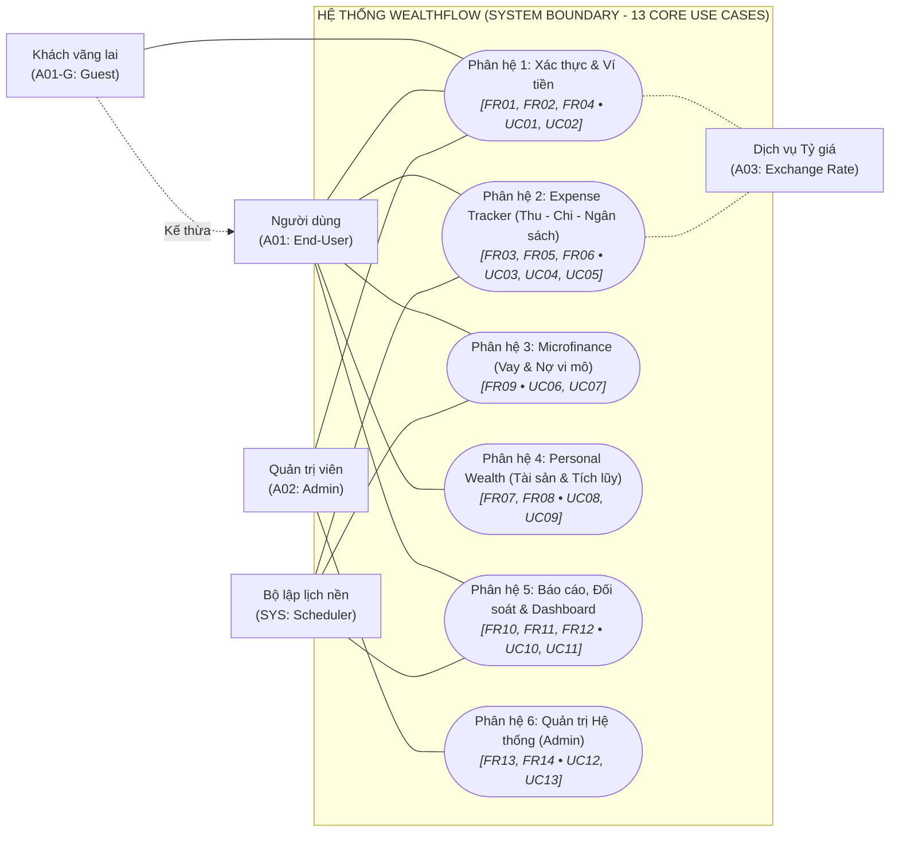
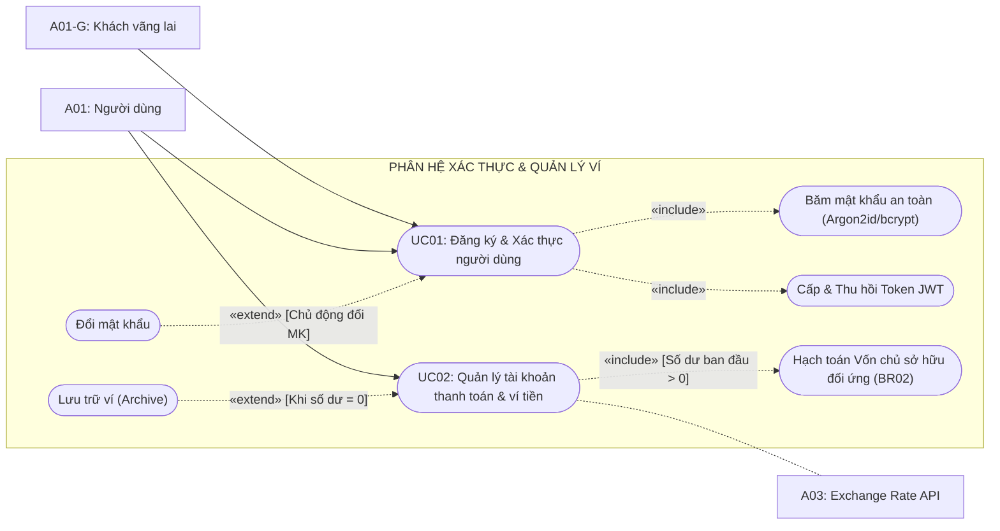
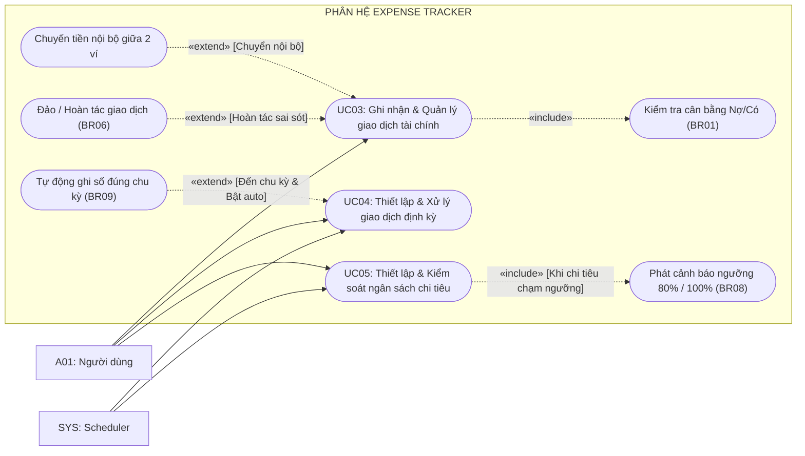
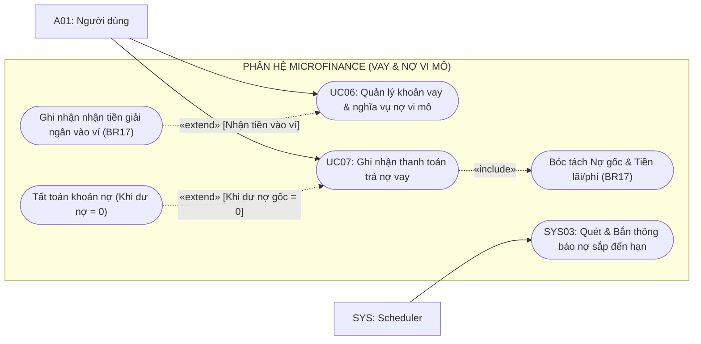
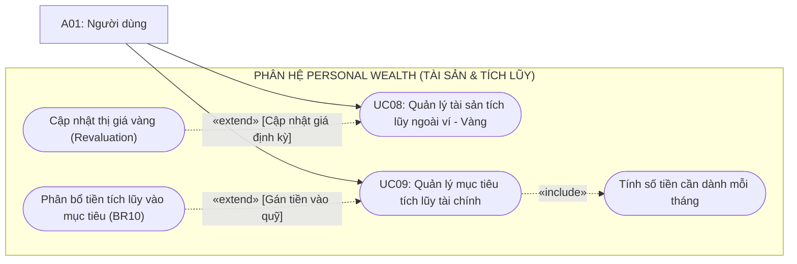
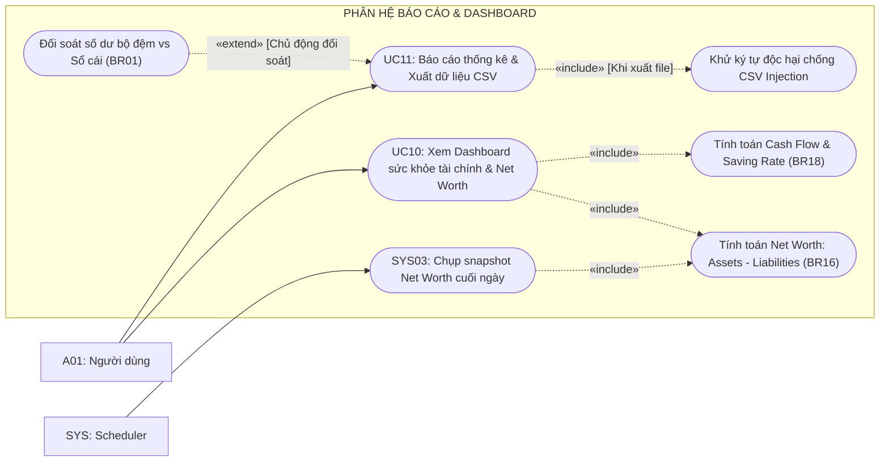
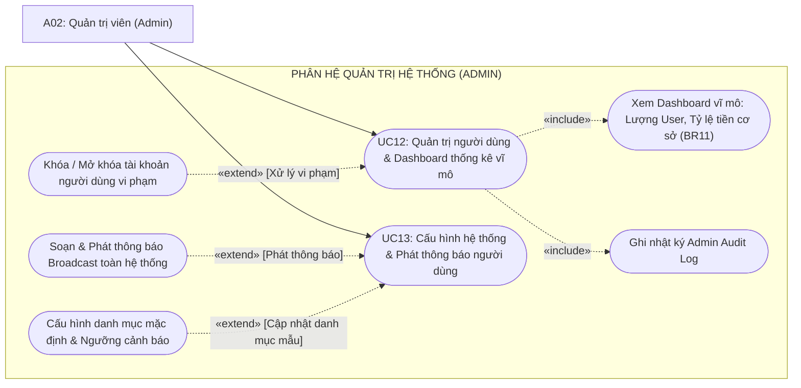

# TÀI LIỆU MÔ HÌNH HÓA USE CASE (USE CASE DIAGRAMS)
## HỆ THỐNG QUẢN LÝ TÀI CHÍNH CÁ NHÂN, TÀI SẢN VÀ TÀI CHÍNH VI MÔ (WEALTHFLOW)

**TRƯỜNG ĐẠI HỌC TÔN ĐỨC THẮNG**  
**KHOA CÔNG NGHỆ THÔNG TIN**  

- **Môn học:** Công nghệ phần mềm (Software Engineering)
- **Nhóm / Lớp:** Voz / N3
- **Giảng viên hướng dẫn:** ThS. Võ Thị Kim Anh
- **Thành viên nhóm:**
  - Võ Trịnh Quốc Huy
  - Võ Văn Khôi Nguyên
  - Nguyễn Thành Trung
  - Phan Nguyễn Tuấn Kiệt
- **Pha tiến trình:** Elaboration (Pha Tinh chế / Phân tích chi tiết)
- **Tài liệu tham chiếu:** [docs/02_elaboration/SRS.md](../SRS.md) v2.1 (Elaboration Refined Baseline - 13 Core Use Cases)

---

## 1. Giới thiệu và Quy ước Mô hình hóa

Tài liệu này trực quan hóa toàn bộ **13 Use Cases cốt lõi (`UC01` – `UC13`)** và **3 Kịch bản nền (`SYS01` – `SYS03`)** đã được tinh gọn và đặc tả chuẩn hóa trong tài liệu SRS v2.1. Để đảm bảo tính khả dụng, tính công thái học và tránh quá tải thị giác, mô hình được tổ chức theo:
1. **01 Sơ đồ Tổng quan Toàn hệ thống (System Overview Diagram):** Thể hiện sự phân bổ 13 Use Cases theo 6 phân hệ nghiệp vụ và mối quan hệ với các tác nhân.
2. **06 Sơ đồ Chi tiết theo Phân hệ (Subsystem Diagrams):** Gom nhóm các Use Case có chung Functional Requirements (FR) và luồng dữ liệu tương hỗ, làm rõ các mối quan hệ cấu trúc chuẩn UML 2.5:
   - **Liên kết cơ bản (Association):** Đường nối liền giữa Tác nhân và Use Case.
   - **Quan hệ `«include»` (Bao hàm):** Mũi tên nét đứt từ Base Use Case trỏ đến Included Use Case (`Base -.->|«include»| Included`), biểu thị hành vi bắt buộc phải thực thi.
   - **Quan hệ `«extend»` (Mở rộng):** Mũi tên nét đứt từ Extension Use Case trỏ ngược về Base Use Case (`Extension -.->|«extend»| Base`), biểu thị hành vi mở rộng có điều kiện tại Extension Point.
   - **Kế thừa tác nhân (Generalization):** Mũi tên trỏ từ tác nhân chuyên biệt về tác nhân tổng quát.

---

## 2. Danh mục Tác nhân Hệ thống (Actors)

| Mã Tác nhân | Tên Tác nhân | Loại | Định nghĩa và Phạm vi tương tác |
| :---: | :--- | :---: | :--- |
| **A01** | **Người dùng (End-User)** | Chính (Primary) | Cá nhân sử dụng hệ thống để quản lý tài chính, ví tiền, thu chi, tài sản vàng tích lũy, vay nợ vi mô và xem báo cáo. |
| **A01-G** | **Khách vãng lai (Guest)** | Chính (Primary) | Người dùng chưa đăng nhập, chỉ có thể xem trang giới thiệu, thực hiện đăng ký tài khoản hoặc đăng nhập (`UC01`). |
| **A02** | **Quản trị viên (System Admin)** | Quản trị (Admin) | Quản lý tài khoản người dùng (khóa/mở khóa), xem Dashboard thống kê vĩ mô, cấu hình hệ thống và phát thông báo (`UC12, UC13`). Tuyệt đối không xem sổ sách cá nhân. |
| **A03** | **Exchange Rate Service** | Hỗ trợ (Secondary) | API nhà cung cấp tỷ giá hối đoái tiền tệ phục vụ quy đổi đa tiền tệ về đồng tiền cơ sở (`baseCurrency`). |
| **SYS** | **System Scheduler (Bộ lập lịch hệ thống)** | Nội bộ (Internal) | Bộ đếm thời gian và tiến trình chạy nền xử lý các tác vụ định kỳ tự động (`SYS01` - `SYS03`). |

---

## 3. Sơ đồ Use Case Tổng quan Toàn hệ thống (System Overview)

Sơ đồ tổng quan thể hiện kiến trúc phân hệ vĩ mô của hệ thống WealthFlow và mối quan hệ tương tác giữa các tác nhân (Actors) với **6 cụm phân hệ nghiệp vụ cốt lõi**:

---

## 4. Sơ đồ Chi tiết theo Phân hệ Nghiệp vụ

---

### 4.1 Phân hệ 1: Xác thực, Hồ sơ Cá nhân & Quản lý Ví tiền
*Nhóm Yêu cầu Chức năng ánh xạ:* **FR01, FR02, FR04, FR15**

---

### 4.2 Phân hệ 2: Expense Tracker (Giao dịch, Định kỳ & Ngân sách)
*Nhóm Yêu cầu Chức năng ánh xạ:* **FR03, FR05, FR06, FR15**

---

### 4.3 Phân hệ 3: Microfinance (Quản lý Vay & Trả nợ vi mô)
*Nhóm Yêu cầu Chức năng ánh xạ:* **FR09, FR15**

---

### 4.4 Phân hệ 4: Personal Wealth (Tài sản tích lũy & Mục tiêu)
*Nhóm Yêu cầu Chức năng ánh xạ:* **FR07, FR08, FR15**

---

### 4.5 Phân hệ 5: Báo cáo, Đối soát & Dashboard Sức khỏe tài chính
*Nhóm Yêu cầu Chức năng ánh xạ:* **FR10, FR11, FR12, FR15**

---

### 4.6 Phân hệ 6: Quản trị Hệ thống (Admin Management)
*Nhóm Yêu cầu Chức năng ánh xạ:* **FR13, FR14, FR15**

---

## 5. Ma trận Phân bố Use Case theo Gói Phân hệ (Package Allocation Matrix)

| Mã UC | Tên Use Case | Phân hệ (Subsystem) | Sơ đồ Xuất hiện | Tác nhân chính |
| :---: | :--- | :--- | :---: | :---: |
| **UC01** | Đăng ký & Xác thực người dùng | 1. Xác thực & Hồ sơ | Plot 1, Plot 2 | A01-G, A01, A02 |
| **UC02** | Quản lý tài khoản thanh toán và ví tiền | 1. Xác thực & Hồ sơ | Plot 1, Plot 2 | A01: Người dùng |
| **UC03** | Ghi nhận & Quản lý giao dịch tài chính | 2. Expense Tracker | Plot 1, Plot 3 | A01: Người dùng |
| **UC04** | Thiết lập & Xử lý giao dịch định kỳ | 2. Expense Tracker | Plot 1, Plot 3 | A01, SYS |
| **UC05** | Thiết lập & Kiểm soát ngân sách chi tiêu | 2. Expense Tracker | Plot 1, Plot 3 | A01, SYS |
| **UC06** | Quản lý khoản vay và nghĩa vụ nợ vi mô | 3. Microfinance | Plot 1, Plot 4 | A01: Người dùng |
| **UC07** | Ghi nhận thanh toán trả nợ vay | 3. Microfinance | Plot 1, Plot 4 | A01: Người dùng |
| **UC08** | Quản lý tài sản tích lũy ngoài ví (Vàng) | 4. Personal Wealth | Plot 1, Plot 5 | A01: Người dùng |
| **UC09** | Quản lý mục tiêu tích lũy tài chính | 4. Personal Wealth | Plot 1, Plot 5 | A01: Người dùng |
| **UC10** | Xem Dashboard sức khỏe tài chính & Net Worth | 5. Báo cáo & Dashboard | Plot 1, Plot 6 | A01: Người dùng |
| **UC11** | Báo cáo thống kê & Xuất dữ liệu CSV | 5. Báo cáo & Dashboard | Plot 1, Plot 6 | A01: Người dùng |
| **UC12** | Quản trị người dùng & Dashboard vĩ mô | 6. Quản trị Hệ thống | Plot 1, Plot 7 | A02: Admin |
| **UC13** | Cấu hình hệ thống & Phát thông báo người dùng | 6. Quản trị Hệ thống | Plot 1, Plot 7 | A02: Admin |
