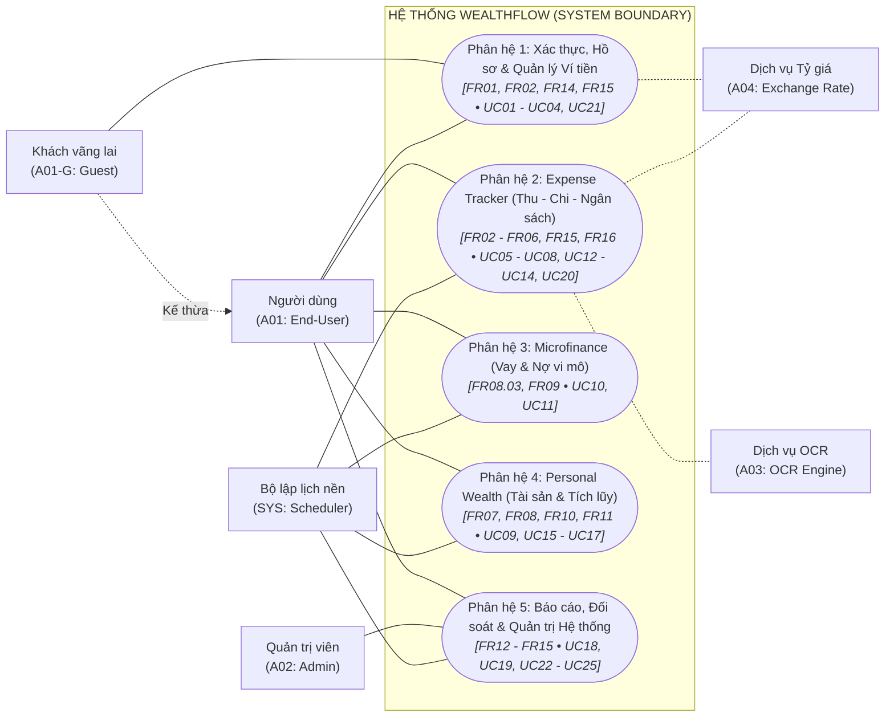
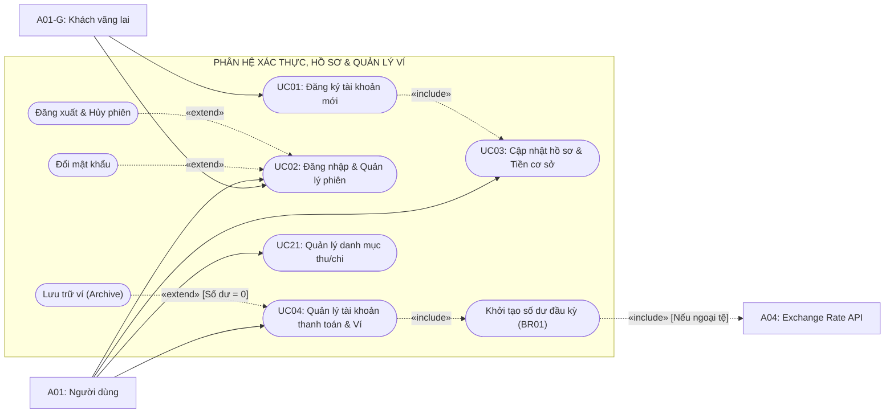
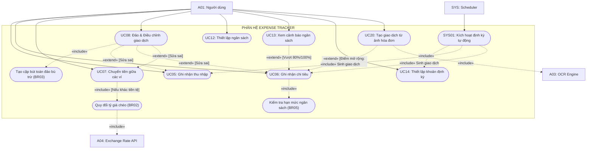
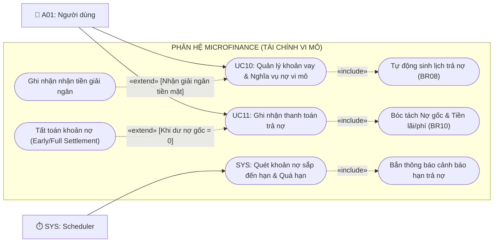
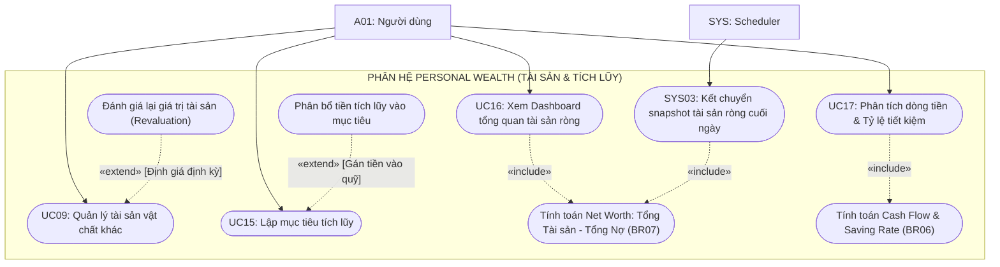
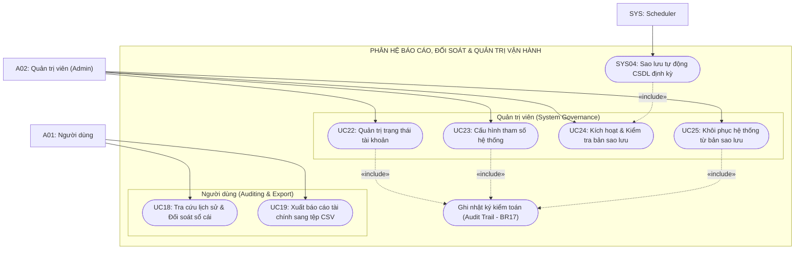

# TÀI LIỆU MÔ HÌNH HÓA USE CASE (USE CASE DIAGRAMS)
## HỆ THỐNG QUẢN LÝ TÀI CHÍNH CÁ NHÂN, TÀI SẢN VÀ TÀI CHÍNH VI MÔ (WEALTHFLOW)

**TRƯỜNG ĐẠI HỌC TÔN ĐỨC THẮNG**  
**KHOA CÔNG NGHỆ THÔNG TIN**  

- **Môn học:** Công nghệ phần mềm (Software Engineering)
- **Nhóm / Lớp:** Voz / N3
- **Giảng viên hướng dẫn:** ThS. Võ Thị Kim Anh
- **Thành viên nhóm:**
  - Võ Trịnh Quốc Huy
  - Võ Văn Khôi Nguyên
  - Nguyễn Thành Trung
  - Phan Nguyễn Tuấn Kiệt
- **Pha tiến trình:** Elaboration (Pha Tinh chế / Phân tích chi tiết)
- **Tài liệu tham chiếu:** [docs/02_elaboration/SRS.md](../SRS.md) v2.0 (Elaboration Baseline)

---

## 1. Giới thiệu và Quy ước Mô hình hóa

Tài liệu này trực quan hóa toàn bộ **25 Use Cases (`UC01` – `UC25`)** và **5 Kịch bản nền (`SYS01` – `SYS05`)** đã được đặc tả chi tiết trong tài liệu SRS v2.0. Để đảm bảo tính khả dụng, tính công thái học và tránh quá tải thị giác khi vẽ toàn bộ hệ thống trên một bản vẽ duy nhất, mô hình được tổ chức theo:
1. **01 Sơ đồ Tổng quan Toàn hệ thống (System Overview Diagram):** Thể hiện sự phân bổ 25 Use Cases theo các phân hệ nghiệp vụ cốt lõi và các tác nhân tương tác.
2. **05 Sơ đồ Chi tiết theo Phân hệ (Subsystem Diagrams):** Gom nhóm các Use Case có chung Functional Requirements (FR) và luồng dữ liệu tương hỗ, làm rõ các mối quan hệ cấu trúc chuẩn UML 2.5:
   - **Liên kết cơ bản (Association):** Đường nối liền giữa Tác nhân và Use Case.
   - **Quan hệ `«include»` (Bao hàm):** Mũi tên nét đứt từ Base Use Case trỏ đến Included Use Case (`Base -.->|«include»| Included`), biểu thị hành vi bắt buộc phải thực thi.
   - **Quan hệ `«extend»` (Mở rộng):** Mũi tên nét đứt từ Extension Use Case trỏ ngược về Base Use Case (`Extension -.->|«extend»| Base`), biểu thị hành vi mở rộng có điều kiện tại Extension Point.
   - **Kế thừa tác nhân (Generalization):** Mũi tên trỏ từ tác nhân chuyên biệt về tác nhân tổng quát.

> [!NOTE]
> Các nhãn quan hệ được chuẩn hóa theo ký tự Pháp chuẩn quốc tế của UML Stereotype (`«include»` và `«extend»`).

---

## 2. Danh mục Tác nhân Hệ thống (Actors)

| Mã Tác nhân | Tên Tác nhân | Loại | Định nghĩa và Phạm vi tương tác |
| :---: | :--- | :---: | :--- |
| **A01** | **Người dùng (End-User)** | Chính (Primary) | Cá nhân sử dụng hệ thống để quản lý tài chính, ví tiền, thu chi, tài sản, các khoản vay nợ vi mô và xem báo cáo. |
| **A01-G** | **Khách vãng lai (Guest)** | Chính (Primary) | Người dùng chưa đăng nhập, chỉ có thể xem trang giới thiệu, thực hiện đăng ký tài khoản hoặc đăng nhập. |
| **A02** | **Quản trị viên (System Admin)** | Quản trị (Admin) | Quản lý người dùng, khóa/mở tài khoản, cấu hình tham số tỷ giá/hạn mức, quản lý sao lưu và phục hồi dữ liệu. |
| **A03** | **OCR Engine (Dịch vụ OCR bên ngoài)** | Hỗ trợ (Secondary) | Hệ thống/API nhận dạng ký tự quang học phục vụ trích xuất tự động dữ liệu từ ảnh chụp hóa đơn (`UC20`). |
| **A04** | **Exchange Rate Service** | Hỗ trợ (Secondary) | API nhà cung cấp tỷ giá hối đoái tiền tệ phục vụ quy đổi đa tiền tệ về đồng tiền cơ sở (`baseCurrency`). |
| **SYS** | **System Scheduler (Bộ lập lịch hệ thống)** | Nội bộ (Internal) | Bộ đếm thời gian và tiến trình chạy nền xử lý các tác vụ định kỳ tự động (`SYS01` - `SYS05`). |

---

## 3. Sơ đồ Use Case Tổng quan Toàn hệ thống (System Overview)

Sơ đồ tổng quan thể hiện kiến trúc phân hệ vĩ mô của hệ thống WealthFlow và mối quan hệ tương tác giữa 6 tác nhân (Actors) với **5 cụm phân hệ nghiệp vụ cốt lõi**. Các Use Case chi tiết của từng phân hệ được phân rã cụ thể ở [Phần 4](#4-sơ-đồ-chi-tiết-theo-phân-hệ-nghiệp-vụ).

---

## 4. Sơ đồ Chi tiết theo Phân hệ Nghiệp vụ

---

### 4.1 Phân hệ 1: Xác thực, Hồ sơ Cá nhân & Quản lý Ví tiền
*Nhóm Yêu cầu Chức năng ánh xạ:* **FR01, FR02, FR14, FR15**

Phân hệ này đảm nhiệm toàn bộ quy trình thiết lập danh tính, bảo mật phiên làm việc và khởi tạo cơ sở dữ liệu nguồn tiền ban đầu.

#### Diễn giải Quan hệ Nghiệp vụ:
1. **`UC01` $\rightarrow$ `UC03` (`«include»`):** Khi đăng ký tài khoản thành công, hệ thống bắt buộc khởi tạo thiết lập tiền cơ sở (`baseCurrency`) ban đầu (mặc định VND). Sau khi phát sinh giao dịch đầu tiên, tiền cơ sở bị khóa cứng vĩnh viễn theo **BR01**.
2. **Đổi mật khẩu / Đăng xuất $\rightarrow$ `UC02` (`«extend»`):** Sau khi đăng nhập hợp lệ, người dùng có thể thực hiện đăng xuất hoặc đổi mật khẩu. Đổi mật khẩu sẽ kích hoạt hủy bỏ token JWT trên toàn bộ thiết bị.
3. **`UC04` $\rightarrow$ Khởi tạo số dư đầu kỳ (`«include»`):** Nếu ví mới có số dư $> 0$, hệ thống tự động sinh bút toán sổ cái kép (Nợ Tài khoản Ví / Có Nguồn vốn chủ sở hữu đầu kỳ). Nếu ví dùng ngoại tệ, hệ thống bắt buộc gọi **A04** để lấy tỷ giá snapshot có hiệu lực trong 24h.

---

### 4.2 Phân hệ 2: Expense Tracker (Thu chi, Chuyển tiền, Ngân sách & Định kỳ)
*Nhóm Yêu cầu Chức năng ánh xạ:* **FR02, FR03, FR04, FR05, FR06, FR15, FR16**

Phân hệ đảm nhiệm ghi chép dòng tiền hàng ngày chuẩn nguyên lý kế toán kép (Double-Entry), kiểm soát ngân sách chi tiêu và tự động hóa các khoản định kỳ.

#### Diễn giải Quan hệ Nghiệp vụ:
1. **`UC13` $\rightarrow$ `UC06` (`«extend»` tại điểm kiểm tra ngân sách):** Mọi giao dịch chi tiêu khi ghi sổ đều tự động kiểm tra số lũy kế theo nhóm danh mục trong kỳ. Nếu vượt 80% hoặc 100% ngân sách, hệ thống kích hoạt hiển thị cảnh báo `UC13` nhưng không chặn ghi sổ (**BR05**).
2. **`UC20` $\rightarrow$ `UC06` (`«extend»`):** Người dùng có thể quét ảnh hóa đơn qua dịch vụ OCR (**A03**); sau khi đối soát các trường bóc tách, hệ thống mở rộng trực tiếp sang màn hình tạo chi tiêu `UC06`.
3. **`UC07` $\rightarrow$ Tỷ giá (`«include»`):** Khi chuyển tiền giữa 2 ví khác đơn vị tiền tệ, hệ thống bắt buộc quy đổi qua tỷ giá snapshot (**BR02**) và tách phí giao dịch thành bút toán chi phí riêng biệt (**BR04**).
4. **`UC08` $\rightarrow$ Đảo bút toán (`«include»`):** Hệ thống cấm xóa cứng (Hard-delete) dữ liệu kế toán; việc sửa sai bắt buộc sinh cặp bút toán đảo bù trừ và bút toán thay thế (**BR03**).

---

### 4.3 Phân hệ 3: Microfinance (Quản lý Vay, Nợ, Lịch Trả Nợ & Tất Toán Vi Mô)
*Nhóm Yêu cầu Chức năng ánh xạ:* **FR08.03, FR09**

Phân hệ giải quyết bài toán đặc thù của tài chính vi mô: theo dõi các khoản nợ cá nhân, mua trả góp, bóc tách nợ gốc so với lãi/phí, và bảo đảm tính toàn vẹn dư nợ.

#### Diễn giải Quan hệ Nghiệp vụ:
1. **`UC10` $\rightarrow$ Sinh lịch trả nợ (`«include»`):** Khi thiết lập khoản vay trả góp, hệ thống tự động tính toán và lập danh sách các kỳ thanh toán (kỳ hạn, ngày đến hạn, số tiền gốc và lãi tạm tính) theo **BR08**.
2. **`UC11` $\rightarrow$ Bóc tách gốc & lãi (`«include»`):** Mỗi khoản trả nợ bắt buộc bóc tách rõ ràng: số tiền trả gốc làm giảm trực tiếp dư nợ phải trả, còn tiền lãi/phí được hạch toán sang chi phí tài chính riêng biệt (**BR10**).
3. **Tất toán nợ $\rightarrow$ `UC11` (`«extend»`):** Khi khoản thanh toán đưa dư nợ gốc về 0 (hoặc người dùng chủ động trả nợ trước hạn toàn bộ), hệ thống tự động mở rộng sang luồng chuyển trạng thái khoản nợ sang `Settled` (Đã tất toán).

---

### 4.4 Phân hệ 4: Personal Wealth (Quản lý Tài sản, Mục tiêu Tích lũy & Net Worth)
*Nhóm Yêu cầu Chức năng ánh xạ:* **FR07, FR08, FR10, FR11**

Phân hệ cốt lõi định hình giá trị của WealthFlow: nâng tầm từ theo dõi chi tiêu đơn thuần sang quản lý tài sản chủ động, phân tích dòng tiền và giám sát tài sản ròng theo thời gian thực.

#### Diễn giải Quan hệ Nghiệp vụ:
1. **`UC16` $\rightarrow$ Tính toán Net Worth (`«include»`):** Dashboard tính toán theo công thức chuẩn:
   $$\text{Net Worth} = \sum(\text{Số dư Ví tài sản}) + \sum(\text{Giá trị Tài sản vật chất}) - \sum(\text{Dư nợ gốc Khoản vay})$$
   Đảm bảo không cộng trùng lặp tiền tiết kiệm đã ghi nhận trong ví (**BR07**).
2. **`UC17` $\rightarrow$ Tính toán Chỉ số (`«include»`):** Phân tích hiệu quả tài chính qua:
   $$\text{Net Cash Flow} = \text{Tổng Thu} - \text{Tổng Chi}$$
   $$\text{Saving Rate} = \frac{\text{Tổng Thu} - \text{Tổng Chi}}{\text{Tổng Thu}} \times 100\% \quad (\text{BR06})$$
3. **`SYS03` $\rightarrow$ Snapshot cuối ngày:** Chạy ngầm lúc 23:59:59 hàng ngày để lưu lại vết biến động Net Worth phục vụ vẽ biểu đồ xu hướng lịch sử.

---

### 4.5 Phân hệ 5: Báo cáo, Đối soát & Quản trị Vận hành Hệ thống
*Nhóm Yêu cầu Chức năng ánh xạ:* **FR12, FR13, FR14, FR15**

Phân hệ bảo đảm tính minh bạch, toàn vẹn dữ liệu cho người dùng và cung cấp công cụ vận hành, an toàn thông tin cho Quản trị viên.

#### Diễn giải Quan hệ Nghiệp vụ:
1. **`UC18` & `UC19`:** Cung cấp khả năng lọc đa tiêu chí (khoảng ngày, ví, danh mục) và xuất tệp CSV mã hóa UTF-8 kèm BOM để tương thích hoàn toàn với Microsoft Excel.
2. **`UC22` – `UC25` $\rightarrow$ Audit Trail (`«include»`):** Mọi thao tác quản trị viên (khóa tài khoản vi phạm, đổi tham số hệ thống, kích hoạt phục hồi dữ liệu khẩn cấp) đều bắt buộc ghi log bất biến (`audit_logs`) theo **BR17** và **NFR02**.

---

## 5. Ma trận Phân bố Use Case theo Gói Phân hệ (Package Allocation Matrix)

Bảng tổng hợp đối chiếu trực quan vị trí xuất hiện của từng Use Case trên các biểu đồ mô hình hóa:

| Mã UC | Tên Use Case | Phân hệ (Subsystem) | Sơ đồ Xuất hiện | Tác nhân chính |
| :---: | :--- | :--- | :---: | :---: |
| **UC01** | Đăng ký tài khoản mới | 1. Xác thực & Hồ sơ | Plot 1, Plot 2 | A01-G (Khách) |
| **UC02** | Đăng nhập, đăng xuất và quản lý phiên | 1. Xác thực & Hồ sơ | Plot 1, Plot 2 | A01 / A02 |
| **UC03** | Cập nhật hồ sơ cá nhân và tiền cơ sở | 1. Xác thực & Hồ sơ | Plot 1, Plot 2 | A01 |
| **UC04** | Quản lý tài khoản thanh toán và ví tiền | 1. Xác thực & Hồ sơ | Plot 1, Plot 2 | A01 |
| **UC05** | Ghi nhận giao dịch thu nhập | 2. Expense Tracker | Plot 1, Plot 3 | A01 |
| **UC06** | Ghi nhận giao dịch chi tiêu | 2. Expense Tracker | Plot 1, Plot 3 | A01 |
| **UC07** | Chuyển tiền giữa các ví nội bộ | 2. Expense Tracker | Plot 1, Plot 3 | A01 |
| **UC08** | Đảo và điều chỉnh thay thế giao dịch | 2. Expense Tracker | Plot 1, Plot 3 | A01 |
| **UC09** | Quản lý danh mục tài sản vật chất khác | 4. Personal Wealth | Plot 1, Plot 5 | A01 |
| **UC10** | Quản lý khoản vay và nghĩa vụ nợ vi mô | 3. Microfinance | Plot 1, Plot 4 | A01 |
| **UC11** | Ghi nhận thanh toán trả nợ vay | 3. Microfinance | Plot 1, Plot 4 | A01 |
| **UC12** | Thiết lập và quản lý ngân sách chi tiêu | 2. Expense Tracker | Plot 1, Plot 3 | A01 |
| **UC13** | Xem và quản lý cảnh báo ngân sách | 2. Expense Tracker | Plot 1, Plot 3 | A01 |
| **UC14** | Thiết lập và theo dõi khoản định kỳ | 2. Expense Tracker | Plot 1, Plot 3 | A01 |
| **UC15** | Lập và theo dõi mục tiêu tích lũy tài chính | 4. Personal Wealth | Plot 1, Plot 5 | A01 |
| **UC16** | Xem Dashboard tổng quan tài sản ròng | 4. Personal Wealth | Plot 1, Plot 5 | A01 |
| **UC17** | Phân tích dòng tiền và tỷ lệ tiết kiệm | 4. Personal Wealth | Plot 1, Plot 5 | A01 |
| **UC18** | Tra cứu lịch sử giao dịch và đối soát sổ | 5. Báo cáo & Quản trị | Plot 1, Plot 6 | A01 |
| **UC19** | Xuất báo cáo tài chính sang tệp CSV | 5. Báo cáo & Quản trị | Plot 1, Plot 6 | A01 |
| **UC20** | Nhận dạng và tạo giao dịch từ ảnh hóa đơn | 2. Expense Tracker | Plot 1, Plot 3 | A01 |
| **UC21** | Quản lý danh mục thu nhập và chi tiêu | 1. Xác thực & Hồ sơ | Plot 1, Plot 2 | A01 |
| **UC22** | Quản trị trạng thái tài khoản người dùng | 5. Báo cáo & Quản trị | Plot 1, Plot 6 | A02 (Admin) |
| **UC23** | Cấu hình tham số vận hành hệ thống | 5. Báo cáo & Quản trị | Plot 1, Plot 6 | A02 (Admin) |
| **UC24** | Kích hoạt và kiểm tra bản sao lưu | 5. Báo cáo & Quản trị | Plot 1, Plot 6 | A02 (Admin) |
| **UC25** | Khôi phục hệ thống từ bản sao lưu | 5. Báo cáo & Quản trị | Plot 1, Plot 6 | A02 (Admin) |

---

## 6. Kết luận và Hướng tiếp theo

Bản vẽ **Use Case Diagrams** này đã hoàn tất việc trực quan hóa chuẩn xác 100% các yêu cầu từ SRS v2.0, bảo đảm tính thống nhất giữa danh mục yêu cầu người dùng (`UR`), yêu cầu chức năng (`FR`), quy tắc nghiệp vụ (`BR`) và các tác nhân tương tác.

**Bước tiếp theo trong thư mục `uml_modeling/`:**
- Xây dựng tài liệu **Sơ đồ Hoạt động (Activity Diagrams)** cho các luồng nghiệp vụ phức tạp nhất:
  1. Luồng Ghi nhận chi tiêu & Cảnh báo ngân sách tự động (`UC06` + `UC13`).
  2. Luồng Chuyển tiền liên ví & Quy đổi tỷ giá hối đoái (`UC07`).
  3. Luồng Quản lý khoản vay, Lập lịch trả góp & Bóc tách gốc/lãi (`UC10` + `UC11`).
  4. Luồng Quét ảnh hóa đơn OCR & Tạo giao dịch tự động (`UC20`).
  5. Luồng Tính toán & Snapshot Net Worth cuối ngày (`UC16` + `SYS03`).
