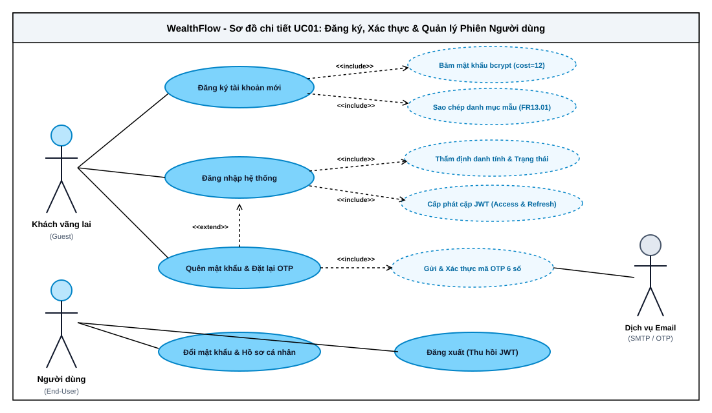
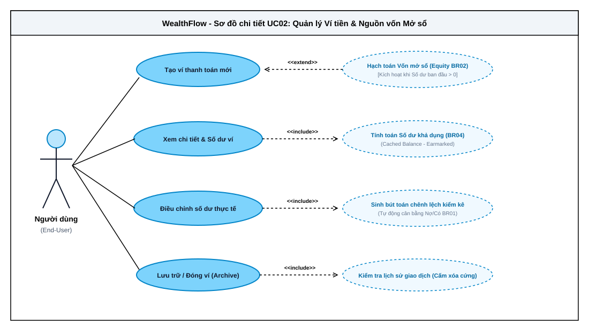
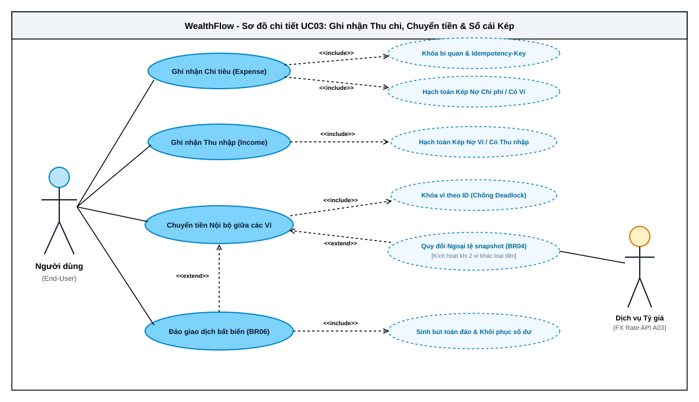
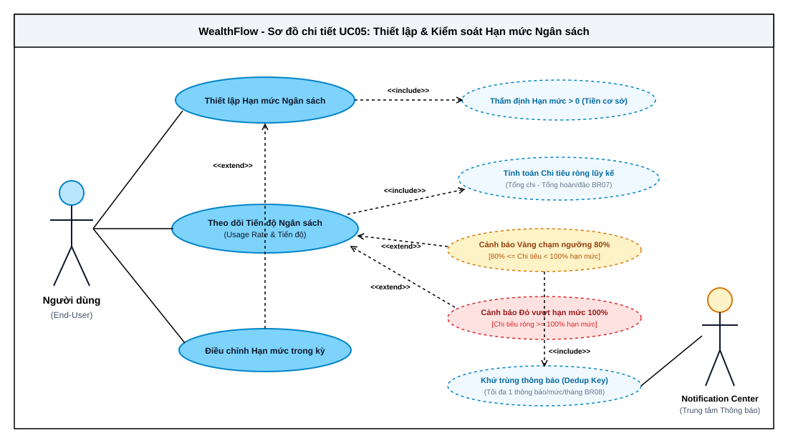
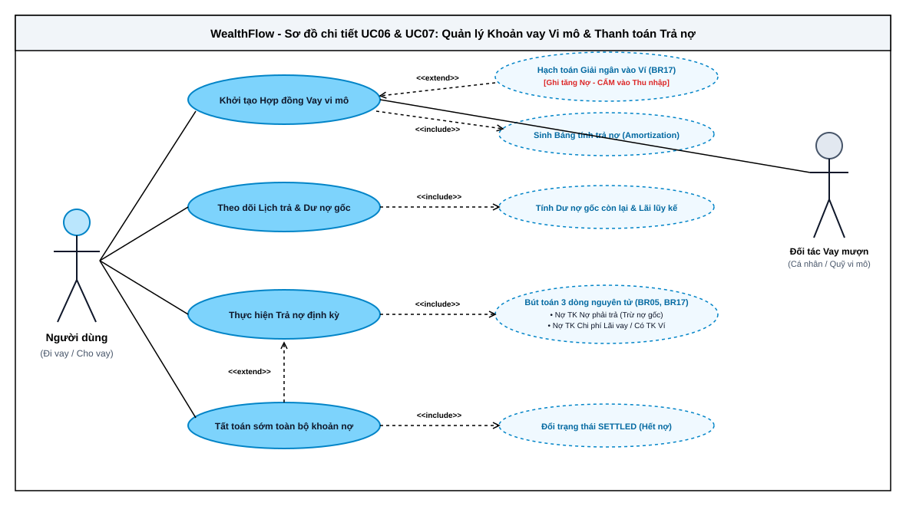

# Mô Hình Hóa Use Case Chi Tiết (Use Case Diagrams & Specifications) - WealthFlow

> **Quy chuẩn Mô hình hóa:** Chuẩn UML 2.5 Use Case Diagram & Đặc tả kịch bản Use Case chuẩn Cockburn / RUP.  
> **Tham chiếu chuẩn:** [SRS.md](../SRS.md) v2.1 (13 Core Use Cases, 15 FRs, 18 BRs, SYS01-SYS03) | [activity_diagram.md](./activity_diagram.md) | [class_diagram.md](./class_diagram.md) | [sequence_diagram.md](./sequence_diagram.md) | [database_design.md](../database_design.md)

---

## 1. Tiêu chuẩn Kỹ nghệ & Hệ thống Ký hiệu Mô hình hóa Use Case

Tài liệu này mô hình hóa góc nhìn chức năng hướng người dùng (**Functional Viewpoint**) của hệ thống **WealthFlow** theo chuẩn **UML 2.5 Use Case Diagram**:

### 1.1 Hệ thống Ký hiệu Trực quan (Constituent Elements)
1. **Ranh giới Hệ thống (System Boundary Box):**
   - Khung hình chữ nhật bao quanh toàn bộ các chức năng thuộc phạm vi phần mềm WealthFlow.
   - Thanh tiêu đề trên cùng thể hiện ngữ cảnh nghiệp vụ chi tiết của Use Case (`WealthFlow - Sơ đồ chi tiết UCxx: ...`).
2. **Tác nhân Tương tác (Actors):**
   - Ký hiệu hình người (*Stick Figure*) nằm ngoài biên hệ thống, đại diện cho vai trò tương tác:
     - `Khách vãng lai (Guest)`: Người dùng chưa có tài khoản, thực hiện đăng ký hoặc gửi yêu cầu khôi phục mật khẩu.
     - `Người dùng (End-User)`: Khách hàng cá nhân thực hiện ghi chép thu chi, quản trị ví, lập ngân sách.
     - `Người vay / Cho vay (Borrower / Lender)`: Người dùng tham gia nghiệp vụ tài chính vi mô cá nhân.
     - `Đối tác Vay mượn (Partner / External Lender)`: Bên cho vay hoặc nhận nợ bên ngoài hệ thống.
     - `Dịch vụ Thứ ba (Secondary Actors)`: Dịch vụ Email SMTP/OTP, Dịch vụ Tỷ giá A03, Trung tâm Thông báo Notification Center.
3. **Use Case Chính (Primary Use Cases - Nền Xanh Dương Đậm `#7DD3FC`):**
   - Ký hiệu hình elip nét liền nền xanh dương (`#7DD3FC`), viền đậm (`#0284C7`), kết nối trực tiếp với Tác nhân qua đường thẳng nét liền (*Association Line*).
   - Đại diện cho các mục tiêu công việc độc lập mà người dùng chủ động khởi phát.
4. **Use Case Thành phần & Mở rộng (Included / Extended Use Cases - Nền Nhạt Viền Nét Đứt `#F0F9FF`):**
   - Ký hiệu hình elip viền nét đứt (`stroke-dasharray`), nền xanh nhạt (`#F0F9FF`).
   - Mối quan hệ `<<include>>`: Mũi tên nét đứt hướng từ Use Case cơ sở sang Use Case bắt buộc phải thực thi (ví dụ: băm mật khẩu, hạch toán kép cân bằng, khóa bi quan).
   - Mối quan hệ `<<extend>>`: Mũi tên nét đứt hướng từ Use Case mở rộng về Use Case cơ sở, thể hiện hành vi rẽ nhánh có điều kiện (ví dụ: hạch toán vốn mở sổ khi $Số dư > 0$, quy đổi ngoại tệ khi khác loại tiền, cảnh báo khi vượt ngưỡng, đảo giao dịch).

---

## 2. Bảng Tra Cứu Tổng Hợp 13 Core Use Cases Hệ Thống (SRS v2.1)

| Mã UC | Tên Use Case Nghiệp vụ | Tác nhân chính | Nhóm FR bao phủ | Quy tắc BR liên kết | Sơ đồ Hoạt động | Sơ đồ Tuần tự |
| :---: | :--- | :---: | :---: | :---: | :---: | :---: |
| **UC01** | Đăng ký & Xác thực người dùng | `Guest`, `End-User` | [FR01](../SRS.md#fr01), [FR15](../SRS.md#fr15) | [BR11](../SRS.md#br11), [BR18](../SRS.md#br18) | [AD01](./activity_diagram.md#ad01) | [SQ01](./sequence_diagram.md#sq01) |
| **UC02** | Quản lý ví & số dư mở sổ | `End-User` | [FR02](../SRS.md#fr02) | [BR01](../SRS.md#br01), [BR02](../SRS.md#br02) | [AD02](./activity_diagram.md#ad02) | [SQ01](./sequence_diagram.md#sq01) |
| **UC03** | Ghi nhận giao dịch thu chi & Chuyển tiền | `End-User`, `Dịch vụ Tỷ giá` | [FR03](../SRS.md#fr03), [FR04](../SRS.md#fr04) | [BR01](../SRS.md#br01), [BR06](../SRS.md#br06), [BR13](../SRS.md#br13) | [AD03](./activity_diagram.md#ad03), [AD04](./activity_diagram.md#ad04) | [SQ02](./sequence_diagram.md#sq02), [SQ03](./sequence_diagram.md#sq03) |
| **UC04** | Thiết lập & Xử lý giao dịch định kỳ | `End-User`, `SYS02` | [FR04](../SRS.md#fr04) | [BR09](../SRS.md#br09), [BR13](../SRS.md#br13) | [AD05](./activity_diagram.md#ad05) | [SQ04](./sequence_diagram.md#sq04) |
| **UC05** | Thiết lập & Kiểm soát ngân sách | `End-User`, `Notification` | [FR05](../SRS.md#fr05) | [BR07](../SRS.md#br07), [BR08](../SRS.md#br08) | [AD03](./activity_diagram.md#ad03) | [SQ02](./sequence_diagram.md#sq02) |
| **UC06** | Quản lý khoản vay vi mô *(Microfinance)* | `End-User`, `Đối tác Vay` | [FR06](../SRS.md#fr06) | [BR01](../SRS.md#br01), [BR17](../SRS.md#br17) | [AD06](./activity_diagram.md#ad06) | [SQ05](./sequence_diagram.md#sq05) |
| **UC07** | Trả nợ & Lịch hoàn vốn định kỳ | `End-User` | [FR07](../SRS.md#fr07) | [BR05](../SRS.md#br05), [BR17](../SRS.md#br17) | [AD06](./activity_diagram.md#ad06) | [SQ05](./sequence_diagram.md#sq05) |
| **UC08** | Mua bán & Tích lũy tài sản vàng | `End-User`, `A04 Gold API` | [FR08](../SRS.md#fr08) | [BR01](../SRS.md#br01), [BR14](../SRS.md#br14) | [AD07](./activity_diagram.md#ad07) | [SQ06](./sequence_diagram.md#sq06) |
| **UC09** | Quản lý mục tiêu tiết kiệm & Earmark | `End-User` | [FR09](../SRS.md#fr09) | [BR10](../SRS.md#br10), [BR15](../SRS.md#br15) | [AD08](./activity_diagram.md#ad08) | [SQ02](./sequence_diagram.md#sq02) |
| **UC10** | Dashboard tài chính cá nhân & Net Worth | `End-User`, `SYS03` | [FR10](../SRS.md#fr10) | [BR02](../SRS.md#br02), [BR16](../SRS.md#br16) | [AD09](./activity_diagram.md#ad09) | [SQ06](./sequence_diagram.md#sq06) |
| **UC11** | Báo cáo đối soát sổ cái & Xuất CSV | `End-User` | [FR11](../SRS.md#fr11) | [BR01](../SRS.md#br01), [BR03](../SRS.md#br03) | [AD10](./activity_diagram.md#ad10) | [SQ07](./sequence_diagram.md#sq07) |
| **UC12** | Quản trị tài khoản & Khóa người dùng | `Admin A02` | [FR12](../SRS.md#fr12), [FR14](../SRS.md#fr14) | [BR11](../SRS.md#br11) | [AD11](./activity_diagram.md#ad11) | [SQ08](./sequence_diagram.md#sq08) |
| **UC13** | Phát thông báo hệ thống toàn diện | `Admin A02` | [FR13](../SRS.md#fr13) | [BR11](../SRS.md#br11) | [AD11](./activity_diagram.md#ad11) | [SQ08](./sequence_diagram.md#sq08) |

---

## 3. Phân Tích & Sơ Đồ Chi Tiết 05 Use Cases Trọng Yếu Nhất

Hệ thống WealthFlow tập trung vào **05 Use Cases cốt lõi** phản ánh chính xác cấu trúc nghiệp vụ thực tế: **Xác thực đa tác nhân**, **Nguồn vốn ví**, **Sổ cái kép cân bằng & đảo bút toán**, **Cảnh báo ngân sách đa ngưỡng** và **Tài chính vi mô bóc tách gốc/lãi**.

---

### 3.1. UC01: Đăng ký, Xác thực & Quản lý Phiên Người dùng (Identity & Access Management)

#### Sơ đồ Use Case Chi tiết (Vector SVG)

#### Bảng Đặc tả Kịch bản Use Case (Use Case Specification)
| Thuộc tính | Chi tiết đặc tả kỹ thuật |
| :--- | :--- |
| **Mã Use Case** | **UC01** |
| **Tên Use Case** | **Đăng ký tài khoản, Xác thực & Quản lý Phiên Người dùng** |
| **Tác nhân tham gia** | • **Chính:** `Khách vãng lai (Guest)`, `Người dùng (End-User)`. • **Phụ trợ:** `Dịch vụ Email (SMTP / OTP)`. |
| **Mục đích** | Quản lý toàn bộ vòng đời định danh: từ tạo tài khoản bảo mật bằng bcrypt, cấp phát token JWT, cập nhật mật khẩu đến thu hồi phiên an toàn. |
| **Tiền điều kiện** | Kết nối mạng khả dụng tới cổng REST API `/api/auth`. |
| **Hậu điều kiện** | Bản ghi người dùng ở trạng thái `ACTIVE`; thiết lập HttpOnly Cookie chứa Refresh Token; ghi nhật ký bảo mật `audit_logs`. |
| **Luồng sự kiện chính (Basic Flow)** | 1. **Đăng ký:** Khách vãng lai nhập Họ tên, Email, Mật khẩu, Tiền tệ cơ sở. Hệ thống kiểm tra email duy nhất, băm mật khẩu `bcrypt (cost=12)`, tạo User mới và tự động sao chép danh mục mẫu. 2. **Đăng nhập:** Người dùng nhập Email và Mật khẩu. Hệ thống thẩm định tính chính xác, kiểm tra trạng thái tài khoản `ACTIVE` và ký phát cặp Token JWT (Access Token 15 phút, Refresh Token 7 ngày). 3. **Đăng xuất:** Người dùng nhấn "Đăng xuất", hệ thống xóa chuỗi băm trong bảng `auth_sessions` và hủy HttpOnly Cookie. |
| **Quan hệ Bắt buộc (`<<include>>`)** | • `Băm mật khẩu bcrypt (cost=12)`: Bắt buộc thi hành khi tạo mật khẩu mới hoặc đổi mật khẩu. • `Sao chép danh mục mẫu (FR13.01)`: Tự động khởi tạo cây danh mục thu/chi mặc định cho tài khoản mới. • `Thẩm định danh tính & Trạng thái Active`: Kiểm tra tài khoản không bị Admin khóa (`status != LOCKED`). • `Cấp phát cặp JWT Tokens`: Sinh Access Token trong JSON Body và Refresh Token băm SHA-256 lưu DB. |
| **Quan hệ Mở rộng (`<<extend>>`)** | • `Quên mật khẩu & Đặt lại OTP`: Kích hoạt khi người dùng không nhớ mật khẩu đăng nhập. Hệ thống gửi mã OTP 6 số qua `Dịch vụ Email`, cho phép đặt lại mật khẩu sau khi xác thực thành công. |
| **Luồng ngoại lệ (Exceptions)** | • **409 Conflict:** Email đăng ký đã tồn tại trong hệ thống. • **401 Unauthorized:** Thông tin email hoặc mật khẩu không chính xác. • **403 Forbidden:** Tài khoản đã bị Quản trị viên khóa kèm lý do. |
| **Quy tắc liên kết** | [BR11](../SRS.md#br11) (Cô lập dữ liệu), [BR18](../SRS.md#br18) (Bảo mật phiên JWT), [NFR02.01](../SRS.md#nfr02) (Mã hóa bcrypt cost=12). |

---

### 3.2. UC02: Quản lý Ví Tiền & Nguồn Vốn Mở Sổ (Wallet Management)

#### Sơ đồ Use Case Chi tiết (Vector SVG)

#### Bảng Đặc tả Kịch bản Use Case (Use Case Specification)
| Thuộc tính | Chi tiết đặc tả kỹ thuật |
| :--- | :--- |
| **Mã Use Case** | **UC02** |
| **Tên Use Case** | **Quản lý Tài khoản Ví & Khởi tạo Số dư Mở sổ** |
| **Tác nhân tham gia** | `Người dùng (End-User)` |
| **Mục đích** | Quản lý các ví tài sản (Tiền mặt, Ngân hàng, Ví điện tử); tự động sinh bút toán đối ứng Vốn chủ sở hữu ban đầu và điều chỉnh số dư kiểm kê. |
| **Tiền điều kiện** | Người dùng sở hữu phiên JWT hợp lệ. |
| **Hậu điều kiện** | Bản ghi ví mới được tạo (`status = ACTIVE`); sinh bút toán mở sổ nếu số dư ban đầu $>0$; bảo tồn lịch sử sổ cái. |
| **Luồng sự kiện chính (Basic Flow)** | 1. Người dùng chọn "Tạo ví mới", nhập Tên ví, Loại ví (Cash, Bank, E-Wallet), Tiền tệ và Số dư ban đầu. 2. Hệ thống kiểm tra tên ví không trùng lặp và lưu ví mới. 3. Người dùng xem chi tiết danh sách ví với số dư sổ sách và số dư khả dụng tức thời. 4. Khi kiểm kê thực tế lệch số dư, người dùng nhập số dư thực tế và lý do để hệ thống cân bằng sổ sách. |
| **Quan hệ Bắt buộc (`<<include>>`)** | • `Tính toán Số dư khả dụng (BR04)`: Luôn tự động tính $AvailableBalance = CachedBalance - EarmarkedBalance$ để tránh bội chi tiền đã phong tỏa tiết kiệm. • `Sinh bút toán chênh lệch kiểm kê (BR01)`: Tự động ghi Nợ/Có đối ứng vào tài khoản chênh lệch kiểm kê để bảo toàn nguyên lý kế toán kép. • `Kiểm tra ràng buộc lịch sử giao dịch`: Nghiêm cấm xóa vật lý ví nếu đã phát sinh giao dịch ghi sổ (chỉ cho phép chuyển trạng thái `ARCHIVED`). |
| **Quan hệ Mở rộng (`<<extend>>`)** | • `Hạch toán Vốn mở sổ (Equity BR02)`: Chỉ kích hoạt khi Người dùng tạo ví có $Số dư ban đầu > 0$. Hệ thống tự động ghi Nợ Ví tài sản / Ghi Có Tài khoản Vốn chủ sở hữu (`Equity:Opening Balance`). |
| **Luồng ngoại lệ (Exceptions)** | • **400 Bad Request:** Số dư ban đầu âm hoặc tên ví rỗng. • **409 Conflict:** Trùng tên ví đang hoạt động trong cùng một tài khoản người dùng. |
| **Quy tắc liên kết** | [BR01](../SRS.md#br01) (Cân bằng kế toán kép), [BR02](../SRS.md#br02) (Vốn chủ sở hữu mở sổ), [BR06](../SRS.md#br06) (Bảo toàn lịch sử). |

---

### 3.3. UC03: Ghi nhận Thu chi, Chuyển tiền & Sổ cái Kép (Double-Entry Ledger)

#### Sơ đồ Use Case Chi tiết (Vector SVG)

#### Bảng Đặc tả Kịch bản Use Case (Use Case Specification)
| Thuộc tính | Chi tiết đặc tả kỹ thuật |
| :--- | :--- |
| **Mã Use Case** | **UC03** |
| **Tên Use Case** | **Ghi nhận Thu chi, Chuyển tiền & Sổ cái Kép** |
| **Tác nhân tham gia** | • **Chính:** `Người dùng (End-User)`. • **Phụ trợ:** `Dịch vụ Tỷ giá (FX Rate API A03)`. |
| **Mục đích** | Trái tim xử lý tài chính của WealthFlow: khóa bi quan ví nguồn, hạch toán kép cân bằng 100%, chống trùng lặp Idempotency và đảo bút toán bất biến. |
| **Tiền điều kiện** | Ví tiền ở trạng thái `ACTIVE`; số dư khả dụng đủ chi trả ($Available \ge Amount$). |
| **Hậu điều kiện** | Bản ghi giao dịch `POSTED`; sinh đủ các dòng Nợ/Có đối ứng; cập nhật `cached_balance` ví; lưu cache Idempotency 24h. |
| **Luồng sự kiện chính (Basic Flow)** | 1. **Ghi nhận Chi tiêu:** Người dùng chọn Ví, Danh mục, Số tiền, Ngày chi và Ghi chú. Hệ thống khóa bi quan dòng ví (`FOR UPDATE`), thẩm định số dư, sinh bút toán kép (Nợ Chi phí / Có Ví) và commit nguyên tử. 2. **Ghi nhận Thu nhập:** Người dùng nhập nguồn thu, hệ thống sinh bút toán (Nợ Ví / Có Thu nhập) và tăng số dư ví. 3. **Chuyển tiền Nội bộ:** Người dùng chọn Ví nguồn và Ví đích. Hệ thống khóa 2 ví theo thứ tự ID tăng dần để chống Deadlock, hạch toán đối ứng Nợ Ví đích / Có Ví nguồn. |
| **Quan hệ Bắt buộc (`<<include>>`)** | • `Khóa bi quan & Idempotency (BR13)`: Khóa hàng CSDL và kiểm tra khóa Idempotency UUIDv4 để tránh trừ tiền 2 lần do mạng chập chờn. • `Hạch toán Kép Nợ/Có cân bằng (BR01)`: Đảm bảo tổng Nợ quy đổi = tổng Có quy đổi tuyệt đối. • `Khóa ví theo thứ tự ID`: Sắp xếp $min(ID_1, ID_2)$ trước khi khóa để triệt tiêu hoàn toàn nguy cơ tranh chấp khóa chéo (Deadlock). • `Sinh bút toán đảo đối ứng`: Bắt buộc tạo bút toán đối ứng ngược dấu khi đảo sổ; cấm xóa cứng bản ghi cũ. |
| **Quan hệ Mở rộng (`<<extend>>`)** | • `Quy đổi Ngoại tệ snapshot (BR04, BR08)`: Kích hoạt khi chuyển tiền giữa 2 ví khác loại tiền tệ (ví dụ: USD $\rightarrow$ VND); hệ thống gọi `Dịch vụ Tỷ giá A03` và gắn tỷ giá cố định vào giao dịch. • `Đảo giao dịch bất biến (BR06)`: Kích hoạt khi người dùng muốn sửa/hủy giao dịch đã ghi sổ. Hệ thống tạo giao dịch đảo `REVERSED` hoàn trả số dư nguyên tử. |
| **Luồng ngoại lệ (Exceptions)** | • **422 Unprocessable Entity:** Số dư khả dụng của ví nguồn không đủ để chi trả. • **409 Conflict:** Gửi lặp `Idempotency-Key` nhưng nội dung payload bị thay đổi. |
| **Quy tắc liên kết** | [BR01](../SRS.md#br01) (Cân bằng kép), [BR03](../SRS.md#br03) (Số học Decimal), [BR04](../SRS.md#br04) (Tỷ giá snapshot), [BR06](../SRS.md#br06) (Bất biến & Đảo sổ), [BR13](../SRS.md#br13) (Idempotency). |

---

### 3.4. UC05: Thiết lập & Kiểm soát Hạn mức Ngân sách (Budget Planning & Alerts)

#### Sơ đồ Use Case Chi tiết (Vector SVG)

#### Bảng Đặc tả Kịch bản Use Case (Use Case Specification)
| Thuộc tính | Chi tiết đặc tả kỹ thuật |
| :--- | :--- |
| **Mã Use Case** | **UC05** |
| **Tên Use Case** | **Thiết lập & Kiểm soát Hạn mức Ngân sách** |
| **Tác nhân tham gia** | • **Chính:** `Người dùng (End-User)`. • **Phụ trợ:** `Notification Center (Trung tâm Thông báo)`. |
| **Mục đích** | Kiểm soát kỷ luật tài chính bằng cách giới hạn chi tiêu theo từng danh mục trong tháng; tự động tính toán chi tiêu ròng và kích hoạt cảnh báo thông minh đa ngưỡng. |
| **Tiền điều kiện** | Danh mục chi tiêu thuộc sở hữu của người dùng; hạn mức ngân sách $>0$. |
| **Hậu điều kiện** | Hạn mức được thiết lập cho tháng; hệ thống tự động đối soát lũy kế chi tiêu sau mỗi giao dịch chi tiêu mới phát sinh. |
| **Luồng sự kiện chính (Basic Flow)** | 1. Người dùng chọn Danh mục chi tiêu, chọn Tháng áp dụng và nhập Số tiền hạn mức. 2. Hệ thống thẩm định tính hợp lệ ($Limit > 0$) và lưu bản ghi ngân sách. 3. Khi có giao dịch chi tiêu mới thuộc danh mục, hệ thống tự động tính chi tiêu ròng lũy kế và tỷ lệ sử dụng ($Usage = \frac{NetSpent}{Limit} \times 100\%$). 4. Hiển thị thanh tiến độ trực quan (Xanh: $<80\%$; Vàng: $80\% - 99\%$; Đỏ: $\ge 100\%$). |
| **Quan hệ Bắt buộc (`<<include>>`)** | • `Thẩm định Hạn mức > 0 (BR07)`: Đảm bảo hạn mức bằng tiền cơ sở và chỉ có 1 ngân sách duy nhất cho mỗi danh mục trong 1 tháng. • `Tính toán Chi tiêu ròng lũy kế`: Công thức $NetSpent = \sum ChiTie\hat{u} - \sum Hoa\grave{n}Tra\check{/}D\tilde{a}o$ trong tháng. • `Khử trùng thông báo (Dedup Key BR08)`: Sử dụng khóa `dedup_key = {userId}_{budgetId}_{month}_{level}` để đảm bảo mỗi mức cảnh báo chỉ phát duy nhất 1 lần trong tháng. |
| **Quan hệ Mở rộng (`<<extend>>`)** | • `Cảnh báo Vàng 80% ([BR08](../SRS.md#br08)):` Kích hoạt khi $80\% \le Usage < 100\%$. • `Cảnh báo Đỏ 100% ([BR08](../SRS.md#br08)):` Kích hoạt khẩn cấp khi $Usage \ge 100\%$, cảnh báo người dùng đã vỡ ngân sách. • `Điều chỉnh Hạn mức trong kỳ:` Cho phép người dùng nâng hoặc hạ hạn mức ngân sách khi nhu cầu chi tiêu thay đổi. |
| **Luồng ngoại lệ (Exceptions)** | • **400 Bad Request:** Hạn mức ngân sách $\le 0$. • **409 Conflict:** Danh mục này đã được cài đặt hạn mức cho cùng tháng đó. |
| **Quy tắc liên kết** | [BR07](../SRS.md#br07) (Hạn mức ngân sách tháng), [BR08](../SRS.md#br08) (Cảnh báo 80%/100% & Chống trùng lặp thông báo). |

---

### 3.5. UC06 & UC07: Quản lý Khoản vay Vi mô & Thanh toán Trả nợ (Microfinance Portfolio)

#### Sơ đồ Use Case Chi tiết (Vector SVG)

#### Bảng Đặc tả Kịch bản Use Case (Use Case Specification)
| Thuộc tính | Chi tiết đặc tả kỹ thuật |
| :--- | :--- |
| **Mã Use Case** | **UC06 & UC07** |
| **Tên Use Case** | **Quản lý Khoản vay Vi mô, Trả nợ & Lịch hoàn vốn** |
| **Tác nhân tham gia** | • **Chính:** `Người dùng (Đi vay / Cho vay)`. • **Bên ngoài:** `Đối tác Vay mượn (Cá nhân / Quỹ vi mô)`. |
| **Mục đích** | Quản lý hợp đồng tài chính vi mô: theo dõi nợ gốc, lãi suất; tự động hạch toán giải ngân vào tài khoản nợ và bóc tách kế toán 3 dòng khi trả nợ. |
| **Tiền điều kiện** | Người dùng đã đăng nhập; có ví thanh toán hợp lệ. |
| **Hậu điều kiện** | Hợp đồng vay được tạo (`status = ACTIVE`); cập nhật giảm dư nợ gốc chính xác; tự động đổi sang `SETTLED` khi trả hết nợ. |
| **Luồng sự kiện chính (Basic Flow)** | 1. Người dùng nhập tên Đối tác, Số tiền gốc, Lãi suất (%/năm), Kỳ hạn (tháng) và Ví nhận tiền giải ngân. 2. Hệ thống lưu hồ sơ vay và tự động sinh Bảng tính trả nợ định kỳ (Amortization Schedule). 3. Người dùng theo dõi tiến độ hoàn vốn và dư nợ gốc còn lại theo thời gian thực. 4. Đến kỳ trả nợ, người dùng chọn kỳ thanh toán: nhập Số tiền gốc, Số tiền lãi và Ví thanh toán. 5. Hệ thống hạch toán bóc tách 3 dòng nguyên tử và giảm số dư nợ gốc `principal_remaining`. |
| **Quan hệ Bắt buộc (`<<include>>`)** | • `Sinh Bảng tính trả nợ (Amortization)`: Tự động chia đều hoặc lập lịch trả góp theo tháng. • `Tính Dư nợ gốc & Lãi lũy kế`: Cập nhật trạng thái nợ sau mỗi lần người dùng trả góp. • `Bút toán 3 dòng nguyên tử (BR05, BR17)`: Bóc tách minh bạch: &nbsp;&nbsp;1. **Nợ TK Nợ phải trả** (Trừ nợ gốc, **KHÔNG** tính vào chi phí sinh hoạt). &nbsp;&nbsp;2. **Nợ TK Chi phí Lãi vay** (Tính vào chi phí sinh hoạt trong kỳ). &nbsp;&nbsp;3. **Có TK Ví tiền** (Tổng số tiền thực tế xuất ví). • `Đổi trạng thái SETTLED`: Tự động đóng hợp đồng vay khi $Dư nợ gốc = 0$. |
| **Quan hệ Mở rộng (`<<extend>>`)** | • `Hạch toán Giải ngân vào Ví ([BR17](../SRS.md#br17)):` Kích hoạt khi khoản vay có giải ngân tiền vào ví. Ghi Nợ Ví tài sản / Ghi Có Nợ phải trả. **Nghiêm cấm ghi nhận số tiền giải ngân vào Thu nhập (Income)**. • `Tất toán sớm toàn bộ khoản nợ:` Cho phép người dùng trả sạch dư nợ gốc trong một lần duy nhất trước kỳ hạn. |
| **Luồng ngoại lệ (Exceptions)** | • **422 Unprocessable Entity:** Số dư ví thanh toán không đủ để thực hiện trả góp. • **400 Bad Request:** Số tiền trả gốc lớn hơn số dư nợ gốc còn lại của hợp đồng. |
| **Quy tắc liên kết** | [BR01](../SRS.md#br01) (Cân bằng kép), [BR05](../SRS.md#br05) (Phân loại hạch toán), [BR17](../SRS.md#br17) (Hạch toán giải ngân & Bóc tách gốc/lãi vi mô). |

---

## 4. Ma Trận Truy Vết Hai Chiều (Use Case Traceability Matrix)

Bảng ma trận dưới đây xác nhận tính truy vết xuyên suốt (**End-to-End Traceability**) từ Use Case đến Yêu cầu Chức năng (FR), Quy tắc Nghiệp vụ (BR), Sơ đồ Thiết kế và Cấu trúc CSDL vật lý:

| Mã UC | Yêu cầu FR | Quy tắc BR | Sơ đồ Hoạt động | Sơ đồ Lớp (Class) | Sơ đồ Tuần tự | Bảng CSDL Vật lý |
| :---: | :---: | :---: | :---: | :---: | :---: | :--- |
| **UC01** | [FR01](../SRS.md#fr01), [FR15](../SRS.md#fr15) | [BR11](../SRS.md#br11), [BR18](../SRS.md#br18) | [AD01](./activity_diagram.md#ad01) | [CD01](./class_diagram.md#cd01) | [SQ01](./sequence_diagram.md#sq01) | `users`, `auth_sessions`, `categories` |
| **UC02** | [FR02](../SRS.md#fr02) | [BR01](../SRS.md#br01), [BR02](../SRS.md#br02) | [AD02](./activity_diagram.md#ad02) | [CD02](./class_diagram.md#cd02) | [SQ01](./sequence_diagram.md#sq01) | `wallets`, `ledger_accounts`, `ledger_entries` |
| **UC03** | [FR03](../SRS.md#fr03), [FR04](../SRS.md#fr04) | [BR01](../SRS.md#br01), [BR03](../SRS.md#br03), [BR06](../SRS.md#br06), [BR13](../SRS.md#br13) | [AD03](./activity_diagram.md#ad03), [AD04](./activity_diagram.md#ad04) | [CD03](./class_diagram.md#cd03) | [SQ02](./sequence_diagram.md#sq02), [SQ03](./sequence_diagram.md#sq03) | `financial_transactions`, `ledger_entries`, `idempotency_keys` |
| **UC05** | [FR05](../SRS.md#fr05) | [BR07](../SRS.md#br07), [BR08](../SRS.md#br08) | [AD03](./activity_diagram.md#ad03) | [CD06](./class_diagram.md#cd06) | [SQ02](./sequence_diagram.md#sq02) | `budgets`, `notifications` |
| **UC06** | [FR06](../SRS.md#fr06), [FR07](../SRS.md#fr07) | [BR01](../SRS.md#br01), [BR05](../SRS.md#br05), [BR17](../SRS.md#br17) | [AD06](./activity_diagram.md#ad06) | [CD07](./class_diagram.md#cd07) | [SQ05](./sequence_diagram.md#sq05) | `micro_loans`, `micro_loan_payments`, `financial_transactions` |

---

## 5. Danh Mục File Sơ Đồ & Mã Nguồn Đồ Họa

Toàn bộ các sơ đồ Use Case trong tài liệu này đều được lưu trữ dưới 2 định dạng:

1. **Vector SVG (Xem trực tiếp):**
   - [uc01_auth.svg](./usecase_diagram/uc01_auth.svg) - Chi tiết UC01: Đăng ký, Xác thực & Quản lý Phiên Người dùng
   - [uc02_wallets.svg](./usecase_diagram/uc02_wallets.svg) - Chi tiết UC02: Quản lý Ví tiền & Nguồn vốn Mở sổ
   - [uc03_transactions.svg](./usecase_diagram/uc03_transactions.svg) - Chi tiết UC03: Ghi nhận Thu chi, Chuyển tiền & Sổ cái Kép
   - [uc05_budgets.svg](./usecase_diagram/uc05_budgets.svg) - Chi tiết UC05: Thiết lập & Kiểm soát Hạn mức Ngân sách
   - [uc06_loans.svg](./usecase_diagram/uc06_loans.svg) - Chi tiết UC06 & UC07: Quản lý Khoản vay Vi mô & Thanh toán Trả nợ

2. **Mã nguồn PlantUML (`.puml`):**
   - [uc01_auth.puml](./usecase_diagram/sources/uc01_auth.puml)
   - [uc02_wallets.puml](./usecase_diagram/sources/uc02_wallets.puml)
   - [uc03_transactions.puml](./usecase_diagram/sources/uc03_transactions.puml)
   - [uc05_budgets.puml](./usecase_diagram/sources/uc05_budgets.puml)
   - [uc06_loans.puml](./usecase_diagram/sources/uc06_loans.puml)
